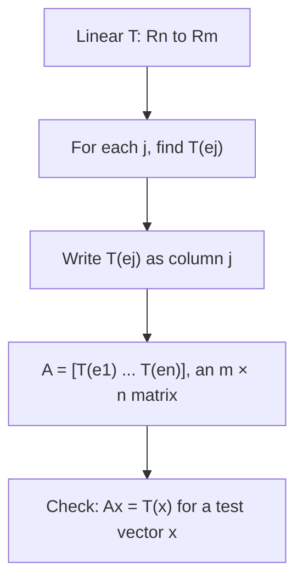

## Every linear transformation is a matrix

The last lesson showed that a linear transformation is pinned down by what it does to
$\mathbf{e}_1, \dots, \mathbf{e}_n$. This lesson packages that fact as a theorem: every
linear transformation from $\mathbb{R}^n$ to $\mathbb{R}^m$ *is* a matrix transformation,
and there's a recipe for the matrix. With it, we can write down matrices for rotations,
reflections, shears and projections just by thinking about where the unit square goes.

## The standard matrix

> *Theorem.* Let $T: \mathbb{R}^n \to \mathbb{R}^m$ be linear. Then there is exactly one $m \times n$ matrix $A$ with $T(\mathbf{x}) = A\mathbf{x}$ for all $\mathbf{x}$, namely
> $$A = \begin{bmatrix} T(\mathbf{e}_1) & T(\mathbf{e}_2) & \cdots & T(\mathbf{e}_n)\end{bmatrix}.$$

$A$ is called the **standard matrix** of $T$. The proof is one line of linearity:

$$T(\mathbf{x}) = T(x_1\mathbf{e}_1 + \cdots + x_n\mathbf{e}_n) = x_1T(\mathbf{e}_1) + \cdots + x_nT(\mathbf{e}_n) = A\mathbf{x}.$$

So "linear transformation" and "matrix transformation" describe the same objects. The
phrase *linear transformation* stresses what the map does; *matrix transformation*
stresses how to compute it. Recipe: *column $j$ of the standard matrix is the image of
$\mathbf{e}_j$.*



### Example 1

Find the standard matrix of $T: \mathbb{R}^2 \to \mathbb{R}^2$ that rotates each vector
counterclockwise through an angle $\theta$ about the origin.

1. $\mathbf{e}_1 = (1, 0)$ rotates to the point on the unit circle at angle $\theta$: $T(\mathbf{e}_1) = (\cos\theta, \sin\theta)$.
2. $\mathbf{e}_2 = (0, 1)$ starts at angle $90^\circ$ and rotates to angle $90^\circ + \theta$: $T(\mathbf{e}_2) = (\cos(90^\circ + \theta), \sin(90^\circ + \theta)) = (-\sin\theta, \cos\theta)$.
3. Use them as columns:

$$A = \begin{bmatrix} \cos\theta & -\sin\theta \\ \sin\theta & \cos\theta\end{bmatrix}.$$

The picture shows the two columns for $\theta = 30^\circ$: both basis vectors turn by the same
angle and stay on the unit circle.

```plot
{"x": [-1.5, 1.5], "y": [-0.5, 1.5], "equal": true, "curves": [{"x": "cos(t)", "y": "sin(t)", "t": [0, "pi"], "dashed": true}], "segments": [{"from": [0, 0], "to": [1, 0], "arrow": true, "label": "e₁"}, {"from": [0, 0], "to": [0, 1], "arrow": true, "label": "e₂"}, {"from": [0, 0], "to": [0.866, 0.5], "arrow": true, "label": "T(e₁) = (cos θ, sin θ)"}, {"from": [0, 0], "to": [-0.5, 0.866], "arrow": true, "label": "T(e₂) = (−sin θ, cos θ)"}], "caption": "Rotation by θ = 30°: the images of e₁ and e₂ are the columns of the rotation matrix"}
```

For $\theta = 90^\circ$ this is $\begin{bmatrix} 0 & -1 \\ 1 & 0\end{bmatrix}$, which sends
$(x_1, x_2)$ to $(-x_2, x_1)$. Rotating $(3, 1)$ by $90^\circ$ gives $(-1, 3)$. (You may
want to verify that a rotation really is linear: rotating a parallelogram gives a
parallelogram, so sums are preserved, and rotating a stretched arrow gives a stretched
arrow.)

## A gallery of plane transformations

To find the matrix of a geometric transformation of $\mathbb{R}^2$, track the unit square
with corners $\mathbf{0}$, $\mathbf{e}_1$, $\mathbf{e}_2$, $\mathbf{e}_1 + \mathbf{e}_2$. The
image is the parallelogram with sides $T(\mathbf{e}_1)$ and $T(\mathbf{e}_2)$, the columns
of $A$.

| Transformation | Standard matrix | Effect |
|---|---|---|
| **Reflection** across the $x_1$-axis | $\begin{bmatrix} 1 & 0 \\ 0 & -1\end{bmatrix}$ | $(x_1, x_2) \mapsto (x_1, -x_2)$ |
| Reflection across the $x_2$-axis | $\begin{bmatrix} -1 & 0 \\ 0 & 1\end{bmatrix}$ | $(x_1, x_2) \mapsto (-x_1, x_2)$ |
| Reflection across the line $x_2 = x_1$ | $\begin{bmatrix} 0 & 1 \\ 1 & 0\end{bmatrix}$ | swaps the coordinates |
| Reflection through the origin | $\begin{bmatrix} -1 & 0 \\ 0 & -1\end{bmatrix}$ | $\mathbf{x} \mapsto -\mathbf{x}$ |
| Horizontal **shear** | $\begin{bmatrix} 1 & k \\ 0 & 1\end{bmatrix}$ | $(x_1, x_2) \mapsto (x_1 + kx_2, x_2)$ |
| Vertical shear | $\begin{bmatrix} 1 & 0 \\ k & 1\end{bmatrix}$ | $(x_1, x_2) \mapsto (x_1, kx_1 + x_2)$ |
| **Dilation** by $r$ | $\begin{bmatrix} r & 0 \\ 0 & r\end{bmatrix}$ | expansion if $r > 1$, contraction if $0 < r < 1$ |
| Horizontal stretch by $k$ | $\begin{bmatrix} k & 0 \\ 0 & 1\end{bmatrix}$ | $(x_1, x_2) \mapsto (kx_1, x_2)$ |
| **Projection** onto the $x_1$-axis | $\begin{bmatrix} 1 & 0 \\ 0 & 0\end{bmatrix}$ | $(x_1, x_2) \mapsto (x_1, 0)$ |
| **Rotation** by $\theta$ | $\begin{bmatrix} \cos\theta & -\sin\theta \\ \sin\theta & \cos\theta\end{bmatrix}$ | counterclockwise |

You don't need to memorize this table: each entry comes from asking "where do $\mathbf{e}_1$
and $\mathbf{e}_2$ go?"

Four of these maps are drawn below, each acting on the unit square. Watch where the two
arrows $T(\mathbf{e}_1)$ and $T(\mathbf{e}_2)$ land: they are the columns of the matrix.


### Example 2

Find the standard matrix of the horizontal shear that moves $\mathbf{e}_2$ to $(2, 1)$ and
leaves $\mathbf{e}_1$ alone, and draw the image of the unit square.

1. $T(\mathbf{e}_1) = (1, 0)$ and $T(\mathbf{e}_2) = (2, 1)$, so $A = \begin{bmatrix} 1 & 2 \\ 0 & 1\end{bmatrix}$.
2. The corner $\mathbf{e}_1 + \mathbf{e}_2 = (1, 1)$ goes to $A(1, 1) = (3, 1)$.
3. The square becomes the parallelogram with corners $(0, 0)$, $(1, 0)$, $(3, 1)$, $(2, 1)$: the top edge slides 2 units right while the bottom edge stays put.

```plot
{"x": [-1, 4], "y": [-1, 2], "equal": true, "polygons": [{"points": [[0, 0], [1, 0], [1, 1], [0, 1]]}, {"points": [[0, 0], [1, 0], [3, 1], [2, 1]]}], "segments": [{"from": [0, 0], "to": [1, 0], "arrow": true, "label": "T(e₁)"}, {"from": [0, 0], "to": [2, 1], "arrow": true, "label": "T(e₂)"}], "caption": "The unit square and its image under the shear with matrix [1 2; 0 1]"}
```

## Composing transformations

Doing one transformation after another gives a new linear transformation, and its standard
matrix can be found the same way: follow $\mathbf{e}_1$ and $\mathbf{e}_2$ through both
steps.

### Example 3

$T$ first reflects across the $x_1$-axis, then rotates by $90^\circ$ counterclockwise. Find its standard matrix.

1. $\mathbf{e}_1 = (1, 0)$: the reflection leaves it at $(1, 0)$; the rotation takes it to $(0, 1)$.
2. $\mathbf{e}_2 = (0, 1)$: the reflection sends it to $(0, -1)$; the rotation takes $(0, -1)$ to $(1, 0)$.
3. $A = \begin{bmatrix} 0 & 1 \\ 1 & 0\end{bmatrix}$.

The composite is the reflection across the line $x_2 = x_1$. Order matters: rotating
first and then reflecting gives $\begin{bmatrix} 0 & -1 \\ -1 & 0\end{bmatrix}$, the
reflection across $x_2 = -x_1$. Module 5 shows that composing transformations corresponds
to multiplying their matrices.

## Common mistakes

- *Putting images in rows.* $T(\mathbf{e}_j)$ is column $j$ of the standard matrix.
- *Sign of the rotation matrix.* For counterclockwise rotation the $-\sin\theta$ is in the top right. Check with $\theta = 90^\circ$: $\mathbf{e}_1$ must go to $\mathbf{e}_2$.
- *Calculator in the wrong mode* for rotations given in degrees.
- *Assuming the order of a composition doesn't matter.* Reflect-then-rotate and rotate-then-reflect usually differ.

## Key points

- Every linear $T: \mathbb{R}^n \to \mathbb{R}^m$ equals $\mathbf{x} \mapsto A\mathbf{x}$ with $A = [\,T(\mathbf{e}_1) \;\cdots\; T(\mathbf{e}_n)\,]$, the standard matrix.
- To find a geometric transformation's matrix, see where $\mathbf{e}_1$ and $\mathbf{e}_2$ go; the unit square maps to the parallelogram they span.
- Rotation by $\theta$: $\begin{bmatrix} \cos\theta & -\sin\theta \\ \sin\theta & \cos\theta\end{bmatrix}$. Reflections, shears, dilations and projections all have simple matrices.
- Compositions are linear too; follow the basis vectors through each step, in order.
