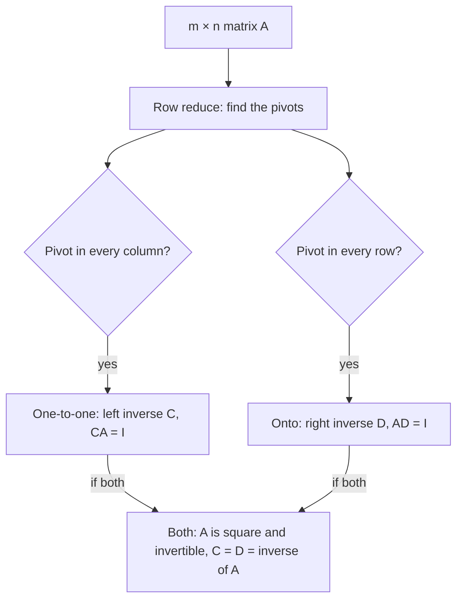

## Going backward

The last core lesson asked two questions about $T(\mathbf{x}) = A\mathbf{x}$: is every output
reached (onto), and is any output reached twice (one-to-one)? Both are questions about
going *backward*, from an output $\mathbf{b}$ to the inputs that produce it. This lesson
studies that backward direction head-on. First we look at the whole set of inputs that land
on a given output, which turns out to have a rigid shape. Then we ask when a matrix can be
"undone" from one side, which leads to left and right inverses: the one-to-one and onto
properties in matrix form.

## Preimages

For $T: \mathbb{R}^n \to \mathbb{R}^m$ and a vector $\mathbf{b}$ in $\mathbb{R}^m$, the
**preimage** of $\mathbf{b}$ is the set of all inputs that $T$ sends to $\mathbf{b}$:

$$\{\mathbf{x} \text{ in } \mathbb{R}^n : T(\mathbf{x}) = \mathbf{b}\}.$$

For a matrix transformation this is just the solution set of $A\mathbf{x} = \mathbf{b}$, so
the structure theorem for solution sets (Module 3) describes it. Either the preimage is
empty, or it is $\mathbf{p} + \{\text{solutions of } A\mathbf{x} = \mathbf{0}\}$ for any one
input $\mathbf{p}$ that works. Geometrically, *every nonempty preimage is a parallel copy
of the preimage of $\mathbf{0}$*, slid over to pass through $\mathbf{p}$. A linear map
slices its domain into parallel, same-shaped pieces (points, lines, planes, …), and squashes
each piece to a single output.

The two properties of the last lesson are statements about these pieces:

- $T$ is onto exactly when *no* preimage is empty.
- $T$ is one-to-one exactly when every nonempty preimage is a single point. Since they are all copies of the preimage of $\mathbf{0}$, it is enough that the preimage of $\mathbf{0}$ is just $\{\mathbf{0}\}$, which is the one-to-one test you already know.

### Example 1

Let $T: \mathbb{R}^2 \to \mathbb{R}$ be $T(x_1, x_2) = x_1 + 2x_2$, the matrix transformation
of the $1 \times 2$ matrix $[\,1 \;\; 2\,]$. Describe its preimages.

1. The preimage of the number $c$ is the line $x_1 + 2x_2 = c$.
2. The preimage of $0$ is the line through the origin spanned by $(-2, 1)$.
3. For any $c$, the point $(c, 0)$ is in the preimage, so the preimage of $c$ is $(c, 0) + t(-2, 1)$: the same line, slid to pass through $(c, 0)$.
4. Every preimage is a nonempty line, so $T$ is onto $\mathbb{R}$ but not one-to-one. The plane is cut into parallel lines, one for each output.

```plot
{"x": [-6, 6], "y": [-4, 4], "equal": true, "functions": [{"f": "(-2 - x)/2", "label": "c = -2"}, {"f": "-x/2", "label": "c = 0"}, {"f": "(2 - x)/2", "label": "c = 2"}, {"f": "(4 - x)/2", "label": "c = 4"}], "segments": [{"from": [0, 0], "to": [-2, 1], "arrow": true}], "labels": [{"at": [-2.6, 1.5], "text": "(-2, 1)"}], "xLabel": "x₁", "yLabel": "x₂", "caption": "Preimages of T(x₁, x₂) = x₁ + 2x₂: parallel lines x₁ + 2x₂ = c, all copies of the line through the origin"}
```

### Example 2

For $A = \begin{bmatrix} 1 & 2 & 0 \\ 0 & 1 & 3\end{bmatrix}$ (the onto, not one-to-one map
from the last lesson), find the preimage of $\mathbf{b} = (b_1, b_2)$.

1. Back-substitute with $x_3 = t$ free: $x_2 = b_2 - 3t$, then $x_1 = b_1 - 2x_2 = b_1 - 2b_2 + 6t$.
2. So the preimage is $(b_1 - 2b_2,\ b_2,\ 0) + t(6, -3, 1)$: a line in $\mathbb{R}^3$.
3. Every $\mathbf{b}$ gives a line with the same direction $(6, -3, 1)$. The map squashes each of these parallel lines in $\mathbb{R}^3$ to one point of $\mathbb{R}^2$.

## Compositions: what passes through

Suppose $T: \mathbb{R}^n \to \mathbb{R}^m$ and $S: \mathbb{R}^m \to \mathbb{R}^p$, and write
$S \circ T$ for "first $T$, then $S$". Two facts, each with a one-line proof:

> *Theorem.* (a) If $S \circ T$ is one-to-one, then $T$ is one-to-one. (b) If $S \circ T$ is onto, then $S$ is onto.

(a) If $T(\mathbf{u}) = T(\mathbf{v})$, apply $S$: $S(T(\mathbf{u})) = S(T(\mathbf{v}))$. Since
$S \circ T$ is one-to-one, $\mathbf{u} = \mathbf{v}$. (b) Any $\mathbf{c}$ in $\mathbb{R}^p$
equals $S(T(\mathbf{x}))$ for some $\mathbf{x}$, so $\mathbf{c}$ is the image under $S$ of the
vector $T(\mathbf{x})$.

Notice what is *not* claimed. Let $T(x) = (x, 0)$ from $\mathbb{R}$ to $\mathbb{R}^2$, and
$S(y_1, y_2) = y_1$ from $\mathbb{R}^2$ to $\mathbb{R}$. Then $S(T(x)) = x$: the composite is
one-to-one and onto. Yet $T$ is not onto (it misses $(0, 1)$) and $S$ is not one-to-one
($S(0, 1) = S(0, 0)$). The first map must be one-to-one, the last map must be onto, and that
is all.

## Left and right inverses

Let $A$ be $m \times n$. A **left inverse** of $A$ is an $n \times m$ matrix $C$ with
$CA = I_n$; a **right inverse** is an $n \times m$ matrix $D$ with $AD = I_m$. The
names say which side the extra matrix sits on. In terms of maps, $CA = I_n$ says "first $A$,
then $C$" does nothing at all; $AD = I_m$ says "first $D$, then $A$" does nothing.

> *Theorem.* Let $A$ be $m \times n$.
> - $A$ has a left inverse ⟺ $\mathbf{x} \mapsto A\mathbf{x}$ is one-to-one ⟺ $A$ has a pivot in every column.
> - $A$ has a right inverse ⟺ $\mathbf{x} \mapsto A\mathbf{x}$ is onto ⟺ $A$ has a pivot in every row.

The forward directions are the composition theorem: "first $A$, then $C$" is the identity,
which is one-to-one, so $A$ (the first map) is one-to-one; "first $D$, then $A$" is the
identity, which is onto, so $A$ (the last map) is onto. Directly: if $A\mathbf{x} = \mathbf{0}$
then $\mathbf{x} = CA\mathbf{x} = C\mathbf{0} = \mathbf{0}$; and any $\mathbf{b}$ equals
$A(D\mathbf{b})$.

For the backward directions we have to build the inverse.

*Right inverse, when $A$ is onto.* Each $A\mathbf{x} = \mathbf{e}_j$ has a solution; pick one,
$\mathbf{d}_j$, for each $j = 1, \dots, m$. Put them side by side: $D = [\,\mathbf{d}_1 \;\cdots\; \mathbf{d}_m\,]$.
By the row-times-column rule, column $j$ of $AD$ is $A\mathbf{d}_j = \mathbf{e}_j$, so $AD = I_m$.

*Left inverse, when $A$ is one-to-one.* If some $n$ of the rows of $A$ form an invertible
$n \times n$ block $B$, let $C$ have $B^{-1}$ in the columns matching those rows and zeros
in the other columns. Then $CA = B^{-1}B = I_n$, because the zero columns of $C$ ignore the
other rows of $A$. Such a block always exists when the columns of $A$ are independent; that
follows from rank facts in Module 7, and we take it on trust here.



### Example 3

Find a right inverse of $A = \begin{bmatrix} 1 & 2 & 0 \\ 0 & 1 & 3\end{bmatrix}$.

1. Use the preimage from Example 2 with $t = 0$. For $\mathbf{e}_1 = (1, 0)$: $\mathbf{d}_1 = (1, 0, 0)$. For $\mathbf{e}_2 = (0, 1)$: $\mathbf{d}_2 = (-2, 1, 0)$.
2. $D = \begin{bmatrix} 1 & -2 \\ 0 & 1 \\ 0 & 0\end{bmatrix}$, and $AD = \begin{bmatrix} 1 & 0 \\ 0 & 1\end{bmatrix}$.
3. Choosing $t = 1$ for the first column gives $\mathbf{d}_1 = (7, -3, 1)$, and $A(7, -3, 1) = (1, 0)$ too. A right inverse is *not unique*: any point of each preimage will do.

### Example 4

Find a left inverse of $A = \begin{bmatrix} 1 & 0 \\ 2 & 1 \\ 0 & 3\end{bmatrix}$ and use it to solve $A\mathbf{x} = (2, 3, -3)$.

1. The top two rows form $B = \begin{bmatrix} 1 & 0 \\ 2 & 1\end{bmatrix}$ with $\det B = 1$ and $B^{-1} = \begin{bmatrix} 1 & 0 \\ -2 & 1\end{bmatrix}$.
2. $C = \begin{bmatrix} 1 & 0 & 0 \\ -2 & 1 & 0\end{bmatrix}$. Check: $CA = \begin{bmatrix} 1 & 0 \\ -2 + 2 & 1\end{bmatrix} = I_2$.
3. Rows 1 and 3 work too: $C' = \begin{bmatrix} 1 & 0 & 0 \\ 0 & 0 & \tfrac13\end{bmatrix}$ also has $C'A = I_2$. Left inverses aren't unique either.
4. If $A\mathbf{x} = \mathbf{b}$ has a solution, multiplying by $C$ on the left gives $\mathbf{x} = CA\mathbf{x} = C\mathbf{b}$. Here $C(2, 3, -3) = (2, -4 + 3) = (2, -1)$, and indeed $A(2, -1) = (2, 3, -3)$.
5. Warning: for $\mathbf{b} = (1, 0, 0)$, $C\mathbf{b} = (1, -2)$ but $C'\mathbf{b} = (1, 0)$, and $A(1, -2) = (1, 0, -6) \ne \mathbf{b}$. This $\mathbf{b}$ is not in the range, so there is no solution; $C\mathbf{b}$ is only a *candidate*, and you must check $A(C\mathbf{b}) = \mathbf{b}$.

## When both sides work

A wide matrix ($n > m$) is never one-to-one and a tall one ($n < m$) is never onto, so a
non-square matrix has at most one kind of one-sided inverse. If a matrix has both, it is
square, and the two are equal: using the associative law for products,

$$C = CI = C(AD) = (CA)D = ID = D.$$

That common matrix is the inverse $A^{-1}$ of the next module, and the pivot conditions above
become part of the invertible matrix theorem. One-sided inverses also come back later: when
$A$ is one-to-one, the least-squares lesson uses the particular left inverse
$(A^TA)^{-1}A^T$, which picks the "best" candidate even when $\mathbf{b}$ is not in the range.

## Common mistakes

- *Mixing up the sides.* Left inverse: $CA = I$ (one-to-one, pivot in every column). Right inverse: $AD = I$ (onto, pivot in every row).
- *Expecting uniqueness.* A non-square matrix with a one-sided inverse has many of them. Only a square invertible matrix has exactly one inverse.
- *Trusting $C\mathbf{b}$ blindly.* A left inverse returns the solution when one exists; when $\mathbf{b}$ is outside the range, $C\mathbf{b}$ solves nothing.
- *Wrong size.* For a $3 \times 2$ matrix, both kinds of one-sided inverse are $2 \times 3$.
- *Reversing the composition theorem.* If $S \circ T$ is one-to-one, $T$ must be, but $S$ need not be.

## Key points

- The preimage of $\mathbf{b}$ is the solution set of $A\mathbf{x} = \mathbf{b}$: empty, or a parallel copy $\mathbf{p} + \{\text{solutions of } A\mathbf{x} = \mathbf{0}\}$.
- Onto: no empty preimages. One-to-one: every nonempty preimage is a single point.
- If $S \circ T$ is one-to-one, $T$ is; if $S \circ T$ is onto, $S$ is.
- Left inverse ($CA = I$) ⟺ one-to-one ⟺ pivot in every column; right inverse ($AD = I$) ⟺ onto ⟺ pivot in every row.
- Build a right inverse column by column from solutions of $A\mathbf{x} = \mathbf{e}_j$; build a left inverse from an invertible block of rows.
- A matrix with both kinds is square, and then $C = D = A^{-1}$.
