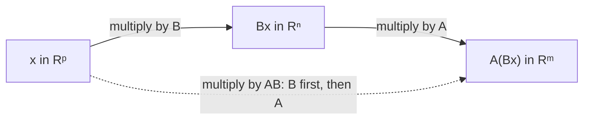

## Why multiply matrices this way?

Module 1 gave the row-times-column rule for $AB$ without justification. Now we can explain
it. A matrix is a linear transformation, and doing one transformation after another is
again a linear transformation. Matrix multiplication is *defined* so that the product
matrix represents that composition. This lesson develops the product from that idea, adds
the transpose, and shows how computer graphics uses products of matrices to move objects
on a screen.

## Notation

For an $m \times n$ matrix $A$, the entries $a_{11}, a_{22}, a_{33}, \dots$ form the **main diagonal**. A **diagonal matrix** is a square matrix whose off-diagonal entries are all zero;
the identity $I_n$ is one. The zero matrix $0$ has every entry zero. Sums and scalar
multiples are entrywise, as before, and obey the usual rules ($A + B = B + A$,
$r(A + B) = rA + rB$, and so on).

## Multiplication as composition

Suppose $B$ is $n \times p$ and $A$ is $m \times n$. For $\mathbf{x}$ in $\mathbb{R}^p$,
first $B$ sends $\mathbf{x}$ to $B\mathbf{x}$ in $\mathbb{R}^n$, then $A$ sends that to
$A(B\mathbf{x})$ in $\mathbb{R}^m$. Write $B = [\,\mathbf{b}_1 \;\cdots\; \mathbf{b}_p\,]$. Then

$$A(B\mathbf{x}) = A(x_1\mathbf{b}_1 + \cdots + x_p\mathbf{b}_p) = x_1A\mathbf{b}_1 + \cdots + x_pA\mathbf{b}_p = [\,A\mathbf{b}_1 \;\cdots\; A\mathbf{b}_p\,]\,\mathbf{x}.$$

So the composite map is multiplication by a single matrix, and we *define* it to be $AB$:

$$AB = A[\,\mathbf{b}_1 \;\; \mathbf{b}_2 \;\cdots\; \mathbf{b}_p\,] = [\,A\mathbf{b}_1 \;\; A\mathbf{b}_2 \;\cdots\; A\mathbf{b}_p\,].$$

Each column of $AB$ is $A$ times the corresponding column of $B$. Reading off entry $i$ of
column $j$ gives the familiar **row–column rule**:
$(AB)_{ij} = a_{i1}b_{1j} + a_{i2}b_{2j} + \cdots + a_{in}b_{nj}$.

The picture shows both rules at once for a $(3 \times 4)(4 \times 2)$ product: one row of $A$
meets one column of $B$ to make one entry of $AB$, and the sizes tell you whether the product
exists and how big it is.


Notice the order: $AB$ means "apply $B$ first, then $A$", because $B$ is next to
$\mathbf{x}$. This is the same right-to-left reading as function composition
$f(g(x))$.

The diagram traces a vector through the two maps and through the single product matrix.



### Example 1

Compute $AB$ for $A = \begin{bmatrix} 1 & -2 \\ 3 & 0\end{bmatrix}$ and $B = \begin{bmatrix} 2 & 1 & 0 \\ 1 & 4 & -1\end{bmatrix}$.

1. Sizes: $(2 \times 2)(2 \times 3)$, so $AB$ is $2 \times 3$.
2. Column 1: $A\begin{bmatrix} 2 \\ 1\end{bmatrix} = \begin{bmatrix} 2 - 2 \\ 6 + 0\end{bmatrix} = \begin{bmatrix} 0 \\ 6\end{bmatrix}$.
3. Column 2: $A\begin{bmatrix} 1 \\ 4\end{bmatrix} = \begin{bmatrix} 1 - 8 \\ 3\end{bmatrix} = \begin{bmatrix} -7 \\ 3\end{bmatrix}$.
4. Column 3: $A\begin{bmatrix} 0 \\ -1\end{bmatrix} = \begin{bmatrix} 2 \\ 0\end{bmatrix}$.

So $AB = \begin{bmatrix} 0 & -7 & 2 \\ 6 & 3 & 0\end{bmatrix}$. The product $BA$ is undefined:
$(2 \times 3)(2 \times 2)$ has mismatched inner sizes.

## Rules for products

For matrices of compatible sizes:

- $A(BC) = (AB)C$ (associative: composition of maps is associative);
- $A(B + C) = AB + AC$ and $(B + C)A = BA + CA$;
- $r(AB) = (rA)B = A(rB)$;
- $I_mA = A = AI_n$.

Three warnings, each with a $2 \times 2$ counterexample you can check:

1. In general $AB \ne BA$.
2. $AB = AC$ does *not* imply $B = C$ (no cancellation).
3. $AB = 0$ does *not* imply $A = 0$ or $B = 0$; for example $\begin{bmatrix} 1 & 1 \\ 1 & 1\end{bmatrix}\begin{bmatrix} 1 & -1 \\ -1 & 1\end{bmatrix} = 0$.

For a square matrix, the **matrix power** $A^k$ is the product of $k$ copies of $A$, with
$A^0 = I$. Powers model repeated application of the same transformation, which is exactly
what Module 8 (dynamical systems) studies.

## The transpose

The **transpose** of an $m \times n$ matrix $A$, written $A^T$, is the $n \times m$ matrix
whose columns are the rows of $A$: $(A^T)_{ij} = a_{ji}$. For example
$\begin{bmatrix} 1 & 2 & 3 \\ 4 & 5 & 6\end{bmatrix}^T = \begin{bmatrix} 1 & 4 \\ 2 & 5 \\ 3 & 6\end{bmatrix}$. Rules:

$$(A^T)^T = A, \quad (A + B)^T = A^T + B^T, \quad (rA)^T = rA^T, \quad (AB)^T = B^TA^T.$$

The last rule reverses the order. A size check shows why: if $A$ is $2 \times 2$ and $B$ is
$2 \times 3$, then $(AB)^T$ is $3 \times 2$, and $B^TA^T$ is $(3 \times 2)(2 \times 2)$,
which fits, while $A^TB^T$ is $(2 \times 2)(3 \times 2)$, which doesn't even exist. With the
matrices of Example 1, $(AB)^T = \begin{bmatrix} 0 & 6 \\ -7 & 3 \\ 2 & 0\end{bmatrix}$, and
multiplying $B^TA^T$ out gives the same thing.

## Partitioned matrices

Large matrices are often cut by horizontal and vertical lines into smaller *blocks*, for
example $A = \begin{bmatrix} A_{11} & A_{12} \\ A_{21} & A_{22}\end{bmatrix}$. If $B$ is cut
compatibly (the way the columns of $A$ are split matches the way the rows of $B$ are split),
then $AB$ can be computed block by block with the row–column rule, treating each block like
an entry but keeping the order of every product:
$$\begin{bmatrix} A_{11} & A_{12} \\ A_{21} & A_{22}\end{bmatrix}\begin{bmatrix} B_1 \\ B_2\end{bmatrix} = \begin{bmatrix} A_{11}B_1 + A_{12}B_2 \\ A_{21}B_1 + A_{22}B_2\end{bmatrix}.$$
The column rule $AB = [\,A\mathbf{b}_1 \;\cdots\; A\mathbf{b}_p\,]$ is the simplest case
(cut $B$ into single columns), and the homogeneous-coordinate matrices below are built from
blocks too.

## Computer graphics and homogeneous coordinates

Graphics software stores a picture as a list of points and moves it by multiplying by
matrices. Rotations, scalings and shears are linear, but *translation*
$(x, y) \mapsto (x + h, y + k)$ is not (it moves the origin). The fix is **homogeneous coordinates**: represent the point $(x, y)$ by the vector $(x, y, 1)$ in $\mathbb{R}^3$.
Then translation becomes a matrix product,

$$\begin{bmatrix} 1 & 0 & h \\ 0 & 1 & k \\ 0 & 0 & 1\end{bmatrix}\begin{bmatrix} x \\ y \\ 1\end{bmatrix} = \begin{bmatrix} x + h \\ y + k \\ 1\end{bmatrix},$$

and any $2 \times 2$ linear map $M$ becomes the $3 \times 3$ block matrix
$\begin{bmatrix} M & \mathbf{0} \\ \mathbf{0}^T & 1\end{bmatrix}$. A sequence of moves is then
a single matrix: the product, with the first move on the right.

### Example 2

In homogeneous coordinates, find the matrix that first translates by $(2, 1)$ and then
rotates $90^\circ$ counterclockwise about the origin, and apply it to $(1, 1)$.

1. Translation $T = \begin{bmatrix} 1 & 0 & 2 \\ 0 & 1 & 1 \\ 0 & 0 & 1\end{bmatrix}$; rotation $R = \begin{bmatrix} 0 & -1 & 0 \\ 1 & 0 & 0 \\ 0 & 0 & 1\end{bmatrix}$.
2. Translate first, so the composite is $RT = \begin{bmatrix} 0 & -1 & -1 \\ 1 & 0 & 2 \\ 0 & 0 & 1\end{bmatrix}$.
3. $RT\begin{bmatrix} 1 \\ 1 \\ 1\end{bmatrix} = \begin{bmatrix} -1 - 1 \\ 1 + 2 \\ 1\end{bmatrix} = \begin{bmatrix} -2 \\ 3 \\ 1\end{bmatrix}$, i.e. the point $(-2, 3)$.
4. Check step by step: $(1, 1)$ translates to $(3, 2)$, and rotating $90^\circ$ gives $(-2, 3)$. ✓

```plot
{"x": [-4, 5], "y": [-1, 5], "equal": true, "polygons": [{"points": [[0, 0], [1, 0], [1, 1], [0, 1]]}, {"points": [[2, 1], [3, 1], [3, 2], [2, 2]]}, {"points": [[-1, 2], [-1, 3], [-2, 3], [-2, 2]]}], "points": [{"at": [1, 1], "label": "(1, 1)"}, {"at": [3, 2], "label": "(3, 2)"}, {"at": [-2, 3], "label": "(-2, 3)"}], "caption": "A square translated by (2, 1), then rotated 90°"}
```

Real 3D graphics works the same way with $4 \times 4$ matrices acting on $(x, y, z, 1)$,
and adds perspective by using the bottom row.

## Common mistakes

- *Reversing the order of a composition.* "Do $B$, then $A$" is $AB$.
- *Writing $(AB)^T = A^TB^T$.* The transpose of a product reverses the order.
- *Cancelling matrices.* From $AB = AC$ you can't conclude $B = C$ unless $A$ is invertible.
- *Forgetting the 1 in homogeneous coordinates*, or putting the translation in the bottom row instead of the last column.

## Key points

- $AB = [\,A\mathbf{b}_1 \;\cdots\; A\mathbf{b}_p\,]$; multiplying matrices composes transformations, right to left.
- Products are associative and distributive, but not commutative, and there's no cancellation.
- $(A^T)_{ij} = a_{ji}$, and $(AB)^T = B^TA^T$.
- Homogeneous coordinates $(x, y, 1)$ turn translations into matrix products, so a whole sequence of graphics moves is one matrix.
