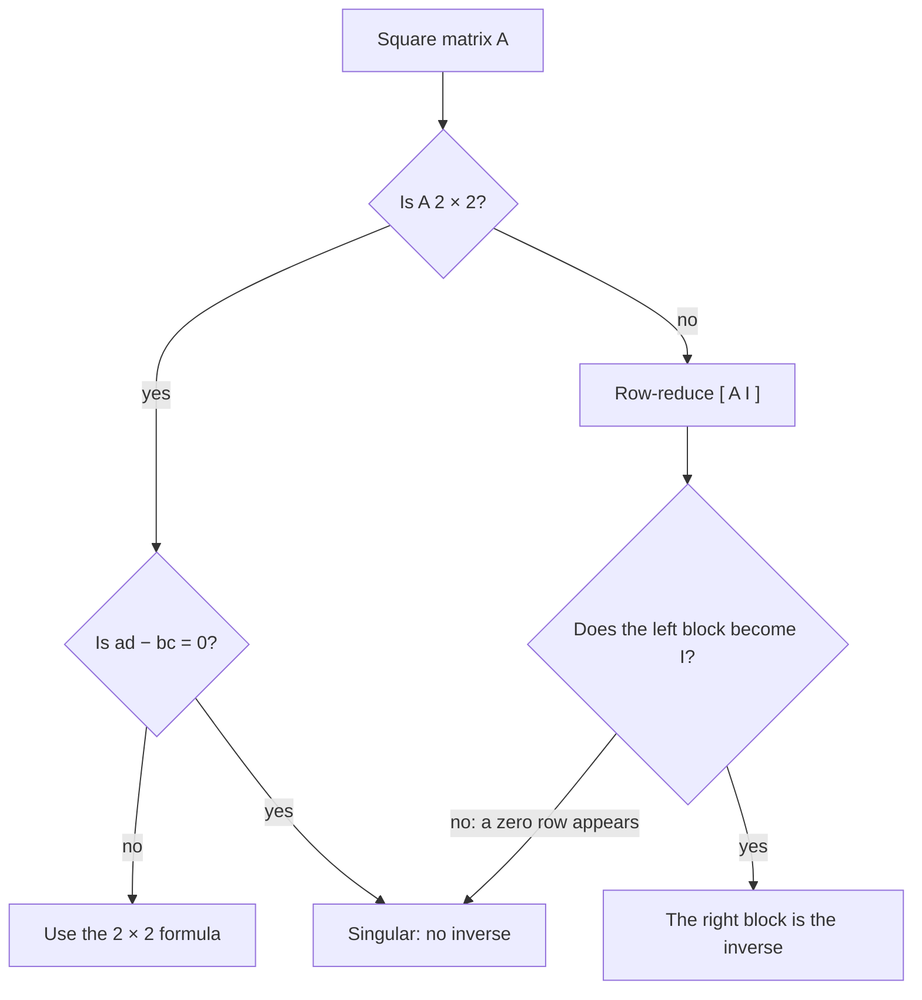

## Undoing a transformation

If a matrix moves vectors, it's natural to ask whether the move can be undone. For a
rotation, rotate back; for a shear, shear the other way; for a projection, no: once the
$x_2$-coordinate is flattened to 0, it's gone. The matrices whose action can be reversed are
the invertible ones. The bridge module gave the $2 \times 2$ formula; this lesson defines
inverses carefully, proves their basic properties, and gives an algorithm that works for any
size.

Here is the shear example in a picture: the shear $\begin{bmatrix} 1 & 1 \\ 0 & 1\end{bmatrix}$ pushes
the unit square over into a parallelogram, and the inverse shear
$\begin{bmatrix} 1 & -1 \\ 0 & 1\end{bmatrix}$ pushes it back.

```plot
{"x": [-0.5, 2.5], "y": [-0.5, 1.6], "equal": true, "polygons": [{"points": [[0, 0], [1, 0], [1, 1], [0, 1]]}, {"points": [[0, 0], [1, 0], [2, 1], [1, 1]]}], "points": [{"at": [0, 1], "label": "(0, 1)"}, {"at": [1, 1], "label": "(1, 1)"}, {"at": [2, 1], "label": "(2, 1)"}], "caption": "The shear sends the unit square to the slanted parallelogram ((0, 1) goes to (1, 1), (1, 1) goes to (2, 1)); the inverse shear sends it back"}
```

## Definition

An $n \times n$ matrix $A$ is **invertible** if there is an $n \times n$ matrix $C$ with

$$CA = I \quad\text{and}\quad AC = I.$$

Then $C$ is unique (if $B$ also works, $B = BI = B(AC) = (BA)C = IC = C$), and we call it
the inverse $A^{-1}$. A matrix that is not invertible is called a **singular matrix**; an
invertible matrix is also called **nonsingular**. Only square matrices have two-sided
inverses in this sense.

For $2 \times 2$ matrices, recall: $A = \begin{bmatrix} a & b \\ c & d\end{bmatrix}$ is
invertible exactly when $ad - bc \ne 0$, and then

$$A^{-1} = \frac{1}{ad - bc}\begin{bmatrix} d & -b \\ -c & a\end{bmatrix}.$$

## Inverses solve systems

> *Theorem.* If $A$ is an invertible $n \times n$ matrix, then for each $\mathbf{b}$ in $\mathbb{R}^n$ the equation $A\mathbf{x} = \mathbf{b}$ has the unique solution $\mathbf{x} = A^{-1}\mathbf{b}$.

Existence: $A(A^{-1}\mathbf{b}) = (AA^{-1})\mathbf{b} = \mathbf{b}$. Uniqueness: if
$A\mathbf{u} = \mathbf{b}$, multiply on the left by $A^{-1}$ to get $\mathbf{u} = A^{-1}\mathbf{b}$.

In practice, computers rarely solve $A\mathbf{x} = \mathbf{b}$ by forming $A^{-1}$; row
reduction (or the LU factorization, two lessons ahead) is faster and more accurate. The
inverse is mainly a theoretical tool and a convenient formula for small cases.

## Properties

If $A$ and $B$ are invertible $n \times n$ matrices:

1. $A^{-1}$ is invertible and $(A^{-1})^{-1} = A$.
2. $AB$ is invertible and $(AB)^{-1} = B^{-1}A^{-1}$.
3. $A^T$ is invertible and $(A^T)^{-1} = (A^{-1})^T$.

Rule 2 reverses the order, like taking off socks and shoes: to undo "socks, then shoes",
remove the shoes first. Check: $(AB)(B^{-1}A^{-1}) = A(BB^{-1})A^{-1} = AIA^{-1} = I$.
Rule 3 follows from transposing $AA^{-1} = I$: $(A^{-1})^TA^T = I^T = I$. Rule 2 extends to
any number of factors: the inverse of a product is the product of the inverses in reverse
order.

## The algorithm for $A^{-1}$

> Row-reduce the $n \times 2n$ matrix $[\,A \;\; I\,]$. If $A$ is row equivalent to $I$, the result is $[\,I \;\; A^{-1}\,]$. Otherwise $A$ is not invertible.

Why it works, informally: finding $A^{-1}$ means solving $A\mathbf{x} = \mathbf{e}_1$,
$A\mathbf{x} = \mathbf{e}_2$, …, $A\mathbf{x} = \mathbf{e}_n$; the solutions are the columns
of $A^{-1}$. All $n$ systems have the same coefficient matrix, so we row-reduce them at the
same time by putting all the right sides $\mathbf{e}_1, \dots, \mathbf{e}_n$ (that is, $I$)
next to $A$. The next lesson gives a second explanation using elementary matrices.

### Example 1

Find the inverse of $A = \begin{bmatrix} 1 & 2 & 0 \\ 0 & 1 & 1 \\ 1 & 2 & 1\end{bmatrix}$.

1. Start with $[\,A \;\; I\,] = \left[\begin{array}{ccc|ccc} 1 & 2 & 0 & 1 & 0 & 0 \\ 0 & 1 & 1 & 0 & 1 & 0 \\ 1 & 2 & 1 & 0 & 0 & 1\end{array}\right]$.
2. $R_3 \leftarrow R_3 - R_1$: row 3 becomes $[\,0 \;\; 0 \;\; 1 \;\; {-1} \;\; 0 \;\; 1\,]$. The left block is already triangular with 1s on the diagonal.
3. Clear above the pivot in column 3: $R_2 \leftarrow R_2 - R_3$ gives $[\,0 \;\; 1 \;\; 0 \;\; 1 \;\; 1 \;\; {-1}\,]$.
4. Clear above the pivot in column 2: $R_1 \leftarrow R_1 - 2R_2$ gives $[\,1 \;\; 0 \;\; 0 \;\; {-1} \;\; {-2} \;\; 2\,]$.
5. The left block is $I$, so
$$A^{-1} = \begin{bmatrix} -1 & -2 & 2 \\ 1 & 1 & -1 \\ -1 & 0 & 1\end{bmatrix}.$$
6. Check one entry of $AA^{-1}$: row 1 of $A$ times column 1 of $A^{-1}$ is $1(-1) + 2(1) + 0(-1) = 1$. ✓ (The others work too.)

### Example 2

Use $A^{-1}$ from Example 1 to solve $A\mathbf{x} = (3, 2, 4)$.

$$\mathbf{x} = A^{-1}\mathbf{b} = \begin{bmatrix} -3 - 4 + 8 \\ 3 + 2 - 4 \\ -3 + 0 + 4\end{bmatrix} = \begin{bmatrix} 1 \\ 1 \\ 1\end{bmatrix}.$$

Check: $A(1, 1, 1) = (1 + 2,\ 1 + 1,\ 1 + 2 + 1) = (3, 2, 4)$. ✓

### Example 3

Is $B = \begin{bmatrix} 1 & 2 \\ 3 & 6\end{bmatrix}$ invertible? Row-reducing $[\,B \;\; I\,]$,
$R_2 \leftarrow R_2 - 3R_1$ gives $[\,0 \;\; 0 \;\; {-3} \;\; 1\,]$: the left block has a zero
row, so it can never become $I$. $B$ is singular, as $ad - bc = 6 - 6 = 0$ confirms.

The chart sums up the decision. (To solve a single system $A\mathbf{x} = \mathbf{b}$, you don't
need $A^{-1}$ at all: row-reduce $[\,A \;\; \mathbf{b}\,]$.)



## Common mistakes

- *$(AB)^{-1} = A^{-1}B^{-1}$.* The order reverses.
- *Writing $\mathbf{x} = \mathbf{b}A^{-1}$.* Multiply on the left: $\mathbf{x} = A^{-1}\mathbf{b}$ (and $\mathbf{b}A^{-1}$ isn't even defined for a column $\mathbf{b}$).
- *Row-reducing only $A$* and forgetting to apply the same operations to $I$.
- *Inverting a non-square matrix.* Only square matrices can be invertible.
- *Assuming every nonzero matrix is invertible.* $\begin{bmatrix} 1 & 2 \\ 3 & 6\end{bmatrix}$ isn't.

## Key points

- $A^{-1}$ satisfies $AA^{-1} = A^{-1}A = I$; it exists only for some square matrices (the nonsingular ones).
- If $A$ is invertible, $A\mathbf{x} = \mathbf{b}$ has exactly one solution, $\mathbf{x} = A^{-1}\mathbf{b}$.
- $(AB)^{-1} = B^{-1}A^{-1}$ and $(A^T)^{-1} = (A^{-1})^T$.
- Row-reduce $[\,A \;\; I\,]$: you get $[\,I \;\; A^{-1}\,]$, or a zero row in the left block if $A$ is singular.
