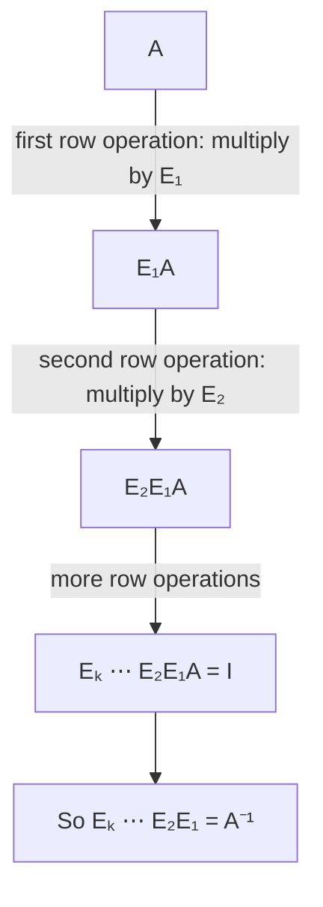
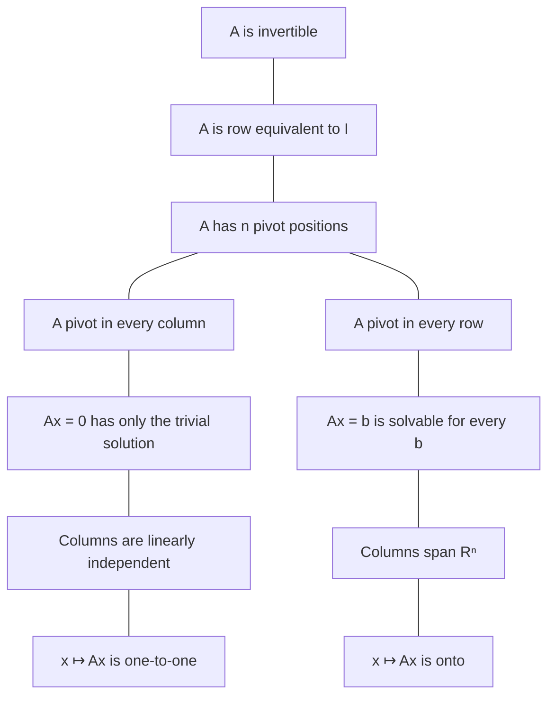

## Row operations are matrix multiplications

The inverse algorithm worked by row reduction, and row reduction has been our tool since
Module 2. This lesson shows that every row operation is itself multiplication by a special
matrix. That observation explains why the inverse algorithm works and leads to the
invertible matrix theorem, which ties together nearly everything in the course so far:
pivots, spanning, independence, one-to-one and onto maps, and inverses.

## Elementary matrices

An **elementary matrix** is a matrix obtained by performing a single elementary row
operation on an identity matrix. For $3 \times 3$ matrices, for example:

$$E_1 = \begin{bmatrix} 1 & 0 & 0 \\ 0 & 1 & 0 \\ -4 & 0 & 1\end{bmatrix}, \qquad E_2 = \begin{bmatrix} 0 & 1 & 0 \\ 1 & 0 & 0 \\ 0 & 0 & 1\end{bmatrix}, \qquad E_3 = \begin{bmatrix} 1 & 0 & 0 \\ 0 & 1 & 0 \\ 0 & 0 & 5\end{bmatrix}.$$

$E_1$ comes from $R_3 \leftarrow R_3 - 4R_1$, $E_2$ from $R_1 \leftrightarrow R_2$, and $E_3$ from
$R_3 \leftarrow 5R_3$. The key fact:

> If an elementary row operation is performed on an $m \times n$ matrix $A$, the result is $EA$, where $E$ is the $m \times m$ elementary matrix made by doing the same operation on $I_m$.

Why: row $i$ of $EA$ is (row $i$ of $E$) times $A$, which is a combination of the rows of
$A$ with weights from row $i$ of $E$. Row 3 of $E_1$ is $(-4, 0, 1)$, so row 3 of $E_1A$ is
$-4(\text{row 1 of } A) + (\text{row 3 of } A)$: exactly the replacement.

Every elementary matrix is invertible, and its inverse is the elementary matrix of the
*reverse* operation. The inverse of $E_1$ adds back 4 times row 1:
$E_1^{-1} = \begin{bmatrix} 1 & 0 & 0 \\ 0 & 1 & 0 \\ 4 & 0 & 1\end{bmatrix}$. A swap is its
own inverse, and scaling by 5 is undone by scaling by $\tfrac15$.

### Example 1

Let $A = \begin{bmatrix} 1 & 2 \\ 3 & 4 \\ 5 & 6\end{bmatrix}$ and $E_1$ as above. Compute $E_1A$.

1. Rows 1 and 2 of $E_1$ are those of $I$, so rows 1 and 2 of $A$ are unchanged.
2. Row 3: $-4(1, 2) + (5, 6) = (1, -2)$.
3. $E_1A = \begin{bmatrix} 1 & 2 \\ 3 & 4 \\ 1 & -2\end{bmatrix}$, which is exactly $A$ after $R_3 \leftarrow R_3 - 4R_1$.

## Why the inverse algorithm works

If $A$ row-reduces to $I$ through operations with elementary matrices $E_1, E_2, \dots, E_k$, then

$$E_k\cdots E_2E_1A = I.$$

So the product $E_k\cdots E_1$ is a matrix that multiplies $A$ to give $I$: it is $A^{-1}$.
And applying the *same* operations to $I$ produces $E_k\cdots E_1I = A^{-1}$. That's why
row-reducing $[\,A \;\; I\,]$ yields $[\,I \;\; A^{-1}\,]$. It also proves:

> *Theorem.* An $n \times n$ matrix $A$ is invertible if and only if $A$ is row equivalent to $I_n$. In that case $A = E_1^{-1}E_2^{-1}\cdots E_k^{-1}$ is a product of elementary matrices.

The chain of products, step by step:

## The invertible matrix theorem

For square matrices, many properties we have studied turn out to be the same property.

> *Theorem* (the **invertible matrix theorem**, or IMT). Let $A$ be an $n \times n$ matrix. The following are equivalent (all true or all false):
> 1. $A$ is invertible.
> 2. $A$ is row equivalent to $I_n$.
> 3. $A$ has $n$ pivot positions.
> 4. $A\mathbf{x} = \mathbf{0}$ has only the trivial solution.
> 5. The columns of $A$ are linearly independent.
> 6. The transformation $\mathbf{x} \mapsto A\mathbf{x}$ is one-to-one.
> 7. $A\mathbf{x} = \mathbf{b}$ has at least one solution for each $\mathbf{b}$ in $\mathbb{R}^n$.
> 8. The columns of $A$ span $\mathbb{R}^n$.
> 9. The transformation $\mathbf{x} \mapsto A\mathbf{x}$ maps $\mathbb{R}^n$ onto $\mathbb{R}^n$.
> 10. There is an $n \times n$ matrix $C$ with $CA = I$.
> 11. There is an $n \times n$ matrix $D$ with $AD = I$.
> 12. $A^T$ is invertible.

The heart of the proof is statement 3. For a *square* matrix, $n$ pivots means a pivot in
every column (statements 4–6, from the independence test and the one-to-one theorem) and
a pivot in every row (statements 7–9, from the spanning theorem). Statement 2 is the RREF
version of 3, and we just showed it's equivalent to 1. Statements 10 and 11 say a one-sided
inverse is enough for square matrices: $CA = I$ forces $A\mathbf{x} = \mathbf{0} \Rightarrow \mathbf{x} = CA\mathbf{x} = \mathbf{0}$ (statement 4); $AD = I$ forces $A(D\mathbf{b}) = \mathbf{b}$ (statement 7).

The diagram shows that structure: everything hangs on the count of pivots, which for a square
matrix means a pivot in every column and in every row at the same time. (Statements 10–12 join
at the top, through invertibility.)

The theorem's power is in the negations. If any one statement fails, they *all* fail. A
singular matrix has dependent columns, a free variable, a non-trivial null solution, columns
that don't span, and a transformation that is neither one-to-one nor onto. Later modules
add more statements to this list (determinant, eigenvalues, rank); the full list is on the
reference sheet.

Be careful: the IMT applies only to *square* matrices. A $3 \times 2$ matrix can have
independent columns without spanning $\mathbb{R}^3$.

### Example 2

Is $A = \begin{bmatrix} 2 & 1 & 3 \\ 1 & 0 & 1 \\ 4 & 1 & 5\end{bmatrix}$ invertible? What else does the answer tell you?

1. Notice that row 3 equals row 1 plus 2 times row 2. So $R_3 \leftarrow R_3 - R_1 - 2R_2$ (two replacements) turns row 3 into zeros.
2. An echelon form then has at most 2 pivots, fewer than 3. By the IMT, $A$ is not invertible.
3. Consequences, all from the IMT: $A\mathbf{x} = \mathbf{0}$ has a nontrivial solution, the columns of $A$ are linearly dependent, they don't span $\mathbb{R}^3$, and $A\mathbf{x} = \mathbf{b}$ is inconsistent for some $\mathbf{b}$.
4. Indeed, column 3 = column 1 + column 2, so $A(1, 1, -1) = \mathbf{0}$.

## Invertible linear transformations

A linear $T: \mathbb{R}^n \to \mathbb{R}^n$ is an **invertible linear transformation** if there is a
map $S$ with $S(T(\mathbf{x})) = \mathbf{x}$ and $T(S(\mathbf{x})) = \mathbf{x}$ for all
$\mathbf{x}$. If $A$ is the standard matrix of $T$, then $T$ is invertible exactly when $A$
is, and the inverse map is $S(\mathbf{x}) = A^{-1}\mathbf{x}$. Rotations and shears are
invertible; projections are not.

## Common mistakes

- *Applying the IMT to non-square matrices.* Its equivalences rely on $m = n$.
- *Multiplying elementary matrices on the right.* $EA$ performs a row operation on $A$; $AE$ performs a *column* operation.
- *Getting the inverse of an elementary matrix backwards.* The inverse of "add $-4R_1$ to $R_3$" adds $+4R_1$.
- *Thinking you must check every IMT statement.* Check whichever is easiest; the rest follow.

## Key points

- An elementary matrix is $I$ after one row operation; multiplying $EA$ performs that operation on $A$.
- Elementary matrices are invertible; the inverse undoes the operation.
- $A$ is invertible ⟺ $A$ row-reduces to $I$; the same operations turn $I$ into $A^{-1}$.
- The IMT: for square $A$, invertibility, $n$ pivots, independent columns, spanning columns, one-to-one and onto all stand or fall together.
