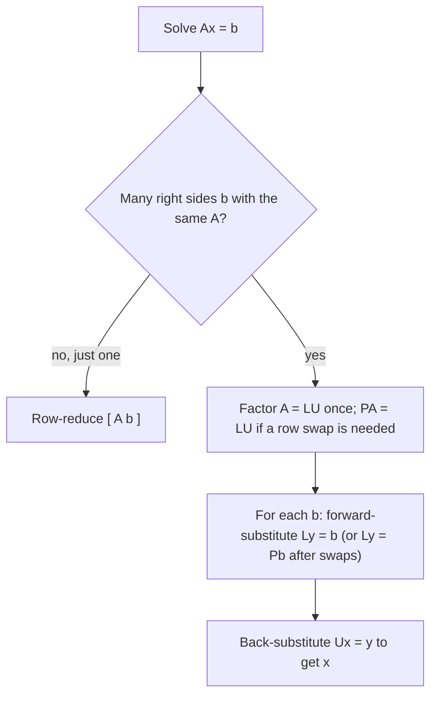

## Saving row reduction for later

Suppose you must solve $A\mathbf{x} = \mathbf{b}$ for the same $A$ but many different
right-hand sides: an engineer testing a structure under many loads, or a simulation that
updates $\mathbf{b}$ at every time step. Row-reducing $[\,A \;\; \mathbf{b}\,]$ from scratch
each time repeats the same work on $A$ over and over. The LU factorization records that work
once, as a pair of triangular matrices, after which each new $\mathbf{b}$ costs only two
quick substitutions. It's how numerical software actually solves linear systems, and it's
the first of several **matrix factorizations** in this course.

## Triangular matrices

A square matrix is **lower triangular** if all entries above the main diagonal are zero, and
**upper triangular** if all entries below it are zero. A **unit lower triangular** matrix is
lower triangular with 1s on the diagonal. Triangular systems are easy: an upper triangular
system is solved by back-substitution from the bottom up, and a lower triangular system by
**forward substitution** from the top down.

## The factorization

An **LU factorization** writes $A = LU$, where $L$ is $m \times m$ unit lower triangular and
$U$ is an $m \times n$ echelon form of $A$. To solve $A\mathbf{x} = \mathbf{b}$, write it as
$L(U\mathbf{x}) = \mathbf{b}$ and set $\mathbf{y} = U\mathbf{x}$:

1. Solve $L\mathbf{y} = \mathbf{b}$ for $\mathbf{y}$ (forward substitution).
2. Solve $U\mathbf{x} = \mathbf{y}$ for $\mathbf{x}$ (back-substitution).

Each step is cheap: for an $n \times n$ matrix, about $n^2$ arithmetic operations, compared
with about $\tfrac23 n^3$ for a fresh row reduction.

## Finding $L$ and $U$

Suppose $A$ can be reduced to echelon form $U$ using only row replacements that add a
multiple of a row to a row *below* it (no interchanges). Each such operation is a unit
lower triangular elementary matrix, so $E_k\cdots E_1A = U$ and

$$A = (E_k\cdots E_1)^{-1}U = LU, \qquad L = E_1^{-1}\cdots E_k^{-1}.$$

You never need to multiply those matrices out. There is a bookkeeping shortcut:

> If you clear entry $(i, j)$ with $R_i \leftarrow R_i - \ell_{ij}R_j$, then the multiplier $\ell_{ij}$ is the $(i, j)$ entry of $L$.

Note the sign: the operation *subtracts* $\ell_{ij}$ times the pivot row, and $L$ records
$+\ell_{ij}$. Equivalently, $\ell_{ij}$ is (entry being cleared) ÷ (pivot), computed at the
moment you clear it.

The picture shows where everything goes in the $4 \times 4$ case.

### Example 1

Find an LU factorization of $A = \begin{bmatrix} 2 & 1 & -1 \\ 4 & 5 & 1 \\ -2 & 2 & 6\end{bmatrix}$.

1. Column 1, pivot 2. Clear $(2,1)$: $\ell_{21} = 4/2 = 2$, so $R_2 \leftarrow R_2 - 2R_1$ gives $[\,0 \;\; 3 \;\; 3\,]$. Clear $(3,1)$: $\ell_{31} = -2/2 = -1$, so $R_3 \leftarrow R_3 + R_1$ gives $[\,0 \;\; 3 \;\; 5\,]$.
2. Column 2, pivot 3. Clear $(3,2)$: $\ell_{32} = 3/3 = 1$, so $R_3 \leftarrow R_3 - R_2$ gives $[\,0 \;\; 0 \;\; 2\,]$.
3. Collect:
$$U = \begin{bmatrix} 2 & 1 & -1 \\ 0 & 3 & 3 \\ 0 & 0 & 2\end{bmatrix}, \qquad L = \begin{bmatrix} 1 & 0 & 0 \\ 2 & 1 & 0 \\ -1 & 1 & 1\end{bmatrix}.$$
4. Check one entry: row 3 of $L$ times column 2 of $U$ is $(-1)(1) + 1(3) + 1(0) = 2 = a_{32}$. ✓

### Example 2

Use the factorization to solve $A\mathbf{x} = \mathbf{b}$ with $\mathbf{b} = (-1, 1, 8)$.

1. Forward-substitute $L\mathbf{y} = \mathbf{b}$: $y_1 = -1$; $2y_1 + y_2 = 1$ gives $y_2 = 3$; $-y_1 + y_2 + y_3 = 8$ gives $y_3 = 8 - 1 - 3 = 4$.
2. Back-substitute $U\mathbf{x} = \mathbf{y} = (-1, 3, 4)$: $2x_3 = 4$ gives $x_3 = 2$; $3x_2 + 3x_3 = 3$ gives $x_2 = -1$; $2x_1 + x_2 - x_3 = -1$ gives $2x_1 = -1 + 1 + 2 = 2$, so $x_1 = 1$.
3. Check in $A$: row 2 gives $4(1) + 5(-1) + 1(2) = 1$. ✓

So $\mathbf{x} = (1, -1, 2)$. For another right-hand side you'd redo only these two short
substitutions.

When is the factorization worth it? The chart gives the rule of thumb.

## When there's no LU factorization

If a zero turns up in a pivot position, you need a row interchange, and the plain
factorization fails; for instance $\begin{bmatrix} 0 & 1 \\ 1 & 1\end{bmatrix}$ has no LU
factorization. Software then uses a **permuted LU factorization** $PA = LU$, where $P$ is a
permutation matrix that reorders the rows first. In floating-point arithmetic, programs also
swap rows on purpose to use the largest available pivot (partial pivoting), which keeps
rounding errors under control.

A quick way to check a factorization is to multiply $L$ by $U$, one row of $L$ at a time:
row $i$ of $LU$ is a combination of the rows of $U$ with weights from row $i$ of $L$. Since
row $i$ of $L$ ends in a 1 on the diagonal, row $i$ of $A$ is row $i$ of $U$ plus the
multipliers times the earlier rows of $U$, which is row reduction run backward.

## Common mistakes

- *Sign errors in $L$.* For $R_i \leftarrow R_i - \ell R_j$, store $+\ell$; for $R_i \leftarrow R_i + R_j$, store $-1$.
- *Computing a multiplier from the original matrix* instead of the current one. In Example 1, $\ell_{32} = 3/3$ uses the updated row 3, not the original $a_{32} = 2$.
- *Scaling rows while finding $U$.* With $L$ unit lower triangular, use replacements only; pivots in $U$ need not be 1.
- *Solving in the wrong order.* First $L\mathbf{y} = \mathbf{b}$, then $U\mathbf{x} = \mathbf{y}$.

## Key points

- $A = LU$ with $L$ unit lower triangular and $U$ an echelon form of $A$.
- Solve $A\mathbf{x} = \mathbf{b}$ by forward substitution $L\mathbf{y} = \mathbf{b}$, then back-substitution $U\mathbf{x} = \mathbf{y}$.
- Entries of $L$ below the diagonal are the multipliers used in row reduction.
- LU pays off when one $A$ is used with many right-hand sides; if row swaps are needed, use $PA = LU$.
