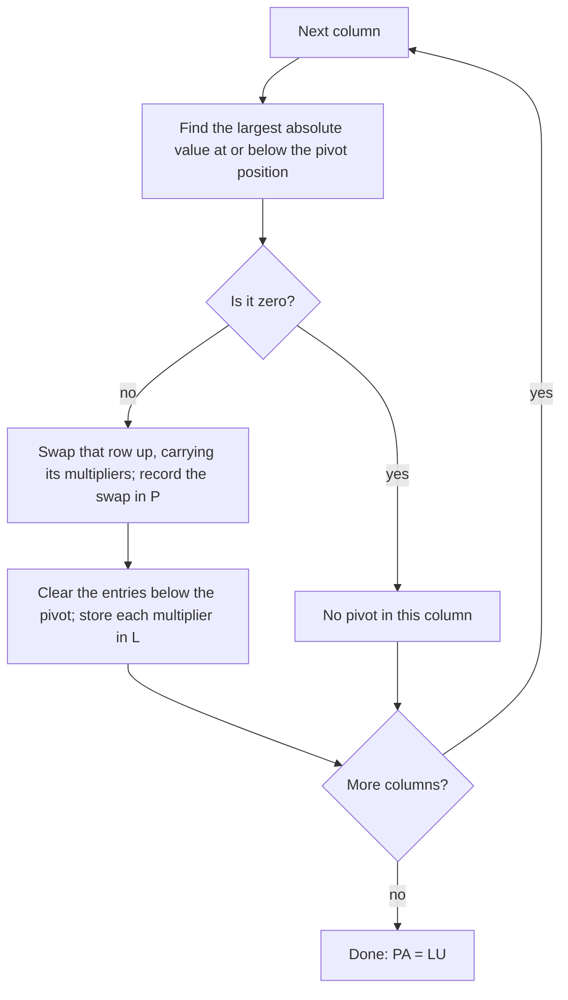
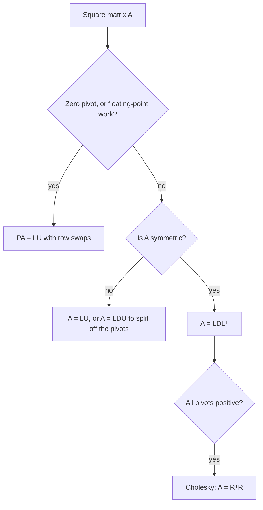

The LU lesson ended with a warning: if a zero turns up in a pivot position, the plain
factorization $A = LU$ fails, and software uses $PA = LU$ instead. This lesson fills in that
remark. We describe permutation matrices exactly, show how row swaps fit into the LU
bookkeeping, see why computers swap rows even when they don't have to, and then split $U$
one step further into the **LDU factorization**, which reveals a hidden symmetry: for a
symmetric matrix, $U$ is just $L^T$ in disguise.

## Permutation matrices

A **permutation matrix** is an identity matrix with its rows put in a different order. Each
row and each column has exactly one 1, and every other entry is 0. There are $n!$ of them of
size $n \times n$ (one for each ordering of the rows), including $I$ itself.

Multiplying by $P$ on the left reorders rows. Row $i$ of $PA$ is (row $i$ of $P$) times $A$,
and row $i$ of $P$ is some $\mathbf{e}_k^T$, which picks out row $k$ of $A$. So if $P$ is $I$
with its rows in the order $3, 1, 2$, then $PA$ is $A$ with its rows in the order $3, 1, 2$.
Multiplying on the right, $AP$, reorders the *columns* of $A$ instead, just as $AE$ performed a
column operation in the elementary-matrix lesson.

The inverse of a permutation matrix is free:

$$P^{-1} = P^T.$$

Why: entry $(i, j)$ of $PP^T$ is row $i$ of $P$ dotted with row $j$ of $P$. Those rows are
standard basis vectors $\mathbf{e}_k^T$ and $\mathbf{e}_l^T$, distinct when $i \ne j$, so the
dot product is 1 when $i = j$ and 0 otherwise. Hence $PP^T = I$, and a square matrix with a
one-sided inverse is invertible (the IMT). A single swap of two rows is its own inverse, but a
general permutation is not: undoing "3, 1, 2" is a different reordering.

### Example 1

Let $P = \begin{bmatrix} 0 & 0 & 1 \\ 1 & 0 & 0 \\ 0 & 1 & 0\end{bmatrix}$ and $A = \begin{bmatrix} 1 & 2 \\ 3 & 4 \\ 5 & 6\end{bmatrix}$. Find $PA$ and $P^{-1}$.

1. Row 1 of $P$ is $\mathbf{e}_3^T$, row 2 is $\mathbf{e}_1^T$, row 3 is $\mathbf{e}_2^T$. So $PA$ lists rows 3, 1, 2 of $A$: $PA = \begin{bmatrix} 5 & 6 \\ 1 & 2 \\ 3 & 4\end{bmatrix}$.
2. $P^{-1} = P^T = \begin{bmatrix} 0 & 1 & 0 \\ 0 & 0 & 1 \\ 1 & 0 & 0\end{bmatrix}$, which lists rows in the order 2, 3, 1.
3. Check: $P^T(PA)$ takes rows 2, 3, 1 of $\begin{bmatrix} 5 & 6 \\ 1 & 2 \\ 3 & 4\end{bmatrix}$, giving back $\begin{bmatrix} 1 & 2 \\ 3 & 4 \\ 5 & 6\end{bmatrix}$. ✓ Note $P^2 \ne I$ here: applying "3, 1, 2" twice gives "2, 3, 1".

## When a swap is forced

Why does $\begin{bmatrix} 0 & 1 \\ 1 & 1\end{bmatrix}$ have no LU factorization? Suppose
$\begin{bmatrix} 0 & 1 \\ 1 & 1\end{bmatrix} = \begin{bmatrix} 1 & 0 \\ \ell & 1\end{bmatrix}\begin{bmatrix} u_{11} & u_{12} \\ 0 & u_{22}\end{bmatrix}$.
The $(1, 1)$ entries give $u_{11} = 0$, and then the $(2, 1)$ entries give $1 = \ell u_{11} = 0$, a
contradiction. Swapping the rows first fixes everything: the swapped matrix is already upper
triangular. In general:

> *Theorem.* For every $m \times n$ matrix $A$ there is a permutation matrix $P$ such that $PA = LU$, with $L$ unit lower triangular and $U$ an echelon form of $A$.

The idea: run row reduction, swapping rows whenever needed. If you knew all the swaps in
advance, you could do them first, to get $PA$, and then $PA$ would reduce with no swaps at
all, so $PA = LU$ by the old method. The only bookkeeping problem is that a swap can happen
*after* some multipliers have been recorded. The rule is simple:

> When two rows are swapped, the multipliers already recorded for those rows are swapped with them.

Each row "carries" its multipliers, because they describe how that row was built. In
practice you keep the multipliers in the cleared positions of the working matrix itself, so
a row swap moves them automatically.

### Example 2

Find $PA = LU$ for $A = \begin{bmatrix} 1 & 2 & 3 \\ 2 & 4 & 7 \\ 3 & 7 & 8\end{bmatrix}$, then solve $A\mathbf{x} = (2, 3, 9)$.

1. Column 1, pivot 1. $R_2 \leftarrow R_2 - 2R_1$ gives $[\,0 \;\; 0 \;\; 1\,]$ (multiplier 2); $R_3 \leftarrow R_3 - 3R_1$ gives $[\,0 \;\; 1 \;\; {-1}\,]$ (multiplier 3).
2. Column 2: the pivot position holds 0, so swap rows 2 and 3, and their multipliers with them. Now row 2 is $[\,0 \;\; 1 \;\; {-1}\,]$ (multiplier 3) and row 3 is $[\,0 \;\; 0 \;\; 1\,]$ (multiplier 2).
3. The entry below the new pivot is already 0, so $\ell_{32} = 0$, and $U$ is finished:
$$P = \begin{bmatrix} 1 & 0 & 0 \\ 0 & 0 & 1 \\ 0 & 1 & 0\end{bmatrix}, \quad L = \begin{bmatrix} 1 & 0 & 0 \\ 3 & 1 & 0 \\ 2 & 0 & 1\end{bmatrix}, \quad U = \begin{bmatrix} 1 & 2 & 3 \\ 0 & 1 & -1 \\ 0 & 0 & 1\end{bmatrix}.$$
4. Check row 2 of $LU$: $3(1, 2, 3) + (0, 1, -1) = (3, 7, 8)$, which is row 3 of $A$, the second row of $PA$. ✓
5. To solve, multiply $A\mathbf{x} = \mathbf{b}$ by $P$: $LU\mathbf{x} = P\mathbf{b} = (2, 9, 3)$. Forward substitution in $L\mathbf{y} = (2, 9, 3)$: $y_1 = 2$, $y_2 = 9 - 3(2) = 3$, $y_3 = 3 - 2(2) - 0 = -1$.
6. Back-substitution in $U\mathbf{x} = (2, 3, -1)$: $x_3 = -1$; $x_2 - x_3 = 3$ gives $x_2 = 2$; $x_1 + 2(2) + 3(-1) = 2$ gives $x_1 = 1$. So $\mathbf{x} = (1, 2, -1)$, and indeed $A(1, 2, -1) = (2, 3, 9)$. ✓

The common slip is step 5: the right-hand side must be permuted too.

## Swapping on purpose: partial pivoting

In exact arithmetic, any nonzero pivot works. Computers, however, round every result to a
fixed number of significant digits (about 16 in standard double precision), and a tiny
pivot magnifies those rounding errors. The cure is **partial pivoting**: in each column,
choose as pivot the entry of largest absolute value at or below the pivot position, and swap
its row up. Then every multiplier satisfies $|\ell_{ij}| \le 1$, so no row is ever multiplied
by a huge number.

### Example 3

To see the danger without a computer, pretend we keep only 3 significant digits after every
step, and solve
$$0.0001x_1 + x_2 = 1, \qquad x_1 + x_2 = 2.$$
The exact solution is $x_1 \approx 1.0001$, $x_2 \approx 0.9999$, so the 3-digit answer
should be $x_1 = x_2 = 1.00$.

1. *No swap.* The multiplier is $1/0.0001 = 10{,}000$. Row 2 becomes $(1 - 10{,}000)x_2 = 2 - 10{,}000$, that is $-9999x_2 = -9998$, which rounds to $-10{,}000x_2 = -10{,}000$. So $x_2 = 1.00$.
2. Back-substitute: $0.0001x_1 = 1 - 1.00 = 0$, so $x_1 = 0$. Completely wrong: the rounding in step 1 lost the information about $x_1$, and dividing by the tiny pivot couldn't recover it.
3. *Partial pivoting.* The larger entry in column 1 is the 1, so swap: $x_1 + x_2 = 2$ is now row 1. The multiplier is $0.0001$, and row 2 becomes $0.9999x_2 = 0.9998$, which rounds to $1.00x_2 = 1.00$. So $x_2 = 1.00$ and $x_1 = 2 - 1.00 = 1.00$. Correct to 3 digits.

This is a simplified model of floating-point arithmetic, but real double precision behaves the
same way: with $10^{-20}$ in place of $0.0001$, solving without the swap again gives
$x_1 = 0$. Partial pivoting is the default in standard numerical libraries (LAPACK, and
the solvers in MATLAB, NumPy and R built on it). It is not a perfect guarantee: specially
built matrices can still make entries grow by a factor as large as $2^{n-1}$, but such
growth is very rare in practice.

## The LDU factorization

In $A = LU$ the two factors look lopsided: $L$ has 1s on its diagonal, while $U$ carries the
pivots $d_1, \dots, d_n$. If $A$ is invertible, every pivot is nonzero, and we can divide
each row of $U$ by its pivot:

$$U = \begin{bmatrix} d_1 & & \\ & \ddots & \\ & & d_n\end{bmatrix}\begin{bmatrix} 1 & u_{12}/d_1 & \cdots \\ & 1 & \cdots \\ & & 1\end{bmatrix} = DU_1.$$

So $A = LDU_1$: unit lower triangular, times diagonal, times unit upper triangular. (Many
books simply write $A = LDU$ with $U$ now meaning the unit upper factor.)

> *Theorem.* If $A$ is invertible and has an LU factorization (no row swaps needed), its LDU factorization is unique.

Proof sketch: suppose $L_1D_1U_1 = L_2D_2U_2$. Then $L_2^{-1}L_1 = D_2U_2U_1^{-1}D_1^{-1}$.
Products and inverses of unit lower triangular matrices are unit lower triangular, and
products and inverses of invertible upper triangular matrices are upper triangular. So the
left side is unit lower triangular and the right side is upper triangular. A matrix that is
both is diagonal with 1s on the diagonal, that is $I$. So $L_1 = L_2$, and the same argument
on the other side gives $D_1 = D_2$ and $U_1 = U_2$.

Uniqueness has a striking consequence. If $A$ is symmetric and $A = LDU_1$, then transposing
gives $A = A^T = U_1^TDL^T$, which is another factorization of the same kind (unit lower,
diagonal, unit upper). By uniqueness, $U_1 = L^T$:

$$A = LDL^T \qquad (A \text{ symmetric}).$$

This is the **LDLᵀ factorization**. It needs only $L$ and the pivots, so it saves about half
the storage and work, and it is the form behind the pivot test for positive definite
matrices and the Cholesky factorization in Module 9.

### Example 4

(a) Find the LDU factorization of $A = \begin{bmatrix} 2 & 1 & -1 \\ 4 & 5 & 1 \\ -2 & 2 & 6\end{bmatrix}$ from the LU lesson. (b) Find $LDL^T$ for $S = \begin{bmatrix} 2 & 4 & -2 \\ 4 & 11 & -1 \\ -2 & -1 & 6\end{bmatrix}$.

1. (a) The LU lesson found $L = \begin{bmatrix} 1 & 0 & 0 \\ 2 & 1 & 0 \\ -1 & 1 & 1\end{bmatrix}$ and $U = \begin{bmatrix} 2 & 1 & -1 \\ 0 & 3 & 3 \\ 0 & 0 & 2\end{bmatrix}$. The pivots are 2, 3, 2.
2. Divide each row of $U$ by its pivot: $D = \operatorname{diag}(2, 3, 2)$ and $U_1 = \begin{bmatrix} 1 & \tfrac12 & -\tfrac12 \\ 0 & 1 & 1 \\ 0 & 0 & 1\end{bmatrix}$. $A$ isn't symmetric, and $U_1 \ne L^T$.
3. (b) Eliminate in $S$: $\ell_{21} = 4/2 = 2$ and $\ell_{31} = -2/2 = -1$ leave rows $[\,0 \;\; 3 \;\; 3\,]$ and $[\,0 \;\; 3 \;\; 4\,]$; then $\ell_{32} = 3/3 = 1$ leaves $[\,0 \;\; 0 \;\; 1\,]$. Pivots 2, 3, 1.
4. So $L = \begin{bmatrix} 1 & 0 & 0 \\ 2 & 1 & 0 \\ -1 & 1 & 1\end{bmatrix}$ and $D = \operatorname{diag}(2, 3, 1)$. Dividing the rows of $U = \begin{bmatrix} 2 & 4 & -2 \\ 0 & 3 & 3 \\ 0 & 0 & 1\end{bmatrix}$ by the pivots gives $\begin{bmatrix} 1 & 2 & -1 \\ 0 & 1 & 1 \\ 0 & 0 & 1\end{bmatrix} = L^T$, as the theorem promised. So $S = LDL^T$.
5. Check the $(2, 2)$ entry: row 2 of $L$ is $(2, 1, 0)$, and $\sum_k \ell_{2k}^2d_k = 2^2(2) + 1^2(3) = 11$. ✓ All three pivots are positive, so (Module 9) $S$ is positive definite.

The chart is a simplification: symmetric solvers in software also pivot, using symmetric
row-and-column swaps that keep the matrix symmetric.

## Common mistakes

- *Forgetting to permute $\mathbf{b}$.* With $PA = LU$, solve $L\mathbf{y} = P\mathbf{b}$, not $L\mathbf{y} = \mathbf{b}$.
- *Leaving the old multipliers in place after a swap.* Multipliers belong to rows and move with them.
- *Assuming $P^{-1} = P$ for every permutation matrix.* That holds for a single swap; in general $P^{-1} = P^T$.
- *Pivoting on the first nonzero entry in floating point.* Exact arithmetic allows it; computers should take the largest entry in absolute value.
- *Writing $A = LDL^T$ for a non-symmetric matrix.* For non-symmetric $A$, the unit upper factor is generally not $L^T$.

## Key points

- A permutation matrix is $I$ with its rows reordered; $PA$ reorders rows, $AP$ reorders columns, and $P^{-1} = P^T$.
- Every matrix has $PA = LU$; when rows are swapped mid-way, their multipliers move with them. Solve $L\mathbf{y} = P\mathbf{b}$, then $U\mathbf{x} = \mathbf{y}$.
- Partial pivoting picks the largest available pivot so every $|\ell_{ij}| \le 1$, which controls rounding error.
- Splitting off the pivots gives $A = LDU$, unique for invertible $A$ without swaps; for symmetric $A$ it becomes $A = LDL^T$.
