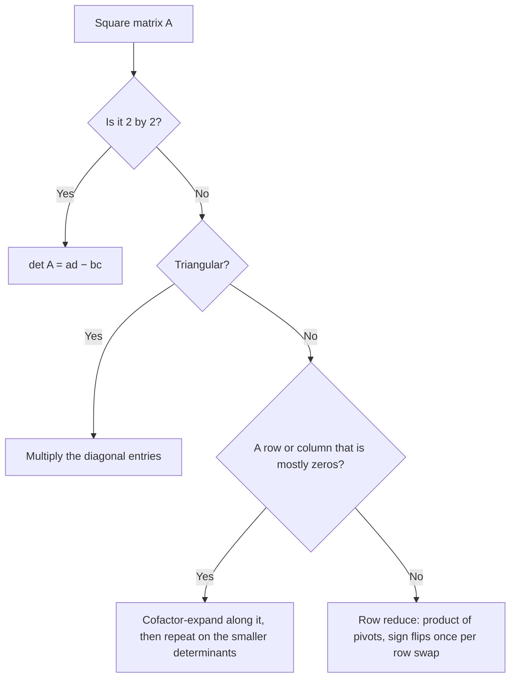

## One number that tells you a lot

For a $2 \times 2$ matrix, the number $ad - bc$ decides whether the matrix is invertible.
The determinant extends that number to every square matrix. It will give a one-line
invertibility test, formulas for inverses and solutions (Cramer's rule), the factor by which
a transformation scales area and volume, and, in Module 8, the equation whose roots are the
eigenvalues. This lesson defines the determinant and shows how to compute it by expanding
along a row or column.

## From $2 \times 2$ to $3 \times 3$

Write $\det A$ or $|A|$ (vertical bars, as in $\begin{vmatrix} a & b \\ c & d\end{vmatrix}$)
for the determinant. For $2 \times 2$, $\det A = ad - bc$. For bigger matrices we define the
determinant in terms of smaller ones.

For an $n \times n$ matrix $A$, let $A_{ij}$ be the $(n-1) \times (n-1)$ matrix obtained by
deleting row $i$ and column $j$. Its determinant, $\det A_{ij}$, is the $(i, j)$ **minor** of
$A$. The $(i, j)$ **cofactor** is the minor with a sign attached:

$$C_{ij} = (-1)^{i+j}\det A_{ij}.$$

The picture shows how $A_{23}$ is formed from a $4 \times 4$ matrix: cross out row 2 and
column 3 (the row and column of the entry $a_{23}$), and the nine entries left over, kept in
their original order, make the $3 \times 3$ matrix $A_{23}$.

The signs $(-1)^{i+j}$ form a checkerboard starting with $+$ in the top left:

$$\begin{bmatrix} + & - & + & \cdots \\ - & + & - & \cdots \\ + & - & + & \cdots \\ \vdots & & & \ddots\end{bmatrix}$$

The determinant is then defined by expanding along the first row:

$$\det A = a_{11}C_{11} + a_{12}C_{12} + \cdots + a_{1n}C_{1n}.$$

For $n = 3$ this reads

$$\det A = a_{11}\begin{vmatrix} a_{22} & a_{23} \\ a_{32} & a_{33}\end{vmatrix} - a_{12}\begin{vmatrix} a_{21} & a_{23} \\ a_{31} & a_{33}\end{vmatrix} + a_{13}\begin{vmatrix} a_{21} & a_{22} \\ a_{31} & a_{32}\end{vmatrix}.$$

Each $3 \times 3$ determinant becomes three $2 \times 2$ determinants; each $4 \times 4$ becomes
four $3 \times 3$ determinants, and so on. (The definition is recursive: it works for every
$n$ because it bottoms out at $1 \times 1$, where $\det[a] = a$.)

### Example 1

Compute $\det A$ for $A = \begin{bmatrix} 1 & 2 & 3 \\ 0 & 4 & 5 \\ 1 & 0 & 6\end{bmatrix}$.

1. Expand along row 1 with signs $+, -, +$.
2. $a_{11}C_{11} = 1 \cdot \begin{vmatrix} 4 & 5 \\ 0 & 6\end{vmatrix} = 1(24 - 0) = 24$.
3. $a_{12}C_{12} = 2 \cdot \left(-\begin{vmatrix} 0 & 5 \\ 1 & 6\end{vmatrix}\right) = 2(-(0 - 5)) = 10$.
4. $a_{13}C_{13} = 3 \cdot \begin{vmatrix} 0 & 4 \\ 1 & 0\end{vmatrix} = 3(0 - 4) = -12$.
5. $\det A = 24 + 10 - 12 = 22$.

## Expanding along any row or column

> *Theorem (cofactor expansion).* The determinant can be computed by a **cofactor expansion** across any row or down any column. Across row $i$: $\det A = a_{i1}C_{i1} + \cdots + a_{in}C_{in}$. Down column $j$: $\det A = a_{1j}C_{1j} + \cdots + a_{nj}C_{nj}$.

The proof takes some work, so we'll accept it. What matters is the strategy: *expand along
the row or column with the most zeros*, because each zero entry kills its whole term. In
Example 1, column 1 has a zero; expanding down column 1 gives
$1\cdot(24 - 0) - 0 + 1\cdot\begin{vmatrix} 2 & 3 \\ 4 & 5\end{vmatrix} = 24 + (10 - 12) = 22$,
the same answer with one fewer $2 \times 2$ determinant.

Use the checkerboard for the signs: the $(i, j)$ position gets $+$ when $i + j$ is even.

### Example 2

Compute $\det B$ for $B = \begin{bmatrix} 3 & 0 & 1 & 0 \\ 2 & 0 & -1 & 4 \\ 1 & 0 & 2 & 0 \\ 5 & 2 & 7 & -1\end{bmatrix}$.

1. Column 2 has three zeros. Its only nonzero entry is $b_{42} = 2$, in position $(4, 2)$, where the sign is $(-1)^{4+2} = +$.
2. Delete row 4 and column 2: $\det B = +2\begin{vmatrix} 3 & 1 & 0 \\ 2 & -1 & 4 \\ 1 & 2 & 0\end{vmatrix}$.
3. In the $3 \times 3$ determinant, column 3 has two zeros. Its nonzero entry 4 is in position $(2, 3)$, sign $-$: $-4\begin{vmatrix} 3 & 1 \\ 1 & 2\end{vmatrix} = -4(6 - 1) = -20$.
4. $\det B = 2(-20) = -40$.

A $4 \times 4$ determinant took just two small $2 \times 2$ computations.

## Triangular matrices

If $A$ is triangular (upper or lower), its determinant is the product of its diagonal
entries. For an upper triangular matrix, expand down column 1: only $a_{11}$ survives, and
its minor is again upper triangular; repeat. For example
$\begin{vmatrix} 2 & 7 & -1 \\ 0 & -3 & 5 \\ 0 & 0 & 4\end{vmatrix} = 2(-3)(4) = -24$. In
particular $\det I = 1$. This fact is the key to computing determinants efficiently in the
next lesson.

## How much work?

Cofactor expansion of an $n \times n$ matrix with no zeros needs about $n!$ multiplications.
For $n = 25$ that's around $1.5 \times 10^{25}$, far beyond any computer. Cofactor
expansion is for small or sparse matrices and for theory; the row-reduction method in the
next lesson takes about $n^3$ operations.

The flowchart sums up which method to reach for. The row-reduction method in its last box is
the subject of the next lesson.

## Common mistakes

- *Forgetting the sign pattern.* The middle term of a $3 \times 3$ row-1 expansion is subtracted.
- *Confusing minor and cofactor.* The cofactor includes the sign $(-1)^{i+j}$; the minor doesn't.
- *Deleting the wrong row or column* when forming $A_{ij}$. Delete the row *and* column of the entry you're using.
- *Expanding along a crowded row* when a row or column full of zeros is available.
- *Applying the "diagonal products" shortcut (rule of Sarrus) to $4 \times 4$ matrices.* It only works for $3 \times 3$.

## Key points

- Minor: $\det A_{ij}$ (delete row $i$, column $j$). Cofactor: $C_{ij} = (-1)^{i+j}\det A_{ij}$.
- $\det A = \sum_j a_{ij}C_{ij}$ along any row, or $\sum_i a_{ij}C_{ij}$ down any column; the answer is the same.
- Expand along the row or column with the most zeros.
- The determinant of a triangular matrix is the product of its diagonal entries.
