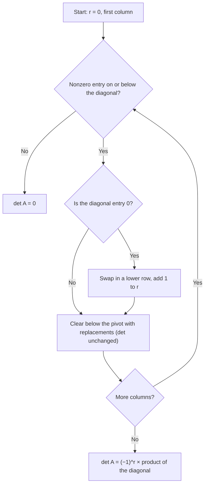

## Row reduction meets determinants

Cofactor expansion is fine for small matrices but hopeless for large ones. Fortunately,
determinants interact very simply with row operations, and row reduction produces a
triangular matrix whose determinant is just a product of diagonal entries. Combining the two
gives a fast method. Along the way we get the theoretical properties that make determinants
useful: the invertibility test and the product rule.

## How row operations change the determinant

> *Theorem.* Let $A$ be square.
> 1. If a multiple of one row is added to another row to produce $B$, then $\det B = \det A$.
> 2. If two rows are interchanged to produce $B$, then $\det B = -\det A$.
> 3. If one row is multiplied by $k$ to produce $B$, then $\det B = k\det A$.

You can check these on $2 \times 2$ matrices. Swapping the rows of
$\begin{bmatrix} a & b \\ c & d\end{bmatrix}$ gives $cb - da = -(ad - bc)$. Scaling the first
row by $k$ gives $(ka)d - (kb)c = k(ad - bc)$. Adding $k$ times row 1 to row 2 gives
$a(d + kb) - b(c + ka) = ad - bc$. The general proof uses induction with cofactor expansion.

Two quick consequences: a matrix with a row of zeros has determinant 0 (expand along that
row), and so does a matrix with two equal rows (subtracting one from the other creates a zero
row without changing the determinant).

## Computing determinants by row reduction

Reduce $A$ to an echelon form $U$ using only replacements and interchanges (no scaling
needed). Replacements don't change the determinant, and each interchange flips its sign.
$U$ is triangular, so

$$\det A = (-1)^r \cdot (\text{product of the diagonal entries of } U),$$

where $r$ is the number of row interchanges used. This takes about $\tfrac23n^3$ operations,
the same as solving a system.

The flowchart below spells out the procedure one column at a time.

### Example 1

Compute $\det A$ for $A = \begin{bmatrix} 1 & 3 & 2 \\ 2 & 8 & 5 \\ -1 & 1 & 4\end{bmatrix}$.

1. $R_2 \leftarrow R_2 - 2R_1$: $[\,0 \;\; 2 \;\; 1\,]$. $R_3 \leftarrow R_3 + R_1$: $[\,0 \;\; 4 \;\; 6\,]$. (Replacements: no change.)
2. $R_3 \leftarrow R_3 - 2R_2$: $[\,0 \;\; 0 \;\; 4\,]$.
3. $U = \begin{bmatrix} 1 & 3 & 2 \\ 0 & 2 & 1 \\ 0 & 0 & 4\end{bmatrix}$, no interchanges, so $\det A = 1 \cdot 2 \cdot 4 = 8$.

Now consider two relatives of $A$:

- $B = \begin{bmatrix} 0 & 2 & 1 \\ 1 & 3 & 2 \\ -1 & 1 & 4\end{bmatrix}$ needs one interchange ($R_1 \leftrightarrow R_2$) before the same reduction, so $\det B = -8$.
- $C = \begin{bmatrix} 2 & 6 & 4 \\ 2 & 8 & 5 \\ -1 & 1 & 4\end{bmatrix}$ has row 1 of $A$ multiplied by 2, so $\det C = 2 \cdot 8 = 16$. Equivalently, factor the 2 out of row 1.

## The invertibility test

> *Theorem.* A square matrix $A$ is invertible if and only if $\det A \ne 0$.

Why: row operations multiply the determinant by nonzero numbers ($1$, $-1$ or $k \ne 0$), so
$\det A$ and $\det U$ are both zero or both nonzero. $U$ is triangular, so $\det U \ne 0$
exactly when every diagonal entry is nonzero, i.e. when $U$ has $n$ pivots, which by the
IMT means $A$ is invertible. So "$\det A \neq 0$" joins the list of IMT statements, and
$\det A = 0$ exactly when the rows (or columns) of $A$ are linearly dependent.

## Products, transposes and inverses

> *Theorem.* For $n \times n$ matrices $A$ and $B$:
> - $\det(AB) = (\det A)(\det B)$ (the **multiplicative property**);
> - $\det A^T = \det A$;
> - if $A$ is invertible, $\det A^{-1} = \dfrac{1}{\det A}$;
> - $\det(cA) = c^n\det A$.

The product rule is surprising and powerful; it's proved using elementary matrices (each
satisfies $\det(EA) = \det E \det A$ by the row-operation theorem). The transpose rule says
everything we've said about rows is also true for *columns*: column replacements don't
change the determinant, column swaps flip its sign, and so on. The inverse rule follows from
$\det A \cdot \det A^{-1} = \det(AA^{-1}) = \det I = 1$. The last rule holds because $cA$
multiplies each of the $n$ rows by $c$.

For columns the rules have a picture. The columns $\mathbf{u}, \mathbf{v}$ of a $2 \times 2$
matrix span a parallelogram whose area is $|\det A|$ (the next lesson proves this). Adding $\mathbf{u}$
to $\mathbf{v}$ slides the top edge sideways (a shear), keeping the base and height; doubling
$\mathbf{v}$ doubles the area; swapping the columns keeps the shape but reverses the direction
of turning from the first column to the second, and that is what the sign records.

Warning: there is no sum rule. In general $\det(A + B) \ne \det A + \det B$; try
$A = B = I_2$: $\det(2I_2) = 4$, but $\det I_2 + \det I_2 = 2$.

### Example 2

$A$ and $B$ are $3 \times 3$ with $\det A = 3$ and $\det B = -2$. Find $\det(2AB^TA^{-1})$.

1. Pull out the scalar: $\det(2M) = 2^3\det M = 8\det M$ for a $3 \times 3$ matrix $M$.
2. Product rule: $\det(AB^TA^{-1}) = \det A \cdot \det B^T \cdot \det A^{-1} = 3 \cdot (-2) \cdot \tfrac13 = -2$.
3. So $\det(2AB^TA^{-1}) = 8(-2) = -16$.

A common slip is $\det(2M) = 2\det M$; the factor is $2^n$, not 2.

## Common mistakes

- *Scaling a row and forgetting to compensate.* If you scale a row by $\tfrac12$ to make a pivot 1, the determinant of the new matrix is half the old one.
- *Forgetting a sign for each row swap.*
- *$\det(cA) = c\det A$.* It's $c^n\det A$.
- *$\det(A + B) = \det A + \det B$.* False in general.
- *Concluding $\det A = 0$ from a zero entry.* Only a zero row, zero column, or dependent rows/columns force $\det A = 0$.

## Key points

- Replacement: no change. Interchange: sign flips. Scaling a row by $k$: multiplies $\det$ by $k$.
- Row-reduce to triangular form: $\det A = (-1)^r \times$ (product of pivots).
- $A$ is invertible ⟺ $\det A \ne 0$.
- $\det(AB) = \det A\det B$, $\det A^T = \det A$, $\det A^{-1} = 1/\det A$, $\det(cA) = c^n\det A$.
