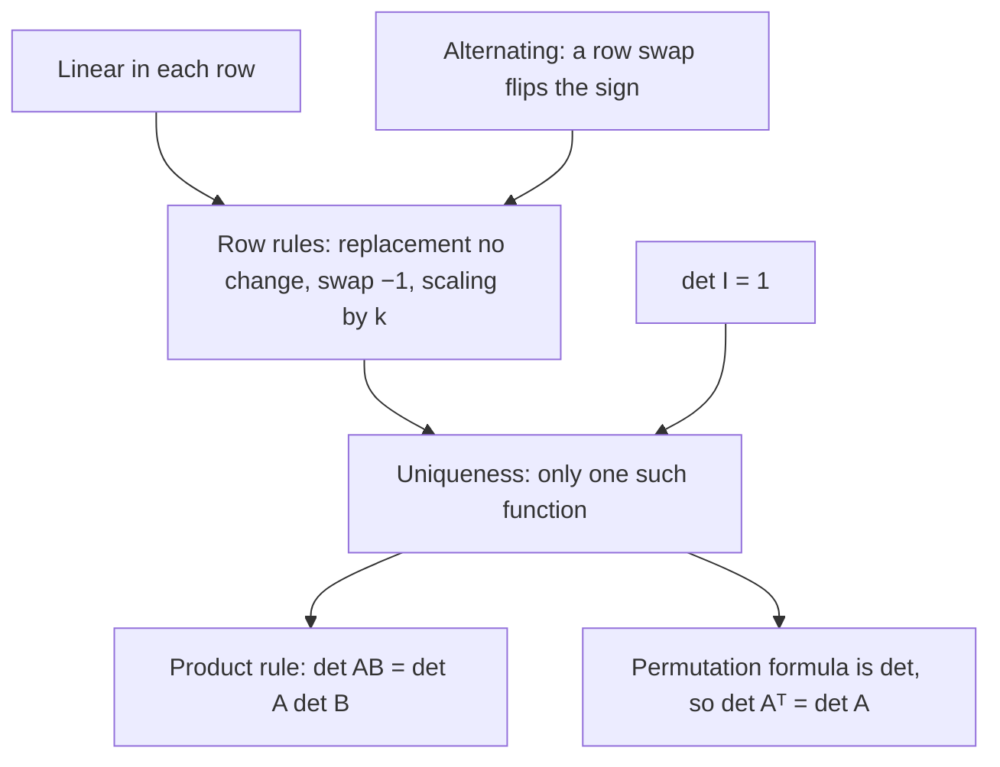

## Where the cofactor definition comes from

The cofactor lesson defined the determinant recursively and asked you to accept two things
without proof: that expanding along *any* row or column gives the same number, and (in the
properties lesson) that $\det(AB) = \det A \det B$. This lesson closes those gaps. It gives a
direct, non-recursive formula for the determinant, the **permutation formula**, and then shows
that three simple properties are enough to pin the determinant down completely. Once you know
that, the product rule and $\det A^T = \det A$ come out in a few lines.

## Permutations and their signs

A **permutation** of $1, 2, \dots, n$ is a rearrangement of those numbers. We write it as a list
$\sigma = (\sigma(1), \sigma(2), \dots, \sigma(n))$; for example $\sigma = (3, 1, 2)$ sends
$1 \mapsto 3$, $2 \mapsto 1$, $3 \mapsto 2$. There are $n!$ permutations of $n$ numbers: $n$ choices
for the first entry, $n - 1$ for the second, and so on.

An **inversion** of $\sigma$ is a pair of positions $i < j$ whose entries are out of order,
$\sigma(i) > \sigma(j)$. The **sign of a permutation** is

$$\operatorname{sgn}\sigma = (-1)^{\text{number of inversions}}.$$

A permutation with an even number of inversions is an **even permutation** (sign $+1$); one
with an odd number is an **odd permutation** (sign $-1$). The identity $(1, 2, \dots, n)$ has no
inversions, so it is even.

A quick way to count: for each entry, count how many entries *to its right* are smaller, then
add. For $(3, 1, 2)$ that is $2 + 0 + 0 = 2$, so $(3, 1, 2)$ is even.

The key fact about signs: *swapping any two entries flips the sign.* A swap of two neighbors
changes the order of exactly one pair, so the inversion count goes up or down by exactly 1.
Swapping the entries in positions $i < j$ can be done as $2(j - i) - 1$ neighbor swaps (walk the
first entry right to position $j$, then walk the other one back left to position $i$), and that
is an odd number, so the sign flips. A swap of two entries is called a **transposition**.

### Example 1

Find the sign of $\sigma = (3, 1, 4, 2)$.

1. Count smaller entries to the right: $3$ has $1, 2$ (2 of them); $1$ has none; $4$ has $2$ (1); $2$ has none.
2. Inversions: $2 + 0 + 1 + 0 = 3$. They are the pairs of values $(3, 1)$, $(3, 2)$, $(4, 2)$.
3. Three is odd, so $\operatorname{sgn}\sigma = -1$.

Check by sorting with swaps: $(3, 1, 4, 2) \to (1, 3, 4, 2) \to (1, 2, 4, 3) \to (1, 2, 3, 4)$ takes
three swaps. Each swap flips the sign, and the identity has sign $+1$, so the sign is
$(-1)^3 = -1$ again. (A different sequence of swaps might be longer, but its length always has
the same parity.)

## The permutation formula

> *Theorem (permutation formula).* For an $n \times n$ matrix $A$,
> $$\det A = \sum_{\sigma} \operatorname{sgn}(\sigma)\, a_{1\sigma(1)}\, a_{2\sigma(2)} \cdots a_{n\sigma(n)},$$
> where the sum runs over all $n!$ permutations $\sigma$ of $1, \dots, n$.

Each term picks one entry from every row, and because $\sigma$ never repeats a value, one
entry from every column too, like placing $n$ rooks on a chessboard so that none attack each
other. For $n = 2$ the two permutations are $(1, 2)$ (even) and $(2, 1)$ (odd), giving
$a_{11}a_{22} - a_{12}a_{21}$, the familiar $ad - bc$. For $n = 3$ there are six terms, shown
below; the three even ones are the "down-right diagonals" of the rule of Sarrus and the three
odd ones are the "down-left diagonals". That is why Sarrus works for $3 \times 3$ and nowhere
else: a $4 \times 4$ determinant has 24 terms, not 8.

*Why it matches the cofactor definition.* Group the terms by the column $j = \sigma(1)$ that
row 1 uses. Every value smaller than $j$ sits to the right of position 1, so exactly $j - 1$
inversions involve position 1. The other inversions are among rows $2, \dots, n$, and those
rows, using every column except $j$, are exactly a term of the permutation formula for the
minor $A_{1j}$. So the terms with $\sigma(1) = j$ add up to
$a_{1j}(-1)^{j-1}\det A_{1j} = a_{1j}(-1)^{1+j}\det A_{1j} = a_{1j}C_{1j}$ (assuming the
formula already holds for the smaller matrix $A_{1j}$), and summing over $j$ gives the
row-1 cofactor expansion. The checkerboard signs were inversion counts all along.

### Example 2

Compute $\det A$ for $A = \begin{bmatrix} 0 & 2 & 1 & 0 \\ 0 & 0 & 0 & 3 \\ 5 & 0 & 0 & 0 \\ 0 & 6 & 4 & 1\end{bmatrix}$.

1. A term is nonzero only if all its entries are. Row 2 has a single nonzero entry, in column 4, and row 3 has one, in column 1. So $\sigma(2) = 4$ and $\sigma(3) = 1$.
2. Rows 1 and 4 must share columns 2 and 3. Row 1 in column 2 and row 4 in column 3 gives $\sigma = (2, 4, 1, 3)$ with product $2 \cdot 3 \cdot 5 \cdot 4 = 120$. Row 1 in column 3 and row 4 in column 2 gives $\sigma = (3, 4, 1, 2)$ with product $1 \cdot 3 \cdot 5 \cdot 6 = 90$.
3. Signs: $(2, 4, 1, 3)$ has $1 + 2 + 0 + 0 = 3$ inversions (odd); $(3, 4, 1, 2)$ has $2 + 2 + 0 + 0 = 4$ (even).
4. $\det A = -120 + 90 = -30$.

Only 2 of the 24 terms survive, so this is quicker than cofactor expansion. For a full matrix,
though, the formula is hopeless for computing: $10! = 3{,}628{,}800$ terms for a $10 \times 10$
matrix. Its value is in proofs.

A special case: the permutation matrix $P_\sigma$ with a 1 in row $i$, column $\sigma(i)$ and
zeros elsewhere has exactly one nonzero term, so $\det P_\sigma = \operatorname{sgn}\sigma$.

## Three properties that pin down the determinant

Read off the formula, the determinant has three properties.

1. **Multilinear**: it is linear in each row when the other rows are held fixed. Each term
   contains exactly one entry from row $i$, so if row $i$ is $\mathbf{r} + c\,\mathbf{s}$, the
   determinant splits as $\det(\dots, \mathbf{r}, \dots) + c\det(\dots, \mathbf{s}, \dots)$.
2. **Alternating**: swapping two rows multiplies it by $-1$. Swapping rows $i$ and $k$ turns the
   term for $\sigma$ into the term for $\sigma$ with entries $i$ and $k$ swapped, which has the
   opposite sign.
3. *Normalized*: $\det I = 1$ (only the identity permutation gives a nonzero term).

Be careful with the first one: linear in *each row separately* does not mean
$\det(A + B) = \det A + \det B$, which changes every row at once.

> *Theorem (uniqueness).* The determinant is the only function of $n \times n$ matrices that is multilinear in the rows, alternating, and equal to 1 at $I$.

*Proof sketch.* Let $D$ be any function with the three properties. If two rows of $A$ are
equal, swapping them leaves $A$ unchanged but flips the sign, so $D(A) = -D(A)$ and $D(A) = 0$.
Then a replacement does nothing: by linearity in row $k$,
$D(\dots, \mathbf{r}_k + c\mathbf{r}_i, \dots) = D(A) + c\,D(\text{a matrix with two equal rows}) = D(A)$.
Scaling a row by $k$ multiplies $D$ by $k$, and a swap by $-1$. These are exactly the row
operation rules from the properties lesson, so the row-reduction computation of $\det A$ also
computes $D(A)$: reduce to an echelon form $U$; if $U$ has a zero row, $D(U) = 0$ by linearity,
and otherwise scaling and replacements turn $U$ into $I$, where $D(I) = 1$. Every step affects
$D$ and $\det$ in the same way, so $D(A) = \det A$. $\blacksquare$

## Payoffs: the product rule and the transpose rule

*Product rule.* Fix $B$. If $\det B = 0$, then $B\mathbf{x} = \mathbf{0}$ has a nonzero solution,
which also solves $AB\mathbf{x} = \mathbf{0}$, so $AB$ is singular and both sides of
$\det(AB) = \det A\det B$ are 0. If $\det B \ne 0$, define $D(A) = \det(AB)/\det B$. Row $i$ of
$AB$ is (row $i$ of $A$)$\,B$, so $D$ is multilinear and alternating in the rows of $A$, and
$D(I) = \det B/\det B = 1$. By uniqueness $D(A) = \det A$, that is, $\det(AB) = \det A\det B$.
(Cauchy gave a proof of this product theorem in 1812; Binet presented one at the same
meeting of the Institut de France.)

*Transpose rule.* The term of $\det A^T$ for $\sigma$ is $a_{\sigma(1)1}a_{\sigma(2)2}\cdots a_{\sigma(n)n}$.
Reordered by rows, this is the term of $\det A$ for the inverse permutation $\sigma^{-1}$ (if
$\sigma(i) = j$, the entry sits in row $j$, column $i$). Each inversion of $\sigma$, positions
$i < j$ with $\sigma(i) > \sigma(j)$, gives an inversion of $\sigma^{-1}$ at positions
$\sigma(j) < \sigma(i)$ (where $\sigma^{-1}$ has the values $j > i$), and the other way round, so
the two permutations have the same number of inversions and the same sign. The terms match one for one, and $\det A^T = \det A$. Everything true for
rows is true for columns.

*Expansion along any row or column.* Move row $i$ to the top by $i - 1$ swaps of neighboring
rows, keeping the other rows in order. That multiplies the determinant by $(-1)^{i-1}$, and the
row-1 expansion of the new matrix uses the same minors $A_{ij}$, so
$\det A = (-1)^{i-1}\sum_j a_{ij}(-1)^{1+j}\det A_{ij} = \sum_j a_{ij}C_{ij}$. Expansion down a
column follows from the transpose rule. Both facts the cofactor lesson took on trust are now
proved.

### Example 3

Show that $\det\begin{bmatrix} 1 & a & a^2 \\ 1 & b & b^2 \\ 1 & c & c^2\end{bmatrix} = (b - a)(c - a)(c - b)$ and evaluate it for $a, b, c = 1, 2, 4$.

1. Replacements $R_2 - R_1$ and $R_3 - R_1$ don't change the determinant: rows 2 and 3 become $(0,\; b - a,\; b^2 - a^2)$ and $(0,\; c - a,\; c^2 - a^2)$.
2. Factor $b - a$ out of row 2 and $c - a$ out of row 3 (linearity in each row), using $b^2 - a^2 = (b - a)(b + a)$: rows 2 and 3 become $(0, 1, b + a)$ and $(0, 1, c + a)$.
3. Expand down column 1: $\det = (b - a)(c - a)\begin{vmatrix} 1 & b + a \\ 1 & c + a\end{vmatrix} = (b - a)(c - a)(c - b)$.
4. For $1, 2, 4$: $(2 - 1)(4 - 1)(4 - 2) = 1 \cdot 3 \cdot 2 = 6$. (Direct expansion of $\begin{bmatrix} 1 & 1 & 1 \\ 1 & 2 & 4 \\ 1 & 4 & 16\end{bmatrix}$ gives $16 - 12 + 2 = 6$ too.)

This is the **Vandermonde determinant**. The same row operations and induction give
$\prod_{i < j}(x_j - x_i)$ for the $n \times n$ Vandermonde matrix, so it is nonzero exactly
when the $x_i$ are distinct. That proves the claim from the Module 2 applications lesson:
there is exactly one polynomial of degree at most $n - 1$ through $n$ points with distinct
$x$-values.

## A little history

Determinants are older than matrices. Seki Takakazu in Japan (1683) and Leibniz in Europe
(in a 1693 letter) both used them to decide when linear equations can be solved. Cramer
stated his rule in 1750, Vandermonde (1771) and Laplace (1772) worked out general ways to
expand them (cofactor expansion is often called Laplace expansion), and
Gauss used the word "determinant" in 1801 for a different quantity attached to quadratic
forms. Cauchy, in 1812, used the word in its modern sense. Matrices as objects in their own
right came decades later.

## Common mistakes

- *Counting inversions by position instead of value.* Compare entries, not their positions: in $(2, 1, 3)$ the pair $2, 1$ is the only inversion.
- *Using a product with a repeated column.* $a_{11}a_{21}a_{33}$ uses column 1 twice and never uses column 2, so it is not a term of the formula.
- *Thinking a 3-cycle like $(2, 3, 1)$ is odd.* It has 2 inversions, so it is even. Count; don't guess from the look.
- *Extending Sarrus to $4 \times 4$.* It gives 8 of the 24 terms.
- *Reading "multilinear" as $\det(A + B) = \det A + \det B$.* Linearity is one row at a time.

## Key points

- $\operatorname{sgn}\sigma = (-1)^{\#\text{inversions}}$; any swap of two entries flips the sign.
- $\det A = \sum_\sigma \operatorname{sgn}(\sigma) a_{1\sigma(1)}\cdots a_{n\sigma(n)}$: $n!$ terms, one entry from each row and each column.
- The determinant is the unique function that is multilinear in the rows, alternating, and 1 at $I$.
- Uniqueness proves $\det(AB) = \det A\det B$; the permutation formula proves $\det A^T = \det A$.
- Vandermonde: $\det = \prod_{i < j}(x_j - x_i)$, nonzero exactly when the $x_i$ are distinct.
