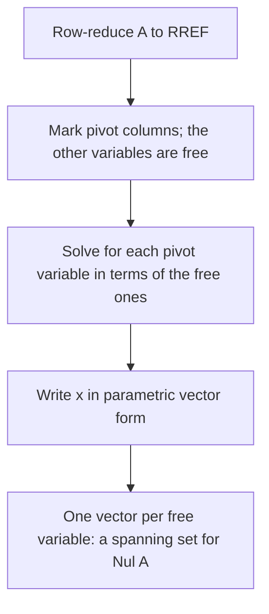

## Two subspaces from every matrix

Every $m \times n$ matrix $A$ comes with two natural subspaces, one in its domain and one in its
codomain. The null space collects the inputs that $A$ sends to zero: it measures what $A$
destroys. The column space collects all possible outputs: it measures what $A$ can reach.
These two subspaces repackage the uniqueness and existence questions once more, and the
next three lessons are about finding bases for them and measuring their size.

## The null space

The **null space** of $A$ is the set of all solutions of the homogeneous equation
$A\mathbf{x} = \mathbf{0}$:

$$\operatorname{Nul} A = \{\mathbf{x} \text{ in } \mathbb{R}^n : A\mathbf{x} = \mathbf{0}\}.$$

> *Theorem.* $\operatorname{Nul} A$ is a subspace of $\mathbb{R}^n$.

Check the three conditions: $A\mathbf{0} = \mathbf{0}$; if $A\mathbf{u} = \mathbf{0}$ and
$A\mathbf{v} = \mathbf{0}$ then $A(\mathbf{u} + \mathbf{v}) = \mathbf{0} + \mathbf{0} = \mathbf{0}$;
and $A(c\mathbf{u}) = cA\mathbf{u} = \mathbf{0}$.

$\operatorname{Nul} A$ is defined *implicitly*: by a condition you can test. To test whether a
given $\mathbf{v}$ is in it, just compute $A\mathbf{v}$. To describe it *explicitly*, solve
$A\mathbf{x} = \mathbf{0}$ and write the solution in parametric vector form; the vectors that
appear form a spanning set.

The procedure, step by step:

### Example 1

Find a spanning set for $\operatorname{Nul} A$, where $A = \begin{bmatrix} 1 & -2 & 0 & 3 \\ 2 & -4 & 1 & 4\end{bmatrix}$.

1. Row-reduce: $R_2 \leftarrow R_2 - 2R_1$ gives $[\,0 \;\; 0 \;\; 1 \;\; {-2}\,]$. The RREF is $\begin{bmatrix} 1 & -2 & 0 & 3 \\ 0 & 0 & 1 & -2\end{bmatrix}$.
2. Pivots in columns 1 and 3; $x_2$ and $x_4$ are free. $x_1 = 2x_2 - 3x_4$ and $x_3 = 2x_4$.
3. Parametric vector form:
$$\mathbf{x} = \begin{bmatrix} 2x_2 - 3x_4 \\ x_2 \\ 2x_4 \\ x_4\end{bmatrix} = x_2\begin{bmatrix} 2 \\ 1 \\ 0 \\ 0\end{bmatrix} + x_4\begin{bmatrix} -3 \\ 0 \\ 2 \\ 1\end{bmatrix}.$$
4. So $\operatorname{Nul} A = \operatorname{Span}\{(2, 1, 0, 0), (-3, 0, 2, 1)\}$, a plane through the origin in $\mathbb{R}^4$.

Two facts about this method: the spanning vectors are automatically linearly independent
(each has a 1 in its own free-variable slot where the others have 0), and there is one
vector per free variable. So the number of free variables measures the size of
$\operatorname{Nul} A$.

## The column space

The **column space** of $A$ is the span of its columns:

$$\operatorname{Col} A = \operatorname{Span}\{\mathbf{a}_1, \dots, \mathbf{a}_n\} = \{\mathbf{b} : \mathbf{b} = A\mathbf{x} \text{ for some } \mathbf{x}\}.$$

It is a subspace of $\mathbb{R}^m$, because every span is. It's defined *explicitly*: you can
write down its elements directly. Testing whether a given $\mathbf{b}$ is in it means asking
whether $A\mathbf{x} = \mathbf{b}$ is consistent, which takes a row reduction. Also,
$\operatorname{Col} A = \mathbb{R}^m$ exactly when $A\mathbf{x} = \mathbf{b}$ is solvable for
every $\mathbf{b}$, i.e. when $A$ has a pivot in every row.

In Example 1, both rows have pivots, so $\operatorname{Col} A = \mathbb{R}^2$.

The **row space** of $A$, $\operatorname{Row} A$, is the span of its rows (viewed as vectors in
$\mathbb{R}^n$); equivalently $\operatorname{Row} A = \operatorname{Col} A^T$. Row operations
don't change the row space, since each new row is a combination of old rows and vice versa.

### Example 2

Let $A = \begin{bmatrix} 1 & 2 \\ 2 & 4 \\ -1 & -2\end{bmatrix}$. Describe $\operatorname{Col} A$ and $\operatorname{Nul} A$.

1. Column 2 is twice column 1, so $\operatorname{Col} A = \operatorname{Span}\{(1, 2, -1)\}$: a line through the origin in $\mathbb{R}^3$.
2. Row reduction leaves one pivot; $x_2$ is free and $x_1 = -2x_2$, so $\operatorname{Nul} A = \operatorname{Span}\{(-2, 1)\}$: a line in $\mathbb{R}^2$.
3. $\mathbf{b} = (3, 6, -3)$ is in $\operatorname{Col} A$ (it's $3\mathbf{a}_1$), but $(1, 0, 0)$ is not.

Here is the same matrix as a picture. Its null space lives among the inputs and its column
space among the outputs, and the two are different lines in different spaces. A vector off
the line $\operatorname{Col} A$, such as $(0, 0, 2)$, is an output that $A$ never produces.

## Comparing the two

| | $\operatorname{Nul} A$ | $\operatorname{Col} A$ |
|---|---|---|
| lives in | $\mathbb{R}^n$ (inputs) | $\mathbb{R}^m$ (outputs) |
| defined | implicitly, by $A\mathbf{x} = \mathbf{0}$ | explicitly, as a span |
| to test a vector | compute $A\mathbf{v}$ | row-reduce $[\,A \;\; \mathbf{b}\,]$ |
| spanning set | solve $A\mathbf{x} = \mathbf{0}$ | the columns of $A$ |
| equals $\{\mathbf{0}\}$ / everything when | $A\mathbf{x} = \mathbf{0}$ has only the trivial solution | $A$ has a pivot in every row |

## Kernel and range

For a linear transformation $T: V \to W$ between vector spaces, the **kernel** of $T$ is the
set of $\mathbf{u}$ in $V$ with $T(\mathbf{u}) = \mathbf{0}$, and the range is the set of all
outputs $T(\mathbf{x})$. If $T(\mathbf{x}) = A\mathbf{x}$, the kernel is $\operatorname{Nul} A$
and the range is $\operatorname{Col} A$. So "$T$ is one-to-one" means the kernel is
$\{\mathbf{0}\}$, and "$T$ is onto" means the range is all of $W$.

The differentiation map $D(p) = p'$ on $\mathbb{P}_3$ is a linear transformation whose kernel
is the constant polynomials (derivative zero) and whose range is $\mathbb{P}_2$.

## Common mistakes

- *Looking for $\operatorname{Nul} A$ in the wrong space.* For a $3 \times 5$ matrix, null-space vectors have 5 entries; column-space vectors have 3.
- *Using the RREF's columns for $\operatorname{Col} A$.* Row operations change the column space; the span of the columns of the RREF is usually different. (They do preserve $\operatorname{Nul} A$ and $\operatorname{Row} A$.)
- *Forgetting the free variable's own entry* when building null-space vectors.
- *Thinking $\operatorname{Nul} A$ is empty when $A\mathbf{x} = \mathbf{0}$ has only the trivial solution.* It's $\{\mathbf{0}\}$, the zero subspace.

## Key points

- $\operatorname{Nul} A = \{\mathbf{x} : A\mathbf{x} = \mathbf{0}\}$, a subspace of $\mathbb{R}^n$; find a spanning set from the parametric vector form.
- $\operatorname{Col} A$ = span of the columns, a subspace of $\mathbb{R}^m$; $\mathbf{b}$ is in it exactly when $A\mathbf{x} = \mathbf{b}$ is consistent.
- $\operatorname{Row} A$ is the span of the rows; row operations preserve it (and $\operatorname{Nul} A$), but not $\operatorname{Col} A$.
- For a linear map, the kernel is what's sent to $\mathbf{0}$ and the range is what's reached; for $\mathbf{x} \mapsto A\mathbf{x}$ these are $\operatorname{Nul} A$ and $\operatorname{Col} A$.
