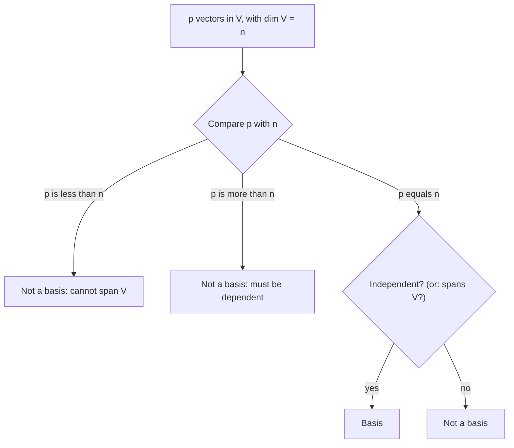

## Measuring the size of a subspace

A line through the origin and a plane through the origin are both infinite sets, yet the
plane is clearly "bigger". Dimension makes that precise: it counts the vectors in a basis.
Applied to the subspaces of a matrix, dimension gives the rank, and the rank theorem
(rank + nullity = number of columns) is one of the most useful bookkeeping facts in linear
algebra. It also adds several more statements to the invertible matrix theorem.

## Every basis has the same size

> *Theorem.* If a vector space $V$ has a basis of $n$ vectors, then every basis of $V$ has exactly $n$ vectors. Moreover, any set in $V$ with more than $n$ vectors is linearly dependent.

The second statement is the general version of "more than $n$ vectors in $\mathbb{R}^n$ are
dependent": apply the coordinate mapping to move the question into $\mathbb{R}^n$. The first
follows from the second: a basis can't be larger than another basis.

So the following definition makes sense. If $V$ is spanned by a finite set, $V$ is
**finite-dimensional**, and the **dimension** of $V$, written $\dim V$, is the number of vectors
in any basis. The dimension of $\{\mathbf{0}\}$ is 0. If $V$ isn't spanned by any finite set,
it is infinite-dimensional (for example the space of all polynomials).

| Space | Basis | Dimension |
|---|---|---|
| $\mathbb{R}^n$ | $\mathbf{e}_1, \dots, \mathbf{e}_n$ | $n$ |
| $\mathbb{P}_n$ | $1, t, \dots, t^n$ | $n + 1$ |
| $M_{2\times 2}$ | the four matrices with a single 1 | 4 |
| a line through $\mathbf{0}$ in $\mathbb{R}^3$ | one direction vector | 1 |
| a plane through $\mathbf{0}$ in $\mathbb{R}^3$ | two non-parallel vectors | 2 |

Note that $\mathbb{P}_n$ has dimension $n + 1$, not $n$: count the constant term.

> *Basis theorem.* Let $V$ have dimension $p \ge 1$. Any linearly independent set of exactly $p$ vectors in $V$ is automatically a basis, and so is any set of exactly $p$ vectors that spans $V$.

If you know the dimension, you only need to check one of the two basis conditions. For
example, three independent vectors in $\mathbb{R}^3$ automatically span $\mathbb{R}^3$.

So deciding whether $p$ given vectors form a basis of $V$ starts with a count:

## Dimensions of $\operatorname{Nul} A$ and $\operatorname{Col} A$

From the bases found in the bases lesson:

- $\dim \operatorname{Nul} A$ = the number of free variables in $A\mathbf{x} = \mathbf{0}$ (one basis vector per free variable);
- $\dim \operatorname{Col} A$ = the number of pivot columns of $A$;
- $\dim \operatorname{Row} A$ = the number of nonzero rows in an echelon form = the number of pivots.

The **rank** of $A$ is $\dim \operatorname{Col} A$, the number of pivots. The **nullity** is
$\dim \operatorname{Nul} A$. Since $\dim\operatorname{Row} A$ is also the number of pivots,
$\operatorname{rank} A = \operatorname{rank} A^T$: the column space and row space have the same
dimension, even though they live in different spaces.

Every column of $A$ is either a pivot column or a non-pivot column, which gives:

> *Rank theorem.* For an $m \times n$ matrix $A$,
> $$\operatorname{rank} A + \dim\operatorname{Nul} A = n.$$

This is often called the **rank–nullity theorem**. In words: the number of columns splits into
the directions $A$ keeps (rank) and the directions it crushes to zero (nullity).

### Example 1

$A$ is $5 \times 7$ with rank 4. Find $\dim\operatorname{Nul} A$, $\dim\operatorname{Row} A$ and $\dim\operatorname{Nul} A^T$, and decide whether $\operatorname{Col} A = \mathbb{R}^5$.

1. Rank theorem: $\dim\operatorname{Nul} A = 7 - 4 = 3$.
2. $\dim\operatorname{Row} A = \operatorname{rank} A = 4$.
3. $A^T$ is $7 \times 5$ with rank 4, so $\dim\operatorname{Nul} A^T = 5 - 4 = 1$.
4. $\operatorname{Col} A$ is a 4-dimensional subspace of $\mathbb{R}^5$, so it is not all of $\mathbb{R}^5$. Some $A\mathbf{x} = \mathbf{b}$ are inconsistent.

The picture shows all four subspaces that come with an $m \times n$ matrix of rank $r$ and
their dimensions. In Example 1, with $n = 7$, $m = 5$ and $r = 4$, they are 4, 3, 4 and 1.

### Example 2

Can a $6 \times 9$ matrix have a 2-dimensional null space?

By the rank theorem, rank $= 9 - 2 = 7$. But the rank is at most the number of rows, 6. So no:
every $6 \times 9$ matrix has nullity at least $9 - 6 = 3$.

### Example 3

The matrix $A = \begin{bmatrix} 1 & 2 & -1 & 3 \\ 2 & 4 & 1 & 0 \\ 3 & 6 & 0 & 3\end{bmatrix}$ from the bases lesson had pivots in columns 1 and 3. So $\operatorname{rank} A = 2$ and $\dim\operatorname{Nul} A = 4 - 2 = 2$, matching the two null-space basis vectors found there.

## The invertible matrix theorem, continued

For an $n \times n$ matrix $A$, the following join the list of statements equivalent to "$A$ is
invertible":

- the columns of $A$ form a basis of $\mathbb{R}^n$;
- $\operatorname{Col} A = \mathbb{R}^n$;
- $\dim\operatorname{Col} A = n$, i.e. $\operatorname{rank} A = n$;
- $\operatorname{Nul} A = \{\mathbf{0}\}$, i.e. $\dim\operatorname{Nul} A = 0$.

Each is just another way of saying "$n$ pivots". (By the rank theorem, rank $n$ and nullity 0
go together.)

## Common mistakes

- *$\dim\mathbb{P}_n = n$.* It's $n + 1$.
- *Thinking a plane in $\mathbb{R}^3$ is $\mathbb{R}^2$.* It's a 2-dimensional subspace of $\mathbb{R}^3$; its vectors still have three entries.
- *Using $m$ instead of $n$ in the rank theorem.* rank + nullity = number of *columns*.
- *Computing rank from $A$'s nonzero rows* instead of an echelon form's. Count pivots.
- *Assuming rank can exceed the smaller dimension.* $\operatorname{rank} A \le \min(m, n)$.

## Key points

- All bases of a space have the same size; that number is the dimension.
- $\dim\mathbb{R}^n = n$, $\dim\mathbb{P}_n = n + 1$; subspaces of $\mathbb{R}^3$ have dimension 0, 1, 2 or 3.
- rank $A$ = number of pivots = $\dim\operatorname{Col} A = \dim\operatorname{Row} A$; nullity = number of free variables.
- Rank theorem: $\operatorname{rank} A + \dim\operatorname{Nul} A = n$ (number of columns).
- For square $A$: invertible ⟺ rank $n$ ⟺ nullity 0 ⟺ columns form a basis of $\mathbb{R}^n$.
