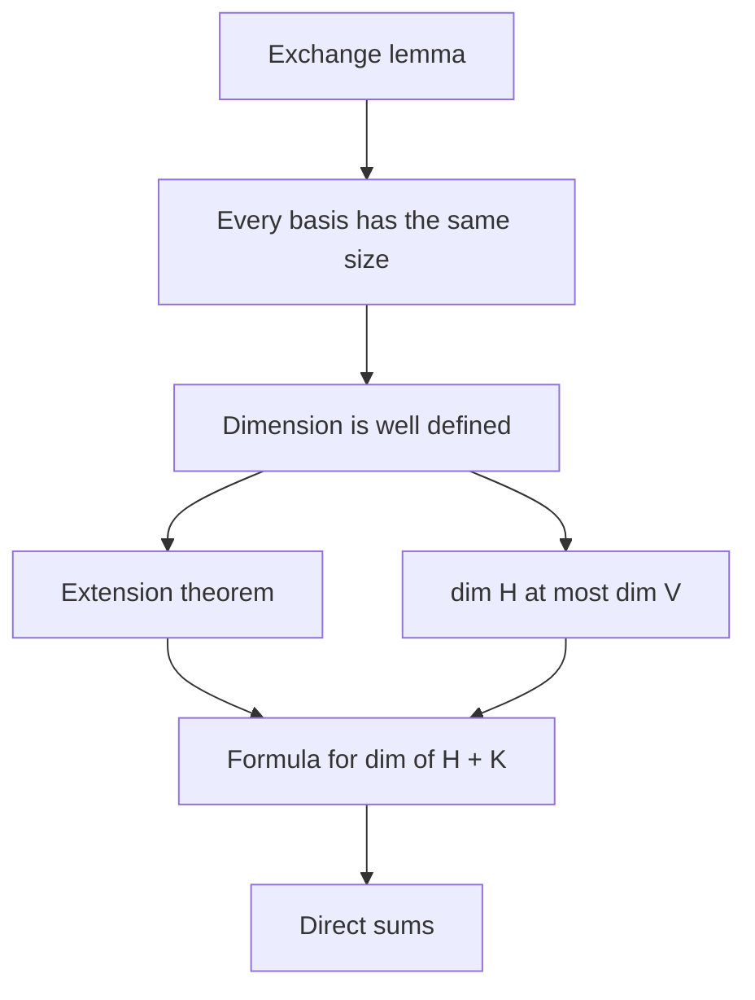

## Where this lesson fits

The dimension lesson defined $\dim V$ as "the number of vectors in any basis" and justified it
quickly: move the question into $\mathbb{R}^n$ with a coordinate mapping, where more than $n$
vectors are always dependent. That argument is correct, but it leans on row reduction in
$\mathbb{R}^n$. This honors lesson proves the same fact directly, inside any vector space, with
one short and beautiful argument called the exchange lemma. From it we get the rest of the
theory of dimension: every independent set can be grown into a basis, a subspace is never
bigger than the whole space, and there is an exact formula for the dimension of the sum of two
subspaces. These are the tools mathematicians use when no matrix is in sight.

## The exchange lemma

> *Exchange lemma.* Suppose $V = \operatorname{Span}\{\mathbf{w}_1, \dots, \mathbf{w}_n\}$ and $\{\mathbf{u}_1, \dots, \mathbf{u}_m\}$ is a linearly independent set in $V$. Then $m \le n$. Moreover, after renumbering the $\mathbf{w}$'s, the set $\{\mathbf{u}_1, \dots, \mathbf{u}_m, \mathbf{w}_{m+1}, \dots, \mathbf{w}_n\}$ still spans $V$.

In words: an independent set can never be larger than a spanning set, and you can swap the
independent vectors into the spanning set one at a time without losing the span. The result
is called the **exchange lemma** (or the Steinitz exchange lemma, after the German
mathematician Ernst Steinitz).

*Proof.* We swap in $\mathbf{u}_1, \mathbf{u}_2, \dots$ in turn. Suppose that after $k - 1$
swaps the set $\{\mathbf{u}_1, \dots, \mathbf{u}_{k-1}, \mathbf{w}_k, \dots, \mathbf{w}_n\}$ spans
$V$ (at the start, $k = 1$ and this is the original spanning set). Since $\mathbf{u}_k$ is in
$V$, we can write

$$\mathbf{u}_k = a_1\mathbf{u}_1 + \cdots + a_{k-1}\mathbf{u}_{k-1} + c_k\mathbf{w}_k + \cdots + c_n\mathbf{w}_n.$$

If every $c_j$ were 0 (or if no $\mathbf{w}$'s were left), $\mathbf{u}_k$ would be a combination
of $\mathbf{u}_1, \dots, \mathbf{u}_{k-1}$, which is impossible because the $\mathbf{u}$'s are
independent. So some $c_j \ne 0$; renumber so that $c_k \ne 0$. Solving for $\mathbf{w}_k$
shows that $\mathbf{w}_k$ is a combination of $\mathbf{u}_1, \dots, \mathbf{u}_k,
\mathbf{w}_{k+1}, \dots, \mathbf{w}_n$. Anything built from the old set can therefore be built
from the new set $\{\mathbf{u}_1, \dots, \mathbf{u}_k, \mathbf{w}_{k+1}, \dots, \mathbf{w}_n\}$,
so it still spans $V$.

Each swap needs a $\mathbf{w}$ to remove, and we never run out: if all $n$ of them were used
up while some $\mathbf{u}_{n+1}$ remained, then $\{\mathbf{u}_1, \dots, \mathbf{u}_n\}$ would
span $V$ and $\mathbf{u}_{n+1}$ would be a combination of them, contradicting independence.
So $m \le n$. $\blacksquare$

### Example 1

Run the exchange with the spanning set $\{\mathbf{e}_1, \mathbf{e}_2, \mathbf{e}_3\}$ of
$\mathbb{R}^3$ and the independent set $\mathbf{u}_1 = (1, 1, 0)$, $\mathbf{u}_2 = (0, 1, 1)$.

1. $\mathbf{u}_1 = 1\mathbf{e}_1 + 1\mathbf{e}_2 + 0\mathbf{e}_3$. The coefficient of $\mathbf{e}_1$ is nonzero, so swap: $\{\mathbf{u}_1, \mathbf{e}_2, \mathbf{e}_3\}$ spans $\mathbb{R}^3$. (Indeed $\mathbf{e}_1 = \mathbf{u}_1 - \mathbf{e}_2$.)
2. Write $\mathbf{u}_2$ in the new set: $(0, 1, 1) = 0\mathbf{u}_1 + 1\mathbf{e}_2 + 1\mathbf{e}_3$. The coefficient of $\mathbf{e}_2$ is nonzero, so swap: $\{\mathbf{u}_1, \mathbf{u}_2, \mathbf{e}_3\}$ spans $\mathbb{R}^3$. (Here $\mathbf{e}_2 = \mathbf{u}_2 - \mathbf{e}_3$.)
3. Three vectors that span the 3-dimensional space $\mathbb{R}^3$ form a basis, by the basis theorem. We could not have swapped $\mathbf{u}_1$ for $\mathbf{e}_3$: its $\mathbf{e}_3$-coefficient is 0.

## Consequences

*Every basis has the same size.* If $\mathcal{B}$ and $\mathcal{C}$ are bases with $m$ and $n$
vectors, then $\mathcal{B}$ is independent and $\mathcal{C}$ spans, so $m \le n$; switching
roles, $n \le m$. So $\dim V$ is well defined.

*Extension theorem.* In a finite-dimensional space $V$, every linearly independent set can be
enlarged to a basis, and every spanning set can be trimmed to one. The trimming half is the
spanning set theorem. For the enlarging half: if an independent set $S$ doesn't span $V$, pick
any $\mathbf{v}$ in $V$ outside $\operatorname{Span} S$. Then $S \cup \{\mathbf{v}\}$ is still
independent, because in a dependence relation the coefficient of $\mathbf{v}$ would have to be
nonzero (the vectors of $S$ alone are independent), and then $\mathbf{v}$ would lie in
$\operatorname{Span} S$. Repeat. By the exchange lemma an independent set has at most
$\dim V$ vectors, so the process stops, and it can only stop at a basis.

*Subspaces are no bigger than the space.* If $H$ is a subspace of a finite-dimensional
space $V$, then $H$ is finite-dimensional and $\dim H \le \dim V$, with equality only when
$H = V$. (A basis of $H$ is an independent set in $V$; if it has $\dim V$ vectors, the basis
theorem says it spans $V$.)

### Example 2

Extend $\{\mathbf{u}_1, \mathbf{u}_2\}$ with $\mathbf{u}_1 = (1, 2, 0, 1)$ and
$\mathbf{u}_2 = (0, 1, 1, 1)$ to a basis of $\mathbb{R}^4$.

1. Put the independent vectors *first*, followed by a spanning set: $A = [\,\mathbf{u}_1 \;\; \mathbf{u}_2 \;\; \mathbf{e}_1 \;\; \mathbf{e}_2 \;\; \mathbf{e}_3 \;\; \mathbf{e}_4\,]$, a $4 \times 6$ matrix.
2. The pivot columns of $A$ form a basis of $\operatorname{Col} A = \mathbb{R}^4$. Because $\mathbf{u}_1$ and $\mathbf{u}_2$ are independent and come first, they are always pivot columns.
3. Row reduction gives pivots in columns 1, 2, 3 and 4. The RREF's last two columns are $(-1, 1, 1, 1)$ and $(1, 0, -1, -2)$, which say $\mathbf{e}_3 = -\mathbf{u}_1 + \mathbf{u}_2 + \mathbf{e}_1 + \mathbf{e}_2$ and $\mathbf{e}_4 = \mathbf{u}_1 - \mathbf{e}_1 - 2\mathbf{e}_2$.
4. Basis: $\{(1, 2, 0, 1), (0, 1, 1, 1), \mathbf{e}_1, \mathbf{e}_2\}$. Check one relation: $-(1, 2, 0, 1) + (0, 1, 1, 1) + (1, 0, 0, 0) + (0, 1, 0, 0) = (0, 0, 1, 0) = \mathbf{e}_3$. ✓

The extension is not unique: $\{\mathbf{u}_1, \mathbf{u}_2, \mathbf{e}_3, \mathbf{e}_4\}$ would also work.
Row reduction simply finds the first one available in the order you listed the vectors.

## Sums and intersections of subspaces

Let $H$ and $K$ be subspaces of $V$. Their intersection $H \cap K$ (vectors in both) is a
subspace: it contains $\mathbf{0}$, and sums and multiples of vectors in both stay in both.
Their union usually is *not* a subspace (think of two lines through the origin in
$\mathbb{R}^2$). The right way to combine them is the **sum of subspaces**

$$H + K = \{\mathbf{h} + \mathbf{k} : \mathbf{h} \text{ in } H,\ \mathbf{k} \text{ in } K\}.$$

It is a subspace, and it is the smallest subspace containing both $H$ and $K$. If
$H = \operatorname{Span}\{\mathbf{h}_1, \dots, \mathbf{h}_p\}$ and $K = \operatorname{Span}\{\mathbf{k}_1, \dots, \mathbf{k}_q\}$,
then $H + K$ is spanned by all $p + q$ vectors together.

> *Dimension formula.* If $H$ and $K$ are finite-dimensional subspaces, then
> $$\dim(H + K) = \dim H + \dim K - \dim(H \cap K).$$

This is sometimes called Grassmann's formula. It looks like counting elements of a union, and
the idea is the same: the intersection is counted twice.

*Proof.* Start with a basis $\{\mathbf{z}_1, \dots, \mathbf{z}_r\}$ of $H \cap K$. By the extension
theorem, extend it to a basis $\{\mathbf{z}_1, \dots, \mathbf{z}_r, \mathbf{x}_1, \dots, \mathbf{x}_s\}$
of $H$ and to a basis $\{\mathbf{z}_1, \dots, \mathbf{z}_r, \mathbf{y}_1, \dots, \mathbf{y}_t\}$ of
$K$. All the $\mathbf{z}$'s, $\mathbf{x}$'s and $\mathbf{y}$'s together span $H + K$. They are also
independent: suppose $\sum a_i\mathbf{z}_i + \sum b_j\mathbf{x}_j + \sum c_l\mathbf{y}_l = \mathbf{0}$.
Then $\sum c_l\mathbf{y}_l = -\sum a_i\mathbf{z}_i - \sum b_j\mathbf{x}_j$ lies in $K$ (left side) and in
$H$ (right side), so in $H \cap K$, so it is a combination of the $\mathbf{z}$'s alone. Since
the $\mathbf{z}$'s and $\mathbf{y}$'s form a basis of $K$, all the $c_l$ are 0. Then the remaining
relation involves only a basis of $H$, so all $a_i$ and $b_j$ are 0. Counting:
$\dim(H + K) = r + s + t = (r + s) + (r + t) - r$. $\blacksquare$

When $H \cap K = \{\mathbf{0}\}$, the sum is called a **direct sum**, written $H \oplus K$. Then
$\dim(H \oplus K) = \dim H + \dim K$, and every vector of the sum splits as $\mathbf{h} + \mathbf{k}$
in exactly one way (if $\mathbf{h} + \mathbf{k} = \mathbf{h}' + \mathbf{k}'$, then
$\mathbf{h} - \mathbf{h}' = \mathbf{k}' - \mathbf{k}$ is in $H \cap K = \{\mathbf{0}\}$). If
$V = H \oplus K$, then $K$ is a **complementary subspace** of $H$ in $V$. Complements are not
unique: in $\mathbb{R}^3$, every line through the origin that is not in a given plane is a
complement of that plane. (The *orthogonal* complement, in the orthogonality module, is one
special choice.)

### Example 3

In $\mathbb{R}^3$, let $H = \operatorname{Span}\{(1, 0, 1), (0, 1, 1)\}$ and
$K = \operatorname{Span}\{(1, 1, 0), (0, 0, 1)\}$. Find $H \cap K$ and $H + K$.

1. $\mathbf{v}$ is in both when $a_1(1, 0, 1) + a_2(0, 1, 1) = b_1(1, 1, 0) + b_2(0, 0, 1)$. Move everything to one side: $(a_1, a_2, b_1, b_2)$ is in the null space of $\begin{bmatrix} 1 & 0 & -1 & 0 \\ 0 & 1 & -1 & 0 \\ 1 & 1 & 0 & -1\end{bmatrix}$.
2. Row reduction leaves $b_2$ free with $a_1 = a_2 = b_1 = \tfrac12 b_2$. Take $b_2 = 2$: $a_1 = a_2 = b_1 = 1$.
3. So $H \cap K = \operatorname{Span}\{(1, 0, 1) + (0, 1, 1)\} = \operatorname{Span}\{(1, 1, 2)\}$, a line. Check from $K$'s side: $(1, 1, 0) + 2(0, 0, 1) = (1, 1, 2)$. ✓
4. Formula: $\dim(H + K) = 2 + 2 - 1 = 3$, so $H + K = \mathbb{R}^3$: two different planes through the origin always add up to all of $\mathbb{R}^3$ and meet in a line.

### Example 4

In $\mathbb{R}^4$, let $H = \operatorname{Span}\{(1, 0, 1, 0), (0, 1, 0, 1)\}$ and
$K = \operatorname{Span}\{(1, 1, 0, 0), (0, 0, 1, 1)\}$. Two planes in $\mathbb{R}^4$ can meet in
just $\{\mathbf{0}\}$ (then their sum is all of $\mathbb{R}^4$), so we have to compute.

1. The four vectors together span $H + K$. Notice $(1, 0, 1, 0) + (0, 1, 0, 1) = (1, 1, 1, 1) = (1, 1, 0, 0) + (0, 0, 1, 1)$, so they are dependent; row reduction confirms rank 3. So $\dim(H + K) = 3$.
2. Formula: $\dim(H \cap K) = 2 + 2 - 3 = 1$.
3. The relation in step 1 already names a common vector: $H \cap K = \operatorname{Span}\{(1, 1, 1, 1)\}$.

Here $H + K$ is a 3-dimensional subspace of $\mathbb{R}^4$, not the whole space. (Every vector in
it has $x_1 - x_2 - x_3 + x_4 = 0$, a check you can do on each of the four spanning vectors.)

## Common mistakes

- *Using $H \cup K$ instead of $H + K$.* The union of two subspaces is a subspace only when one contains the other.
- *Extending to a basis with the new vectors first.* Put the given independent vectors at the front of the matrix; otherwise row reduction may keep standard vectors and drop some of yours.
- *Extending inclusion–exclusion to three subspaces.* Three different lines through the origin in $\mathbb{R}^2$ have pairwise and triple intersections $\{\mathbf{0}\}$, so the "formula" would give $1 + 1 + 1 = 3$, but their sum is $\mathbb{R}^2$, of dimension 2. The formula is for two subspaces only.
- *Calling a complement unique.* A subspace has many complementary subspaces; only the orthogonal complement is singled out.
- *Forgetting finite dimension.* "A subspace of the same dimension equals the whole space" needs $\dim V$ finite. The polynomials with zero constant term form an infinite-dimensional subspace of the space of all polynomials, yet they are not all of it.

## Key points

- Exchange lemma: an independent set is never larger than a spanning set, and its vectors can be swapped into the spanning set one at a time.
- So all bases have the same size, and $\dim V$ is well defined.
- In a finite-dimensional space, independent sets extend to bases and spanning sets shrink to bases; $\dim H \le \dim V$ for a subspace, with equality only when $H = V$.
- $H + K$ is the smallest subspace containing $H$ and $K$, and $\dim(H + K) = \dim H + \dim K - \dim(H \cap K)$.
- If $H \cap K = \{\mathbf{0}\}$ the sum is direct, $H \oplus K$, and each vector splits uniquely as $\mathbf{h} + \mathbf{k}$.
