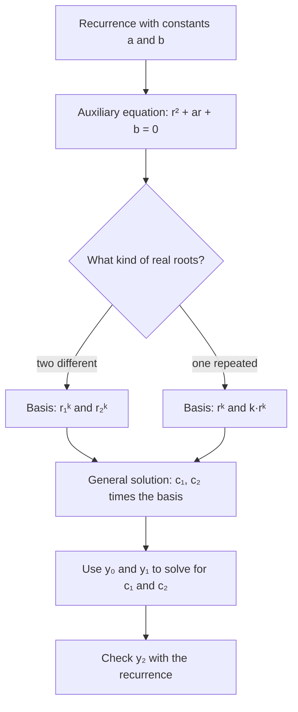

## Vectors that are functions

The first lesson of this module promised that polynomials, functions and signals could be
treated as vectors. This honors lesson cashes that promise in twice. First, polynomial
interpolation (fitting a polynomial through data points, which you met as a linear system in
the applications lesson) becomes a statement about bases of $\mathbb{P}_n$: there is a basis in
which the coordinates of a polynomial are simply its values at the data points. Second, the
solutions of a recurrence such as $y_{k+2} = y_{k+1} + 6y_k$ form a subspace of a space of
sequences, and knowing its dimension tells you exactly how many basic solutions to look for.
Both use the same tools: subspaces, bases, coordinates, dimension and isomorphisms.

## Interpolation through the lens of bases

Pick three different numbers $t_0, t_1, t_2$ (the *nodes*) and consider the evaluation map

$$E: \mathbb{P}_2 \to \mathbb{R}^3, \qquad E(p) = (p(t_0), p(t_1), p(t_2)).$$

$E$ is linear, because $(p + q)(t_i) = p(t_i) + q(t_i)$ and $(cp)(t_i) = cp(t_i)$. Its matrix
relative to the standard basis $\{1, t, t^2\}$ is the Vandermonde matrix

$$V = \begin{bmatrix} 1 & t_0 & t_0^2 \\ 1 & t_1 & t_1^2 \\ 1 & t_2 & t_2^2\end{bmatrix}.$$

*$E$ is an isomorphism.* If $E(p) = \mathbf{0}$, then $p$ has three different roots; a nonzero
polynomial of degree at most 2 has at most two roots, so $p = 0$. The kernel is $\{0\}$, and
since $\dim\mathbb{P}_2 = \dim\mathbb{R}^3 = 3$, rank–nullity makes $E$ onto as well. So for any
data values $y_0, y_1, y_2$ there is exactly one $p$ in $\mathbb{P}_2$ with $p(t_i) = y_i$. The
same argument works for $n + 1$ nodes and $\mathbb{P}_n$.

### The Lagrange basis

Since $E$ is an isomorphism, the polynomials that $E$ sends to $\mathbf{e}_1, \mathbf{e}_2,
\mathbf{e}_3$ form a basis of $\mathbb{P}_2$. They are the **Lagrange basis** polynomials
$L_0, L_1, L_2$, defined by $L_i(t_j) = 1$ if $i = j$ and $0$ if $i \ne j$. Each one is easy to
write down: $L_0$ must vanish at $t_1$ and $t_2$, so it is a multiple of $(t - t_1)(t - t_2)$,
scaled to equal 1 at $t_0$:

$$L_0(t) = \frac{(t - t_1)(t - t_2)}{(t_0 - t_1)(t_0 - t_2)}, \quad L_1(t) = \frac{(t - t_0)(t - t_2)}{(t_1 - t_0)(t_1 - t_2)}, \quad L_2(t) = \frac{(t - t_0)(t - t_1)}{(t_2 - t_0)(t_2 - t_1)}.$$

The payoff: *the Lagrange coordinates of a polynomial are its values at the nodes*,

$$p = p(t_0)L_0 + p(t_1)L_1 + p(t_2)L_2.$$

(Both sides are in $\mathbb{P}_2$ and agree at the three nodes, so they are equal by uniqueness.)
To interpolate data, you never solve a system: just weight the basis polynomials by the data.

### Example 1

Find the quadratic through $(0, 1)$, $(1, 3)$ and $(2, 2)$.

1. Nodes $0, 1, 2$. $L_0(t) = \dfrac{(t - 1)(t - 2)}{(0 - 1)(0 - 2)} = \tfrac12(t - 1)(t - 2)$, $L_1(t) = \dfrac{t(t - 2)}{(1)(-1)} = -t(t - 2)$, $L_2(t) = \dfrac{t(t - 1)}{(2)(1)} = \tfrac12 t(t - 1)$.
2. $p = 1L_0 + 3L_1 + 2L_2$.
3. Expand: $\tfrac12(t^2 - 3t + 2) - 3(t^2 - 2t) + (t^2 - t) = 1 + \tfrac72 t - \tfrac32 t^2$.
4. Check: $p(0) = 1$; $p(1) = 1 + 3.5 - 1.5 = 3$; $p(2) = 1 + 7 - 6 = 2$. ✓

```plot
{"x": [-0.5, 2.5], "y": [-0.6, 3.6], "functions": [{"f": "(x-1)*(x-2)/2", "label": "L₀", "dashed": true}, {"f": "-x*(x-2)", "label": "L₁", "dashed": true}, {"f": "x*(x-1)/2", "label": "L₂", "dashed": true}, {"f": "1 + 3.5*x - 1.5*x^2", "label": "p"}], "points": [{"at": [0, 1], "label": "(0, 1)"}, {"at": [1, 3], "label": "(1, 3)"}, {"at": [2, 2], "label": "(2, 2)"}], "caption": "Each Lagrange polynomial (dashed) is 1 at its own node and 0 at the other two; p = 1·L₀ + 3·L₁ + 2·L₂ passes through the data"}
```

### Example 2

For the nodes $0, 1, 2$, find the change-of-coordinates matrix from the Lagrange basis
$\mathcal{L}$ to the standard basis $\mathcal{S} = \{1, t, t^2\}$, and relate it to the
Vandermonde matrix.

1. Its columns are the standard coordinates of $L_0, L_1, L_2$. From Example 1: $L_0 = 1 - \tfrac32t + \tfrac12t^2$, $L_1 = 2t - t^2$, $L_2 = -\tfrac12t + \tfrac12t^2$.
2. $P_{\mathcal{S} \leftarrow \mathcal{L}} = \begin{bmatrix} 1 & 0 & 0 \\ -\tfrac32 & 2 & -\tfrac12 \\ \tfrac12 & -1 & \tfrac12\end{bmatrix}$.
3. Going the other way, $[p]_{\mathcal{L}}$ is the list of values $(p(0), p(1), p(2)) = V[p]_{\mathcal{S}}$. So $P_{\mathcal{L} \leftarrow \mathcal{S}} = V = \begin{bmatrix} 1 & 0 & 0 \\ 1 & 1 & 1 \\ 1 & 2 & 4\end{bmatrix}$, and the matrix in step 2 is $V^{-1}$. (Multiply them to check: the product is $I_3$.)
4. Use it: the data $(1, 3, 2)$ from Example 1 gives standard coordinates $V^{-1}(1, 3, 2) = (1, \tfrac72, -\tfrac32)$, the same polynomial.

So "solve the Vandermonde system" and "use the Lagrange basis" are the same computation seen
from two sides.

## Spaces of sequences

Let $\mathbb{S}$ be the set of all real sequences $y = (y_0, y_1, y_2, \dots)$, added and scaled
term by term. It is a vector space, and it is infinite-dimensional (for each $n$, the
sequences with a single 1 in position $0, 1, \dots, n$ are $n + 1$ independent vectors).

A **linear difference equation** of order 2 (also called a linear recurrence) is

$$y_{k+2} + a\,y_{k+1} + b\,y_k = 0 \quad \text{for all } k \ge 0,$$

with constants $a$ and $b \ne 0$. Its solution set $H$ is a subspace of $\mathbb{S}$: the zero
sequence solves it, and sums and multiples of solutions are solutions (the left side is linear
in $y$), just like the solutions of $A\mathbf{x} = \mathbf{0}$.

*$\dim H = 2$.* Consider the map $H \to \mathbb{R}^2$, $y \mapsto (y_0, y_1)$. It is linear. It is
onto, because any starting pair can be continued using $y_{k+2} = -a\,y_{k+1} - b\,y_k$. It is
one-to-one, because the recurrence then determines every later term, so a solution starting
$(0, 0)$ is all zeros. An isomorphism onto $\mathbb{R}^2$ means $\dim H = 2$. Consequently any
two independent solutions form a basis, and every solution is a combination of them.

### Finding a basis

Try a geometric sequence $y_k = r^k$ with $r \ne 0$. Substituting and dividing by $r^k$ gives
the **auxiliary equation**

$$r^2 + ar + b = 0.$$

(Many books call it the characteristic equation of the recurrence. It is the characteristic
equation of a $2 \times 2$ matrix that runs the recurrence, a link the eigenvalue module makes
possible.)

- *Two different real roots $r_1, r_2$:* $\{r_1^k, r_2^k\}$ is a basis. Their starting pairs $(1, r_1)$ and $(1, r_2)$ are independent when $r_1 \ne r_2$, and the isomorphism carries independence back to $H$.
- *One repeated root $r$:* $\{r^k, k\,r^k\}$ is a basis. (Here $a = -2r$ and $b = r^2$; substituting $k\,r^k$ gives $r^k\big[(k + 2)r^2 - 2r(k + 1)r + kr^2\big] = 0$. The starting pairs $(1, r)$ and $(0, r)$ are independent.)
- *Complex roots:* a real basis can be written with powers of $|r|$ times cosines and sines; we only note that the dimension is still 2.

To test whether two solutions $u$, $v$ of the same recurrence are independent, it is enough to
check their first two terms: they are independent exactly when the **Casorati matrix**
$\begin{bmatrix} u_0 & v_0 \\ u_1 & v_1\end{bmatrix}$ is invertible. That is the isomorphism
again: it turns independence of solutions into independence of vectors in $\mathbb{R}^2$.



### Example 3

Solve $y_{k+2} = y_{k+1} + 6y_k$ with $y_0 = 3$, $y_1 = 4$.

1. Standard form: $y_{k+2} - y_{k+1} - 6y_k = 0$. Auxiliary equation: $r^2 - r - 6 = (r - 3)(r + 2) = 0$, so $r = 3$ and $r = -2$.
2. Basis $\{3^k, (-2)^k\}$; general solution $y_k = c_1 3^k + c_2(-2)^k$.
3. Initial values: $c_1 + c_2 = 3$ and $3c_1 - 2c_2 = 4$. Adding twice the first to the second: $5c_1 = 10$, so $c_1 = 2$ and $c_2 = 1$.
4. $y_k = 2\cdot 3^k + (-2)^k$. Check: the recurrence gives $y_2 = 4 + 6\cdot 3 = 22$, and the formula gives $18 + 4 = 22$. ✓ Then $y_3 = 22 + 24 = 46 = 54 - 8$. ✓

### Example 4

Solve $y_{k+2} - 4y_{k+1} + 4y_k = 0$ with $y_0 = 1$, $y_1 = 4$.

1. Auxiliary equation: $r^2 - 4r + 4 = (r - 2)^2$, a repeated root $r = 2$.
2. Basis $\{2^k, k\,2^k\}$; general solution $y_k = c_1 2^k + c_2 k\,2^k$.
3. $k = 0$: $c_1 = 1$. $k = 1$: $2c_1 + 2c_2 = 4$, so $c_2 = 1$.
4. $y_k = (1 + k)2^k$. Check: $y_2 = 4(4) - 4(1) = 12$ and $(1 + 2)2^2 = 12$. ✓

The famous Fibonacci recurrence $F_{k+2} = F_{k+1} + F_k$ fits the first case, with the two
irrational roots $\tfrac{1 \pm \sqrt5}{2}$; the same steps produce a closed formula for $F_k$.

### Adding a forcing term

For $y_{k+2} + a\,y_{k+1} + b\,y_k = f_k$, the solution set is no longer a subspace, but it has
the same shape as the solutions of $A\mathbf{x} = \mathbf{b}$: *one particular solution plus every
solution of the homogeneous equation.* For example, $y_{k+2} - 5y_{k+1} + 6y_k = 2$ has the
constant solution $y_k = 1$ (since $1 - 5 + 6 = 2$), and the homogeneous part has roots 2 and 3,
so every solution is $y_k = 1 + c_1 2^k + c_2 3^k$.

## Common mistakes

- *Using the Lagrange formula with a repeated node.* The nodes must be different; otherwise a denominator is 0 and the evaluation map is not one-to-one.
- *Confusing a Lagrange coordinate with a coefficient.* $p = 1L_0 + 3L_1 + 2L_2$ does not mean $p = 1 + 3t + 2t^2$.
- *Taking only $r^k$ for a repeated root.* That gives one basis vector for a 2-dimensional space; the second is $k\,r^k$.
- *Fitting the constants before writing the general solution.* Initial values pin down $c_1, c_2$ only after you have a basis of two solutions.
- *Calling the solutions of a forced recurrence a subspace.* The zero sequence doesn't solve $y_{k+2} - 5y_{k+1} + 6y_k = 2$.

## Key points

- Evaluation at $n + 1$ different nodes is an isomorphism $\mathbb{P}_n \to \mathbb{R}^{n+1}$, so interpolation always has exactly one solution in $\mathbb{P}_n$.
- In the Lagrange basis, a polynomial's coordinates are its values at the nodes; the change of basis to the standard basis is the inverse Vandermonde matrix.
- The solutions of $y_{k+2} + a\,y_{k+1} + b\,y_k = 0$ form a 2-dimensional subspace of the sequence space, because $(y_0, y_1)$ determines a solution.
- Roots of $r^2 + ar + b = 0$ give the basis: $r_1^k, r_2^k$ for different real roots, $r^k, k\,r^k$ for a repeated root.
- Forced recurrence: particular solution plus the homogeneous solutions.
