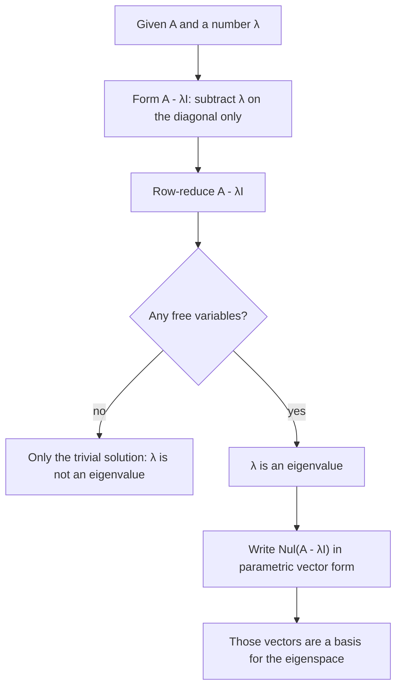

## Directions a matrix doesn't turn

Most vectors change direction when you multiply them by a matrix. But many matrices have a
few special directions that they only stretch, shrink or flip. Along those directions the
matrix acts like plain multiplication by a number, which makes repeated multiplication,
long-term behavior and many applications (population models, Markov chains, vibrations,
Google's PageRank, principal component analysis) easy to understand. These directions are
the eigenvectors, and the stretch factors are the eigenvalues.

## Definitions

Let $A$ be an $n \times n$ matrix. An **eigenvector** of $A$ is a *nonzero* vector
$\mathbf{x}$ with

$$A\mathbf{x} = \lambda\mathbf{x}$$

for some scalar $\lambda$. A scalar $\lambda$ is an **eigenvalue** of $A$ if this equation has a
nontrivial solution $\mathbf{x}$; then $\mathbf{x}$ is called an eigenvector *corresponding to*
$\lambda$. (The zero vector is excluded because $A\mathbf{0} = \lambda\mathbf{0}$ for every
$\lambda$, which would make every number an eigenvalue. The eigen*value* $\lambda = 0$, on the
other hand, is allowed.)

### Example 1

Let $A = \begin{bmatrix} 4 & -2 \\ 1 & 1\end{bmatrix}$, $\mathbf{u} = (1, 1)$, $\mathbf{v} = (2, 1)$, $\mathbf{w} = (1, 0)$. Which are eigenvectors?

1. $A\mathbf{u} = (4 - 2, 1 + 1) = (2, 2) = 2\mathbf{u}$. Eigenvector, eigenvalue 2.
2. $A\mathbf{v} = (8 - 2, 2 + 1) = (6, 3) = 3\mathbf{v}$. Eigenvector, eigenvalue 3.
3. $A\mathbf{w} = (4, 1)$, which is not a multiple of $(1, 0)$. Not an eigenvector.

```plot
{"x": [-1, 7], "y": [-1, 4], "equal": true, "segments": [{"from": [0, 0], "to": [2, 2], "arrow": true, "dashed": true, "label": "Au = 2u"}, {"from": [0, 0], "to": [1, 1], "arrow": true, "label": "u"}, {"from": [0, 0], "to": [6, 3], "arrow": true, "dashed": true, "label": "Av = 3v"}, {"from": [0, 0], "to": [2, 1], "arrow": true, "label": "v"}, {"from": [0, 0], "to": [1, 0], "arrow": true, "label": "w"}, {"from": [0, 0], "to": [4, 1], "arrow": true, "dashed": true, "label": "Aw"}], "caption": "u and v stay on their own lines; w is turned"}
```

Checking a proposed eigenvector is just one multiplication. Checking a proposed eigenvalue
takes a little more thought.

## Testing an eigenvalue and finding its eigenvectors

$A\mathbf{x} = \lambda\mathbf{x}$ is the same as $A\mathbf{x} - \lambda I\mathbf{x} = \mathbf{0}$, i.e.

$$(A - \lambda I)\mathbf{x} = \mathbf{0}.$$

So $\lambda$ is an eigenvalue exactly when this homogeneous system has a nontrivial solution,
which happens exactly when $A - \lambda I$ is *not* invertible. The set of all solutions,
$\operatorname{Nul}(A - \lambda I)$, is a subspace: the **eigenspace** of $A$ for $\lambda$. It
contains $\mathbf{0}$ and all eigenvectors for $\lambda$. To find a basis, row-reduce
$A - \lambda I$ and write the null space in parametric vector form.

### Example 2

Show that 2 is an eigenvalue of $B = \begin{bmatrix} 3 & 1 & 1 \\ 1 & 3 & 1 \\ 1 & 1 & 3\end{bmatrix}$ and find a basis for its eigenspace.

1. Subtract $2I$: $B - 2I = \begin{bmatrix} 1 & 1 & 1 \\ 1 & 1 & 1 \\ 1 & 1 & 1\end{bmatrix}$.
2. Row-reduce: rows 2 and 3 become zero, leaving $[\,1 \;\; 1 \;\; 1\,]$. Two free variables, so nontrivial solutions exist: 2 is an eigenvalue.
3. $x_1 = -x_2 - x_3$: $\mathbf{x} = x_2(-1, 1, 0) + x_3(-1, 0, 1)$.
4. Basis for the eigenspace: $\{(-1, 1, 0), (-1, 0, 1)\}$. It's a plane: $B$ doubles every vector in it.
5. Check: $B(-1, 1, 0) = (-3 + 1,\ -1 + 3,\ -1 + 1) = (-2, 2, 0)$. ✓

(The vector $(1, 1, 1)$ is another eigenvector: $B(1, 1, 1) = (5, 5, 5)$, eigenvalue 5.)

The flowchart sums up the test and the eigenspace computation:



## Useful facts

- *Triangular matrices.* The eigenvalues of a triangular matrix are its diagonal entries. If $A$ is upper triangular, $A - \lambda I$ is too, and it's singular exactly when some diagonal entry $a_{ii} - \lambda$ is 0.
- *Zero as an eigenvalue.* $0$ is an eigenvalue of $A$ exactly when $A\mathbf{x} = \mathbf{0}$ has a nontrivial solution, i.e. when $A$ is not invertible. So "0 is not an eigenvalue of $A$" joins the invertible matrix theorem.
- *Independence.* Eigenvectors that correspond to distinct eigenvalues are linearly independent. (If one were a combination of earlier ones, applying $A$ and subtracting $\lambda$ times the relation gives a shorter relation; repeating leads to a contradiction.) In particular an $n \times n$ matrix has at most $n$ distinct eigenvalues.
- *Powers.* If $A\mathbf{x} = \lambda\mathbf{x}$ then $A^2\mathbf{x} = A(\lambda\mathbf{x}) = \lambda^2\mathbf{x}$, and in general $A^k\mathbf{x} = \lambda^k\mathbf{x}$. This is why eigenvectors make repeated multiplication easy.

## Do eigenvalues survive row reduction?

No. Row operations change eigenvalues: $\begin{bmatrix} 1 & 2 \\ 3 & 4\end{bmatrix}$ and its echelon
form $\begin{bmatrix} 1 & 2 \\ 0 & -2\end{bmatrix}$ have different eigenvalues (the second has
eigenvalues 1 and $-2$; the first doesn't). Eigenvalues are about how $A$ acts on vectors,
which row operations don't preserve. You may row-reduce $A - \lambda I$ to find eigenvectors,
but never row-reduce $A$ to find eigenvalues.

## Seeing eigenvectors geometrically

For transformations you can picture, eigenvectors can often be found without any algebra:
look for lines through the origin that the transformation maps to themselves.

### Example 3

Find the eigenvalues and eigenvectors of the reflection across the line $x_2 = x_1$, with matrix $\begin{bmatrix} 0 & 1 \\ 1 & 0\end{bmatrix}$.

1. Vectors *on* the mirror line don't move: $(1, 1) \mapsto (1, 1)$. So $(1, 1)$ is an eigenvector with eigenvalue 1.
2. Vectors *perpendicular* to the mirror flip: $(1, -1) \mapsto (-1, 1) = -1\cdot(1, -1)$. Eigenvalue $-1$.
3. Every other vector changes direction, so these two lines are the only eigenspaces.

The picture shows all three kinds of vector. The solid arrows are vectors and the dashed arrows are their images under the reflection $T$.


The same reasoning shows that a projection onto a line has eigenvalue 1 (vectors on the line) and 0 (vectors perpendicular to it), and that a rotation by an angle other than $0^\circ$ or $180^\circ$ has no real eigenvectors at all.

## Common mistakes

- *Calling $\mathbf{0}$ an eigenvector.* Eigenvectors must be nonzero (but $\lambda = 0$ is a fine eigenvalue).
- *Solving $(A - \lambda)\mathbf{x} = \mathbf{0}$.* Subtract $\lambda$ only on the diagonal: $A - \lambda I$.
- *Reading eigenvalues off the diagonal of a non-triangular matrix.*
- *Row-reducing $A$ first.* That changes the eigenvalues.
- *Forgetting that an eigenspace contains infinitely many eigenvectors.* Any nonzero multiple of an eigenvector is also one.

## Key points

- $A\mathbf{x} = \lambda\mathbf{x}$ with $\mathbf{x} \ne \mathbf{0}$: $\mathbf{x}$ is an eigenvector, $\lambda$ its eigenvalue.
- $\lambda$ is an eigenvalue ⟺ $(A - \lambda I)\mathbf{x} = \mathbf{0}$ has a nontrivial solution ⟺ $A - \lambda I$ is singular.
- The eigenspace for $\lambda$ is $\operatorname{Nul}(A - \lambda I)$.
- Triangular matrices have their eigenvalues on the diagonal; $0$ is an eigenvalue ⟺ $A$ is singular.
- Eigenvectors for distinct eigenvalues are independent, and $A^k\mathbf{x} = \lambda^k\mathbf{x}$.
