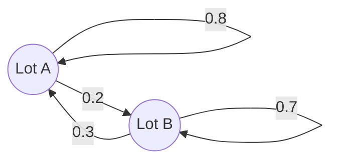

## Systems that step forward in time

Many processes update a state vector by the same rule at every step: populations from one
year to the next, market shares from one month to the next, rental cars moving between
locations each day. When the rule is linear, the state evolves by $\mathbf{x}_{k+1} = A\mathbf{x}_k$,
and eigenvalues and eigenvectors predict the long-run behavior without computing hundreds of
steps. Markov chains are the most important special case. (The next lesson treats quantities
that change continuously in time, $\mathbf{x}' = A\mathbf{x}$.)

## Discrete dynamical systems

A **discrete dynamical system** is a sequence of vectors with $\mathbf{x}_{k+1} = A\mathbf{x}_k$
for $k = 0, 1, 2, \dots$, starting from an initial state $\mathbf{x}_0$. Then
$\mathbf{x}_k = A^k\mathbf{x}_0$.

Suppose $A$ is $n \times n$ with an eigenvector basis $\mathbf{v}_1, \dots, \mathbf{v}_n$ and
eigenvalues $\lambda_1, \dots, \lambda_n$. Write $\mathbf{x}_0 = c_1\mathbf{v}_1 + \cdots + c_n\mathbf{v}_n$.
Because $A^k\mathbf{v}_i = \lambda_i^k\mathbf{v}_i$,

$$\mathbf{x}_k = c_1\lambda_1^k\mathbf{v}_1 + c_2\lambda_2^k\mathbf{v}_2 + \cdots + c_n\lambda_n^k\mathbf{v}_n.$$

Each eigen-direction grows or decays on its own. Terms with $|\lambda_i| < 1$ fade away;
terms with $|\lambda_i| > 1$ grow; the term with the largest $|\lambda_i|$ eventually dominates,
so (if its weight $c_i \neq 0$) $\mathbf{x}_k$ lines up with that eigenvector and grows by a
factor of about $\lambda_i$ per step.

For $2 \times 2$ systems the origin is classified by the eigenvalues:

| Eigenvalues | Name | Behavior |
|---|---|---|
| both $\lvert\lambda\rvert < 1$ | **attractor** | every trajectory tends to $\mathbf{0}$ |
| both $\lvert\lambda\rvert > 1$ | **repeller** | trajectories move away from $\mathbf{0}$ |
| one $\lvert\lambda\rvert > 1$, one $\lvert\lambda\rvert < 1$ | **saddle point** | attracted along one direction, repelled along the other |

The pictures show typical trajectories of each kind, with diagonal matrices so that the eigenvectors lie along the axes. Each dot is one step.


### Example 1

Let $A = \begin{bmatrix} 0.85 & 0.25 \\ 0.25 & 0.85\end{bmatrix}$ and $\mathbf{x}_0 = (3, 1)$. Describe $\mathbf{x}_k$.

1. Eigenvectors: $A(1, 1) = (1.1, 1.1)$, so $\lambda_1 = 1.1$ with $\mathbf{v}_1 = (1, 1)$; $A(1, -1) = (0.6, -0.6)$, so $\lambda_2 = 0.6$ with $\mathbf{v}_2 = (1, -1)$.
2. Decompose: $(3, 1) = 2(1, 1) + 1(1, -1)$.
3. So $\mathbf{x}_k = 2(1.1)^k(1, 1) + (0.6)^k(1, -1)$.
4. As $k$ grows, $(0.6)^k \to 0$, so $\mathbf{x}_k \approx 2(1.1)^k(1, 1)$: the two components become equal and grow 10% per step. The origin is a saddle point.

```plot
{"x": [-1, 8], "y": [-1, 8], "equal": true, "functions": [{"f": "x", "dashed": true, "label": "eigenvector line (λ = 1.1)"}], "points": [{"at": [3, 1], "label": "x₀"}, {"at": [2.8, 1.6]}, {"at": [2.78, 2.06]}, {"at": [2.88, 2.45]}, {"at": [3.06, 2.8]}, {"at": [3.3, 3.14]}, {"at": [3.59, 3.5]}, {"at": [3.93, 3.87]}, {"at": [4.3, 4.27]}, {"at": [4.73, 4.71]}, {"at": [5.19, 5.18]}], "caption": "The trajectory from x₀ = (3, 1) bends onto the line of the dominant eigenvector"}
```

## Markov chains

A **probability vector** has nonnegative entries that add up to 1. A **stochastic matrix** is a
square matrix whose columns are probability vectors. A **Markov chain** is a dynamical system
$\mathbf{x}_{k+1} = P\mathbf{x}_k$ with $P$ stochastic and $\mathbf{x}_0$ a probability vector;
each $\mathbf{x}_k$, called a **state vector**, is then also a probability vector. Entry $p_{ij}$
is the probability of moving *to* state $i$ *from* state $j$ in one step.

### Example 2

A rental company has two lots, A and B. Each day, 80% of the cars at A stay at A and 20% are
returned to B; 30% of the cars at B end up at A and 70% stay at B. Today half the fleet is at
each lot. Find the distribution tomorrow and the day after.

1. Columns are "from", rows are "to": $P = \begin{bmatrix} 0.8 & 0.3 \\ 0.2 & 0.7\end{bmatrix}$. Each column sums to 1.
2. $\mathbf{x}_1 = P\mathbf{x}_0 = \begin{bmatrix} 0.8(0.5) + 0.3(0.5) \\ 0.2(0.5) + 0.7(0.5)\end{bmatrix} = \begin{bmatrix} 0.55 \\ 0.45\end{bmatrix}$.
3. $\mathbf{x}_2 = P\mathbf{x}_1 = \begin{bmatrix} 0.44 + 0.135 \\ 0.11 + 0.315\end{bmatrix} = \begin{bmatrix} 0.575 \\ 0.425\end{bmatrix}$.

A transition diagram shows the numbers of $P$: an arrow for each move, labeled with its probability. The arrows leaving each lot add up to 1.



## Steady states

A **steady-state vector** (or equilibrium) of a stochastic matrix $P$ is a probability vector
$\mathbf{q}$ with $P\mathbf{q} = \mathbf{q}$: an eigenvector for eigenvalue 1, scaled so its entries
add to 1. Every stochastic matrix has eigenvalue 1 (the rows of $P - I$ add to the zero row, so
$P - I$ is singular). A stochastic matrix is **regular** if some power $P^k$ has all entries
strictly positive.

> *Theorem.* If $P$ is a regular stochastic matrix, it has a unique steady-state vector $\mathbf{q}$, and for every initial probability vector, $\mathbf{x}_k \to \mathbf{q}$.

To find $\mathbf{q}$: solve $(P - I)\mathbf{x} = \mathbf{0}$, then divide by the sum of the entries.

### Example 3

Find the steady state for the rental cars.

1. $P - I = \begin{bmatrix} -0.2 & 0.3 \\ 0.2 & -0.3\end{bmatrix}$. Row 2 is $-1$ times row 1, so $-0.2x_1 + 0.3x_2 = 0$: $x_1 = 1.5x_2$.
2. Take $x_2 = 2$: $(3, 2)$. Divide by $3 + 2 = 5$: $\mathbf{q} = (0.6, 0.4)$.
3. Check: $P\mathbf{q} = (0.48 + 0.12,\ 0.12 + 0.28) = (0.6, 0.4)$. ✓

In the long run 60% of the cars are at lot A, whatever the starting split. The other
eigenvalue of $P$ is $0.5$ (from $\operatorname{tr} P = 1.5 = 1 + 0.5$), so the distance to the
steady state halves each day: $0.5 \to 0.55 \to 0.575 \to \cdots \to 0.6$.

## Common mistakes

- *Rows vs columns.* In this convention the *columns* of a stochastic matrix sum to 1, and $p_{ij}$ is the chance of going from $j$ to $i$.
- *Forgetting to normalize* the eigenvector for $\lambda = 1$ into a probability vector.
- *Assuming every trajectory follows the dominant eigenvector.* If $\mathbf{x}_0$ has zero weight on it, it never appears.
- *Calling a system with eigenvalues 1.2 and 0.5 an attractor.* One eigenvalue bigger than 1 in absolute value makes the origin a saddle.

## Key points

- $\mathbf{x}_k = A^k\mathbf{x}_0 = \sum c_i\lambda_i^k\mathbf{v}_i$ when $\mathbf{x}_0 = \sum c_i\mathbf{v}_i$ in an eigenvector basis.
- The largest $|\lambda|$ dominates in the long run; $|\lambda| < 1$ terms die out. Attractor, repeller and saddle describe $2 \times 2$ cases.
- A stochastic matrix has probability-vector columns; a Markov chain is $\mathbf{x}_{k+1} = P\mathbf{x}_k$.
- A steady state solves $P\mathbf{q} = \mathbf{q}$ with entries summing to 1; for regular $P$ every chain converges to it.
