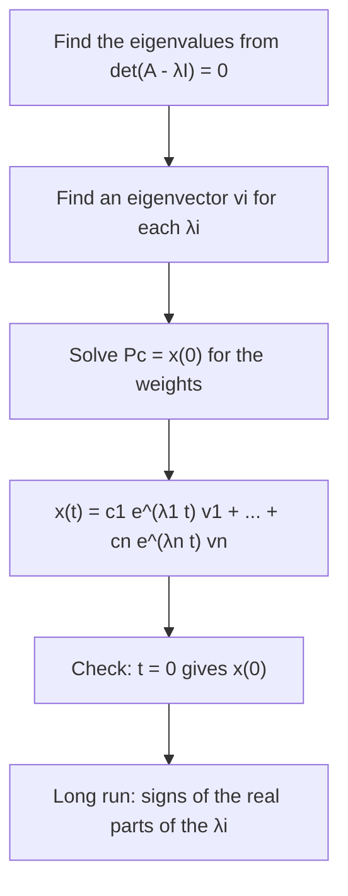

## From steps to continuous time

The last lesson followed a state vector that jumps forward one step at a time,
$\mathbf{x}_{k+1} = A\mathbf{x}_k$. Many quantities change continuously instead: the temperatures
of connected rooms, the amounts of a drug in blood and tissue, the currents in a circuit, the
positions and velocities of masses joined by springs. When each rate of change is a linear
combination of the current values, the model is

$$\mathbf{x}'(t) = A\mathbf{x}(t),$$

a **system of linear differential equations**. Here $\mathbf{x}(t)$ is a vector of functions, the
prime means the derivative of every entry, and $A$ is a constant $n \times n$ matrix. Eigenvalues
and eigenvectors solve it in almost the same way they solved the discrete system; the only change
is that $\lambda^k$ becomes $e^{\lambda t}$. This lesson uses one fact from calculus: the
derivative of $e^{\lambda t}$ is $\lambda e^{\lambda t}$.

## Eigenvector solutions

For one equation, $x' = ax$ has the solutions $x(t) = ce^{at}$. For a system, try a solution that
keeps a fixed direction and changes only in size: $\mathbf{x}(t) = e^{\lambda t}\mathbf{v}$. Its
derivative is $\lambda e^{\lambda t}\mathbf{v}$, and $A\mathbf{x}(t) = e^{\lambda t}A\mathbf{v}$. These
agree for every $t$ exactly when $A\mathbf{v} = \lambda\mathbf{v}$:

> If $A\mathbf{v} = \lambda\mathbf{v}$, then $\mathbf{x}(t) = e^{\lambda t}\mathbf{v}$ solves $\mathbf{x}' = A\mathbf{x}$.

The system is linear, so sums and scalar multiples of solutions are again solutions. If $A$ has
an eigenvector basis $\mathbf{v}_1, \dots, \mathbf{v}_n$ with eigenvalues $\lambda_1, \dots, \lambda_n$,
every solution has the form

$$\mathbf{x}(t) = c_1e^{\lambda_1t}\mathbf{v}_1 + c_2e^{\lambda_2t}\mathbf{v}_2 + \cdots + c_ne^{\lambda_nt}\mathbf{v}_n.$$

At $t = 0$ every exponential equals 1, so the weights come from the initial state:
$c_1\mathbf{v}_1 + \cdots + c_n\mathbf{v}_n = \mathbf{x}(0)$, that is, $P\mathbf{c} = \mathbf{x}(0)$ with
$P = [\,\mathbf{v}_1 \;\cdots\; \mathbf{v}_n\,]$.

The steps, in order:



### Example 1

Solve $\mathbf{x}' = A\mathbf{x}$ with $A = \begin{bmatrix} 1 & 2 \\ 3 & 2\end{bmatrix}$ and $\mathbf{x}(0) = (3, 2)$.

1. Eigenvalues: $\operatorname{tr} A = 3$ and $\det A = -4$, so $\lambda^2 - 3\lambda - 4 = (\lambda - 4)(\lambda + 1) = 0$, giving $\lambda = 4$ and $\lambda = -1$.
2. Eigenvectors: $A - 4I = \begin{bmatrix} -3 & 2 \\ 3 & -2\end{bmatrix}$ gives $\mathbf{v}_1 = (2, 3)$; $A + I = \begin{bmatrix} 2 & 2 \\ 3 & 3\end{bmatrix}$ gives $\mathbf{v}_2 = (1, -1)$.
3. Weights: $c_1(2, 3) + c_2(1, -1) = (3, 2)$ means $2c_1 + c_2 = 3$ and $3c_1 - c_2 = 2$. Adding, $5c_1 = 5$, so $c_1 = 1$ and $c_2 = 1$.
4. Solution: $\mathbf{x}(t) = e^{4t}\begin{bmatrix} 2 \\ 3\end{bmatrix} + e^{-t}\begin{bmatrix} 1 \\ -1\end{bmatrix}$.
5. Check: at $t = 0$ this is $(2 + 1, 3 - 1) = (3, 2)$. ✓ For large $t$ the $e^{-t}$ term dies away and $\mathbf{x}(t)$ runs off along the line through $(2, 3)$.

```plot
{"x": [-5, 5], "y": [-5, 5], "equal": true, "vectorField": {"u": "x + 2*y", "v": "3*x + 2*y", "step": 1}, "functions": [{"f": "1.5*x", "dashed": true, "label": "λ = 4"}, {"f": "-x", "dashed": true, "label": "λ = -1"}], "curves": [{"x": "2*exp(4*t) + exp(-t)", "y": "3*exp(4*t) - exp(-t)", "t": [-1.4, 0.2]}], "points": [{"at": [3, 2], "label": "x(0)"}], "caption": "A saddle: the solution comes in along the λ = -1 line and leaves along the λ = 4 line"}
```

## Decoupling

Why does this work? Change variables to eigenvector coordinates, $\mathbf{x} = P\mathbf{y}$. Then
$P\mathbf{y}' = AP\mathbf{y}$, so

$$\mathbf{y}' = P^{-1}AP\,\mathbf{y} = D\mathbf{y}, \qquad\text{i.e.}\qquad y_1' = \lambda_1y_1,\ \dots,\ y_n' = \lambda_ny_n.$$

In the original variables every rate depends on every other variable; in the new ones each
equation involves a single unknown. The system is **decoupled** into $n$ separate one-variable
equations, solved by $y_i = c_ie^{\lambda_it}$. Multiplying back by $P$ gives the general solution
above. This is the same idea as diagonalization, now applied to rates of change.

### Example 2

Two rooms share a wall. Let $x_1$ and $x_2$ be how many degrees each room is above the outdoor
temperature, with $t$ in hours. Each room loses heat outdoors at rate $2x_i$ and gains heat from
the other room at rate $x_j - x_i$, so $x_1' = -3x_1 + x_2$ and $x_2' = x_1 - 3x_2$. Room 1
starts $4^\circ$ above outside and room 2 at the outdoor temperature. Find $\mathbf{x}(t)$.

1. $A = \begin{bmatrix} -3 & 1 \\ 1 & -3\end{bmatrix}$. $A(1, 1) = (-2, -2)$ and $A(1, -1) = (-4, 4)$, so $\lambda_1 = -2$ with $\mathbf{v}_1 = (1, 1)$ and $\lambda_2 = -4$ with $\mathbf{v}_2 = (1, -1)$.
2. Weights: $c_1(1, 1) + c_2(1, -1) = (4, 0)$ gives $c_1 = c_2 = 2$.
3. $\mathbf{x}(t) = 2e^{-2t}(1, 1) + 2e^{-4t}(1, -1)$, so $x_1 = 2e^{-2t} + 2e^{-4t}$ and $x_2 = 2e^{-2t} - 2e^{-4t}$.
4. Read the decoupled pieces: the average $\tfrac12(x_1 + x_2) = 2e^{-2t}$ decays at rate 2 (heat leaving the house), and the difference $x_1 - x_2 = 4e^{-4t}$ decays faster, at rate 4 (the rooms evening out).
5. Room 2 warms at first, then cools: $x_2' = -4e^{-2t} + 8e^{-4t} = 0$ when $e^{-2t} = \tfrac12$, at $t = \tfrac12\ln 2 \approx 0.35$ hours, where $x_2 = 1 - 0.5 = 0.5^\circ$.

```plot
{"x": [0, 2.5], "y": [0, 4.2], "xLabel": "t (hours)", "yLabel": "degrees above outside", "functions": [{"f": "2*exp(-2*x) + 2*exp(-4*x)", "color": "#2c5e8f"}, {"f": "2*exp(-2*x) - 2*exp(-4*x)", "dashed": true, "color": "#c2570c"}], "points": [{"at": [0.347, 0.5], "label": "peak"}], "labels": [{"at": [0.45, 2.3], "text": "room 1: x₁(t)"}, {"at": [1.1, 0.95], "text": "room 2: x₂(t), dashed"}], "caption": "Both rooms approach the outdoor temperature; room 2 first warms, then cools"}
```

## The matrix exponential

For one equation the solution is $x(t) = e^{at}x(0)$. The same formula works for systems once
$e^{At}$ is defined, using the power series of $e^x$:

$$e^{At} = I + At + \frac{(At)^2}{2!} + \frac{(At)^3}{3!} + \cdots$$

This **matrix exponential** always converges. Differentiating term by term gives
$\frac{d}{dt}e^{At} = A + A^2t + \frac{A^3t^2}{2!} + \cdots = Ae^{At}$, and $e^{A\cdot0} = I$, so

> $\mathbf{x}(t) = e^{At}\mathbf{x}(0)$ is the solution of $\mathbf{x}' = A\mathbf{x}$ with initial state $\mathbf{x}(0)$.

You never sum the series by hand for a diagonalizable matrix. Since $A^k = PD^kP^{-1}$, every term
has the form $P(\cdots)P^{-1}$, and the diagonal series sums entry by entry:

$$e^{At} = Pe^{Dt}P^{-1}, \qquad e^{Dt} = \begin{bmatrix} e^{\lambda_1t} & & \\ & \ddots & \\ & & e^{\lambda_nt}\end{bmatrix}.$$

### Example 3

Find $e^{At}$ for the rooms matrix $A = \begin{bmatrix} -3 & 1 \\ 1 & -3\end{bmatrix}$.

1. From Example 2, $P = \begin{bmatrix} 1 & 1 \\ 1 & -1\end{bmatrix}$ and $D = \operatorname{diag}(-2, -4)$. Then $P^{-1} = \tfrac12\begin{bmatrix} 1 & 1 \\ 1 & -1\end{bmatrix}$.
2. $Pe^{Dt} = \begin{bmatrix} e^{-2t} & e^{-4t} \\ e^{-2t} & -e^{-4t}\end{bmatrix}$.
3. $e^{At} = \dfrac12\begin{bmatrix} e^{-2t} + e^{-4t} & e^{-2t} - e^{-4t} \\ e^{-2t} - e^{-4t} & e^{-2t} + e^{-4t}\end{bmatrix}$.
4. Check: at $t = 0$ this is $I$. ✓ And $e^{At}(4, 0)$ is 4 times the first column, $(2e^{-2t} + 2e^{-4t},\ 2e^{-2t} - 2e^{-4t})$, matching Example 2.

Two cautions. First, $e^{At}$ is *not* the matrix of exponentials of the entries: in Example 3
the entries of $At$ are $-3t$ and $t$, and nothing like $e^{-3t}$ appears. Second, the series
also handles matrices that can't be diagonalized. For $N = \begin{bmatrix} 0 & 1 \\ 0 & 0\end{bmatrix}$,
$N^2 = 0$, so the series stops: $e^{Nt} = I + Nt = \begin{bmatrix} 1 & t \\ 0 & 1\end{bmatrix}$.
For $\begin{bmatrix} \lambda & 1 \\ 0 & \lambda\end{bmatrix} = \lambda I + N$, the result is
$e^{\lambda t}\begin{bmatrix} 1 & t \\ 0 & 1\end{bmatrix}$, so a missing eigenvector shows up as a
factor $t$. (The rule $e^{X + Y} = e^Xe^Y$ used here needs $XY = YX$, which holds because
$\lambda I$ commutes with everything.)

## Complex eigenvalues: spirals

For the rotation–scaling matrix $C = \begin{bmatrix} a & -b \\ b & a\end{bmatrix}$ (eigenvalues
$a \pm bi$), the series gives

$$e^{Ct} = e^{at}\begin{bmatrix} \cos bt & -\sin bt \\ \sin bt & \cos bt\end{bmatrix}.$$

Every solution turns through the angle $bt$ (counterclockwise when $b > 0$) while its length is
multiplied by $e^{at}$: it spirals in if $a < 0$, spirals out if $a > 0$, and goes around a
closed loop if $a = 0$. A general real $2 \times 2$ matrix with eigenvalues $a \pm bi$ is
$PCP^{-1}$, so its solutions are the same spirals viewed through the change of coordinates $P$.

```plot
{"x": [-4.5, 4.5], "y": [-4, 4], "equal": true, "vectorField": {"u": "-x - 2*y", "v": "2*x - y", "step": 1}, "curves": [{"x": "4*exp(-t)*cos(2*t)", "y": "4*exp(-t)*sin(2*t)", "t": [0, 6]}], "points": [{"at": [4, 0], "label": "x(0)"}], "caption": "x′ = Cx with a = -1, b = 2: eigenvalues -1 ± 2i, a spiral sink"}
```

## Stability

Each term $c_ie^{\lambda_it}\mathbf{v}_i$ decays when $\lambda_i < 0$ and grows when $\lambda_i > 0$,
and for complex $\lambda = a \pm bi$ the size is controlled by $e^{at}$. So the test is the *sign
of the real part*, not the size of $|\lambda|$:

> The origin is **asymptotically stable** (every solution tends to $\mathbf{0}$) exactly when every eigenvalue of $A$ has negative real part.

For $2 \times 2$ systems:

| Eigenvalues of $A$ | Origin | Solutions |
|---|---|---|
| real, both negative | **sink** (attractor) | approach $\mathbf{0}$ |
| real, both positive | **source** (repeller) | move away from $\mathbf{0}$ |
| real, opposite signs | saddle point | in along one eigenvector, out along the other |
| $a \pm bi$ with $a < 0$ | spiral sink | spiral in |
| $a \pm bi$ with $a > 0$ | spiral source | spiral out |
| $\pm bi$ (real part 0) | **center** | closed loops around $\mathbf{0}$ |

Because $\operatorname{tr} A = \lambda_1 + \lambda_2$ and $\det A = \lambda_1\lambda_2$ (complex
eigenvalues included), a $2 \times 2$ system is asymptotically stable exactly when
$\operatorname{tr} A < 0$ and $\det A > 0$. Example 1 ($\det A = -4$) is a saddle; Example 2
($\operatorname{tr} = -6$, $\det = 8$) is a sink.

The trace–determinant plane collects the whole table in one picture. The parabola $\det A = (\operatorname{tr} A)^2/4$ is where the discriminant $(\operatorname{tr} A)^2 - 4\det A$ is zero: above it the eigenvalues are complex (spirals and centers), below it they are real. Points exactly on the parabola or on the horizontal axis are borderline cases (a repeated eigenvalue, or an eigenvalue 0) not covered by the table.


The discrete and continuous tests fit together. Sampling a solution once per time unit gives
$\mathbf{x}(k + 1) = e^{A}\mathbf{x}(k)$, a discrete system whose matrix $e^A$ has eigenvalues
$e^{\lambda}$. Since $|e^{\lambda}| = e^{\operatorname{Re}\lambda}$, the condition $|e^{\lambda}| < 1$
is the same as $\operatorname{Re}\lambda < 0$.

## Common mistakes

- *Using the discrete test.* For $\mathbf{x}' = A\mathbf{x}$, eigenvalues $0.5$ and $0.8$ give a source, not an attractor: $e^{0.8t}$ grows. Look at the sign of the real part, not whether $|\lambda| < 1$.
- *Exponentiating entries.* $e^{At}$ is $Pe^{Dt}P^{-1}$ (or the series), never the matrix of $e^{a_{ij}t}$. Even for a diagonal matrix only the diagonal entries are exponentiated; the zeros stay 0.
- *Using $\mathbf{x}(0)$ as the weights.* The weights solve $P\mathbf{c} = \mathbf{x}(0)$; they equal the entries of $\mathbf{x}(0)$ only when the eigenvectors are the standard basis.
- *Pairing a weight with the wrong exponential.* $c_i$ and $e^{\lambda_it}$ go with the eigenvector $\mathbf{v}_i$ for that same $\lambda_i$.

## Key points

- If $A\mathbf{v} = \lambda\mathbf{v}$, then $e^{\lambda t}\mathbf{v}$ solves $\mathbf{x}' = A\mathbf{x}$; with an eigenvector basis, $\mathbf{x}(t) = \sum c_ie^{\lambda_it}\mathbf{v}_i$ where $P\mathbf{c} = \mathbf{x}(0)$.
- The substitution $\mathbf{x} = P\mathbf{y}$ decouples the system into $y_i' = \lambda_iy_i$.
- $\mathbf{x}(t) = e^{At}\mathbf{x}(0)$, with $e^{At} = \sum (At)^k/k!$; for diagonalizable $A$, $e^{At} = Pe^{Dt}P^{-1}$.
- Asymptotically stable ⟺ every eigenvalue has negative real part ($2 \times 2$: $\operatorname{tr} A < 0$ and $\det A > 0$). Complex eigenvalues $a \pm bi$ give spirals, and $a = 0$ gives a center.
