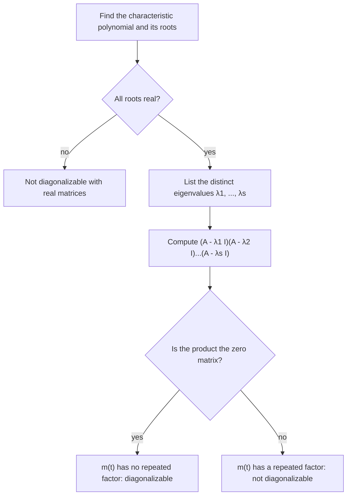

## A matrix satisfies its own characteristic equation

In the characteristic equation lesson, the characteristic polynomial $p(\lambda) = \det(A - \lambda I)$
was a tool for *finding* eigenvalues: plug in numbers, look for zeros. This lesson plugs in
something else: the matrix $A$ itself. The surprising result, the **Cayley–Hamilton theorem**, is
that the answer is always the zero matrix. It turns high powers of $A$ into low ones, gives a
formula for $A^{-1}$ without row reduction, and leads to the *minimal polynomial*, which
decides whether a matrix is diagonalizable without finding a single eigenvector.

## Polynomials in a matrix

If $q(t) = c_0 + c_1t + c_2t^2 + \cdots + c_mt^m$ is an ordinary polynomial and $A$ is square,
the **matrix polynomial** $q(A)$ is

$$q(A) = c_0I + c_1A + c_2A^2 + \cdots + c_mA^m.$$

The constant term becomes $c_0I$, not $c_0$: you can't add a number to a matrix. Two facts make
matrix polynomials easy to work with.

- *They factor like ordinary polynomials.* Powers of the same matrix commute, so if
  $q(t) = (t - 2)(t - 5)$ then $q(A) = (A - 2I)(A - 5I)$, in either order.
- *They act on eigenvectors by plugging in the eigenvalue.* If $A\mathbf{v} = \lambda\mathbf{v}$, then
  $A^k\mathbf{v} = \lambda^k\mathbf{v}$ for every $k$, so
  $$q(A)\mathbf{v} = q(\lambda)\mathbf{v}.$$
  So every eigenvector of $A$ is an eigenvector of $q(A)$, with eigenvalue $q(\lambda)$.

## The Cayley–Hamilton theorem

> *Cayley–Hamilton theorem.* If $p(\lambda) = \det(A - \lambda I)$ is the characteristic polynomial of an $n \times n$ matrix $A$, then $p(A) = 0$, the $n \times n$ zero matrix.

For a $2 \times 2$ matrix the characteristic polynomial is $\lambda^2 - (\operatorname{tr} A)\lambda + \det A$, so
the theorem says

$$A^2 - (\operatorname{tr} A)\,A + (\det A)\,I = 0.$$

You can check this directly for $A = \begin{bmatrix} a & b \\ c & d\end{bmatrix}$: the top-left entry of $A^2$ is
$a^2 + bc$, and $a^2 + bc - (a + d)a + (ad - bc) = 0$. The other three entries cancel the same way.

*Why it's true when $A$ is diagonalizable.* Write $A = PDP^{-1}$. Then $A^k = PD^kP^{-1}$ for every $k$,
so $p(A) = P\,p(D)\,P^{-1}$, and $p(D)$ is diagonal with entries $p(\lambda_1), \dots, p(\lambda_n)$. Each
$\lambda_i$ is a root of $p$, so $p(D) = 0$ and $p(A) = 0$. Equivalently: $p(A)$ sends every vector of an
eigenvector basis to $p(\lambda_i)\mathbf{v}_i = \mathbf{0}$, so it is the zero matrix.

*The general case (proof sketch).* Not every matrix is diagonalizable, so a different argument
is needed. Let $M(\lambda) = \operatorname{adj}(A - \lambda I)$, the adjugate. Its entries are cofactors of
$A - \lambda I$, polynomials of degree at most $n - 1$, so $M(\lambda) = B_0 + B_1\lambda + \cdots + B_{n-1}\lambda^{n-1}$
for some constant matrices $B_j$. The adjugate formula from the Cramer's rule lesson says
$(A - \lambda I)M(\lambda) = p(\lambda)I$ for every $\lambda$. Expanding the left side and matching the
coefficient of each power of $\lambda$ gives $n + 1$ matrix equations; multiplying the one for
$\lambda^j$ on the left by $A^j$ and adding them all, the left side telescopes to $0$ and the right
side is $p(A)$. (Filling in every step is a good exercise, but it isn't needed in this course.)

*A tempting wrong proof.* "Substitute $\lambda = A$: $p(A) = \det(A - AI) = \det 0 = 0$." This mixes
up two different things. $\det(A - \lambda I)$ is a *number* for each number $\lambda$; putting a
matrix inside the determinant this way gives the number $0$, while $p(A)$ is a *matrix* built from
powers of $A$. The real theorem says that matrix is zero, which is much more.

*History.* William Rowan Hamilton proved a special case in 1853, phrased in terms of quaternions.
Arthur Cayley stated the result in his 1858 memoir on matrices, checked it for $2 \times 2$ matrices,
said he had verified the $3 \times 3$ case, and saw no need for a general proof. Ferdinand Georg
Frobenius gave the first general proof in 1878.

### Example 1

Let $A = \begin{bmatrix} 3 & 1 \\ 2 & 4\end{bmatrix}$. Verify Cayley–Hamilton, then use it to find $A^{-1}$ and $A^3$.

1. $\operatorname{tr} A = 7$ and $\det A = 12 - 2 = 10$, so $p(\lambda) = \lambda^2 - 7\lambda + 10$ (eigenvalues 2 and 5).
2. $A^2 = \begin{bmatrix} 11 & 7 \\ 14 & 18\end{bmatrix}$, and $A^2 - 7A + 10I = \begin{bmatrix} 11 - 21 + 10 & 7 - 7 \\ 14 - 14 & 18 - 28 + 10\end{bmatrix} = \begin{bmatrix} 0 & 0 \\ 0 & 0\end{bmatrix}$. ✓
3. *Inverse.* Rewrite $A^2 - 7A = -10I$ as $A(7I - A) = 10I$. So $A^{-1} = \tfrac{1}{10}(7I - A) = \tfrac{1}{10}\begin{bmatrix} 4 & -1 \\ -2 & 3\end{bmatrix}$. (This is the familiar $2 \times 2$ inverse formula in disguise: $7I - A$ swaps the diagonal and negates the rest.)
4. *Cube.* $A^2 = 7A - 10I$, so $A^3 = A \cdot A^2 = 7A^2 - 10A = 7(7A - 10I) - 10A = 39A - 70I$.
5. $A^3 = 39\begin{bmatrix} 3 & 1 \\ 2 & 4\end{bmatrix} - 70I = \begin{bmatrix} 47 & 39 \\ 78 & 86\end{bmatrix}$. Multiplying $A^2$ by $A$ directly gives the same matrix. ✓

The pattern in step 4 works for any power: each time a power higher than $n - 1$ appears, the
theorem replaces it with lower powers. *Every power of an $n \times n$ matrix is a combination of
$I, A, \dots, A^{n-1}$.*

## High powers by remainders

That last fact can be made efficient. Divide $t^k$ by $p(t)$ (ordinary polynomial division):
$t^k = Q(t)p(t) + r(t)$, with a remainder $r$ of degree less than $n$. Replace $t$ by $A$: since
$p(A) = 0$, we get $A^k = r(A)$. To find $r$ without long division, plug in the eigenvalues:
$p(\lambda_i) = 0$, so $\lambda_i^k = r(\lambda_i)$. With $n$ distinct eigenvalues that is $n$ equations for
the $n$ coefficients of $r$.

### Example 2

$A = \begin{bmatrix} 4 & -2 \\ 1 & 1\end{bmatrix}$ has eigenvalues 2 and 3. Write $A^k = \alpha A + \beta I$ and find $A^{10}$.

1. The remainder $r(t) = \alpha t + \beta$ must agree with $t^k$ at both eigenvalues: $2\alpha + \beta = 2^k$ and $3\alpha + \beta = 3^k$.
2. Subtract: $\alpha = 3^k - 2^k$. Then $\beta = 2^k - 2\alpha = 3\cdot2^k - 2\cdot3^k$.
3. So $A^k = (3^k - 2^k)A + (3\cdot2^k - 2\cdot3^k)I$. The top-left entry is $4(3^k - 2^k) + 3\cdot2^k - 2\cdot3^k = 2\cdot3^k - 2^k$, matching the formula found by diagonalization in the Diagonalization lesson. ✓
4. For $k = 10$: $\alpha = 59049 - 1024 = 58025$ and $\beta = 3072 - 118098 = -115026$, so
   $A^{10} = 58025A - 115026I = \begin{bmatrix} 117074 & -116050 \\ 58025 & -57001\end{bmatrix}$.

No eigenvectors and no $P^{-1}$ were needed, only the eigenvalues.

## The minimal polynomial

The characteristic polynomial is one polynomial that sends $A$ to zero, but it may not be the
smallest. Call $q$ an **annihilating polynomial** of $A$ if $q(A) = 0$. A polynomial is *monic* if
its leading coefficient is 1. The **minimal polynomial** $m(t)$ of $A$ is the monic polynomial of
smallest degree with $m(A) = 0$. Three facts about it:

1. *It divides every annihilating polynomial.* Divide: $q = Qm + r$ with $\deg r < \deg m$. Then
   $r(A) = q(A) - Q(A)m(A) = 0$, and a nonzero $r$ would beat $m$'s degree, so $r = 0$.
   In particular $m$ divides the characteristic polynomial (Cayley–Hamilton), so $\deg m \le n$.
2. *Its roots are exactly the eigenvalues.* If $A\mathbf{v} = \lambda\mathbf{v}$ with $\mathbf{v} \ne \mathbf{0}$,
   then $\mathbf{0} = m(A)\mathbf{v} = m(\lambda)\mathbf{v}$, so $m(\lambda) = 0$. And every root of $m$ is a root
   of the characteristic polynomial, since $m$ divides it. Only the *multiplicities* can differ.
3. *It detects diagonalizability.*

> *Theorem.* A real square matrix $A$ is diagonalizable (with real $P$ and $D$) exactly when its minimal polynomial is a product of distinct real linear factors, $m(t) = (t - \lambda_1)(t - \lambda_2)\cdots(t - \lambda_s)$ with $\lambda_1, \dots, \lambda_s$ different.

One direction is short. If $A$ is diagonalizable with distinct eigenvalues $\lambda_1, \dots, \lambda_s$,
let $q(t) = (t - \lambda_1)\cdots(t - \lambda_s)$. For an eigenvector $\mathbf{v}$ with eigenvalue $\lambda_i$, the
factor $A - \lambda_iI$ sends it to $\mathbf{0}$ (the factors commute, so put that one last), so $q(A)$ kills
an entire eigenvector basis and $q(A) = 0$. Then $m$ divides $q$, and since every $\lambda_i$ must be a
root of $m$, $m = q$. The other direction (no repeated factor forces enough eigenvectors) takes
more machinery; we state it without proof.

So to test diagonalizability: list the distinct eigenvalues $\lambda_1, \dots, \lambda_s$ and compute the
single product $(A - \lambda_1I)\cdots(A - \lambda_sI)$. Zero means diagonalizable; nonzero means not.

### Example 3

Find the minimal polynomials of $B = \begin{bmatrix} 3 & 1 & 1 \\ 1 & 3 & 1 \\ 1 & 1 & 3\end{bmatrix}$ and $S = \begin{bmatrix} 2 & 1 & 0 \\ 0 & 2 & 0 \\ 0 & 0 & 5\end{bmatrix}$. Both have characteristic polynomial $-(\lambda - 2)^2(\lambda - 5)$.

1. The candidates are the monic divisors that contain every eigenvalue: $(t - 2)(t - 5)$ or $(t - 2)^2(t - 5)$.
2. For $B$: $B - 2I$ is the all-ones matrix $J$, and $B - 5I = J - 3I$. Since $J^2 = 3J$, $(B - 2I)(B - 5I) = J^2 - 3J = 0$. So $m_B(t) = (t - 2)(t - 5)$, and $B$ is diagonalizable, as the Diagonalization lesson found by counting eigenvectors.
3. For $S$: $(S - 2I)(S - 5I) = \begin{bmatrix} 0 & 1 & 0 \\ 0 & 0 & 0 \\ 0 & 0 & 3\end{bmatrix}\begin{bmatrix} -3 & 1 & 0 \\ 0 & -3 & 0 \\ 0 & 0 & 0\end{bmatrix} = \begin{bmatrix} 0 & -3 & 0 \\ 0 & 0 & 0 \\ 0 & 0 & 0\end{bmatrix} \ne 0$.
4. So $m_S(t) = (t - 2)^2(t - 5)$, the full characteristic polynomial up to sign. The repeated factor means $S$ is not diagonalizable: its eigenvalue 2 has only one independent eigenvector.

### Example 4

Use Cayley–Hamilton to find $B^{-1}$ for the matrix $B$ of Example 3.

1. For a $3 \times 3$ matrix, $\det(\lambda I - B) = \lambda^3 - (\operatorname{tr} B)\lambda^2 + c\lambda - \det B$, where $c$ is the sum of the three products of pairs of eigenvalues. With eigenvalues $2, 2, 5$: $\operatorname{tr} B = 9$, $c = 4 + 10 + 10 = 24$, $\det B = 20$.
2. Cayley–Hamilton: $B^3 - 9B^2 + 24B - 20I = 0$, so $B(B^2 - 9B + 24I) = 20I$ and $B^{-1} = \tfrac{1}{20}(B^2 - 9B + 24I)$.
3. $B^2$ has 11 on the diagonal and 7 elsewhere. Diagonal of $B^2 - 9B + 24I$: $11 - 27 + 24 = 8$; off-diagonal: $7 - 9 = -2$.
4. $B^{-1} = \tfrac{1}{20}\begin{bmatrix} 8 & -2 & -2 \\ -2 & 8 & -2 \\ -2 & -2 & 8\end{bmatrix}$. Check one entry of $BB^{-1}$: row 1 times column 1 is $\tfrac{1}{20}(24 - 2 - 2) = 1$. ✓

(The minimal polynomial gives an even shorter route here: $(B - 2I)(B - 5I) = 0$ means $B^2 - 7B + 10I = 0$, so $B^{-1} = \tfrac{1}{10}(7I - B)$, which is the same matrix.)

## Common mistakes

- *Writing the constant term as a number.* In $A^2 - 7A + 10I$ the last term is $10I$; "$A^2 - 7A + 10$" is meaningless.
- *The determinant "proof".* Substituting $\lambda = A$ inside $\det(A - \lambda I)$ proves nothing; the theorem is about the matrix $p(A)$.
- *Thinking $p(A) = 0$ makes $A$ zero.* It is a relation among the powers of $A$, not a statement about $A$ alone.
- *Dropping an eigenvalue from the minimal polynomial.* Every eigenvalue is a root of $m$; only multiplicities can shrink.
- *Assuming $m = p$ always.* For $B$ above, $m$ has degree 2 while $p$ has degree 3. For $I$, the minimal polynomial is $t - 1$.

## Key points

- For a polynomial $q$, $q(A) = c_0I + c_1A + \cdots$, and $q(A)\mathbf{v} = q(\lambda)\mathbf{v}$ for each eigenvector.
- Cayley–Hamilton: $p(A) = 0$. For $2 \times 2$: $A^2 - (\operatorname{tr} A)A + (\det A)I = 0$.
- Consequences: every power of $A$ is a combination of $I, \dots, A^{n-1}$; for invertible $2 \times 2$ $A$, $A^{-1} = \frac{1}{\det A}\big((\operatorname{tr} A)I - A\big)$; $A^k = r(A)$ where $r$ matches $t^k$ at the eigenvalues.
- The minimal polynomial is the monic annihilating polynomial of least degree; it divides $p$ and has the same roots.
- $A$ is diagonalizable ⟺ its minimal polynomial has only distinct real linear factors.
