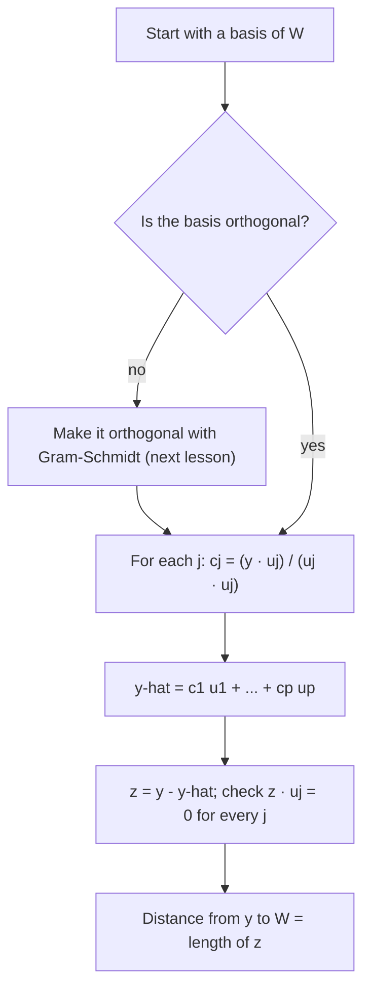

## Why perpendicular bases are so convenient

Finding coordinates in an arbitrary basis means solving a linear system. If the basis
vectors are mutually perpendicular, each coordinate comes from a single dot product, with no
system at all. Perpendicularity also gives us orthogonal projection: the closest point in a
subspace to a given vector. That "closest point" idea is the engine of least squares,
coming in two lessons.

## Orthogonal sets

A set $\{\mathbf{u}_1, \dots, \mathbf{u}_p\}$ is an **orthogonal set** if every pair of distinct
vectors in it is orthogonal: $\mathbf{u}_i\cdot\mathbf{u}_j = 0$ for $i \ne j$.

> *Theorem.* An orthogonal set of nonzero vectors is linearly independent.

Why: if $c_1\mathbf{u}_1 + \cdots + c_p\mathbf{u}_p = \mathbf{0}$, dot both sides with $\mathbf{u}_j$.
Every term but one vanishes, leaving $c_j(\mathbf{u}_j\cdot\mathbf{u}_j) = 0$, and
$\mathbf{u}_j\cdot\mathbf{u}_j > 0$, so $c_j = 0$.

An **orthogonal basis** for a subspace $W$ is a basis that is also an orthogonal set. The
same dot-product trick finds coordinates:

> *Theorem.* If $\{\mathbf{u}_1, \dots, \mathbf{u}_p\}$ is an orthogonal basis for $W$ and $\mathbf{y}$ is in $W$, then
> $$\mathbf{y} = c_1\mathbf{u}_1 + \cdots + c_p\mathbf{u}_p \quad\text{with}\quad c_j = \frac{\mathbf{y}\cdot\mathbf{u}_j}{\mathbf{u}_j\cdot\mathbf{u}_j}.$$

### Example 1

$\mathbf{u}_1 = (1, 1, 0)$, $\mathbf{u}_2 = (1, -1, 1)$, $\mathbf{u}_3 = (-1, 1, 2)$. Show this is an orthogonal basis of $\mathbb{R}^3$ and write $\mathbf{y} = (3, 1, 4)$ in it.

1. $\mathbf{u}_1\cdot\mathbf{u}_2 = 1 - 1 + 0 = 0$, $\mathbf{u}_1\cdot\mathbf{u}_3 = -1 + 1 + 0 = 0$, $\mathbf{u}_2\cdot\mathbf{u}_3 = -1 - 1 + 2 = 0$. Three nonzero orthogonal vectors are independent, hence a basis of $\mathbb{R}^3$.
2. $c_1 = \dfrac{3 + 1 + 0}{2} = 2$, $c_2 = \dfrac{3 - 1 + 4}{3} = 2$, $c_3 = \dfrac{-3 + 1 + 8}{6} = 1$.
3. So $\mathbf{y} = 2\mathbf{u}_1 + 2\mathbf{u}_2 + \mathbf{u}_3$. Check: $(2 + 2 - 1,\ 2 - 2 + 1,\ 0 + 2 + 2) = (3, 1, 4)$. ✓

## Projection onto a line

Given a nonzero $\mathbf{u}$ and any $\mathbf{y}$, we want to split $\mathbf{y} = \hat{\mathbf{y}} + \mathbf{z}$
with $\hat{\mathbf{y}}$ a multiple of $\mathbf{u}$ and $\mathbf{z}$ orthogonal to $\mathbf{u}$. Writing
$\hat{\mathbf{y}} = \alpha\mathbf{u}$ and requiring $(\mathbf{y} - \alpha\mathbf{u})\cdot\mathbf{u} = 0$ gives
$\alpha = \mathbf{y}\cdot\mathbf{u}/\mathbf{u}\cdot\mathbf{u}$. So the **orthogonal projection** of
$\mathbf{y}$ onto the line $L = \operatorname{Span}\{\mathbf{u}\}$ is

$$\hat{\mathbf{y}} = \operatorname{proj}_L\mathbf{y} = \frac{\mathbf{y}\cdot\mathbf{u}}{\mathbf{u}\cdot\mathbf{u}}\,\mathbf{u},$$

and $\mathbf{z} = \mathbf{y} - \hat{\mathbf{y}}$ is the component of $\mathbf{y}$ orthogonal to $\mathbf{u}$. The
distance from $\mathbf{y}$ to the line is $\|\mathbf{z}\|$.

### Example 2

Project $\mathbf{y} = (2, 6)$ onto the line through $\mathbf{u} = (3, 1)$, and find the distance from $\mathbf{y}$ to that line.

1. $\mathbf{y}\cdot\mathbf{u} = 6 + 6 = 12$ and $\mathbf{u}\cdot\mathbf{u} = 10$.
2. $\hat{\mathbf{y}} = \tfrac{12}{10}(3, 1) = (3.6, 1.2)$.
3. $\mathbf{z} = \mathbf{y} - \hat{\mathbf{y}} = (-1.6, 4.8)$. Check: $\mathbf{z}\cdot\mathbf{u} = -4.8 + 4.8 = 0$. ✓
4. Distance: $\|\mathbf{z}\| = \sqrt{2.56 + 23.04} = \sqrt{25.6} \approx 5.06$.

```plot
{"x": [-1, 5], "y": [-1, 7], "equal": true, "functions": [{"f": "x/3", "dashed": true, "label": "L"}], "segments": [{"from": [0, 0], "to": [2, 6], "arrow": true, "label": "y"}, {"from": [0, 0], "to": [3, 1], "arrow": true, "label": "u"}, {"from": [0, 0], "to": [3.6, 1.2], "arrow": true, "label": "ŷ"}, {"from": [3.6, 1.2], "to": [2, 6], "arrow": true, "dashed": true, "label": "z"}], "rightAngles": [[[3.6, 1.2], [0, 0], [2, 6]]], "caption": "y splits into its projection ŷ on L plus a component z perpendicular to L"}
```

## Orthonormal sets and orthogonal matrices

An **orthonormal set** is an orthogonal set of unit vectors; an orthonormal basis makes the
coordinate formula even simpler: $c_j = \mathbf{y}\cdot\mathbf{u}_j$. Normalizing the basis of
Example 1 gives the orthonormal basis $\tfrac{1}{\sqrt2}(1, 1, 0)$, $\tfrac{1}{\sqrt3}(1, -1, 1)$,
$\tfrac{1}{\sqrt6}(-1, 1, 2)$.

A matrix $U$ has orthonormal columns exactly when $U^TU = I$, since entry $(i, j)$ of $U^TU$ is
$\mathbf{u}_i\cdot\mathbf{u}_j$. Such a matrix preserves lengths, angles and dot products:
$\|U\mathbf{x}\| = \|\mathbf{x}\|$ and $(U\mathbf{x})\cdot(U\mathbf{y}) = \mathbf{x}\cdot\mathbf{y}$. A
*square* matrix with orthonormal columns is called an **orthogonal matrix**; for it,
$U^{-1} = U^T$. Rotations and reflections are the standard examples.

## Projection onto a subspace

> *Orthogonal decomposition theorem.* Let $W$ be a subspace of $\mathbb{R}^n$. Every $\mathbf{y}$ can be written uniquely as $\mathbf{y} = \hat{\mathbf{y}} + \mathbf{z}$ with $\hat{\mathbf{y}}$ in $W$ and $\mathbf{z}$ in $W^\perp$. If $\{\mathbf{u}_1, \dots, \mathbf{u}_p\}$ is an orthogonal basis of $W$,
> $$\hat{\mathbf{y}} = \operatorname{proj}_W\mathbf{y} = \frac{\mathbf{y}\cdot\mathbf{u}_1}{\mathbf{u}_1\cdot\mathbf{u}_1}\mathbf{u}_1 + \cdots + \frac{\mathbf{y}\cdot\mathbf{u}_p}{\mathbf{u}_p\cdot\mathbf{u}_p}\mathbf{u}_p.$$

The projection onto $W$ is the sum of the projections onto the orthogonal basis directions.
(This formula needs an *orthogonal* basis; with a non-orthogonal one it gives the wrong
answer.)

> *Best approximation theorem.* $\hat{\mathbf{y}} = \operatorname{proj}_W\mathbf{y}$ is the point of $W$ closest to $\mathbf{y}$: $\|\mathbf{y} - \hat{\mathbf{y}}\| < \|\mathbf{y} - \mathbf{v}\|$ for every other $\mathbf{v}$ in $W$.

Why: $\mathbf{y} - \mathbf{v} = (\mathbf{y} - \hat{\mathbf{y}}) + (\hat{\mathbf{y}} - \mathbf{v})$, where the first
part is in $W^\perp$ and the second is in $W$; by Pythagoras,
$\|\mathbf{y} - \mathbf{v}\|^2 = \|\mathbf{y} - \hat{\mathbf{y}}\|^2 + \|\hat{\mathbf{y}} - \mathbf{v}\|^2$.

The picture shows the theorem for a plane $W$ in $\mathbb{R}^3$. The projection $\hat{\mathbf{y}}$ lies in $W$, the leftover $\mathbf{z} = \mathbf{y} - \hat{\mathbf{y}}$ sticks straight out of $W$, and any other point $\mathbf{v}$ of $W$ is farther from $\mathbf{y}$: the dashed segment from $\mathbf{v}$ to $\mathbf{y}$ is the hypotenuse of a right triangle whose legs are $\mathbf{z}$ and $\hat{\mathbf{y}} - \mathbf{v}$.


The steps for computing a projection fit in one chart:



### Example 3

With $W = \operatorname{Span}\{\mathbf{u}_1, \mathbf{u}_2\}$ from Example 1 and $\mathbf{y} = (3, 1, 4)$:
$\operatorname{proj}_W\mathbf{y} = 2\mathbf{u}_1 + 2\mathbf{u}_2 = (4, 0, 2)$, and
$\mathbf{z} = (3, 1, 4) - (4, 0, 2) = (-1, 1, 2)$, which is $\mathbf{u}_3$, orthogonal to the plane
$W$. The distance from $\mathbf{y}$ to $W$ is $\|\mathbf{z}\| = \sqrt6$.

## Common mistakes

- *Dividing by $\|\mathbf{u}\|$ instead of $\mathbf{u}\cdot\mathbf{u} = \|\mathbf{u}\|^2$* in the projection formula.
- *Using the projection-sum formula with a non-orthogonal basis.* Orthogonalize first (next lesson).
- *Calling a matrix with orthogonal but not unit columns "orthogonal".* An orthogonal matrix needs orthonormal columns.
- *Confusing $\hat{\mathbf{y}}$ and $\mathbf{z}$.* $\hat{\mathbf{y}}$ lies in $W$; $\mathbf{z} = \mathbf{y} - \hat{\mathbf{y}}$ is perpendicular to it.

## Key points

- Nonzero orthogonal vectors are independent; in an orthogonal basis, $c_j = \dfrac{\mathbf{y}\cdot\mathbf{u}_j}{\mathbf{u}_j\cdot\mathbf{u}_j}$.
- $\operatorname{proj}_L\mathbf{y} = \dfrac{\mathbf{y}\cdot\mathbf{u}}{\mathbf{u}\cdot\mathbf{u}}\mathbf{u}$; the leftover $\mathbf{y} - \hat{\mathbf{y}}$ is orthogonal to $\mathbf{u}$.
- $U^TU = I$ for orthonormal columns; a square such $U$ is orthogonal, with $U^{-1} = U^T$.
- $\operatorname{proj}_W\mathbf{y}$ (sum of projections onto an orthogonal basis) is the closest point of $W$ to $\mathbf{y}$.
