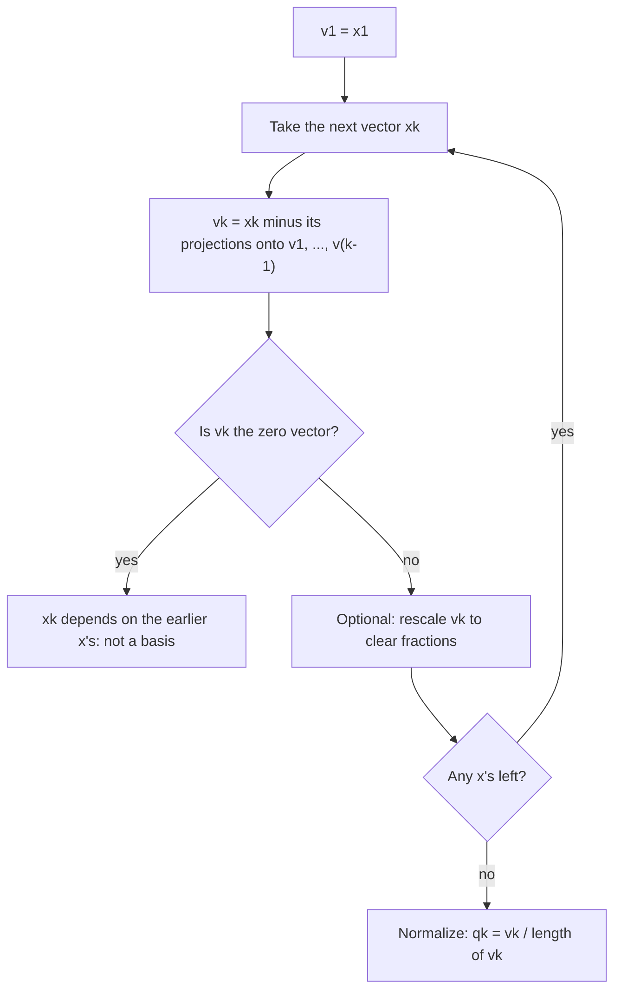

## Making any basis orthogonal

The last lesson showed how much easier life is with an orthogonal basis: coordinates and
projections come from simple dot products. But the bases we usually get, such as the
pivot columns of a matrix, are rarely orthogonal. The Gram–Schmidt process converts any
basis of a subspace into an orthogonal one that spans the same subspace, one vector at a
time. Recording the process as matrices gives the **QR factorization**, which is central to
numerical least squares and eigenvalue algorithms.

## The idea

Take a basis $\{\mathbf{x}_1, \mathbf{x}_2\}$ of a plane $W$. Keep $\mathbf{v}_1 = \mathbf{x}_1$. Then
subtract from $\mathbf{x}_2$ its projection onto $\mathbf{v}_1$; what's left is perpendicular to
$\mathbf{v}_1$ and still in $W$:

$$\mathbf{v}_2 = \mathbf{x}_2 - \frac{\mathbf{x}_2\cdot\mathbf{v}_1}{\mathbf{v}_1\cdot\mathbf{v}_1}\mathbf{v}_1.$$

For more vectors, subtract the projections onto *all* the previous $\mathbf{v}$'s.

> The **Gram–Schmidt process**: given a basis $\{\mathbf{x}_1, \dots, \mathbf{x}_p\}$ for a subspace $W$ of $\mathbb{R}^n$, define
> $$\begin{aligned} \mathbf{v}_1 &= \mathbf{x}_1 \\ \mathbf{v}_2 &= \mathbf{x}_2 - \frac{\mathbf{x}_2\cdot\mathbf{v}_1}{\mathbf{v}_1\cdot\mathbf{v}_1}\mathbf{v}_1 \\ \mathbf{v}_3 &= \mathbf{x}_3 - \frac{\mathbf{x}_3\cdot\mathbf{v}_1}{\mathbf{v}_1\cdot\mathbf{v}_1}\mathbf{v}_1 - \frac{\mathbf{x}_3\cdot\mathbf{v}_2}{\mathbf{v}_2\cdot\mathbf{v}_2}\mathbf{v}_2 \\ &\;\;\vdots \end{aligned}$$
> Then $\{\mathbf{v}_1, \dots, \mathbf{v}_p\}$ is an orthogonal basis for $W$, and for each $k$, $\operatorname{Span}\{\mathbf{v}_1, \dots, \mathbf{v}_k\} = \operatorname{Span}\{\mathbf{x}_1, \dots, \mathbf{x}_k\}$.

The picture shows the first step in the plane. With $\mathbf{x}_1 = (2, 1)$ and $\mathbf{x}_2 = (1, 3)$, the projection of $\mathbf{x}_2$ onto $\mathbf{v}_1 = \mathbf{x}_1$ is $\tfrac{5}{5}(2, 1) = (2, 1)$, and what is left is $\mathbf{v}_2 = (1, 3) - (2, 1) = (-1, 2)$, perpendicular to $\mathbf{v}_1$.

```plot
{"x": [-2, 3], "y": [-1, 4], "equal": true, "segments": [{"from": [0, 0], "to": [2, 1], "arrow": true, "label": "v₁ = x₁"}, {"from": [0, 0], "to": [1, 3], "arrow": true, "label": "x₂"}, {"from": [2, 1], "to": [1, 3], "dashed": true}, {"from": [0, 0], "to": [-1, 2], "arrow": true, "label": "v₂"}], "rightAngles": [[[0, 0], [2, 1], [-1, 2]]], "caption": "v₂ = x₂ − proj(x₂ onto v₁) = (1, 3) − (2, 1) = (−1, 2) is perpendicular to v₁"}
```

As a loop, the whole process looks like this:



Why it works: $\mathbf{v}_k = \mathbf{x}_k - \operatorname{proj}_{W_{k-1}}\mathbf{x}_k$, where
$W_{k-1} = \operatorname{Span}\{\mathbf{v}_1, \dots, \mathbf{v}_{k-1}\}$. By the orthogonal
decomposition theorem this is orthogonal to $W_{k-1}$. It's nonzero because $\mathbf{x}_k$ is not
in $W_{k-1}$ (the $\mathbf{x}$'s are independent). To get an *orthonormal* basis, normalize each
$\mathbf{v}_k$ at the end.

A practical tip: you may rescale any $\mathbf{v}_k$ (say, to clear fractions) before using it in
later steps; scaling doesn't change orthogonality or the spans.

### Example 1

Apply Gram–Schmidt to $\mathbf{x}_1 = (1, 1, 0)$, $\mathbf{x}_2 = (2, 0, 1)$, $\mathbf{x}_3 = (1, 2, 3)$.

1. $\mathbf{v}_1 = (1, 1, 0)$, with $\mathbf{v}_1\cdot\mathbf{v}_1 = 2$.
2. $\mathbf{x}_2\cdot\mathbf{v}_1 = 2$, so $\mathbf{v}_2 = (2, 0, 1) - \tfrac22(1, 1, 0) = (1, -1, 1)$. Check $\mathbf{v}_1\cdot\mathbf{v}_2 = 0$. ✓ And $\mathbf{v}_2\cdot\mathbf{v}_2 = 3$.
3. $\mathbf{x}_3\cdot\mathbf{v}_1 = 3$ and $\mathbf{x}_3\cdot\mathbf{v}_2 = 1 - 2 + 3 = 2$, so
$$\mathbf{v}_3 = (1, 2, 3) - \tfrac32(1, 1, 0) - \tfrac23(1, -1, 1) = \left(-\tfrac76,\ \tfrac76,\ \tfrac73\right).$$
4. Rescale by $\tfrac67$: $\mathbf{v}_3 = (-1, 1, 2)$. Check: $\mathbf{v}_3\cdot\mathbf{v}_1 = 0$ and $\mathbf{v}_3\cdot\mathbf{v}_2 = -1 - 1 + 2 = 0$. ✓
5. Orthonormal basis: $\tfrac{1}{\sqrt2}(1, 1, 0)$, $\tfrac{1}{\sqrt3}(1, -1, 1)$, $\tfrac{1}{\sqrt6}(-1, 1, 2)$.

(This is the orthogonal basis used in the previous lesson's examples.)

## The QR factorization

Record Gram–Schmidt (with normalization) applied to the columns of a matrix:

> *QR factorization.* If $A$ is $m \times n$ with linearly independent columns, then $A = QR$, where $Q$ is $m \times n$ with orthonormal columns forming a basis of $\operatorname{Col} A$, and $R$ is $n \times n$ upper triangular and invertible with positive diagonal entries.

$Q$ holds the orthonormal vectors from Gram–Schmidt. Since $Q^TQ = I$, multiplying $A = QR$
on the left by $Q^T$ gives $R = Q^TA$; its entries are dot products $r_{ij} = \mathbf{q}_i\cdot\mathbf{x}_j$.
$R$ is upper triangular because $\mathbf{x}_j$ lies in the span of $\mathbf{q}_1, \dots, \mathbf{q}_j$, so
it has no component along later $\mathbf{q}$'s. The diagonal entry $r_{jj}$ is the length of the
$\mathbf{v}_j$ that was normalized.

### Example 2

Find the QR factorization of $A = \begin{bmatrix} 1 & 2 \\ 1 & 0 \\ 0 & 1\end{bmatrix}$ (columns $\mathbf{x}_1, \mathbf{x}_2$ from Example 1).

1. From Example 1, $\mathbf{q}_1 = \tfrac{1}{\sqrt2}(1, 1, 0)$ and $\mathbf{q}_2 = \tfrac{1}{\sqrt3}(1, -1, 1)$, so $Q = \begin{bmatrix} 1/\sqrt2 & 1/\sqrt3 \\ 1/\sqrt2 & -1/\sqrt3 \\ 0 & 1/\sqrt3\end{bmatrix}$.
2. $R = Q^TA$: $r_{11} = \mathbf{q}_1\cdot\mathbf{x}_1 = \tfrac{2}{\sqrt2} = \sqrt2$, $r_{12} = \mathbf{q}_1\cdot\mathbf{x}_2 = \tfrac{2}{\sqrt2} = \sqrt2$, $r_{21} = \mathbf{q}_2\cdot\mathbf{x}_1 = 0$, $r_{22} = \mathbf{q}_2\cdot\mathbf{x}_2 = \tfrac{3}{\sqrt3} = \sqrt3$.
3. $R = \begin{bmatrix} \sqrt2 & \sqrt2 \\ 0 & \sqrt3\end{bmatrix}$. Check column 2 of $QR$: $\sqrt2\,\mathbf{q}_1 + \sqrt3\,\mathbf{q}_2 = (1, 1, 0) + (1, -1, 1) = (2, 0, 1) = \mathbf{x}_2$. ✓

Computer libraries compute QR with more stable methods (Householder reflections), but the
result is the same factorization.

### Example 3

Find an orthonormal basis for the plane $W$: $x_1 + x_2 + x_3 = 0$ in $\mathbb{R}^3$.

1. First any basis: $x_1 = -x_2 - x_3$ gives $\mathbf{x}_1 = (-1, 1, 0)$ and $\mathbf{x}_2 = (-1, 0, 1)$. They are not orthogonal: $\mathbf{x}_1\cdot\mathbf{x}_2 = 1$.
2. $\mathbf{v}_1 = \mathbf{x}_1$, with $\mathbf{v}_1\cdot\mathbf{v}_1 = 2$.
3. $\mathbf{v}_2 = \mathbf{x}_2 - \tfrac12\mathbf{v}_1 = \left(-\tfrac12, -\tfrac12, 1\right)$; rescale to $(-1, -1, 2)$.
4. Normalize: $\tfrac{1}{\sqrt2}(-1, 1, 0)$ and $\tfrac{1}{\sqrt6}(-1, -1, 2)$.
5. Check: both satisfy $x_1 + x_2 + x_3 = 0$ (so they lie in $W$), and their dot product is $\tfrac{1}{\sqrt{12}}(1 - 1 + 0) = 0$. ✓

Why normalize only at the end? Normalizing introduces square roots, and carrying $\sqrt2$ and $\sqrt6$ through later projections is error-prone. The projection coefficients $\frac{\mathbf{x}_k\cdot\mathbf{v}_i}{\mathbf{v}_i\cdot\mathbf{v}_i}$ don't care how long the $\mathbf{v}_i$ are, so work with convenient integer vectors and divide by lengths once, at the finish.

## Common mistakes

- *Projecting onto the $\mathbf{x}$'s instead of the $\mathbf{v}$'s.* Each step subtracts projections onto the new orthogonal vectors $\mathbf{v}_1, \dots, \mathbf{v}_{k-1}$.
- *Dividing by $\|\mathbf{v}\|$ instead of $\mathbf{v}\cdot\mathbf{v}$* inside the projection coefficients.
- *Forgetting to normalize* when an orthonormal basis or $Q$ is required.
- *Expecting $R$ to be orthogonal or $Q$ to be square.* For a tall $A$, $Q$ is tall with orthonormal columns and $R$ is square upper triangular.

## Key points

- Gram–Schmidt: $\mathbf{v}_k = \mathbf{x}_k - \sum_{i<k}\dfrac{\mathbf{x}_k\cdot\mathbf{v}_i}{\mathbf{v}_i\cdot\mathbf{v}_i}\mathbf{v}_i$; the $\mathbf{v}$'s are orthogonal and span the same spaces as the $\mathbf{x}$'s.
- Normalize at the end to get an orthonormal basis; rescaling along the way is allowed.
- $A = QR$: $Q$ has orthonormal columns (a basis for $\operatorname{Col} A$), $R = Q^TA$ is upper triangular with positive diagonal.
