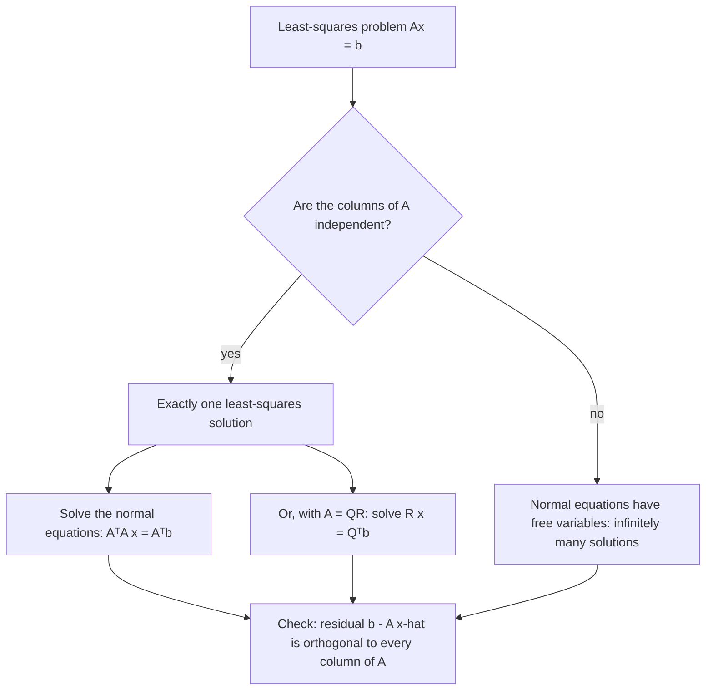

## When there is no solution, find the best one

Real data rarely fits a model exactly. Measure the same quantity several times, or ask a
line to pass through ten scattered points, and you get an overdetermined system
$A\mathbf{x} = \mathbf{b}$ with no solution. Rather than give up, we look for the $\mathbf{x}$ that
makes $A\mathbf{x}$ as close as possible to $\mathbf{b}$. The previous lessons already contain the
answer: the closest point of $\operatorname{Col} A$ to $\mathbf{b}$ is an orthogonal projection.
This lesson turns that into a formula and applies it to fitting lines to data.

## The least-squares problem

For an $m \times n$ matrix $A$ and $\mathbf{b}$ in $\mathbb{R}^m$, a **least-squares solution** of
$A\mathbf{x} = \mathbf{b}$ is an $\hat{\mathbf{x}}$ in $\mathbb{R}^n$ with

$$\|\mathbf{b} - A\hat{\mathbf{x}}\| \le \|\mathbf{b} - A\mathbf{x}\| \quad\text{for all } \mathbf{x}.$$

The name comes from minimizing $\|\mathbf{b} - A\mathbf{x}\|^2$, a sum of squares. The minimum
value $\|\mathbf{b} - A\hat{\mathbf{x}}\|$ is the **least-squares error**.

As $\mathbf{x}$ varies, $A\mathbf{x}$ ranges over $\operatorname{Col} A$. By the best approximation
theorem, the closest point is $\hat{\mathbf{b}} = \operatorname{proj}_{\operatorname{Col} A}\mathbf{b}$,
so we want $A\hat{\mathbf{x}} = \hat{\mathbf{b}}$. That happens exactly when $\mathbf{b} - A\hat{\mathbf{x}}$
is orthogonal to $\operatorname{Col} A$, i.e. to every column of $A$:
$A^T(\mathbf{b} - A\hat{\mathbf{x}}) = \mathbf{0}$. Rearranged:

> *Theorem.* The least-squares solutions of $A\mathbf{x} = \mathbf{b}$ are exactly the solutions of the **normal equations**
> $$A^TA\,\mathbf{x} = A^T\mathbf{b}.$$
> The solution is unique exactly when the columns of $A$ are linearly independent (equivalently, $A^TA$ is invertible), and then $\hat{\mathbf{x}} = (A^TA)^{-1}A^T\mathbf{b}$.

The normal equations are always consistent, even when $A\mathbf{x} = \mathbf{b}$ isn't.

### Example 1

Find the least-squares solution of $A\mathbf{x} = \mathbf{b}$ for $A = \begin{bmatrix} 2 & 0 \\ 0 & 1 \\ 1 & 1\end{bmatrix}$ and $\mathbf{b} = (1, 2, 4)$, and the least-squares error.

1. $A^TA = \begin{bmatrix} 2 & 0 & 1 \\ 0 & 1 & 1\end{bmatrix}\begin{bmatrix} 2 & 0 \\ 0 & 1 \\ 1 & 1\end{bmatrix} = \begin{bmatrix} 5 & 1 \\ 1 & 2\end{bmatrix}$ and $A^T\mathbf{b} = (2 + 4,\ 2 + 4) = (6, 6)$.
2. Solve $5x_1 + x_2 = 6$, $x_1 + 2x_2 = 6$: $\det = 9$, so $x_1 = \dfrac{12 - 6}{9} = \dfrac23$ and $x_2 = \dfrac{30 - 6}{9} = \dfrac83$.
3. $A\hat{\mathbf{x}} = \left(\tfrac43, \tfrac83, \tfrac{10}{3}\right)$, and $\mathbf{b} - A\hat{\mathbf{x}} = \left(-\tfrac13, -\tfrac23, \tfrac23\right)$.
4. Error: $\sqrt{\tfrac19 + \tfrac49 + \tfrac49} = 1$. No choice of $\mathbf{x}$ gets closer than 1 to $\mathbf{b}$.
5. Check orthogonality: $A^T(\mathbf{b} - A\hat{\mathbf{x}}) = \left(-\tfrac23 + \tfrac23,\ -\tfrac23 + \tfrac23\right) = \mathbf{0}$. ✓

If you have a QR factorization $A = QR$, the normal equations simplify to $R\hat{\mathbf{x}} = Q^T\mathbf{b}$,
which is triangular and numerically better behaved.

## Fitting a line to data

Given data points $(x_1, y_1), \dots, (x_n, y_n)$, we want the line $y = \beta_0 + \beta_1x$ that fits
best. If the line went through every point, we'd have

$$X\boldsymbol\beta = \mathbf{y}, \qquad X = \begin{bmatrix} 1 & x_1 \\ 1 & x_2 \\ \vdots & \vdots \\ 1 & x_n\end{bmatrix},\quad \boldsymbol\beta = \begin{bmatrix} \beta_0 \\ \beta_1\end{bmatrix},\quad \mathbf{y} = \begin{bmatrix} y_1 \\ \vdots \\ y_n\end{bmatrix}.$$

$X$ is the **design matrix**, $\boldsymbol\beta$ the parameter vector and $\mathbf{y}$ the observation
vector. The differences $y_i - (\beta_0 + \beta_1x_i)$ are the **residuals**, and the
**least-squares line** (or regression line) minimizes the sum of their squares: it is the
least-squares solution of $X\boldsymbol\beta = \mathbf{y}$, found from $X^TX\boldsymbol\beta = X^T\mathbf{y}$.

Written out, $X^TX = \begin{bmatrix} n & \sum x_i \\ \sum x_i & \sum x_i^2\end{bmatrix}$ and $X^T\mathbf{y} = \begin{bmatrix} \sum y_i \\ \sum x_iy_i\end{bmatrix}$.

### Example 2

Find the least-squares line for $(1, 1)$, $(2, 3)$, $(3, 4)$, $(4, 4)$.

1. $n = 4$, $\sum x_i = 10$, $\sum x_i^2 = 30$, $\sum y_i = 12$, $\sum x_iy_i = 1 + 6 + 12 + 16 = 35$.
2. Normal equations: $4\beta_0 + 10\beta_1 = 12$ and $10\beta_0 + 30\beta_1 = 35$.
3. Multiply the first by 2.5 and subtract from the second: $5\beta_1 = 5$, so $\beta_1 = 1$; then $\beta_0 = (12 - 10)/4 = 0.5$.
4. The line is $y = 0.5 + x$. Residuals: $-0.5,\ 0.5,\ 0.5,\ -0.5$; they add to 0, as they always do when the model includes an intercept.

```plot
{"x": [0, 5], "y": [0, 6], "functions": [{"f": "0.5 + x", "label": "y = 0.5 + x"}], "points": [{"at": [1, 1]}, {"at": [2, 3]}, {"at": [3, 4]}, {"at": [4, 4]}], "segments": [{"from": [1, 1], "to": [1, 1.5], "dashed": true}, {"from": [2, 3], "to": [2, 2.5], "dashed": true}, {"from": [3, 4], "to": [3, 3.5], "dashed": true}, {"from": [4, 4], "to": [4, 4.5], "dashed": true}], "caption": "The least-squares line minimizes the sum of the squared vertical residuals"}
```

The picture labels the parts of a regression for a different data set, $(0, 1)$, $(1, 1)$, $(2, 4)$, $(3, 4)$, whose least-squares line is $y = 0.7 + 1.2x$. (Check it: $n = 4$, $\sum x_i = 6$, $\sum x_i^2 = 14$, $\sum y_i = 10$, $\sum x_iy_i = 21$, and the normal equations $4\beta_0 + 6\beta_1 = 10$, $6\beta_0 + 14\beta_1 = 21$ give $\beta_0 = 0.7$, $\beta_1 = 1.2$.) Each residual is the vertical gap between a data point and the **fitted value** $\beta_0 + \beta_1x_i$ on the line; here they are $0.3$, $-0.9$, $0.9$ and $-0.3$.


The same method fits any model that is linear in its parameters: a parabola
$y = \beta_0 + \beta_1x + \beta_2x^2$ uses design-matrix rows $(1, x_i, x_i^2)$, and multiple
regression $y = \beta_0 + \beta_1u + \beta_2v$ uses rows $(1, u_i, v_i)$. This is **linear regression** in its linear-algebra form.

A useful habit: after solving the normal equations, compute the residual vector and confirm
that $A^T(\mathbf{b} - A\hat{\mathbf{x}}) = \mathbf{0}$. It catches arithmetic errors, and it reminds
you what the method does: it makes the error perpendicular to everything the model can produce.

Which route to take depends on the columns of $A$:



## Common mistakes

- *Solving $A\mathbf{x} = \mathbf{b}$ directly* when it's inconsistent; use $A^TA\mathbf{x} = A^T\mathbf{b}$.
- *Writing $A^T\mathbf{b}$ as $\mathbf{b}^TA$ or $A\mathbf{b}$.* Check sizes: $A^T$ is $n \times m$ and $\mathbf{b}$ is in $\mathbb{R}^m$.
- *Forgetting the column of 1s* in the design matrix, which forces the line through the origin.
- *Minimizing horizontal or perpendicular distances.* Least squares uses vertical residuals in $y$.
- *Reporting $\|\mathbf{b} - A\hat{\mathbf{x}}\|^2$ as the error.* The least-squares error is the length, not its square.

## Key points

- A least-squares solution minimizes $\|\mathbf{b} - A\mathbf{x}\|$; $A\hat{\mathbf{x}}$ is the projection of $\mathbf{b}$ onto $\operatorname{Col} A$.
- Solve the normal equations $A^TA\mathbf{x} = A^T\mathbf{b}$; the solution is unique when $A$ has independent columns.
- With $A = QR$: $R\hat{\mathbf{x}} = Q^T\mathbf{b}$.
- Regression: design matrix rows $(1, x_i)$; solve $X^TX\boldsymbol\beta = X^T\mathbf{y}$ for the least-squares line.
