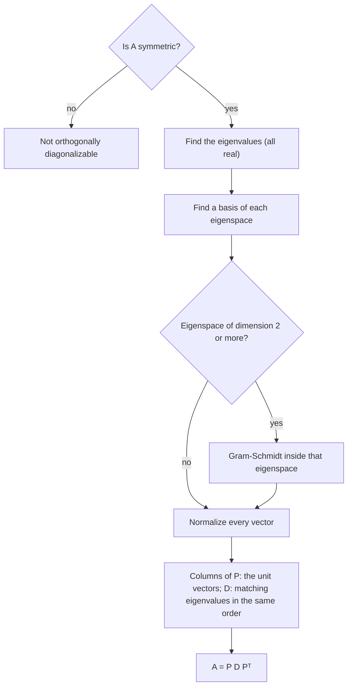

## The best-behaved matrices

Diagonalization can fail, eigenvalues can be complex, and eigenvectors can point in awkward
directions. Symmetric matrices avoid all of that: their eigenvalues are real, they are
always diagonalizable, and their eigenvectors can be chosen perpendicular to each other.
Symmetric matrices appear everywhere data and geometry meet: covariance matrices in
statistics, $A^TA$ in least squares, stiffness and inertia matrices in engineering, and the
quadratic forms of the next lesson.

## Symmetric matrices

A matrix is **symmetric** if $A^T = A$, i.e. $a_{ij} = a_{ji}$: it's square and mirror-symmetric
across the main diagonal. For example $\begin{bmatrix} 3 & 1 \\ 1 & 3\end{bmatrix}$ and
$\begin{bmatrix} 2 & -1 & 0 \\ -1 & 5 & 4 \\ 0 & 4 & 1\end{bmatrix}$ are symmetric. For any
matrix $B$, both $B^TB$ and $BB^T$ are symmetric, since $(B^TB)^T = B^T(B^T)^T = B^TB$.

> *Theorem.* If $A$ is symmetric, eigenvectors from different eigenspaces are orthogonal.

Proof: suppose $A\mathbf{v}_1 = \lambda_1\mathbf{v}_1$ and $A\mathbf{v}_2 = \lambda_2\mathbf{v}_2$ with
$\lambda_1 \ne \lambda_2$. Then
$\lambda_1\,\mathbf{v}_1\cdot\mathbf{v}_2 = (A\mathbf{v}_1)^T\mathbf{v}_2 = \mathbf{v}_1^TA^T\mathbf{v}_2 = \mathbf{v}_1^TA\mathbf{v}_2 = \lambda_2\,\mathbf{v}_1\cdot\mathbf{v}_2$,
so $(\lambda_1 - \lambda_2)\,\mathbf{v}_1\cdot\mathbf{v}_2 = 0$ and $\mathbf{v}_1\cdot\mathbf{v}_2 = 0$. The step
$A^T = A$ is exactly where symmetry is used.

## Orthogonal diagonalization

A matrix $A$ is **orthogonally diagonalizable** if $A = PDP^T$ with $P$ an orthogonal matrix
(so $P^{-1} = P^T$) and $D$ diagonal. Such an $A$ must be symmetric, because
$(PDP^T)^T = PD^TP^T = PDP^T$. Remarkably, the converse is true:

> The **spectral theorem**: an $n \times n$ matrix $A$ is orthogonally diagonalizable if and only if it is symmetric. Moreover, a symmetric matrix:
> - has $n$ real eigenvalues, counted with multiplicity;
> - has eigenspaces whose dimensions equal the algebraic multiplicities;
> - has mutually orthogonal eigenspaces.

So for a symmetric matrix, the recipe is: find the eigenvalues, find a basis of each
eigenspace, make each eigenspace's basis orthonormal (Gram–Schmidt if the eigenspace has
dimension 2 or more), and use the resulting vectors as the columns of $P$.



### Example 1

Orthogonally diagonalize $A = \begin{bmatrix} 3 & 1 \\ 1 & 3\end{bmatrix}$.

1. $\lambda^2 - 6\lambda + 8 = (\lambda - 2)(\lambda - 4)$: eigenvalues 4 and 2.
2. $A - 4I = \begin{bmatrix} -1 & 1 \\ 1 & -1\end{bmatrix}$ gives $(1, 1)$; $A - 2I = \begin{bmatrix} 1 & 1 \\ 1 & 1\end{bmatrix}$ gives $(1, -1)$. They're orthogonal, as promised.
3. Normalize: $\mathbf{u}_1 = \tfrac{1}{\sqrt2}(1, 1)$, $\mathbf{u}_2 = \tfrac{1}{\sqrt2}(1, -1)$.
4. $P = \dfrac{1}{\sqrt2}\begin{bmatrix} 1 & 1 \\ 1 & -1\end{bmatrix}$, $D = \begin{bmatrix} 4 & 0 \\ 0 & 2\end{bmatrix}$, and $A = PDP^T$.

Geometrically, $A$ stretches by 4 along the line $y = x$ and by 2 along $y = -x$.

The picture shows this: $A$ maps the unit circle to an ellipse whose axes lie along the perpendicular eigenvectors, with semi-axes 4 and 2.

```plot
{"x": [-4.5, 4.5], "y": [-4.5, 4.5], "equal": true, "curves": [{"x": "cos(t)", "y": "sin(t)", "t": [0, "2pi"], "dashed": true}, {"x": "3*cos(t) + sin(t)", "y": "cos(t) + 3*sin(t)", "t": [0, "2pi"]}], "segments": [{"from": [0, 0], "to": [2.828, 2.828], "arrow": true, "label": "4u₁"}, {"from": [0, 0], "to": [1.414, -1.414], "arrow": true}], "labels": [{"at": [1.45, -0.75], "text": "2u₂"}], "caption": "A = [3 1; 1 3] maps the unit circle (dashed) to an ellipse with semi-axes 4 along (1, 1) and 2 along (1, −1)"}
```

### Example 2

Orthogonally diagonalize $B = \begin{bmatrix} 3 & 1 & 1 \\ 1 & 3 & 1 \\ 1 & 1 & 3\end{bmatrix}$ (eigenvalues 2, 2, 5).

1. Eigenspace for 5: spanned by $(1, 1, 1)$.
2. Eigenspace for 2: basis $\mathbf{x}_1 = (-1, 1, 0)$, $\mathbf{x}_2 = (-1, 0, 1)$. These are not orthogonal ($\mathbf{x}_1\cdot\mathbf{x}_2 = 1$).
3. Gram–Schmidt inside the eigenspace: $\mathbf{v}_2 = \mathbf{x}_2 - \tfrac12\mathbf{x}_1 = \left(-\tfrac12, -\tfrac12, 1\right)$; rescale to $(-1, -1, 2)$. It is still an eigenvector for 2, since it's in the eigenspace.
4. Both are automatically orthogonal to $(1, 1, 1)$ (different eigenspace).
5. Normalize: $P = \begin{bmatrix} -1/\sqrt2 & -1/\sqrt6 & 1/\sqrt3 \\ 1/\sqrt2 & -1/\sqrt6 & 1/\sqrt3 \\ 0 & 2/\sqrt6 & 1/\sqrt3\end{bmatrix}$, $D = \operatorname{diag}(2, 2, 5)$.

## The spectral decomposition

Writing $A = PDP^T$ column by column gives the **spectral decomposition**

$$A = \lambda_1\mathbf{u}_1\mathbf{u}_1^T + \lambda_2\mathbf{u}_2\mathbf{u}_2^T + \cdots + \lambda_n\mathbf{u}_n\mathbf{u}_n^T.$$

Each $\mathbf{u}_j\mathbf{u}_j^T$ is an $n \times n$ matrix of rank 1, and $(\mathbf{u}_j\mathbf{u}_j^T)\mathbf{x}$
is the projection of $\mathbf{x}$ onto the line through $\mathbf{u}_j$. So a symmetric matrix is a
weighted sum of projections onto perpendicular directions. For Example 1:
$4\cdot\tfrac12\begin{bmatrix} 1 & 1 \\ 1 & 1\end{bmatrix} + 2\cdot\tfrac12\begin{bmatrix} 1 & -1 \\ -1 & 1\end{bmatrix} = \begin{bmatrix} 3 & 1 \\ 1 & 3\end{bmatrix}$. ✓

### Example 3

Find the spectral decomposition of $A = \begin{bmatrix} 2 & 2 \\ 2 & 5\end{bmatrix}$.

1. $\lambda^2 - 7\lambda + 6 = (\lambda - 6)(\lambda - 1)$: eigenvalues 6 and 1.
2. $A - 6I = \begin{bmatrix} -4 & 2 \\ 2 & -1\end{bmatrix}$ gives $(1, 2)$; $A - I = \begin{bmatrix} 1 & 2 \\ 2 & 4\end{bmatrix}$ gives $(2, -1)$. They are orthogonal, as they must be.
3. Unit vectors: $\mathbf{u}_1 = \tfrac{1}{\sqrt5}(1, 2)$, $\mathbf{u}_2 = \tfrac{1}{\sqrt5}(2, -1)$.
4. $\mathbf{u}_1\mathbf{u}_1^T = \tfrac15\begin{bmatrix} 1 & 2 \\ 2 & 4\end{bmatrix}$ and $\mathbf{u}_2\mathbf{u}_2^T = \tfrac15\begin{bmatrix} 4 & -2 \\ -2 & 1\end{bmatrix}$.
5. $A = 6\,\mathbf{u}_1\mathbf{u}_1^T + 1\,\mathbf{u}_2\mathbf{u}_2^T = \tfrac15\begin{bmatrix} 6 + 4 & 12 - 2 \\ 12 - 2 & 24 + 1\end{bmatrix} = \begin{bmatrix} 2 & 2 \\ 2 & 5\end{bmatrix}$. ✓

Read geometrically: $A$ takes the component of a vector along $(1, 2)$ and multiplies it by 6, takes the component along $(2, -1)$ and leaves it alone, then adds the pieces back together. Every symmetric matrix works this way along its own perpendicular axes.

## Common mistakes

- *Forgetting to normalize.* $P$ must have *unit* columns for $P^{-1} = P^T$.
- *Skipping Gram–Schmidt within a repeated eigenspace.* Eigenvectors from different eigenspaces are automatically orthogonal; two from the same eigenspace may not be.
- *Assuming every diagonalizable matrix is orthogonally diagonalizable.* Only symmetric ones are; $\begin{bmatrix} 4 & -2 \\ 1 & 1\end{bmatrix}$ is diagonalizable, but its eigenvectors $(1, 1)$ and $(2, 1)$ aren't orthogonal.
- *Using $P^{-1}$ when $P^T$ is available*, or vice versa with a non-orthogonal $P$.

## Key points

- Symmetric: $A^T = A$. Eigenvectors for different eigenvalues are orthogonal.
- Spectral theorem: $A$ is symmetric ⟺ $A = PDP^T$ with $P$ orthogonal; eigenvalues are real.
- Recipe: eigenvalues, eigenspace bases, Gram–Schmidt within each eigenspace, normalize.
- Spectral decomposition: $A = \sum \lambda_j\mathbf{u}_j\mathbf{u}_j^T$, a sum of scaled projections.
