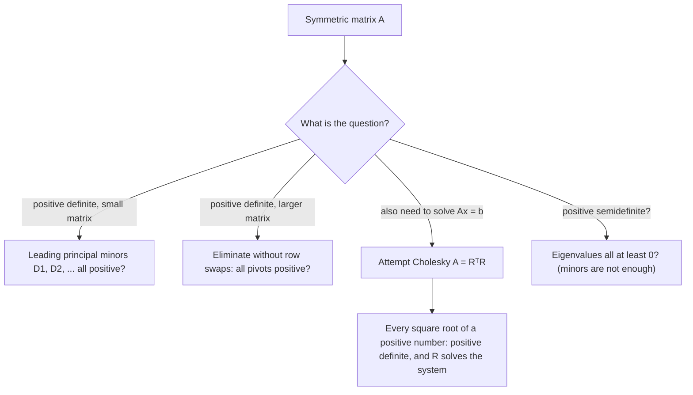

## Testing positivity without eigenvalues

The last lesson classified a quadratic form $\mathbf{x}^TA\mathbf{x}$ by the signs of the eigenvalues of
its symmetric matrix. Positive definite matrices are the most important class: they are the
covariance matrices of statistics, the energy matrices of mechanics, the Hessians in the
second-derivative test for a minimum, and the matrices $A^TA$ in least squares. But finding the eigenvalues of
a $3 \times 3$ matrix means solving a cubic. This lesson gives two tests that need only
elimination or determinants, and a factorization, $A = R^TR$, that positive definite matrices
always have.

Throughout, $A$ is symmetric. A symmetric $A$ is a **positive definite matrix** when
$\mathbf{x}^TA\mathbf{x} > 0$ for every $\mathbf{x} \ne \mathbf{0}$, which (as the last lesson showed) happens
exactly when all its eigenvalues are positive.

## Quick consequences

- *Diagonal entries are positive.* Taking $\mathbf{x} = \mathbf{e}_i$ gives $\mathbf{e}_i^TA\mathbf{e}_i = a_{ii} > 0$. This is necessary but far from sufficient: $\begin{bmatrix} 1 & 3 \\ 3 & 1\end{bmatrix}$ has positive diagonal but is indefinite.
- *Positive determinant.* $\det A$ is the product of the eigenvalues, so it is positive, and $A$ is invertible.
- *Matrices $B^TB$.* For any $m \times n$ matrix $B$, $\mathbf{x}^T(B^TB)\mathbf{x} = (B\mathbf{x})\cdot(B\mathbf{x}) = \|B\mathbf{x}\|^2 \ge 0$, so $B^TB$ is always positive semidefinite. It is positive definite exactly when $B\mathbf{x} \ne \mathbf{0}$ for every $\mathbf{x} \ne \mathbf{0}$, that is, when the columns of $B$ are linearly independent. That is why the normal equations $A^TA\hat{\mathbf{x}} = A^T\mathbf{b}$ have a unique solution when $A$ has independent columns.

## The pivot test: completing the square

Write a $2 \times 2$ form with $a \ne 0$ and complete the square:

$$ax_1^2 + 2bx_1x_2 + cx_2^2 = a\Big(x_1 + \frac{b}{a}x_2\Big)^2 + \frac{ac - b^2}{a}\,x_2^2.$$

Now look at elimination on $\begin{bmatrix} a & b \\ b & c\end{bmatrix}$: the first pivot is $a$,
and subtracting $\tfrac{b}{a}$ times row 1 from row 2 leaves the second pivot
$c - \tfrac{b^2}{a} = \tfrac{ac - b^2}{a}$. The coefficients of the squares are *exactly the
pivots*, and the multiplier $\tfrac{b}{a}$ sits inside the first square. A sum
$p_1u_1^2 + p_2u_2^2$ is positive for every nonzero $(u_1, u_2)$ exactly when $p_1 > 0$ and
$p_2 > 0$, and $(u_1, u_2)$ ranges over all nonzero vectors as $\mathbf{x}$ does.

The same thing happens for any size. Elimination without row swaps writes a symmetric matrix
as $A = LDL^T$ ($L$ unit lower triangular holding the multipliers, $D$ diagonal holding the
pivots), and then $\mathbf{x}^TA\mathbf{x} = \sum p_iu_i^2$ with $\mathbf{u} = L^T\mathbf{x}$.

> *Pivot test.* A symmetric matrix is positive definite exactly when elimination without row swaps produces $n$ pivots, all positive.

More generally, when there are $n$ nonzero pivots, the number of positive pivots equals the
number of positive eigenvalues (and likewise for negative ones), so pivots of mixed sign mean
indefinite. If a zero turns up in a pivot position, $A$ is not positive definite.

## The determinant test: leading principal minors

The **leading principal minors** of $A$ are $D_1, D_2, \dots, D_n$, where $D_k$ is the determinant of
the upper-left $k \times k$ submatrix. For a $3 \times 3$ matrix,

$$D_1 = a_{11}, \qquad D_2 = \begin{vmatrix} a_{11} & a_{12} \\ a_{21} & a_{22}\end{vmatrix}, \qquad D_3 = \det A.$$

Elimination down the first $k$ columns uses only the first $k$ rows to change rows $1$ to $k$, and
replacements don't change determinants, so $D_k = p_1p_2\cdots p_k$ and $p_k = D_k/D_{k-1}$.
Positive pivots and positive leading minors are therefore the same condition.

> *Determinant test (Sylvester's criterion).* A symmetric matrix is positive definite exactly when all of its leading principal minors are positive.

Applying the test to $-A$ gives the negative definite test: $D_1 < 0$, $D_2 > 0$, $D_3 < 0$, …,
alternating in sign, because $\det(-A_k) = (-1)^kD_k$.

### Example 1

Test $A = \begin{bmatrix} 2 & -1 & 0 \\ -1 & 2 & -1 \\ 0 & -1 & 2\end{bmatrix}$ three ways.

1. *Minors.* $D_1 = 2$; $D_2 = 4 - 1 = 3$; expanding along row 1, $D_3 = 2(4 - 1) - (-1)(-2 - 0) = 6 - 2 = 4$. All positive.
2. *Pivots.* They are the ratios $D_1 = 2$, $D_2/D_1 = \tfrac32$, $D_3/D_2 = \tfrac43$. By elimination: $R_2 + \tfrac12R_1$ gives row 2 $= (0, \tfrac32, -1)$; then $R_3 + \tfrac23R_2$ gives the last pivot $2 - \tfrac23 = \tfrac43$. All positive.
3. *Eigenvalues.* They are $2 - \sqrt2$, $2$ and $2 + \sqrt2$, all positive, confirming that $A$ is positive definite.

The minors were by far the least work. This matrix (2s on the diagonal, $-1$s beside it) shows
up whenever a second derivative is approximated on a grid.

### Example 2

For which $k$ is $A = \begin{bmatrix} 1 & 1 & 0 \\ 1 & 3 & 2 \\ 0 & 2 & k\end{bmatrix}$ positive definite?

1. $D_1 = 1 > 0$ and $D_2 = 3 - 1 = 2 > 0$, whatever $k$ is.
2. Row 1 expansion: $D_3 = 1(3k - 4) - 1(k - 0) + 0 = 2k - 4$.
3. Positive definite exactly when $2k - 4 > 0$, i.e. $k > 2$.
4. Pivot check: $R_2 - R_1$ gives $(0, 2, 2)$, then $R_3 - R_2$ gives the last pivot $k - 2$. The pivots are $1, 2, k - 2$, which agrees.

```plot
{"x": [-3, 3], "y": [-3, 3], "equal": true, "curves": [{"x": "(cos(t)/sqrt(1.5) + sin(t)/sqrt(0.5))/sqrt(2)", "y": "(cos(t)/sqrt(1.5) - sin(t)/sqrt(0.5))/sqrt(2)", "t": [0, "2pi"], "color": "#2c5e8f"}, {"x": "(cosh(t)/sqrt(3) + sinh(t))/sqrt(2)", "y": "(cosh(t)/sqrt(3) - sinh(t))/sqrt(2)", "t": [-2.5, 2.5], "color": "#6b46c1"}, {"x": "(-cosh(t)/sqrt(3) + sinh(t))/sqrt(2)", "y": "(-cosh(t)/sqrt(3) - sinh(t))/sqrt(2)", "t": [-2.5, 2.5], "color": "#6b46c1"}], "functions": [{"f": "1 - x", "dashed": true, "color": "#c2570c"}, {"f": "-1 - x", "dashed": true, "color": "#c2570c"}], "labels": [{"at": [1.1, -1.3], "text": "b = 0.5"}, {"at": [-2.9, 2.2], "text": "b = 1"}, {"at": [1.7, 0.4], "text": "b = 2"}], "caption": "x₁² + 2b x₁x₂ + x₂² = 1: an ellipse for b = 0.5 (D₂ > 0), two parallel lines for b = 1 (D₂ = 0), a hyperbola for b = 2 (D₂ < 0)"}
```

The figure shows the $2 \times 2$ case $\begin{bmatrix} 1 & b \\ b & 1\end{bmatrix}$, with
$D_1 = 1$ and $D_2 = 1 - b^2$: the level curve $\mathbf{x}^TA\mathbf{x} = 1$ is a closed ellipse only
while $|b| < 1$.

*A warning about semidefinite matrices.* Leading minors $\ge 0$ do *not* show positive
semidefiniteness. $\begin{bmatrix} 0 & 0 \\ 0 & -1\end{bmatrix}$ has $D_1 = 0$ and $D_2 = 0$, yet
$\mathbf{x}^TA\mathbf{x} = -x_2^2$ is negative at $(0, 1)$. For semidefinite questions use the
eigenvalues (or check every principal minor, not only the leading ones).

With several equivalent tests available, pick by the question you are asking:



## Cholesky factorization

Positive pivots let us take square roots. Put $R = \sqrt{D}\,L^T$, where $\sqrt{D}$ holds the
square roots of the pivots. Then $R^TR = L\sqrt{D}\sqrt{D}L^T = LDL^T = A$.

> A symmetric matrix $A$ is positive definite exactly when $A = R^TR$ for an upper triangular $R$ with positive diagonal entries. This is the **Cholesky factorization** of $A$, and $R$ is unique.

(Some books write $A = LL^T$ with $L = R^T$ lower triangular; it is the same factorization.)
To compute $R$, match entries of $R^TR$ with $A$ row by row: each diagonal entry is a square
root of what remains, and each entry to its right is divided by it. For $3 \times 3$:

$$r_{11} = \sqrt{a_{11}},\quad r_{12} = \frac{a_{12}}{r_{11}},\quad r_{13} = \frac{a_{13}}{r_{11}},\quad r_{22} = \sqrt{a_{22} - r_{12}^2},\quad r_{23} = \frac{a_{23} - r_{12}r_{13}}{r_{22}},\quad r_{33} = \sqrt{a_{33} - r_{13}^2 - r_{23}^2}.$$

If a number under a square root is zero or negative, the matrix is not positive definite, so
attempting Cholesky is itself a practical test. Cholesky needs about half the arithmetic of
$LU$, never needs row swaps, and is how software solves systems with positive definite
matrices (least squares via $A^TA$, simulations, optimization). Solve $A\mathbf{x} = \mathbf{b}$ by
forward substitution in $R^T\mathbf{y} = \mathbf{b}$, then back substitution in $R\mathbf{x} = \mathbf{y}$.

### Example 3

Factor $A = \begin{bmatrix} 4 & 2 & -2 \\ 2 & 10 & 2 \\ -2 & 2 & 6\end{bmatrix}$ and solve $A\mathbf{x} = (2, 4, 4)$.

1. Row 1 of $R$: $r_{11} = \sqrt4 = 2$, $r_{12} = 2/2 = 1$, $r_{13} = -2/2 = -1$.
2. Row 2: $r_{22} = \sqrt{10 - 1^2} = 3$, $r_{23} = \big(2 - (1)(-1)\big)/3 = 1$.
3. Row 3: $r_{33} = \sqrt{6 - (-1)^2 - 1^2} = 2$. So $R = \begin{bmatrix} 2 & 1 & -1 \\ 0 & 3 & 1 \\ 0 & 0 & 2\end{bmatrix}$. All square roots were of positive numbers, so $A$ is positive definite.
4. Forward: $R^T\mathbf{y} = (2, 4, 4)$ reads $2y_1 = 2$, $y_1 + 3y_2 = 4$, $-y_1 + y_2 + 2y_3 = 4$, so $\mathbf{y} = (1, 1, 2)$.
5. Back: $R\mathbf{x} = (1, 1, 2)$ gives $x_3 = 1$, then $3x_2 + 1 = 1$ so $x_2 = 0$, then $2x_1 + 0 - 1 = 1$ so $x_1 = 1$.
6. Check: $A(1, 0, 1) = (4 - 2,\ 2 + 2,\ -2 + 6) = (2, 4, 4)$. ✓

## Common mistakes

- *Judging by the diagonal.* Positive diagonal entries are necessary, not sufficient; $\begin{bmatrix} 1 & 3 \\ 3 & 1\end{bmatrix}$ is indefinite.
- *Using any minors.* The test uses the *leading* (upper-left) minors in order, and all of them; $\det A > 0$ alone doesn't do it ($-I_2$ has determinant 1).
- *Extending the test to semidefinite.* Leading minors $\ge 0$ don't prove positive semidefinite.
- *Forgetting to subtract in Cholesky.* $r_{22} = \sqrt{a_{22} - r_{12}^2}$, not $\sqrt{a_{22}}$; and $r_{12} = a_{12}/r_{11}$, not $a_{12}$.
- *Solving in the wrong order.* With $A = R^TR$, solve $R^T\mathbf{y} = \mathbf{b}$ first, then $R\mathbf{x} = \mathbf{y}$.

## Key points

- For symmetric $A$ these are equivalent: positive definite; all eigenvalues $> 0$; all pivots (no row swaps) $> 0$; all leading principal minors $> 0$; $A = R^TR$ with $R$ upper triangular and positive diagonal.
- Pivots are the coefficients when $\mathbf{x}^TA\mathbf{x}$ is written as a sum of squares, and $p_k = D_k/D_{k-1}$.
- Negative definite: leading minors alternate in sign starting with $D_1 < 0$.
- $B^TB$ is always positive semidefinite, and positive definite exactly when $B$ has independent columns.
- Cholesky: $r_{11} = \sqrt{a_{11}}$, divide across, subtract what is known, take square roots down the diagonal; solve with $R^T\mathbf{y} = \mathbf{b}$, $R\mathbf{x} = \mathbf{y}$.
