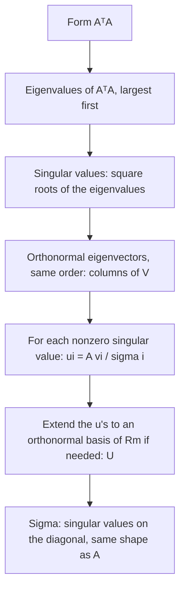

## A factorization for every matrix

Diagonalization needs a square matrix with enough eigenvectors, and orthogonal
diagonalization needs a symmetric one. The **singular value decomposition** (SVD) works for
*every* matrix, square or not. It says that any linear transformation, seen in the right
orthonormal coordinates on the input side and the output side, simply stretches along
perpendicular axes. The SVD is the workhorse behind image compression, recommendation
systems, principal component analysis and numerically reliable least squares. This lesson
is an introduction: what the SVD is, how to compute it for small matrices, and what it tells
you.

## Singular values

Let $A$ be $m \times n$. The matrix $A^TA$ is $n \times n$ and symmetric, so it has orthonormal
eigenvectors $\mathbf{v}_1, \dots, \mathbf{v}_n$ with real eigenvalues $\lambda_1, \dots, \lambda_n$.
They are never negative:

$$\|A\mathbf{v}_i\|^2 = \mathbf{v}_i^TA^TA\mathbf{v}_i = \lambda_i\mathbf{v}_i^T\mathbf{v}_i = \lambda_i \ge 0.$$

Order them so $\lambda_1 \ge \lambda_2 \ge \cdots \ge \lambda_n \ge 0$. The **singular values** of $A$
are $\sigma_i = \sqrt{\lambda_i}$, so $\sigma_1 \ge \sigma_2 \ge \cdots \ge 0$. By the computation
above, $\sigma_i = \|A\mathbf{v}_i\|$: the singular values are the lengths of the images of the
orthonormal vectors $\mathbf{v}_i$.

Geometrically, $A$ maps the unit sphere to an ellipsoid (possibly flattened), and the singular
values are the lengths of its semi-axes. $\sigma_1$ is the largest stretch $A$ applies to any
unit vector.

## The decomposition

> *Singular value decomposition.* Let $A$ be $m \times n$ with rank $r$. Then
> $$A = U\Sigma V^T,$$
> where $V$ is an $n \times n$ orthogonal matrix whose columns $\mathbf{v}_i$ (the **right singular vectors**) are orthonormal eigenvectors of $A^TA$; $\Sigma$ is $m \times n$ with $\sigma_1, \dots, \sigma_r$ on its diagonal and zeros elsewhere; and $U$ is an $m \times m$ orthogonal matrix whose first $r$ columns (the **left singular vectors**) are $\mathbf{u}_i = \dfrac{1}{\sigma_i}A\mathbf{v}_i$.

Why the $\mathbf{u}_i$ are orthonormal: for $i \neq j$,
$(A\mathbf{v}_i)\cdot(A\mathbf{v}_j) = \mathbf{v}_i^TA^TA\mathbf{v}_j = \lambda_j\mathbf{v}_i\cdot\mathbf{v}_j = 0$, and
dividing by $\sigma_i$ makes them unit vectors. Then $AV = U\Sigma$ column by column, so
$A = U\Sigma V^T$. (If $r < m$, extend $\mathbf{u}_1, \dots, \mathbf{u}_r$ to an orthonormal basis of
$\mathbb{R}^m$ to fill out $U$.)

Reading the SVD: $V^T$ rotates the input into the $\mathbf{v}$-coordinates, $\Sigma$ stretches
each axis by $\sigma_i$, and $U$ rotates into the output coordinates. (An orthogonal matrix
can also include a reflection, so "rotate" here means "rotate, possibly with a flip".)

The picture follows a unit circle through the three steps (it is a sketch: the circle and the ellipses are not drawn to the same scale). $V^T$ turns the right singular vectors $\mathbf{v}_1, \mathbf{v}_2$ into the standard axes $\mathbf{e}_1, \mathbf{e}_2$, $\Sigma$ stretches the axes by $\sigma_1$ and $\sigma_2$, and $U$ turns the stretched axes to $\sigma_1\mathbf{u}_1$ and $\sigma_2\mathbf{u}_2$. Doing all three is the same as multiplying by $A$.

![Four panels in a cycle. Top left: a unit circle with perpendicular unit vectors v1 and v2. An arrow labeled V transpose leads to the top right panel: the same circle with v1 and v2 now along the axes as e1 and e2. An arrow labeled Sigma leads down to the bottom right panel: an ellipse with semi-axes sigma1 e1 and sigma2 e2 along the coordinate axes. An arrow labeled U leads to the bottom left panel: the ellipse turned so its semi-axes are sigma1 u1 and sigma2 u2. A dashed arrow labeled A goes straight from the first panel to the last.](images/la-m9-svd-steps.svg)

The hand computation always follows the same steps:



### Example 1

Find the singular values and an SVD of $A = \begin{bmatrix} 3 & 0 \\ 4 & 5\end{bmatrix}$.

1. $A^TA = \begin{bmatrix} 3 & 4 \\ 0 & 5\end{bmatrix}\begin{bmatrix} 3 & 0 \\ 4 & 5\end{bmatrix} = \begin{bmatrix} 25 & 20 \\ 20 & 25\end{bmatrix}$.
2. Eigenvalues: trace 50, determinant $625 - 400 = 225$, so $\lambda^2 - 50\lambda + 225 = (\lambda - 45)(\lambda - 5)$: $\lambda_1 = 45$, $\lambda_2 = 5$.
3. Singular values: $\sigma_1 = \sqrt{45} = 3\sqrt5 \approx 6.71$ and $\sigma_2 = \sqrt5 \approx 2.24$.
4. Eigenvectors of $A^TA$: $\mathbf{v}_1 = \tfrac{1}{\sqrt2}(1, 1)$ and $\mathbf{v}_2 = \tfrac{1}{\sqrt2}(1, -1)$.
5. $A\mathbf{v}_1 = \tfrac{1}{\sqrt2}(3, 9)$, so $\mathbf{u}_1 = \dfrac{1}{3\sqrt5}\cdot\dfrac{1}{\sqrt2}(3, 9) = \tfrac{1}{\sqrt{10}}(1, 3)$. And $A\mathbf{v}_2 = \tfrac{1}{\sqrt2}(3, -1)$, so $\mathbf{u}_2 = \tfrac{1}{\sqrt{10}}(3, -1)$.
6. $A = U\Sigma V^T$ with $U = \dfrac{1}{\sqrt{10}}\begin{bmatrix} 1 & 3 \\ 3 & -1\end{bmatrix}$, $\Sigma = \begin{bmatrix} 3\sqrt5 & 0 \\ 0 & \sqrt5\end{bmatrix}$, $V = \dfrac{1}{\sqrt2}\begin{bmatrix} 1 & 1 \\ 1 & -1\end{bmatrix}$.

Check: $\sigma_1\sigma_2 = 15 = |\det A|$, as it must be for a square matrix (orthogonal
matrices have determinant $\pm1$).

```plot
{"x": [-7, 7], "y": [-7, 7], "equal": true, "curves": [{"x": "cos(t)", "y": "sin(t)", "t": [0, "2pi"], "dashed": true}, {"x": "3*cos(t)", "y": "4*cos(t) + 5*sin(t)", "t": [0, "2pi"]}], "segments": [{"from": [0, 0], "to": [2.121, 6.364], "arrow": true, "label": "σ₁u₁"}, {"from": [0, 0], "to": [2.121, -0.707], "arrow": true, "label": "σ₂u₂"}], "caption": "A maps the unit circle (dashed) to an ellipse with semi-axes σ₁ ≈ 6.71 and σ₂ ≈ 2.24"}
```

## What the SVD tells you

- *Rank.* The rank of $A$ equals the number of nonzero singular values. For $A = \begin{bmatrix} 1 & 1 \\ 1 & 1 \\ 0 & 0\end{bmatrix}$, $A^TA = \begin{bmatrix} 2 & 2 \\ 2 & 2\end{bmatrix}$ has eigenvalues 4 and 0, so $\sigma_1 = 2$, $\sigma_2 = 0$ and the rank is 1.
- *Bases for the fundamental subspaces.* $\mathbf{u}_1, \dots, \mathbf{u}_r$ is an orthonormal basis for $\operatorname{Col} A$, and $\mathbf{v}_{r+1}, \dots, \mathbf{v}_n$ is one for $\operatorname{Nul} A$.
- *Low-rank approximation.* $A = \sigma_1\mathbf{u}_1\mathbf{v}_1^T + \cdots + \sigma_r\mathbf{u}_r\mathbf{v}_r^T$. Keeping only the first $k$ terms gives the best rank-$k$ approximation of $A$; this is how an image stored as a matrix can be compressed by keeping its largest singular values.
- *Sensitivity.* For an invertible $n \times n$ matrix, the **condition number** $\sigma_1/\sigma_n$ measures how much relative errors in $\mathbf{b}$ can be magnified in the solution of $A\mathbf{x} = \mathbf{b}$. A huge condition number means the matrix is nearly singular.
- *Least squares.* The **pseudoinverse** $A^+ = V_r\Sigma_r^{-1}U_r^T$ (using only the nonzero singular values and their vectors) gives $\hat{\mathbf{x}} = A^+\mathbf{b}$, the least-squares solution of smallest length.

For a symmetric positive semidefinite matrix, the SVD is just the orthogonal diagonalization:
the singular values are the eigenvalues. In general they're different: the eigenvalues of
$\begin{bmatrix} 3 & 0 \\ 4 & 5\end{bmatrix}$ are 3 and 5, but its singular values are about
6.71 and 2.24.

## Common mistakes

- *Taking eigenvalues of $A$ instead of $A^TA$.* Singular values are square roots of the eigenvalues of $A^TA$.
- *Forgetting the square root.* $\lambda = 45$ gives $\sigma = \sqrt{45}$, not 45.
- *Wrong order.* Singular values are listed from largest to smallest, and the columns of $U$ and $V$ follow the same order.
- *Computing $\mathbf{u}_i$ independently* as eigenvectors of $AA^T$ without matching signs. Using $\mathbf{u}_i = A\mathbf{v}_i/\sigma_i$ guarantees the pieces fit.
- *Expecting $\Sigma$ to be square.* It has the same shape as $A$.

## Key points

- Singular values: $\sigma_i = \sqrt{\lambda_i(A^TA)} = \|A\mathbf{v}_i\|$, in decreasing order; they're the semi-axes of the image of the unit sphere.
- $A = U\Sigma V^T$: $V$ from orthonormal eigenvectors of $A^TA$, $\mathbf{u}_i = A\mathbf{v}_i/\sigma_i$, $\Sigma$ the same size as $A$.
- Rank = number of nonzero singular values; the SVD gives orthonormal bases for $\operatorname{Col} A$ and $\operatorname{Nul} A$.
- Applications: best low-rank approximation, condition number $\sigma_1/\sigma_n$, pseudoinverse for least squares.
