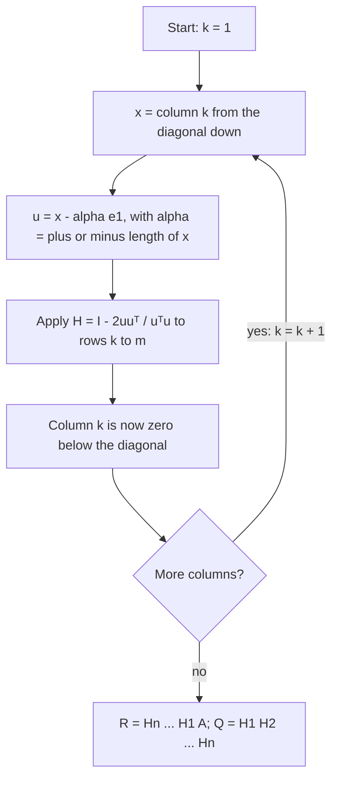

## Why software doesn't use Gram–Schmidt

The Gram–Schmidt lesson ended with a remark: computer libraries compute $A = QR$ with
"more stable methods (Householder reflections)". This lesson explains both halves of that
sentence. First, *why* Gram–Schmidt can fail on a computer even though every formula in it
is correct. Then the alternative: instead of building $Q$ one projection at a time, reflect
the columns of $A$ into upper triangular form with orthogonal matrices, which never distort
lengths. The idea is due to Alston Householder (1958), and it is still how standard
numerical libraries compute QR factorizations.

## How Gram–Schmidt loses orthogonality

Computers store numbers with about 16 significant digits, so a sum like $1 + 10^{-16}$ is
stored as exactly 1. Usually this rounding is harmless, but Gram–Schmidt subtracts nearly
equal vectors when the columns of $A$ are nearly dependent, and the rounding errors that
survive the subtraction are no longer small compared with what's left.

### Example 1

Take $\varepsilon = 10^{-8}$, so that $\varepsilon^2 = 10^{-16}$ and the computer treats $1 + \varepsilon^2$ as 1. Run Gram–Schmidt on
$$\mathbf{a}_1 = (1, \varepsilon, 0, 0), \quad \mathbf{a}_2 = (1, 0, \varepsilon, 0), \quad \mathbf{a}_3 = (1, 0, 0, \varepsilon),$$
rounding the way the computer does.

1. $\|\mathbf{a}_1\| = \sqrt{1 + \varepsilon^2}$ rounds to 1, so $\mathbf{q}_1 = (1, \varepsilon, 0, 0)$.
2. $\mathbf{a}_2\cdot\mathbf{q}_1 = 1$, so $\mathbf{v}_2 = \mathbf{a}_2 - \mathbf{q}_1 = (0, -\varepsilon, \varepsilon, 0)$ and $\mathbf{q}_2 = \tfrac{1}{\sqrt2}(0, -1, 1, 0)$.
3. $\mathbf{a}_3\cdot\mathbf{q}_1 = 1$ and $\mathbf{a}_3\cdot\mathbf{q}_2 = 0$, so $\mathbf{v}_3 = \mathbf{a}_3 - \mathbf{q}_1 = (0, -\varepsilon, 0, \varepsilon)$ and $\mathbf{q}_3 = \tfrac{1}{\sqrt2}(0, -1, 0, 1)$.
4. But $\mathbf{q}_2\cdot\mathbf{q}_3 = \tfrac12$. The angle between them is $60^\circ$, not $90^\circ$.

In exact arithmetic the three $\mathbf{q}$'s would be orthonormal. One rounding in step 1,
far too small to matter by itself, left tiny errors in $\mathbf{q}_1$. Subtracting $\mathbf{q}_1$
cancelled the large parts of $\mathbf{a}_2$ and $\mathbf{a}_3$, leaving vectors of size about
$\varepsilon$ in which those errors are no longer tiny. (Running this in double-precision
arithmetic gives $\mathbf{q}_2\cdot\mathbf{q}_3 \approx 0.5$, as predicted.)

A partial fix is **modified Gram–Schmidt**: subtract the projections one at a time, each
computed from the *current, already reduced* vector instead of from the original $\mathbf{a}_k$.
In step 3 that means $\mathbf{w} = \mathbf{a}_3 - (\mathbf{a}_3\cdot\mathbf{q}_1)\mathbf{q}_1 = (0, -\varepsilon, 0, \varepsilon)$,
then $\mathbf{w} - (\mathbf{w}\cdot\mathbf{q}_2)\mathbf{q}_2 = (0, -\tfrac{\varepsilon}{2}, -\tfrac{\varepsilon}{2}, \varepsilon)$,
which *is* orthogonal to $\mathbf{q}_2$. In exact arithmetic the two versions are identical;
with rounding, the modified one is much better, though it can still lose some orthogonality
when the columns are very nearly dependent.

## Householder reflections

For a nonzero vector $\mathbf{u}$ in $\mathbb{R}^n$, the **Householder reflection** (or Householder
matrix) is

$$H = I - \frac{2}{\mathbf{u}^T\mathbf{u}}\,\mathbf{u}\mathbf{u}^T.$$

Why it is a reflection: write any $\mathbf{x}$ as $\mathbf{x} = \hat{\mathbf{x}} + \mathbf{z}$, its projection
onto $\mathbf{u}$ plus a part orthogonal to $\mathbf{u}$. Since $\dfrac{\mathbf{u}\mathbf{u}^T}{\mathbf{u}^T\mathbf{u}}\mathbf{x} = \dfrac{\mathbf{u}^T\mathbf{x}}{\mathbf{u}^T\mathbf{u}}\mathbf{u} = \hat{\mathbf{x}}$,
we get $H\mathbf{x} = \mathbf{x} - 2\hat{\mathbf{x}} = \mathbf{z} - \hat{\mathbf{x}}$. The part along $\mathbf{u}$
flips sign and the part perpendicular to $\mathbf{u}$ is untouched. So $H$ reflects across the
**hyperplane** $\mathbf{u}^\perp$, the $(n - 1)$-dimensional subspace orthogonal to $\mathbf{u}$
(a line in $\mathbb{R}^2$, a plane in $\mathbb{R}^3$). Consequences:

- $H\mathbf{u} = -\mathbf{u}$, and $H\mathbf{w} = \mathbf{w}$ for every $\mathbf{w}$ orthogonal to $\mathbf{u}$;
- $H$ is symmetric ($H^T = H$, since $(\mathbf{u}\mathbf{u}^T)^T = \mathbf{u}\mathbf{u}^T$);
- $H^2 = I$ (reflecting twice gives back the vector), so $H^{-1} = H = H^T$ and $H$ is an orthogonal matrix;
- $\|H\mathbf{x}\| = \|\mathbf{x}\|$ for every $\mathbf{x}$, and $\det H = -1$.

Rescaling $\mathbf{u}$ doesn't change $H$, so you may clear fractions in $\mathbf{u}$ first.

## Sending a vector onto an axis

Here is the key trick. Given $\mathbf{x} \ne \mathbf{0}$, we want a reflection with
$H\mathbf{x} = \alpha\mathbf{e}_1$: all entries after the first become 0. Reflections keep
lengths, so $\alpha = \pm\|\mathbf{x}\|$. Take

$$\mathbf{u} = \mathbf{x} - \alpha\mathbf{e}_1.$$

*Why it works.* $\mathbf{u}^T\mathbf{x} = \|\mathbf{x}\|^2 - \alpha x_1$ and
$\mathbf{u}^T\mathbf{u} = \|\mathbf{x}\|^2 - 2\alpha x_1 + \alpha^2 = 2(\|\mathbf{x}\|^2 - \alpha x_1)$, using
$\alpha^2 = \|\mathbf{x}\|^2$. So $\dfrac{2\,\mathbf{u}^T\mathbf{x}}{\mathbf{u}^T\mathbf{u}} = 1$ and
$H\mathbf{x} = \mathbf{x} - \mathbf{u} = \alpha\mathbf{e}_1$. Geometrically, the mirror is the hyperplane
halfway between $\mathbf{x}$ and $\alpha\mathbf{e}_1$.

```plot
{"x": [-2.5, 6], "y": [-1.5, 5], "equal": true, "functions": [{"f": "x/2", "dashed": true, "label": "mirror"}], "segments": [{"from": [0, 0], "to": [3, 4], "arrow": true, "label": "x"}, {"from": [0, 0], "to": [5, 0], "arrow": true}, {"from": [3, 4], "to": [5, 0], "dashed": true}, {"from": [0, 0], "to": [-2, 4], "arrow": true}], "labels": [{"at": [3.6, 0.35], "text": "Hx = 5e₁"}, {"at": [-1.15, 4.6], "text": "u = x − 5e₁"}], "caption": "For x = (3, 4), u = x − 5e₁ = (−2, 4); H reflects x across the line perpendicular to u (y = x/2) onto (5, 0)"}
```

*Which sign?* By hand, either works. Software takes $\alpha = -\operatorname{sign}(x_1)\|\mathbf{x}\|$
(the sign opposite to $x_1$). Then computing $u_1 = x_1 - \alpha$ adds two numbers of the same
sign instead of subtracting nearly equal ones, which would happen when $\mathbf{x}$ already
points almost along $\mathbf{e}_1$.

### Example 2

Find a Householder matrix $H$ with $H\mathbf{x} = \|\mathbf{x}\|\mathbf{e}_1$ for $\mathbf{x} = (2, 1, 2)$.

1. $\|\mathbf{x}\| = \sqrt{4 + 1 + 4} = 3$, so $\alpha = 3$ and $\mathbf{u} = (2 - 3, 1, 2) = (-1, 1, 2)$, with $\mathbf{u}^T\mathbf{u} = 6$.
2. $H = I - \tfrac{2}{6}\mathbf{u}\mathbf{u}^T = I - \tfrac13\begin{bmatrix} 1 & -1 & -2 \\ -1 & 1 & 2 \\ -2 & 2 & 4\end{bmatrix} = \dfrac13\begin{bmatrix} 2 & 1 & 2 \\ 1 & 2 & -2 \\ 2 & -2 & -1\end{bmatrix}$.
3. Check: $H\mathbf{x} = \tfrac13(4 + 1 + 4,\ 2 + 2 - 4,\ 4 - 2 - 2) = (3, 0, 0)$. ✓ The columns of $H$ are orthonormal (each has length $\tfrac13\sqrt{9} = 1$), and $H$ is symmetric.

(With software's sign, $\alpha = -3$ and $\mathbf{u} = (5, 1, 2)$, giving $H\mathbf{x} = (-3, 0, 0)$.)

## Householder QR

Apply this column by column, the way elimination clears a column below a pivot, but with
orthogonal matrices instead of row replacements:

1. Choose $H_1$ that sends column 1 of $A$ to $(\pm\|\mathbf{a}_1\|, 0, \dots, 0)$. Multiply: $H_1A$ has zeros below the first entry of column 1.
2. Choose a reflection $\hat H_2$ of size $m - 1$ that does the same to the part of column 2 *below row 1*, and set $H_2 = \begin{bmatrix} 1 & \mathbf{0}^T \\ \mathbf{0} & \hat H_2\end{bmatrix}$. It leaves row 1 and column 1 alone.
3. Continue to column $n$. Then $H_n\cdots H_2H_1A = R$, an $m \times n$ matrix that is upper triangular (zeros below the diagonal).

Each $H_k$ is its own inverse, so $A = H_1H_2\cdots H_nR = QR$ with $Q = H_1H_2\cdots H_n$, an
$m \times m$ orthogonal matrix. Its first $n$ columns, with the top $n$ rows of $R$, give the
factorization from the Gram–Schmidt lesson. If a diagonal entry of $R$ comes out negative,
multiply that row of $R$ and the matching column of $Q$ by $-1$ to get the
positive-diagonal version; when the columns of $A$ are independent, the factorization with positive diagonal is unique, so both
methods produce the same $Q$ and $R$ in exact arithmetic.



### Example 3

Find the QR factorization of $A = \begin{bmatrix} 2 & 4 \\ 1 & 1 \\ 2 & -3\end{bmatrix}$ with Householder reflections.

1. Column 1 is $(2, 1, 2)$, so $H_1$ is the matrix of Example 2. Multiply column 2: $H_1(4, 1, -3) = \tfrac13(8 + 1 - 6,\ 4 + 2 + 6,\ 8 - 2 + 3) = (1, 4, 3)$. So $H_1A = \begin{bmatrix} 3 & 1 \\ 0 & 4 \\ 0 & 3\end{bmatrix}$.
2. Below row 1, column 2 is $\hat{\mathbf{x}} = (4, 3)$ with length 5. Take $\hat{\mathbf{u}} = (4 - 5, 3) = (-1, 3)$, $\hat{\mathbf{u}}^T\hat{\mathbf{u}} = 10$, and $\hat H_2 = I - \tfrac{2}{10}\begin{bmatrix} 1 & -3 \\ -3 & 9\end{bmatrix} = \tfrac15\begin{bmatrix} 4 & 3 \\ 3 & -4\end{bmatrix}$. Check: $\hat H_2(4, 3) = \tfrac15(25, 0) = (5, 0)$. ✓
3. So $R = \begin{bmatrix} 3 & 1 \\ 0 & 5 \\ 0 & 0\end{bmatrix}$; its top block $\begin{bmatrix} 3 & 1 \\ 0 & 5\end{bmatrix}$ already has a positive diagonal.
4. The first two columns of $Q = H_1H_2$ are $H_1\mathbf{e}_1 = \tfrac13(2, 1, 2)$ and $H_1(0, \tfrac45, \tfrac35) = \left(\tfrac23, \tfrac{2}{15}, -\tfrac{11}{15}\right)$.
5. Check column 2 of $A$: $1\cdot\tfrac13(2, 1, 2) + 5\left(\tfrac23, \tfrac{2}{15}, -\tfrac{11}{15}\right) = \left(\tfrac23 + \tfrac{10}{3},\ \tfrac13 + \tfrac23,\ \tfrac23 - \tfrac{11}{3}\right) = (4, 1, -3)$. ✓

Gram–Schmidt gives the same answer here: $\mathbf{q}_1 = \tfrac13(2, 1, 2)$ and $r_{12} = \mathbf{q}_1\cdot\mathbf{a}_2 = \tfrac13(8 + 1 - 6) = 1$.

## Why this is more reliable

Every step multiplies by an orthogonal matrix, which doesn't change lengths, so rounding
errors are never magnified by the method itself. In floating-point arithmetic, the computed
$Q$ is orthogonal to about the machine precision, *whatever* the columns of $A$ look like;
for the matrix of Example 1, a Householder QR in double precision gives $\mathbf{q}$'s whose
dot products are around $10^{-16}$, against 0.5 for classical Gram–Schmidt. (The accuracy of
$R$ and of a least-squares solution still depends on the conditioning of $A$; no method can
fix a problem that is itself sensitive.)

Two practical notes. Software usually doesn't form $H$ as a matrix: applying $H$ to a vector is
$\mathbf{y} - \dfrac{2\,\mathbf{u}^T\mathbf{y}}{\mathbf{u}^T\mathbf{u}}\mathbf{u}$, one dot product and one vector
update. And the cost is modest: for an $m \times n$ matrix, Householder QR takes roughly
$2mn^2 - \tfrac23n^3$ arithmetic operations, against about $2mn^2$ for Gram–Schmidt (standard
counts from numerical analysis texts). For sparse matrices, *Givens rotations*, which zero
one entry at a time with a rotation in two coordinates, are often preferred.

## Common mistakes

- *Dividing by $\|\mathbf{u}\|$ instead of $\mathbf{u}^T\mathbf{u}$.* $H = I - \dfrac{2\mathbf{u}\mathbf{u}^T}{\mathbf{u}^T\mathbf{u}}$; with a unit $\mathbf{u}$ it is $I - 2\mathbf{u}\mathbf{u}^T$.
- *Forgetting the 2.* $I - \dfrac{\mathbf{u}\mathbf{u}^T}{\mathbf{u}^T\mathbf{u}}$ is the projection onto $\mathbf{u}^\perp$, not the reflection.
- *Using $\mathbf{u} = \mathbf{x} - \mathbf{e}_1$.* The target must have the same length as $\mathbf{x}$: $\mathbf{u} = \mathbf{x} - \alpha\mathbf{e}_1$ with $|\alpha| = \|\mathbf{x}\|$.
- *Applying $\hat H_2$ to the whole matrix.* The second reflection acts on rows 2 to $m$ only; row 1 is finished.
- *Thinking Gram–Schmidt is wrong.* Its formulas are exact; the trouble is rounding when columns are nearly dependent.

## Key points

- Classical Gram–Schmidt can lose orthogonality badly in floating-point arithmetic; modified Gram–Schmidt is better; Householder QR keeps $Q$ orthogonal to machine precision.
- $H = I - \dfrac{2\mathbf{u}\mathbf{u}^T}{\mathbf{u}^T\mathbf{u}}$ reflects across $\mathbf{u}^\perp$; it is symmetric, orthogonal and its own inverse.
- $\mathbf{u} = \mathbf{x} - \alpha\mathbf{e}_1$ with $\alpha = \pm\|\mathbf{x}\|$ gives $H\mathbf{x} = \alpha\mathbf{e}_1$; software picks the sign of $\alpha$ opposite to $x_1$.
- $H_n\cdots H_1A = R$ and $Q = H_1\cdots H_n$; fix negative diagonal entries of $R$ by flipping signs in matching rows of $R$ and columns of $Q$.
