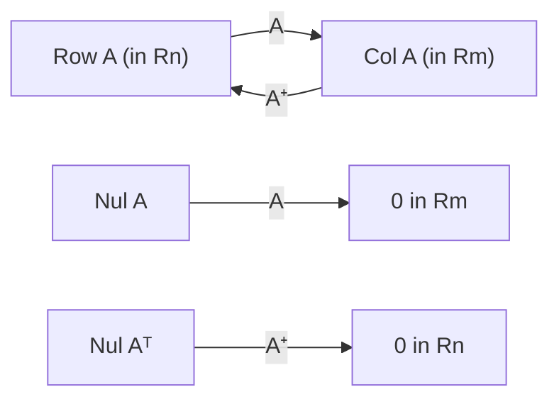

## Two promises from the SVD lesson

The SVD lesson ended with a list of what the decomposition tells you, including two claims
stated without proof: the pseudoinverse gives "the least-squares solution of smallest
length", and keeping the first $k$ terms of $\sigma_1\mathbf{u}_1\mathbf{v}_1^T + \cdots + \sigma_r\mathbf{u}_r\mathbf{v}_r^T$
gives "the best rank-$k$ approximation". This lesson makes both precise, proves what can be
proved with the tools of this course, and shows how to compute with them. Both ideas rest on
the same picture: the SVD hands you orthonormal bases for the four fundamental subspaces,
and orthonormal bases make projections and lengths easy.

## Least squares when the columns are dependent

The least-squares lesson promised a unique solution only when $A$ has independent columns.
Otherwise the normal equations $A^TA\mathbf{x} = A^T\mathbf{b}$ have free variables, and any two
solutions differ by a vector of $\operatorname{Nul} A$ (since $A^TA\mathbf{x} = \mathbf{0}$ exactly when
$\|A\mathbf{x}\|^2 = \mathbf{x}^TA^TA\mathbf{x} = 0$). Every one of them gives the same $A\hat{\mathbf{x}}$, the
projection of $\mathbf{b}$, so which should we report? The natural choice is the shortest.

> *Theorem.* Exactly one least-squares solution of $A\mathbf{x} = \mathbf{b}$ lies in $\operatorname{Row} A$, and it is shorter than every other least-squares solution. It is called the **minimum-norm least-squares solution**.

*Proof.* Take any least-squares solution $\hat{\mathbf{x}}$ and split it as
$\hat{\mathbf{x}} = \mathbf{x}_r + \mathbf{x}_n$ with $\mathbf{x}_r$ in $\operatorname{Row} A$ and $\mathbf{x}_n$ in
$\operatorname{Nul} A = (\operatorname{Row} A)^\perp$ (the orthogonal decomposition theorem). Then
$A\mathbf{x}_r = A\hat{\mathbf{x}}$, so $\mathbf{x}_r$ is also a least-squares solution, and by Pythagoras
$\|\hat{\mathbf{x}}\|^2 = \|\mathbf{x}_r\|^2 + \|\mathbf{x}_n\|^2 \ge \|\mathbf{x}_r\|^2$. If two least-squares
solutions were in $\operatorname{Row} A$, their difference would be in both $\operatorname{Row} A$ and
$\operatorname{Nul} A$, so it would be orthogonal to itself, hence $\mathbf{0}$. $\square$

## The pseudoinverse

Let $A$ have rank $r$ and SVD $A = U\Sigma V^T$. Only the first $r$ columns of $U$ and $V$ meet
nonzero singular values, so

$$A = U_r\Sigma_rV_r^T,$$

where $U_r = [\mathbf{u}_1 \cdots \mathbf{u}_r]$, $V_r = [\mathbf{v}_1 \cdots \mathbf{v}_r]$ and
$\Sigma_r = \operatorname{diag}(\sigma_1, \dots, \sigma_r)$ is invertible. This is the **reduced SVD**.
Its pieces are orthonormal bases: $\mathbf{u}_1, \dots, \mathbf{u}_r$ for $\operatorname{Col} A$ and
$\mathbf{v}_1, \dots, \mathbf{v}_r$ for $\operatorname{Row} A$ (the remaining $\mathbf{v}$'s span
$\operatorname{Nul} A$, whose orthogonal complement is $\operatorname{Row} A$). Reversing every step gives
the pseudoinverse

$$A^+ = V_r\Sigma_r^{-1}U_r^T = \frac{1}{\sigma_1}\mathbf{v}_1\mathbf{u}_1^T + \cdots + \frac{1}{\sigma_r}\mathbf{v}_r\mathbf{u}_r^T.$$

> *Theorem.* $\mathbf{x}^+ = A^+\mathbf{b}$ is the minimum-norm least-squares solution of $A\mathbf{x} = \mathbf{b}$.

*Proof.* $A\mathbf{x}^+ = U_r\Sigma_rV_r^TV_r\Sigma_r^{-1}U_r^T\mathbf{b} = U_rU_r^T\mathbf{b}$, using
$V_r^TV_r = I$. Since the columns of $U_r$ are an orthonormal basis of $\operatorname{Col} A$,
$U_rU_r^T\mathbf{b}$ is the projection of $\mathbf{b}$ onto $\operatorname{Col} A$, so $\mathbf{x}^+$ is a
least-squares solution. And $\mathbf{x}^+ = V_r(\Sigma_r^{-1}U_r^T\mathbf{b})$ is a combination of
$\mathbf{v}_1, \dots, \mathbf{v}_r$, so it lies in $\operatorname{Row} A$. By the previous theorem it is the
shortest. $\square$

The proof also shows that $AA^+ = U_rU_r^T$ is the projection matrix onto $\operatorname{Col} A$,
and similarly $A^+A = V_rV_r^T$ is the projection onto $\operatorname{Row} A$. So $A^+$ undoes
$A$ as far as anything can: it inverts the stretch from $\operatorname{Row} A$ onto $\operatorname{Col} A$
and sends $\operatorname{Nul} A^T$ to $\mathbf{0}$.



Useful special cases, each a quick check from the formula:

| $A$ | $A^+$ |
|---|---|
| invertible | $A^{-1}$ |
| independent columns | $(A^TA)^{-1}A^T$ (the normal-equations solution) |
| rank one, $A = \sigma\mathbf{u}\mathbf{v}^T$ | $\tfrac{1}{\sigma}\mathbf{v}\mathbf{u}^T = \dfrac{A^T}{\sigma^2}$, where $\sigma^2$ is the sum of the squares of the entries of $A$ |
| rectangular diagonal | transpose it and invert the nonzero entries |

The pseudoinverse is also called the *Moore–Penrose inverse*: E. H. Moore described it in
1920, and Roger Penrose rediscovered it in 1955 and characterized it as the only matrix $X$
with $AXA = A$, $XAX = X$ and both $AX$ and $XA$ symmetric.

### Example 1

Find all least-squares solutions of $A\mathbf{x} = \mathbf{b}$ for $A = \begin{bmatrix} 1 & 1 \\ 1 & 1 \\ 0 & 0\end{bmatrix}$ and $\mathbf{b} = (1, 3, 5)$, and the minimum-norm one.

1. Normal equations: $A^TA = \begin{bmatrix} 2 & 2 \\ 2 & 2\end{bmatrix}$ and $A^T\mathbf{b} = (4, 4)$, so $x_1 + x_2 = 2$: a whole line of solutions, such as $(2, 0)$, $(0, 2)$ and $(1, 1)$.
2. $A$ has rank one with $\sigma_1 = 2$ (the SVD lesson found this); the squares of its entries add to $4 = \sigma_1^2$. So $A^+ = \dfrac{A^T}{4} = \dfrac14\begin{bmatrix} 1 & 1 & 0 \\ 1 & 1 & 0\end{bmatrix}$.
3. $\mathbf{x}^+ = A^+\mathbf{b} = \tfrac14(4, 4) = (1, 1)$. It lies in $\operatorname{Row} A = \operatorname{Span}\{(1, 1)\}$, and its length $\sqrt2$ beats $\|(2, 0)\| = 2$.
4. Check: $A\mathbf{x}^+ = (2, 2, 0)$ and $\mathbf{b} - A\mathbf{x}^+ = (-1, 1, 5)$, which is orthogonal to both columns $(1, 1, 0)$. ✓

### Example 2

Find the solution of $x_1 + 2x_2 + 2x_3 = 9$ closest to the origin.

1. This is $A\mathbf{x} = 9$ with the $1 \times 3$ matrix $A = \begin{bmatrix} 1 & 2 & 2\end{bmatrix}$, rank one, sum of squares 9. So $A^+ = \tfrac19(1, 2, 2)$, a column.
2. $\mathbf{x}^+ = 9A^+ = (1, 2, 2)$. Check: $1 + 4 + 4 = 9$. ✓
3. Geometrically, the solutions form a plane with normal vector $(1, 2, 2)$, and the closest point to the origin lies along the normal. Its distance from the origin is $\|\mathbf{x}^+\| = 3$.

## Measuring the size of a matrix

To say one matrix approximates another, we need a distance between matrices. Two
standard choices:

- The **Frobenius norm** $\|A\|_F = \sqrt{\sum_{i,j} a_{ij}^2}$, the length of $A$ treated as one long vector of its entries.
- The **spectral norm** $\|A\|_2 = \max_{\|\mathbf{x}\| = 1}\|A\mathbf{x}\|$, the largest stretch $A$ applies to a unit vector.

Both are read off from the singular values:

$$\|A\|_2 = \sigma_1, \qquad \|A\|_F = \sqrt{\sigma_1^2 + \sigma_2^2 + \cdots + \sigma_r^2}.$$

The first is the SVD lesson's description of $\sigma_1$. For the second, $\|A\|_F^2$ is the sum of
the squared lengths of the columns, which is the sum of the diagonal entries of $A^TA$, its
trace. The trace equals the sum of the eigenvalues of $A^TA$, which are the $\sigma_i^2$. For
$A = \begin{bmatrix} 3 & 0 \\ 4 & 5\end{bmatrix}$: $9 + 0 + 16 + 25 = 50 = 45 + 5$. ✓

## The best rank-k approximation

Write $A = \sigma_1\mathbf{u}_1\mathbf{v}_1^T + \cdots + \sigma_r\mathbf{u}_r\mathbf{v}_r^T$ and keep the first
$k < r$ terms:

$$A_k = \sigma_1\mathbf{u}_1\mathbf{v}_1^T + \cdots + \sigma_k\mathbf{u}_k\mathbf{v}_k^T.$$

$A_k$ has rank $k$, and the leftover $A - A_k = \sigma_{k+1}\mathbf{u}_{k+1}\mathbf{v}_{k+1}^T + \cdots + \sigma_r\mathbf{u}_r\mathbf{v}_r^T$
is itself written in SVD form, with singular values $\sigma_{k+1}, \dots, \sigma_r$. So by the norm
formulas,

$$\|A - A_k\|_2 = \sigma_{k+1}, \qquad \|A - A_k\|_F = \sqrt{\sigma_{k+1}^2 + \cdots + \sigma_r^2}.$$

> The **Eckart–Young theorem**: no matrix of rank at most $k$ is closer to $A$ than $A_k$, in either the spectral or the Frobenius norm.

The error formulas above are fully proved; the claim that *nothing* of rank $k$ does better
needs more work, and we state it without proof. Carl Eckart and Gale Young published the
Frobenius-norm version in 1936 (Erhard Schmidt had proved a version for integral equations
in 1907), and Leon Mirsky extended it to other norms in 1960.

### Example 3

Find the best rank-one approximation of $A = \begin{bmatrix} 3 & 0 \\ 4 & 5\end{bmatrix}$ and its error.

1. From the SVD lesson: $\sigma_1 = 3\sqrt5$, $\mathbf{u}_1 = \tfrac{1}{\sqrt{10}}(1, 3)$, $\mathbf{v}_1 = \tfrac{1}{\sqrt2}(1, 1)$, and $\sigma_2 = \sqrt5$.
2. $A_1 = \sigma_1\mathbf{u}_1\mathbf{v}_1^T = \dfrac{3\sqrt5}{\sqrt{20}}\begin{bmatrix} 1 & 1 \\ 3 & 3\end{bmatrix} = \dfrac32\begin{bmatrix} 1 & 1 \\ 3 & 3\end{bmatrix} = \begin{bmatrix} 1.5 & 1.5 \\ 4.5 & 4.5\end{bmatrix}$.
3. $A - A_1 = \begin{bmatrix} 1.5 & -1.5 \\ -0.5 & 0.5\end{bmatrix}$, and $\|A - A_1\|_F^2 = 2.25 + 2.25 + 0.25 + 0.25 = 5 = \sigma_2^2$. ✓
4. The error is $\sqrt5 \approx 2.24$ in both norms (only one singular value is left over).

### Example 4

A $1000 \times 800$ matrix (say, a grayscale image) is stored as $800{,}000$ numbers. Its rank-$k$ approximation needs only $\mathbf{u}_1, \dots, \mathbf{u}_k$, $\mathbf{v}_1, \dots, \mathbf{v}_k$ and $\sigma_1, \dots, \sigma_k$: $k(1000 + 800 + 1)$ numbers. For $k = 50$ that is $90{,}050$, about 11% of the original.

How good is it? That depends on how fast the singular values fall off. As an illustration (a made-up small case), suppose a matrix has singular values $10, 6, 3, 1, 0.5$. Then $\|A\|_F^2 = 100 + 36 + 9 + 1 + 0.25 = 146.25$, and

1. the rank-2 approximation has $\|A - A_2\|_F = \sqrt{9 + 1 + 0.25} = \sqrt{10.25} \approx 3.20$;
2. relative to the size of $A$, that is $\sqrt{10.25 / 146.25} \approx 0.265$, about 26%;
3. its spectral-norm error is $\sigma_3 = 3$.

```plot
{"x": [0, 6], "y": [0, 11], "xLabel": "i", "yLabel": "σᵢ", "bars": [{"x": 1, "height": 10, "width": 0.7, "label": "10"}, {"x": 2, "height": 6, "width": 0.7, "label": "6"}, {"x": 3, "height": 3, "width": 0.7, "label": "3"}, {"x": 4, "height": 1, "width": 0.7, "label": "1"}, {"x": 5, "height": 0.5, "width": 0.7, "label": "0.5"}], "segments": [{"from": [2.5, 0], "to": [2.5, 10.5], "dashed": true, "label": "keep k = 2"}], "caption": "Keeping the first two singular values; the error comes from the ones to the right of the line"}
```

## Small singular values and truncation

The formula $A^+ = \sum \tfrac{1}{\sigma_i}\mathbf{v}_i\mathbf{u}_i^T$ has a weak spot: a tiny $\sigma_i$ becomes
a huge $\tfrac{1}{\sigma_i}$, and any noise in $\mathbf{b}$ along $\mathbf{u}_i$ gets multiplied by it. In
floating-point arithmetic a matrix that "should" have rank 2 usually has a third singular
value like $10^{-15}$ instead of 0. So numerical routines treat singular values below a small
tolerance as zero before inverting, which amounts to using a low-rank approximation of $A$
first. Dropping small singular values on purpose (a *truncated SVD*) is a standard way to get
stable answers from noisy data.

## Common mistakes

- *Using $(A^TA)^{-1}A^T$ when the columns are dependent.* Then $A^TA$ is singular; use the SVD formula.
- *Inverting all of $\Sigma$.* Only the nonzero singular values are inverted; zeros stay zero, and $A^+$ has the shape of $A^T$.
- *Thinking any least-squares solution is $A^+\mathbf{b}$.* With dependent columns there are infinitely many; $A^+\mathbf{b}$ is the one in $\operatorname{Row} A$, the shortest.
- *Mixing up the two norms.* $\|A\|_2 = \sigma_1$, but $\|A\|_F$ is the square root of the sum of *all* the $\sigma_i^2$.
- *Forgetting the square root in the error.* $\|A - A_k\|_F = \sqrt{\sigma_{k+1}^2 + \cdots}$, not $\sigma_{k+1} + \cdots$.

## Key points

- With dependent columns, least-squares solutions form a translate of $\operatorname{Nul} A$; the unique one in $\operatorname{Row} A$ is the shortest.
- $A^+ = V_r\Sigma_r^{-1}U_r^T$; $A^+\mathbf{b}$ is the minimum-norm least-squares solution; $AA^+$ and $A^+A$ project onto $\operatorname{Col} A$ and $\operatorname{Row} A$.
- Rank one: $A^+ = A^T/(\text{sum of squares of the entries})$; independent columns: $A^+ = (A^TA)^{-1}A^T$.
- $\|A\|_2 = \sigma_1$ and $\|A\|_F^2 = \sum\sigma_i^2$.
- Eckart–Young: $A_k$ (the first $k$ SVD terms) is the closest rank-$k$ matrix, with errors $\sigma_{k+1}$ (spectral) and $\sqrt{\sigma_{k+1}^2 + \cdots + \sigma_r^2}$ (Frobenius).
