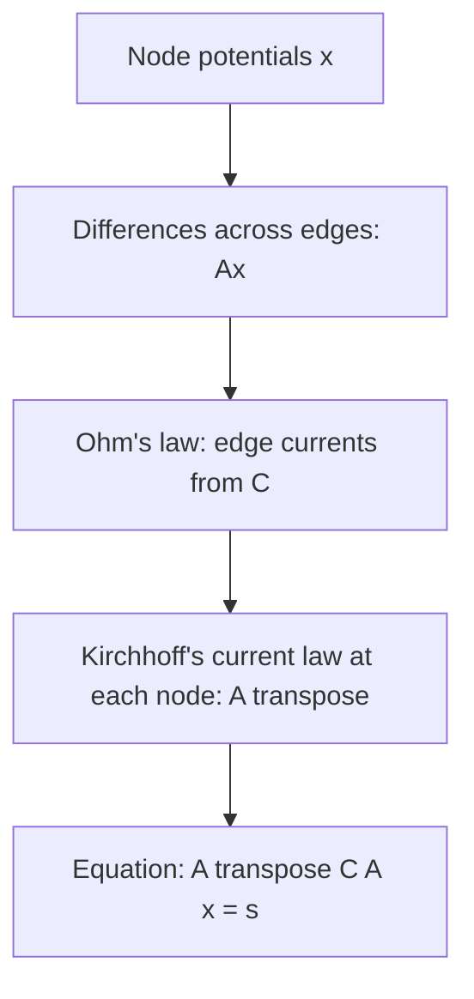

## The network becomes the matrix

In the applications lesson of Module 2 you solved network problems by writing one
conservation equation per node and row-reducing. That treated each network as a new puzzle.
This lesson does something more powerful: it turns the *shape* of a network into one matrix,
the incidence matrix, and then reads off its four fundamental subspaces. Each subspace turns
out to be a physical law you may already know from science class: potentials, Kirchhoff's
voltage law, Kirchhoff's current law, and the count of independent loops. The same matrix
then builds the graph Laplacian, which solves electrical circuits and even counts spanning
trees.

## Graphs and incidence matrices

A **graph** is a set of nodes joined by edges. In a **directed graph** each edge is given a
direction, from its *tail* node to its *head* node. The direction is only a bookkeeping
choice, like choosing which way is positive on a number line: a current or flow may run
against the arrow, and then it is simply negative.

A directed graph with $m$ edges and $n$ nodes has an $m \times n$ **incidence matrix** $A$. Row
$i$ describes edge $i$: it has $-1$ in the column of the edge's tail, $+1$ in the column of
its head, and 0 everywhere else.

For the graph in the picture (rows $e_1, \dots, e_5$, columns nodes 1 to 4):

$$A = \begin{bmatrix} -1 & 1 & 0 & 0 \\ 0 & -1 & 1 & 0 \\ -1 & 0 & 1 & 0 \\ 0 & 0 & -1 & 1 \\ -1 & 0 & 0 & 1\end{bmatrix}.$$

Every row has exactly one $-1$ and one $+1$, so every row adds to 0. We will use this graph
throughout the lesson.

## Potentials: the null space and column space of $A$

Attach a number $x_k$ to each node $k$: a voltage, a height, a pressure. Call it the node's
*potential*. Then $A\mathbf{x}$ lists, for each edge, the potential at its head minus the
potential at its tail. For our graph,

$$A\mathbf{x} = (x_2 - x_1,\ x_3 - x_2,\ x_3 - x_1,\ x_4 - x_3,\ x_4 - x_1).$$

*Null space.* $A\mathbf{x} = \mathbf{0}$ says the potential is the same at both ends of every
edge. If you can walk from any node to any other along edges, the graph is a
**connected graph**, and then all the potentials must be equal. So for a connected graph,
$\operatorname{Nul} A = \operatorname{Span}\{(1, 1, \dots, 1)\}$: adding the same constant to every
potential changes no difference, just as only voltage *differences* matter in a circuit. By
the rank theorem, $\operatorname{rank} A = n - 1$.

*Column space.* Which edge vectors $\mathbf{b}$ are differences of potentials? Walk around a
closed loop of edges and add up the differences, counting an edge with a $+$ sign if you
walk along its arrow and a $-$ sign if you walk against it. The potentials cancel in pairs,
so the total is 0. This is **Kirchhoff's voltage law**: around every loop, the potential
differences add to zero. A vector $\mathbf{b}$ is in $\operatorname{Col} A$ exactly when it passes
this test for every loop.

## Balanced flows: the null space of $A^T$

Now put a number $y_i$ on each edge: the flow along it (current, water, traffic), positive
along the arrow and negative against it. Column $k$ of $A$ has $+1$ for the edges coming
into node $k$ and $-1$ for the edges leaving it, so

$$(A^T\mathbf{y})_k = (\text{flow into node } k) - (\text{flow out of node } k).$$

So $A^T\mathbf{y} = \mathbf{0}$ is **Kirchhoff's current law**: at every node, flow in equals
flow out. This is the "in = out" rule from Module 2, now written as one matrix equation.

Which flows balance? Send one unit of flow around a loop: $+1$ on edges you travel along,
$-1$ on edges you travel against, 0 elsewhere. Each node on the loop gains one unit and loses
one, so this loop vector is in $\operatorname{Nul} A^T$. In fact the loop vectors span
$\operatorname{Nul} A^T$, and its dimension is

$$\dim \operatorname{Nul} A^T = m - \operatorname{rank} A = m - n + 1$$

for a connected graph. That is the number of *independent loops*. For a graph drawn in the
plane without crossings, the independent loops are the bounded regions (faces) of the
drawing, and $m - n + 1 = (\text{faces}) - 1$ rearranges to Euler's formula
$n - m + \text{faces} = 2$, counting the outside region as a face.

The theorem $(\operatorname{Col} A)^\perp = \operatorname{Nul} A^T$ from the orthogonality lesson now
says something physical: $\mathbf{b}$ is a list of potential differences exactly when
$\mathbf{b}$ is orthogonal to every loop vector. That is the voltage law again, proved by
linear algebra.

### Example 1

For the graph above: (a) find $\operatorname{Nul} A$ and the rank; (b) find a basis of loop
vectors for $\operatorname{Nul} A^T$; (c) decide whether $\mathbf{b} = (2, 1, 3, -4, -1)$ is a
list of potential differences, and if so find potentials.

1. The graph is connected, so $\operatorname{Nul} A = \operatorname{Span}\{(1, 1, 1, 1)\}$ and $\operatorname{rank} A = 4 - 1 = 3$.
2. $\dim\operatorname{Nul} A^T = 5 - 3 = 2$: two independent loops, the two triangles. Loop $1 \to 2 \to 3 \to 1$ uses $e_1$ and $e_2$ forward and $e_3$ backward: $\mathbf{y}_1 = (1, 1, -1, 0, 0)$. Loop $1 \to 3 \to 4 \to 1$ uses $e_3$, $e_4$ forward and $e_5$ backward: $\mathbf{y}_2 = (0, 0, 1, 1, -1)$. Check $A^T\mathbf{y}_1$: node 1 gets $-1 + 1 = 0$, node 2 gets $1 - 1 = 0$, node 3 gets $1 - 1 = 0$, node 4 gets 0.
3. Test $\mathbf{b}$: $\mathbf{b}\cdot\mathbf{y}_1 = 2 + 1 - 3 = 0$ and $\mathbf{b}\cdot\mathbf{y}_2 = 3 - 4 + 1 = 0$. Both loops pass, so $\mathbf{b}$ is in $\operatorname{Col} A$.
4. Find potentials by walking the edges. Choose $x_1 = 0$ (any constant can be added). Then $x_2 = x_1 + b_1 = 2$, $x_3 = x_2 + b_2 = 3$, $x_4 = x_3 + b_4 = -1$. Check the other two edges: $x_3 - x_1 = 3 = b_3$ and $x_4 - x_1 = -1 = b_5$.

So $\mathbf{x} = (0, 2, 3, -1) + c(1, 1, 1, 1)$ for any $c$.

## Trees: the row space

Which sets of rows of $A$ are linearly independent? A set of edges whose rows are dependent
always contains a loop, and a loop's rows are dependent (the loop vector gives the
dependence relation). So a set of edges is independent exactly when it contains no loop.
A **spanning tree** is a set of edges that contains no loop and still connects every node to
every other (you can walk between any two nodes using only those edges). A
spanning tree of a connected graph always has $n - 1$ edges, and its rows form a basis of
$\operatorname{Row} A$. In our graph, $\{e_1, e_2, e_4\}$ is a spanning tree (the path
$1 \to 2 \to 3 \to 4$); $\{e_1, e_2, e_3\}$ is not, since it is a loop and misses node 4.

## The graph Laplacian

The $n \times n$ matrix $L = A^TA$ is the **graph Laplacian**. Its entries need no
multiplication:

- the diagonal entry $L_{kk}$ is the **degree of a node**: the number of edges touching node $k$;
- an off-diagonal entry $L_{jk}$ is $-1$ if nodes $j$ and $k$ are joined by an edge, and 0 if not (we assume at most one edge joins any two nodes).

So $L = D - W$, where $D$ is the diagonal matrix of degrees and $W$ is the **adjacency matrix**
(1 for each pair of joined nodes, 0 otherwise). The arrow directions do not matter: reversing
an edge flips the sign of its row in $A$, which does not change $A^TA$. For our graph,

$$L = \begin{bmatrix} 3 & -1 & -1 & -1 \\ -1 & 2 & -1 & 0 \\ -1 & -1 & 3 & -1 \\ -1 & 0 & -1 & 2\end{bmatrix}.$$

Two facts from earlier modules apply at once. First, $L$ is symmetric and

$$\mathbf{x}^TL\mathbf{x} = \|A\mathbf{x}\|^2 = \sum_{\text{edges } j \to k}(x_k - x_j)^2 \ge 0,$$

so $L$ is positive semidefinite. Second, $L\mathbf{1} = A^T(A\mathbf{1}) = \mathbf{0}$, so $L$ is
singular, with eigenvalue 0. Deleting the row and column of one node (which, in a circuit,
means fixing that node's potential at 0, or *grounding* it) leaves a positive definite
matrix when the graph is connected.

A famous result, Kirchhoff's **matrix-tree theorem** (1847), says more. We state it without
proof: *the number of spanning trees of a connected graph equals the determinant of $L$ with
any one row and the same-numbered column deleted.*

### Example 2

Count the spanning trees of our graph with the matrix-tree theorem, and check by listing.

1. Delete row 4 and column 4: $L_0 = \begin{bmatrix} 3 & -1 & -1 \\ -1 & 2 & -1 \\ -1 & -1 & 3\end{bmatrix}$.
2. Expand along row 1: $3(6 - 1) - (-1)(-3 - 1) + (-1)(1 + 2) = 15 - 4 - 3 = 8$.
3. Check: a spanning tree here is 3 of the 5 edges with no loop. There are $\binom{5}{3} = 10$ sets of three edges, and exactly two of them are loops (the triangles $\{e_1, e_2, e_3\}$ and $\{e_3, e_4, e_5\}$). So there are $10 - 2 = 8$ spanning trees.

## Circuits: $A^TCA\mathbf{x} = \mathbf{s}$

Put a resistor on each edge, with *conductance* $c_i$ (1 divided by the resistance). Ohm's
law says current flows from high potential to low: the current along edge $i$, from its tail
$j$ to its head $k$, is $c_i(x_j - x_k)$. Now feed a current $s_k$ into each node $k$ from
outside (a battery or current source; $s_k < 0$ means current is taken out). Kirchhoff's
current law says the current leaving node $k$ through its edges equals $s_k$. Adding up
over the edges at node $k$, with $C$ the diagonal matrix of conductances, this is

$$A^TCA\,\mathbf{x} = \mathbf{s}.$$

With every $c_i = 1$, this is just $L\mathbf{x} = \mathbf{s}$. The chain of ideas is below.

### Example 3

Every edge of our graph is a 1-ohm resistor. One ampere is fed in at node 2 and taken out
at node 4. Find the potentials and the current in each edge.

1. $\mathbf{s} = (0, 1, 0, -1)$ and $C = I$, so solve $L\mathbf{x} = \mathbf{s}$. Ground node 4: $x_4 = 0$. Delete its row and column: $L_0\mathbf{x} = (0, 1, 0)$ with $L_0$ from Example 2.
2. Solve $3x_1 - x_2 - x_3 = 0$, $-x_1 + 2x_2 - x_3 = 1$, $-x_1 - x_2 + 3x_3 = 0$. Subtracting the third equation from the first gives $4x_1 - 4x_3 = 0$, so $x_1 = x_3$. Then the first equation gives $x_2 = 2x_1$, and the second gives $-x_1 + 4x_1 - x_1 = 1$, so $x_1 = \tfrac12$.
3. Potentials: $\mathbf{x} = (\tfrac12, 1, \tfrac12, 0)$.
4. Currents $x_{\text{tail}} - x_{\text{head}}$: $e_1$: $\tfrac12 - 1 = -\tfrac12$ (half an ampere runs from node 2 to node 1, against the arrow); $e_2$: $1 - \tfrac12 = \tfrac12$; $e_3$: $\tfrac12 - \tfrac12 = 0$; $e_4$: $\tfrac12$; $e_5$: $\tfrac12$.
5. Check Kirchhoff's current law at node 1: $\tfrac12$ arrives from node 2 and $\tfrac12$ leaves toward node 4.

No current flows through the diagonal, because the two routes $2 \to 1 \to 4$ and
$2 \to 3 \to 4$ are identical, so nodes 1 and 3 sit at the same potential (a *balanced
bridge*). The voltage between nodes 2 and 4 is 1 volt for 1 ampere, so the whole network
acts like a single 1-ohm resistor: two 2-ohm paths in parallel.

The same equation $A^TCA\mathbf{x} = \mathbf{f}$ describes networks of springs (with
stiffnesses in $C$), heat flow between rooms and water in pipes, which is why engineers call
it the fundamental equation of equilibrium. Data scientists use eigenvectors of $L$ to split
large graphs, such as social networks, into clusters.

## Common mistakes

- *Putting nodes in the rows.* The incidence matrix has one row per edge and one column per node, so it is $m \times n$; $A^T$ is the one with a row per node.
- *Reversing the signs.* The tail gets $-1$ and the head $+1$. Swapping them for one edge is harmless for $L$ but changes that entry of $A\mathbf{x}$ and the loop vectors.
- *Forgetting the constant vector.* $L$ is always singular, so $L\mathbf{x} = \mathbf{s}$ has no unique solution until a node is grounded. It has a solution only when the entries of $\mathbf{s}$ add to 0 (current in = current out).
- *Counting loops by eye.* A drawing may show many loops, but only $m - n + 1$ of them are independent; the rest are combinations.
- *Treating negative flow as an error.* A negative current means it runs against the chosen arrow.

## Key points

- Incidence matrix ($m$ edges $\times$ $n$ nodes): $-1$ at each edge's tail, $+1$ at its head.
- $A\mathbf{x}$ = potential differences. For a connected graph, $\operatorname{Nul} A$ is the constant vectors and $\operatorname{rank} A = n - 1$.
- $A^T\mathbf{y} = \mathbf{0}$ is Kirchhoff's current law; $\operatorname{Nul} A^T$ is spanned by loop vectors and has dimension $m - n + 1$.
- $\mathbf{b} \in \operatorname{Col} A$ exactly when $\mathbf{b}$ is orthogonal to every loop vector: Kirchhoff's voltage law.
- Spanning trees ($n - 1$ edges, no loops) give bases of $\operatorname{Row} A$.
- Graph Laplacian $L = A^TA = D - W$, positive semidefinite with $L\mathbf{1} = \mathbf{0}$; deleting one row and column gives a matrix whose determinant counts spanning trees.
- Circuits: $A^TCA\mathbf{x} = \mathbf{s}$; ground one node to get a unique solution.
