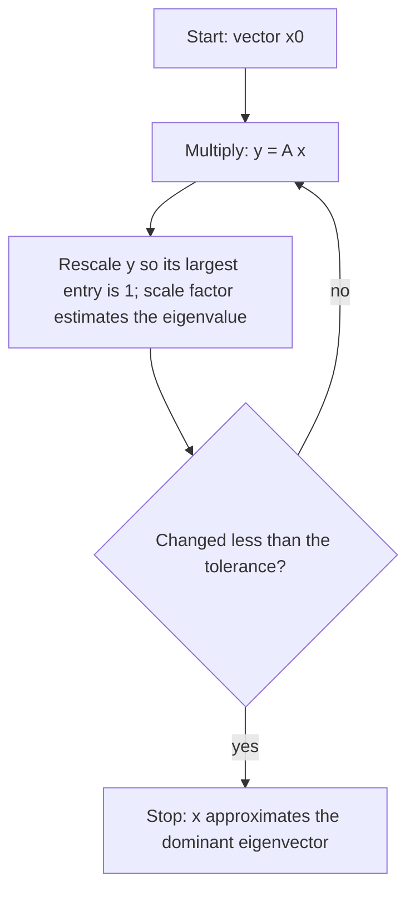

## An eigenvector worth billions

In the late 1990s, web search engines mostly matched the words on a page, which made them
easy to fool. Larry Page and Sergey Brin, then graduate students at Stanford, proposed a
different signal: a page is important if important pages link to it. That sounds circular,
and it is. Linear algebra turns the circle into an equation: the importance scores form the
steady-state vector of a Markov chain, an eigenvector for eigenvalue 1. Their 1998 paper
called the scores **PageRank**, and it became the core of Google's first search engine.

This lesson builds the PageRank matrix from the Markov chain lesson, shows why two repairs
are needed, and then studies the **power method**, the simple algorithm that computes
eigenvectors of matrices far too large for any characteristic polynomial. (Today's search
engines combine hundreds of signals; PageRank as described here is the original, simplified
idea.)

## The random surfer and the link matrix

Picture a surfer who starts on some page and, at every step, clicks one of that page's links
at random. If page $j$ has $d_j$ outgoing links, the surfer moves to each linked page with
probability $1/d_j$. This is a Markov chain on the pages. Its transition matrix is the
**link matrix** $S$: column $j$ has $1/d_j$ in the row of each page that $j$ links to, and 0
elsewhere. As in the Markov chain lesson, columns are "from" and rows are "to", and every
column sums to 1.


For the tiny web in the picture (pages in the order A, B, C, D):

$$S = \begin{bmatrix} 0 & 0 & 1 & \tfrac12 \\ \tfrac12 & 0 & 0 & 0 \\ \tfrac12 & 1 & 0 & \tfrac12 \\ 0 & 0 & 0 & 0\end{bmatrix}.$$

Column A has $\tfrac12$ in rows B and C because A has two links. Row D is all zeros: no page
links to D.

If $\mathbf{x}$ is a probability vector giving the chance the surfer is on each page, then
$S\mathbf{x}$ gives the chances one click later. A ranking that is stable under clicking
satisfies $S\mathbf{x} = \mathbf{x}$: a steady-state vector. Here that is
$\mathbf{x} = (0.4, 0.2, 0.4, 0)$. Notice how the scores reward links from important pages:
B has only one incoming link, but it comes from A, which scores 0.4; D has no incoming
links at all and scores 0.

## Two repairs: dangling pages and damping

Real webs break this neat picture in two ways.

1. *Dangling pages.* A page with no outgoing links (a PDF, an image, a dead end) is a **dangling node**. Its column of $S$ is all zeros, so $S$ is not stochastic and probability leaks away. The standard fix: a surfer on a dangling page jumps to a page chosen at random, so its column becomes $\tfrac1n$ in every entry.
2. *Traps and ties.* A group of pages that link only to each other traps the surfer forever, and if the web falls into two such groups, the eigenvalue 1 is repeated and there is no single steady state. The ranking would then depend on where the surfer started.

The second repair is the clever one. With probability $\alpha$ the surfer follows a link, and
with probability $1 - \alpha$ gets bored and jumps to a page chosen at random from all $n$.
The number $\alpha$ is the **damping factor**; Brin and Page suggested $\alpha = 0.85$. The
resulting **Google matrix** is

$$G = \alpha S + \frac{1 - \alpha}{n}J,$$

where $J$ is the $n \times n$ matrix of all ones. Every column of $G$ is still a probability
vector, and now every entry of $G$ is positive. So $G$ is a regular stochastic matrix, and
the theorem from the Markov chain lesson applies: $G$ has a *unique* steady-state vector,
and every starting distribution converges to it. That vector is the PageRank vector. (The
general fact behind this is the **Perron–Frobenius theorem**: a square matrix with all
entries positive has a positive eigenvalue that is larger in absolute value than every
other eigenvalue, with an eigenvector whose entries are all positive.)

### Example 1

Find the PageRank vector of the four-page web with $\alpha = 0.85$, and carry out the first
step of the iteration from $\mathbf{x}_0 = (0.25, 0.25, 0.25, 0.25)$.

1. There are no dangling pages, so $G = 0.85S + 0.0375J$ (since $0.15/4 = 0.0375$).
2. For a probability vector $\mathbf{x}$, $J\mathbf{x} = (1, 1, 1, 1)$ because the entries of $\mathbf{x}$ add to 1. So $G\mathbf{x} = 0.85S\mathbf{x} + 0.0375\,(1, 1, 1, 1)$. Software never builds $G$; it only multiplies by the sparse matrix $S$.
3. First step: $S\mathbf{x}_0 = (0.25 + 0.125,\ 0.125,\ 0.125 + 0.25 + 0.125,\ 0) = (0.375, 0.125, 0.5, 0)$. Then $\mathbf{x}_1 = 0.85(0.375, 0.125, 0.5, 0) + 0.0375(1, 1, 1, 1) = (0.35625, 0.14375, 0.4625, 0.0375)$.
4. Exact answer: $G\mathbf{x} = \mathbf{x}$ becomes $(I - 0.85S)\mathbf{x} = 0.0375\,(1, 1, 1, 1)$. Row reduction (or software) gives $\mathbf{x} \approx (0.380, 0.199, 0.384, 0.0375)$.

So C edges out A, B is third, and D gets only the $0.0375$ that comes from random jumps.
Compare the undamped vector $(0.4, 0.2, 0.4, 0)$: damping spreads a little importance to
every page, and it breaks the tie between A and C, slightly in C's favor.

## The power method

For the real web, $n$ is in the billions, so solving $(I - \alpha S)\mathbf{x} = \text{constant}$
by elimination is out of the question. Instead, keep multiplying: $\mathbf{x}_{k+1} = G\mathbf{x}_k$.
This is the power method, and it works far beyond PageRank.

Why it works is the eigenvector expansion from the dynamical systems lesson. Suppose $A$ has
an eigenvector basis $\mathbf{v}_1, \dots, \mathbf{v}_n$ and a **dominant eigenvalue**
$\lambda_1$, meaning $|\lambda_1| > |\lambda_i|$ for every other eigenvalue. Write
$\mathbf{x}_0 = c_1\mathbf{v}_1 + \cdots + c_n\mathbf{v}_n$ with $c_1 \neq 0$. Then

$$A^k\mathbf{x}_0 = \lambda_1^k\left(c_1\mathbf{v}_1 + c_2\left(\frac{\lambda_2}{\lambda_1}\right)^k\mathbf{v}_2 + \cdots + c_n\left(\frac{\lambda_n}{\lambda_1}\right)^k\mathbf{v}_n\right).$$

Every ratio $|\lambda_i/\lambda_1|$ is less than 1, so the bracket tends to $c_1\mathbf{v}_1$: the
direction of $A^k\mathbf{x}_0$ approaches the dominant eigenvector. The error shrinks roughly by
the factor $|\lambda_2/\lambda_1|$ per step, where $\lambda_2$ is the next-largest eigenvalue in
absolute value. Ratio 0.5 gains about one binary digit per step; ratio 0.99 is painfully slow.

In practice each $\mathbf{x}_k$ is rescaled so the numbers neither blow up nor vanish. One easy
rule: divide by the entry of largest absolute value, so that entry becomes 1. The number you
divided by then approaches $\lambda_1$. For a symmetric matrix, the **Rayleigh quotient**
$\dfrac{\mathbf{x}^TA\mathbf{x}}{\mathbf{x}^T\mathbf{x}}$ gives an even better estimate of $\lambda_1$.



### Example 2

Use the power method on $A = \begin{bmatrix} 4 & 1 \\ 2 & 3\end{bmatrix}$ starting from
$\mathbf{x}_0 = (1, 0)$, scaling so the largest entry is 1.

1. $A\mathbf{x}_0 = (4, 2)$. Scale by 4: $\mathbf{x}_1 = (1, 0.5)$, estimate 4.
2. $A\mathbf{x}_1 = (4.5, 3.5)$. Scale by 4.5: $\mathbf{x}_2 = (1, 0.778)$, estimate 4.5.
3. $A\mathbf{x}_2 = (4.778, 4.333)$. Scale: $\mathbf{x}_3 = (1, 0.907)$, estimate 4.778.
4. Continuing: $\mathbf{x}_4 = (1, 0.962)$ with estimate 4.907, then $\mathbf{x}_5 = (1, 0.985)$ with estimate 4.962.
5. The limit: $A(1, 1) = (5, 5)$, so $(1, 1)$ is an eigenvector for $\lambda_1 = 5$. The trace is 7, so $\lambda_2 = 2$.

The gap between the second entry and 1 goes $0.5,\ 0.222,\ 0.093,\ 0.038,\ 0.015$: each is
roughly $0.4$ times the one before, just as the ratio $\lambda_2/\lambda_1 = 2/5 = 0.4$ predicts.

## How fast does PageRank converge?

A neat fact: if $S$ is stochastic, every eigenvalue of $G$ other than 1 is $\alpha$ times an
eigenvalue of $S$ other than 1. Since the eigenvalues of a
stochastic matrix satisfy $|\lambda| \le 1$, the second eigenvalue of $G$ has
$|\lambda_2| \le \alpha$, whatever the web looks like (Haveliwala and Kamvar published this bound
in 2003). With $\alpha = 0.85$, the error shrinks roughly by a factor of 0.85 or better per step. Since $0.85^{50} \approx 0.0003$,
fifty steps reduce the error at least about 3,000-fold, and each step costs only one pass over
the links. A smaller $\alpha$ converges faster but listens less to the actual links; 0.85 is
a compromise.

For our four-page web, the eigenvalues of $S$ are $1$, $0$ and $-\tfrac12 \pm \tfrac12 i$, so
$|\lambda_2(G)| = 0.85 \times 0.707 \approx 0.60$, faster than the guarantee.

```plot
{"x": [0, 12], "y": [0, 0.6], "xLabel": "step k", "yLabel": "error", "points": [{"at": [0, 0.527]}, {"at": [1, 0.157]}, {"at": [2, 0.134]}, {"at": [3, 0.097]}, {"at": [4, 0.041]}, {"at": [5, 0.021]}, {"at": [6, 0.017]}, {"at": [7, 0.013]}, {"at": [8, 0.005]}, {"at": [9, 0.003]}, {"at": [10, 0.002]}, {"at": [11, 0.002]}, {"at": [12, 0.001]}], "caption": "Four-page web: total distance from x_k to the PageRank vector, starting from the uniform vector"}
```

### Example 3

A three-page web: A links to B and C, B links to C, and C has no links. Repair the dangling
page and find the steady state without damping.

1. Columns A and B are $(0, \tfrac12, \tfrac12)$ and $(0, 0, 1)$. Column C would be zero; replace it with $(\tfrac13, \tfrac13, \tfrac13)$.
2. Solve $(S - I)\mathbf{x} = \mathbf{0}$. Row A: $-x_A + \tfrac13x_C = 0$, so $x_A = \tfrac13x_C$. Row B: $\tfrac12x_A - x_B + \tfrac13x_C = 0$, so $x_B = \tfrac16x_C + \tfrac13x_C = \tfrac12x_C$.
3. Take $x_C = 6$: $(2, 3, 6)$, which sums to 11. So $\mathbf{x} = (\tfrac{2}{11}, \tfrac{3}{11}, \tfrac{6}{11}) \approx (0.182, 0.273, 0.545)$.
4. Check row C: $\tfrac12(\tfrac{2}{11}) + 1(\tfrac{3}{11}) + \tfrac13(\tfrac{6}{11}) = \tfrac{1 + 3 + 2}{11} = \tfrac{6}{11}$.

Here the repaired $S$ is already regular ($S^2$ has all entries positive), so the steady state
is unique even without damping. With $\alpha = 0.85$ it moves slightly toward uniform:
about $(0.198, 0.282, 0.521)$.

## Common mistakes

- *Using rows for "from".* In this course's convention the columns of $S$ sum to 1 and column $j$ lists where page $j$'s links go.
- *Counting links into a page.* PageRank is not the number of incoming links; one link from an important page can outweigh many links from unimportant ones.
- *Forgetting the $(1 - \alpha)/n$ term.* $G\mathbf{x} = \alpha S\mathbf{x} + \tfrac{1-\alpha}{n}(1, \dots, 1)$ for a probability vector $\mathbf{x}$; leaving out the second term loses probability every step.
- *Expecting the power method to find any eigenvalue.* It finds the dominant one, and only when exactly one eigenvalue has the largest absolute value and $\mathbf{x}_0$ has a component along its eigenvector.
- *Judging speed by $\lambda_1$.* Convergence speed depends on the ratio $|\lambda_2/\lambda_1|$, not on $\lambda_1$ alone.

## Key points

- Link matrix $S$: column $j$ has $1/d_j$ for each page $j$ links to. A steady state $S\mathbf{x} = \mathbf{x}$ ranks pages by links from important pages.
- Dangling pages get a uniform column; damping gives $G = \alpha S + \tfrac{1-\alpha}{n}J$, which is positive, so its steady state (the PageRank vector) is unique.
- Power method: $\mathbf{x}_{k+1} = A\mathbf{x}_k$, rescaled each step, converges to the dominant eigenvector; the error shrinks like $|\lambda_2/\lambda_1|^k$.
- For the Google matrix $|\lambda_2| \le \alpha$, so with $\alpha = 0.85$ a few dozen sparse multiplications suffice.
