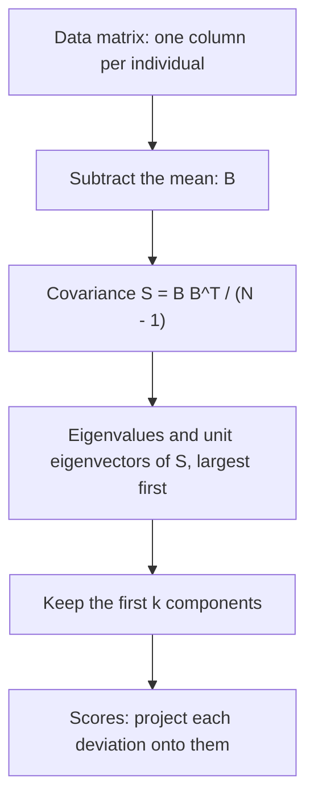

## Finding the shape of a cloud of data

Modern data sets are tables of numbers: thousands of patients with dozens of blood tests,
millions of customers with ratings for movies, images with a brightness value for every
pixel. Such a table is a matrix, and the tools of the last module (symmetric matrices,
quadratic forms and the SVD) answer two practical questions about it:

1. *Which directions in the data carry most of its variation?* That is **principal component analysis** (PCA), invented by Karl Pearson in 1901 and developed by Harold Hotelling in 1933.
2. *What is the best simpler matrix that is close to this one?* That is low-rank approximation, made precise by Carl Eckart and Gale Young in 1936.

Both come down to the same eigenvectors.

## Centering and the covariance matrix

Suppose we measure $p$ variables on each of $N$ individuals. Put the measurements of
individual $j$ in a column $\mathbf{x}_j \in \mathbb{R}^p$, so the data form a $p \times N$
matrix $[\mathbf{x}_1 \cdots \mathbf{x}_N]$. Let $\mathbf{m}$ be the mean of the columns.
Subtracting it from every column gives the matrix in **mean-deviation form**,

$$B = [\mathbf{x}_1 - \mathbf{m}\ \ \cdots\ \ \mathbf{x}_N - \mathbf{m}],$$

whose rows each add to 0. The **covariance matrix** is the $p \times p$ matrix

$$S = \frac{1}{N - 1}BB^T.$$

Its diagonal entry $s_{ii}$ is the (sample) variance of variable $i$: the average squared
deviation, using $N - 1$ as statisticians do. The off-diagonal entry $s_{ij}$ is the covariance
of variables $i$ and $j$: positive when they tend to be above their means together, negative
when one tends to be high while the other is low. $S$ is symmetric, and
$\mathbf{u}^TS\mathbf{u} = \tfrac{1}{N-1}\|B^T\mathbf{u}\|^2 \ge 0$, so it is positive semidefinite.
The sum of the variances, $\operatorname{tr} S$, is the **total variance** of the data.

## Principal components

Take a unit vector $\mathbf{u}$ and give each individual the single number
$\mathbf{u}^T(\mathbf{x}_j - \mathbf{m})$: the length of the projection of its deviation onto the
line through $\mathbf{u}$. These numbers are the individual's *scores* along $\mathbf{u}$, and
their variance is

$$\frac{1}{N - 1}\sum_j \left(\mathbf{u}^T(\mathbf{x}_j - \mathbf{m})\right)^2 = \frac{1}{N-1}\|B^T\mathbf{u}\|^2 = \mathbf{u}^TS\mathbf{u}.$$

So the variance in direction $\mathbf{u}$ is a quadratic form. The quadratic forms lesson showed
that the maximum of $\mathbf{u}^TS\mathbf{u}$ over unit vectors is the largest eigenvalue
$\lambda_1$ of $S$, reached at a unit eigenvector $\mathbf{u}_1$. Then, among unit vectors
orthogonal to $\mathbf{u}_1$, the maximum is $\lambda_2$ at $\mathbf{u}_2$, and so on.

Orthogonally diagonalize $S = UDU^T$ with eigenvalues $\lambda_1 \ge \lambda_2 \ge \cdots \ge \lambda_p \ge 0$.
The unit eigenvectors $\mathbf{u}_1, \dots, \mathbf{u}_p$ are the **principal components** of the
data. They have three properties that make them useful:

- *They are ordered by importance.* The variance along $\mathbf{u}_i$ is $\lambda_i$, and since the trace is the sum of the eigenvalues, $\lambda_1 + \cdots + \lambda_p$ is the total variance. The first $k$ components explain the fraction $(\lambda_1 + \cdots + \lambda_k)/\operatorname{tr} S$ of it.
- *The new variables are uncorrelated.* The scores $\mathbf{y} = U^T(\mathbf{x} - \mathbf{m})$ have covariance matrix $U^TSU = D$, which is diagonal.
- *Dropping the small ones loses little.* If the last few eigenvalues are tiny, the data lie close to the subspace spanned by the first few components, so a few scores describe each individual almost as well as all $p$ measurements.




### Example 1

Five leaves have (length, width) in mm: $(7, 18)$, $(9, 20)$, $(10, 20)$, $(11, 22)$,
$(13, 20)$. Find the covariance matrix, the principal components, and the fraction of the
variance the first component explains.

1. Mean: $\mathbf{m} = (50/5, 100/5) = (10, 20)$.
2. Deviations: $B = \begin{bmatrix} -3 & -1 & 0 & 1 & 3 \\ -2 & 0 & 0 & 2 & 0\end{bmatrix}$.
3. $BB^T = \begin{bmatrix} 9 + 1 + 0 + 1 + 9 & 6 + 0 + 0 + 2 + 0 \\ 8 & 4 + 0 + 0 + 4 + 0\end{bmatrix} = \begin{bmatrix} 20 & 8 \\ 8 & 8\end{bmatrix}$, so $S = \tfrac14 BB^T = \begin{bmatrix} 5 & 2 \\ 2 & 2\end{bmatrix}$.
4. Length has variance 5, width has variance 2, and the covariance 2 is positive: longer leaves tend to be wider. Total variance: $5 + 2 = 7$.
5. Eigenvalues: trace 7, determinant $10 - 4 = 6$, so $\lambda^2 - 7\lambda + 6 = (\lambda - 6)(\lambda - 1)$: $\lambda_1 = 6$, $\lambda_2 = 1$.
6. Eigenvectors: for 6, $(S - 6I)\mathbf{u} = \mathbf{0}$ gives $-u_1 + 2u_2 = 0$, so $\mathbf{u}_1 = \tfrac{1}{\sqrt5}(2, 1)$. For 1, $\mathbf{u}_2 = \tfrac{1}{\sqrt5}(-1, 2)$.
7. The first component explains $6/7 \approx 85.7\%$ of the total variance.

This is the matrix from the quadratic forms lesson, where $5x_1^2 + 4x_1x_2 + 2x_2^2$ had
maximum 6 on the unit circle at $\pm\tfrac{1}{\sqrt5}(2, 1)$. The first component's scores are
$(2d_1 + d_2)/\sqrt5$ for each deviation $(d_1, d_2)$: $-8/\sqrt5$, $-2/\sqrt5$, $0$, $4/\sqrt5$,
$6/\sqrt5$. Their squares add to $120/5 = 24$, and $24/4 = 6 = \lambda_1$, as promised. The sign of
a principal component is arbitrary: $-\mathbf{u}_1$ is just as good, and simply flips every
score.

```plot
{"x": [5, 15], "y": [15, 24], "equal": true, "xLabel": "length (mm)", "yLabel": "width (mm)", "points": [{"at": [7, 18]}, {"at": [9, 20]}, {"at": [10, 20], "label": "mean"}, {"at": [11, 22]}, {"at": [13, 20]}], "segments": [{"from": [5.5, 17.75], "to": [14.5, 22.25], "label": "first component"}, {"from": [11, 18], "to": [9, 22], "dashed": true, "label": "second"}], "caption": "The five leaves and their principal component directions through the mean"}
```

## PCA through the SVD

In practice PCA is computed from the SVD of $B$, not by forming $BB^T$ (forming the product
squares the condition number and can lose accuracy). If $B = U\Sigma V^T$, then

$$S = \frac{1}{N-1}BB^T = \frac{1}{N-1}U\Sigma\Sigma^TU^T,$$

so the principal components are the left singular vectors of $B$, and $\lambda_i = \sigma_i^2/(N - 1)$.
In Example 1, $\sigma_1^2 = 24$ and $\sigma_2^2 = 4$, matching $\lambda_1 = 6$ and $\lambda_2 = 1$.

## The best low-rank approximation

The SVD writes any $m \times n$ matrix of rank $r$ as a sum of rank-one pieces,

$$A = \sigma_1\mathbf{u}_1\mathbf{v}_1^T + \sigma_2\mathbf{u}_2\mathbf{v}_2^T + \cdots + \sigma_r\mathbf{u}_r\mathbf{v}_r^T,$$

ordered from the largest singular value down. Keep the first $k$ terms and call the result
$A_k$; it has rank $k$. To say how close two matrices are, use the **Frobenius norm**, the
square root of the sum of the squares of all the entries:

$$\|A\|_F = \sqrt{\textstyle\sum_{i,j} a_{ij}^2}.$$

Since $\|A\|_F^2 = \operatorname{tr}(A^TA)$ and the trace is the sum of the eigenvalues
$\sigma_i^2$ of $A^TA$, we get $\|A\|_F^2 = \sigma_1^2 + \cdots + \sigma_r^2$.

> **Eckart–Young theorem.** Among all $m \times n$ matrices of rank at most $k$, the one closest to $A$ in the Frobenius norm is $A_k$, and the error is
> $$\|A - A_k\|_F = \sqrt{\sigma_{k+1}^2 + \cdots + \sigma_r^2}.$$

(The same $A_k$ is also best when distance is measured by the largest stretch of $A - B$; then
the error is $\sigma_{k+1}$. We state both without proof.) So the singular values tell you, before
you compute anything, how much a rank-$k$ summary must lose.

### Example 2

Find the best rank-one approximation of $A = \begin{bmatrix} 2 & 0 \\ 3 & 2\end{bmatrix}$ and
its error.

1. $A^TA = \begin{bmatrix} 13 & 6 \\ 6 & 4\end{bmatrix}$: trace 17, determinant $52 - 36 = 16$, so the eigenvalues are 16 and 1, and $\sigma_1 = 4$, $\sigma_2 = 1$.
2. For 16: $(13 - 16)v_1 + 6v_2 = 0$ gives $\mathbf{v}_1 = \tfrac{1}{\sqrt5}(2, 1)$.
3. $A\mathbf{v}_1 = \tfrac{1}{\sqrt5}(4, 8)$, so $\mathbf{u}_1 = \tfrac{1}{4}A\mathbf{v}_1 = \tfrac{1}{\sqrt5}(1, 2)$.
4. $A_1 = 4\mathbf{u}_1\mathbf{v}_1^T = \tfrac45\begin{bmatrix} 2 & 1 \\ 4 & 2\end{bmatrix} = \begin{bmatrix} 1.6 & 0.8 \\ 3.2 & 1.6\end{bmatrix}$.
5. Error: $A - A_1 = \begin{bmatrix} 0.4 & -0.8 \\ -0.2 & 0.4\end{bmatrix}$, and $\|A - A_1\|_F = \sqrt{0.16 + 0.64 + 0.04 + 0.16} = 1 = \sigma_2$.
6. Check: $\|A\|_F^2 = 4 + 0 + 9 + 4 = 17 = 4^2 + 1^2$.

### Example 3

A grayscale photo is an $800 \times 1000$ matrix of brightness values. How many numbers does
the rank-50 approximation need, and what fraction of the original is that?

1. Each rank-one piece $\sigma_i\mathbf{u}_i\mathbf{v}_i^T$ is stored as $\sigma_i$, the 800 entries of $\mathbf{u}_i$ and the 1000 entries of $\mathbf{v}_i$: $1 + 800 + 1000 = 1801$ numbers.
2. Fifty pieces: $50 \times 1801 = 90{,}050$ numbers, against $800 \times 1000 = 800{,}000$ for the full image.
3. Fraction: $90{,}050/800{,}000 \approx 11.3\%$.

Photos usually have rapidly decreasing singular values, so the rank-50 picture often looks
close to the original. (Real image formats such as JPEG use other transforms, but the idea of
keeping only the large components is the same.) Recommendation systems use the same
principle: a ratings table with millions of entries is approximated by a matrix of small rank,
whose rank-one pieces act like hidden "taste" factors.

## Cautions

- *Units matter.* PCA on height in centimeters and weight in kilograms gives different components than on height in meters, because variances change with units. When variables have different units, standardize each one first (divide each row of $B$ by its standard deviation); then PCA uses the correlation matrix.
- *PCA finds straight directions only.* Data on a curve may need many components even though they are really one-dimensional.
- *Variance is not meaning.* The direction of largest variance is not always the one you care about; a component is a mathematical summary that still needs interpreting.

## Common mistakes

- *Forgetting to center.* Without subtracting the mean, the first "component" of data far from the origin points roughly toward the mean, not along the spread.
- *Dividing by $N$ instead of $N - 1$.* This changes every eigenvalue by the same factor, so the components and fractions don't change, but the variances are not the sample variances.
- *Reading the fraction from one eigenvalue alone.* The explained fraction is $\lambda_1/(\lambda_1 + \cdots + \lambda_p)$, not $\lambda_1$.
- *Using $\sigma_{k+1}$ as the Frobenius error.* The Frobenius error includes all the dropped singular values: $\sqrt{\sigma_{k+1}^2 + \cdots + \sigma_r^2}$.
- *Counting storage as $k \cdot mn$.* A rank-$k$ approximation needs about $k(m + n + 1)$ numbers.

## Key points

- Center the data ($B$), then $S = BB^T/(N - 1)$ is the covariance matrix: symmetric, positive semidefinite, trace = total variance.
- Principal components are the unit eigenvectors of $S$; the variance along $\mathbf{u}_i$ is $\lambda_i$, and the first $k$ explain $(\lambda_1 + \cdots + \lambda_k)/\operatorname{tr} S$.
- Scores along the components are uncorrelated. In practice PCA uses the SVD of $B$: $\lambda_i = \sigma_i^2/(N - 1)$.
- Eckart–Young: truncating the SVD after $k$ terms gives the best rank-$k$ approximation; the Frobenius error is $\sqrt{\sigma_{k+1}^2 + \cdots}$.
- $\|A\|_F^2$ = sum of squared entries = sum of $\sigma_i^2$. A rank-$k$ approximation stores $k(m + n + 1)$ numbers.
