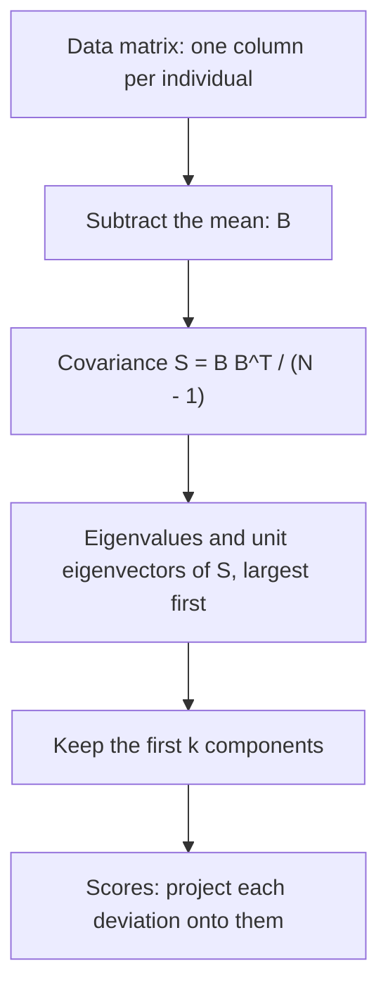

## Finding the shape of a cloud of data

Modern data sets are tables of numbers: patients with dozens of blood tests, students with
scores on many exams, faces stored as thousands of pixel brightnesses. Such a table is a
matrix, and a natural question is which directions in the data carry most of its variation.
If 50 measurements really vary along only three or four independent directions, those few
directions summarize the data, reveal its structure and make it possible to plot.

**Principal component analysis** (PCA) finds those directions. Karl Pearson described it in
1901 as fitting the line or plane "of closest fit" to a cloud of points, and Harold Hotelling
developed it in 1933. It pulls together several earlier lessons: the covariance matrix is
symmetric, so it can be orthogonally diagonalized; variance in a direction is a quadratic
form; and the computation is done with the SVD. It is also a close cousin of least squares,
with one crucial difference, explained below.

## Centering and the covariance matrix

Suppose we measure $p$ variables on each of $N$ individuals. Put the measurements of
individual $j$ in a column $\mathbf{x}_j \in \mathbb{R}^p$, so the data form a $p \times N$
matrix $[\mathbf{x}_1 \cdots \mathbf{x}_N]$. Let $\mathbf{m}$ be the mean of the columns.
Subtracting it from every column gives the matrix in **mean-deviation form**,

$$B = [\mathbf{x}_1 - \mathbf{m}\ \ \cdots\ \ \mathbf{x}_N - \mathbf{m}],$$

whose rows each add to 0. The **covariance matrix** is the $p \times p$ matrix

$$S = \frac{1}{N - 1}BB^T.$$

Its diagonal entry $s_{ii}$ is the (sample) variance of variable $i$: the average squared
deviation, dividing by $N - 1$ as statisticians do. The off-diagonal entry $s_{ij}$ is the
covariance of variables $i$ and $j$: positive when they tend to be above their means
together, negative when one tends to be high while the other is low. $S$ is symmetric, and
$\mathbf{u}^TS\mathbf{u} = \tfrac{1}{N-1}\|B^T\mathbf{u}\|^2 \ge 0$, so it is positive semidefinite.
The sum of the variances, $\operatorname{tr} S$, is the **total variance** of the data.

## Principal components

Take a unit vector $\mathbf{u}$ and give each individual the single number
$\mathbf{u}^T(\mathbf{x}_j - \mathbf{m})$: the signed length of the projection of its deviation onto
the line through $\mathbf{u}$. These numbers are the individuals' *scores* along $\mathbf{u}$, and
their variance is

$$\frac{1}{N - 1}\sum_j \left(\mathbf{u}^T(\mathbf{x}_j - \mathbf{m})\right)^2 = \frac{1}{N-1}\|B^T\mathbf{u}\|^2 = \mathbf{u}^TS\mathbf{u}.$$

So the variance in direction $\mathbf{u}$ is a quadratic form. The quadratic forms lesson showed
that the maximum of $\mathbf{u}^TS\mathbf{u}$ over unit vectors is the largest eigenvalue
$\lambda_1$ of $S$, reached at a unit eigenvector $\mathbf{u}_1$; among unit vectors orthogonal to
$\mathbf{u}_1$, the maximum is $\lambda_2$ at $\mathbf{u}_2$; and so on.

Orthogonally diagonalize $S = UDU^T$ with eigenvalues $\lambda_1 \ge \lambda_2 \ge \cdots \ge \lambda_p \ge 0$.
The unit eigenvectors $\mathbf{u}_1, \dots, \mathbf{u}_p$ are the **principal components** of the
data. Three properties make them useful:

- *They are ordered by importance.* The variance along $\mathbf{u}_i$ is $\lambda_i$, and since the trace is the sum of the eigenvalues, $\lambda_1 + \cdots + \lambda_p$ is the total variance. The first $k$ components explain the fraction $(\lambda_1 + \cdots + \lambda_k)/\operatorname{tr} S$ of it.
- *The new variables are uncorrelated.* The scores $\mathbf{y} = U^T(\mathbf{x} - \mathbf{m})$ have covariance matrix $U^TSU = D$, which is diagonal.
- *Dropping the small ones loses little.* This is made precise in the next section.




### Example 1

Five leaves have (length, width) in mm: $(7, 18)$, $(9, 20)$, $(10, 20)$, $(11, 22)$,
$(13, 20)$. Find the covariance matrix, the principal components, and the fraction of the
variance the first component explains.

1. Mean: $\mathbf{m} = (50/5, 100/5) = (10, 20)$.
2. Deviations: $B = \begin{bmatrix} -3 & -1 & 0 & 1 & 3 \\ -2 & 0 & 0 & 2 & 0\end{bmatrix}$.
3. $BB^T = \begin{bmatrix} 9 + 1 + 0 + 1 + 9 & 6 + 0 + 0 + 2 + 0 \\ 8 & 4 + 0 + 0 + 4 + 0\end{bmatrix} = \begin{bmatrix} 20 & 8 \\ 8 & 8\end{bmatrix}$, so $S = \tfrac14 BB^T = \begin{bmatrix} 5 & 2 \\ 2 & 2\end{bmatrix}$.
4. Length has variance 5, width has variance 2, and the covariance 2 is positive: longer leaves tend to be wider. Total variance: $5 + 2 = 7$.
5. Eigenvalues: trace 7, determinant $10 - 4 = 6$, so $\lambda^2 - 7\lambda + 6 = (\lambda - 6)(\lambda - 1)$: $\lambda_1 = 6$, $\lambda_2 = 1$.
6. Eigenvectors: for 6, $(S - 6I)\mathbf{u} = \mathbf{0}$ gives $-u_1 + 2u_2 = 0$, so $\mathbf{u}_1 = \tfrac{1}{\sqrt5}(2, 1)$. For 1, $\mathbf{u}_2 = \tfrac{1}{\sqrt5}(-1, 2)$.
7. The first component explains $6/7 \approx 85.7\%$ of the total variance.

This is the matrix from the quadratic forms lesson, where $5x_1^2 + 4x_1x_2 + 2x_2^2$ had
maximum 6 on the unit circle at $\pm\tfrac{1}{\sqrt5}(2, 1)$. The first component's scores are
$(2d_1 + d_2)/\sqrt5$ for each deviation $(d_1, d_2)$: $-8/\sqrt5$, $-2/\sqrt5$, $0$, $4/\sqrt5$,
$6/\sqrt5$. Their squares add to $120/5 = 24$, and $24/4 = 6 = \lambda_1$, as promised. The sign of
a principal component is arbitrary: $-\mathbf{u}_1$ is just as good, and simply flips every
score.

## Keeping $k$ components

Since $\mathbf{u}_1, \dots, \mathbf{u}_p$ is an orthonormal basis, each deviation splits as
$\mathbf{x}_j - \mathbf{m} = y_{j1}\mathbf{u}_1 + \cdots + y_{jp}\mathbf{u}_p$, where the $y$'s are its
scores. Keeping only the first $k$ terms is the orthogonal projection onto the span of
$\mathbf{u}_1, \dots, \mathbf{u}_k$, and what is lost is the part along the other components. Adding
over all individuals, the squared lengths of the lost parts total

$$\sum_j \left(y_{j,k+1}^2 + \cdots + y_{jp}^2\right) = (N - 1)(\lambda_{k+1} + \cdots + \lambda_p),$$

because the scores along $\mathbf{u}_i$ have squares adding to $(N - 1)\lambda_i$. So the dropped
eigenvalues measure exactly what a $k$-component summary misses. A common working rule is to
keep enough components to explain, say, 80% to 95% of the total variance, or to plot the
eigenvalues in decreasing order and stop where they level off. These are conventions, not
theorems.

In Example 1, keeping one component replaces each leaf by a point on the line through
$(10, 20)$ in direction $(2, 1)$. The scores along $\mathbf{u}_2$ are $-1/\sqrt5$, $1/\sqrt5$, $0$,
$3/\sqrt5$, $-3/\sqrt5$; their squares add to $20/5 = 4 = (5 - 1)\lambda_2$.

## PCA is not regression

The squared length of each deviation is fixed, and it equals (squared score along
$\mathbf{u}_1$) + (squared distance from the line through $\mathbf{m}$ along $\mathbf{u}_1$). So
*maximizing* the variance along the line is the same as *minimizing* the sum of squared
perpendicular distances from the points to the line. That was Pearson's "line of closest
fit".

The least-squares line of the regression lesson minimizes something different: the squared
*vertical* distances, because it treats $x$ as known exactly and $y$ as the noisy variable to
predict. The two lines usually differ.

### Example 2

For the leaves, compare the first-component line with the least-squares line for predicting
width from length.

1. First-component line: through $(10, 20)$ in direction $(2, 1)$, slope $\tfrac12$: $y = 20 + 0.5(x - 10)$.
2. Least-squares line: its slope is $s_{12}/s_{11} = 2/5 = 0.4$ (the normal equations for centered data reduce to this), so $y = 20 + 0.4(x - 10)$.
3. Sum of squared perpendicular distances: 4 for the component line, about 4.14 for the regression line.
4. Sum of squared vertical distances: 5 for the component line, 4.8 for the regression line.

Each line wins by its own measure. Use regression to predict one variable from another; use
PCA when no variable is singled out and you want the shape of the cloud.

```plot
{"x": [5, 15], "y": [16, 24], "equal": true, "xLabel": "length (mm)", "yLabel": "width (mm)", "points": [{"at": [7, 18]}, {"at": [9, 20]}, {"at": [10, 20], "label": "mean"}, {"at": [11, 22]}, {"at": [13, 20]}], "functions": [{"f": "20 + 0.5*(x - 10)", "label": "first component"}, {"f": "20 + 0.4*(x - 10)", "dashed": true, "label": "least squares"}], "caption": "The leaves with the first-component line (solid) and the least-squares line (dashed)"}
```

## Computing PCA with the SVD

In practice PCA is computed from the SVD of $B$, not by forming $BB^T$ (forming the product
squares the condition number and can lose accuracy). If $B = U\Sigma V^T$, then

$$S = \frac{1}{N-1}BB^T = \frac{1}{N-1}U\Sigma\Sigma^TU^T,$$

so the principal components are the left singular vectors of $B$, and $\lambda_i = \sigma_i^2/(N - 1)$.
In Example 1, $\sigma_1^2 = 24$ and $\sigma_2^2 = 4$, matching $\lambda_1 = 6$ and $\lambda_2 = 1$. Keeping $k$
components is the same as replacing $B$ by its truncated SVD with $k$ terms, which is why the
low-rank approximation results for the SVD apply directly to PCA.

## Units matter: standardizing

Variances depend on units, so PCA does too. When the variables are measured in different
units, each row of $B$ is usually divided by its standard deviation first. The covariance
matrix of the standardized data is the *correlation matrix*: 1s on the diagonal and the
correlation coefficients off it.

### Example 3

Two variables have variances 100 and 1 and covariance 6. Compare PCA on the covariance
matrix with PCA on the correlation matrix.

1. $S = \begin{bmatrix} 100 & 6 \\ 6 & 1\end{bmatrix}$ has trace 101 and determinant $100 - 36 = 64$, so $\lambda = \tfrac{101 \pm \sqrt{101^2 - 256}}{2} \approx 100.36$ and $0.64$.
2. The first component, about $(0.998, 0.060)$, points almost exactly along variable 1 and explains $100.36/101 \approx 99.4\%$. It mainly reports which variable has the bigger numbers.
3. Correlation: $r = \tfrac{6}{\sqrt{100}\sqrt{1}} = 0.6$, so $R = \begin{bmatrix} 1 & 0.6 \\ 0.6 & 1\end{bmatrix}$, with eigenvalues $1.6$ and $0.4$.
4. Now the first component is $\tfrac{1}{\sqrt2}(1, 1)$, weighting both variables equally, and it explains $1.6/2 = 80\%$: a real joint trend.

## PCA at work

Applications run from psychology (Hotelling's original setting, test scores) to finance
(a few components describe most of the day-to-day movement of interest rates across
different loan lengths) and image
recognition ("eigenfaces", principal components of face images, used by Turk and Pentland in
1991). A striking example from genetics: in a 2008 study, Novembre and colleagues plotted about
1,400 Europeans by their scores on the first two components of their genetic data, and the
cloud of points closely resembled a map of Europe.

PCA has limits worth knowing. It finds straight directions only, so data lying along a curve
may need many components. Its components are mathematical summaries, and the direction of
largest variance is not always the one you care about. And it is sensitive to outliers,
since a single far-off point can swing a direction of large variance.

## Common mistakes

- *Forgetting to center.* Without subtracting the mean, the first "component" of data far from the origin points roughly toward the mean, not along the spread.
- *Dividing by $N$ instead of $N - 1$.* This scales every eigenvalue by the same factor, so the components and fractions don't change, but the variances are not the sample variances.
- *Reading the fraction from one eigenvalue alone.* The explained fraction is $\lambda_1/(\lambda_1 + \cdots + \lambda_p)$, not $\lambda_1$.
- *Treating the first component as a regression line.* It minimizes perpendicular distances, not vertical ones.
- *Mixing units.* Without standardizing, the variable with the largest numbers dominates.

## Key points

- Center the data ($B$); then $S = BB^T/(N - 1)$ is the covariance matrix: symmetric, positive semidefinite, with trace = total variance.
- Principal components are the unit eigenvectors of $S$; the variance along $\mathbf{u}_i$ is $\lambda_i$, and the first $k$ explain $(\lambda_1 + \cdots + \lambda_k)/\operatorname{tr} S$.
- Scores along different components are uncorrelated; the dropped eigenvalues measure what a $k$-component summary loses.
- The first component gives the line of least perpendicular distance, unlike the least-squares line.
- Compute with the SVD of $B$: $\lambda_i = \sigma_i^2/(N - 1)$. Standardize variables measured in different units.
