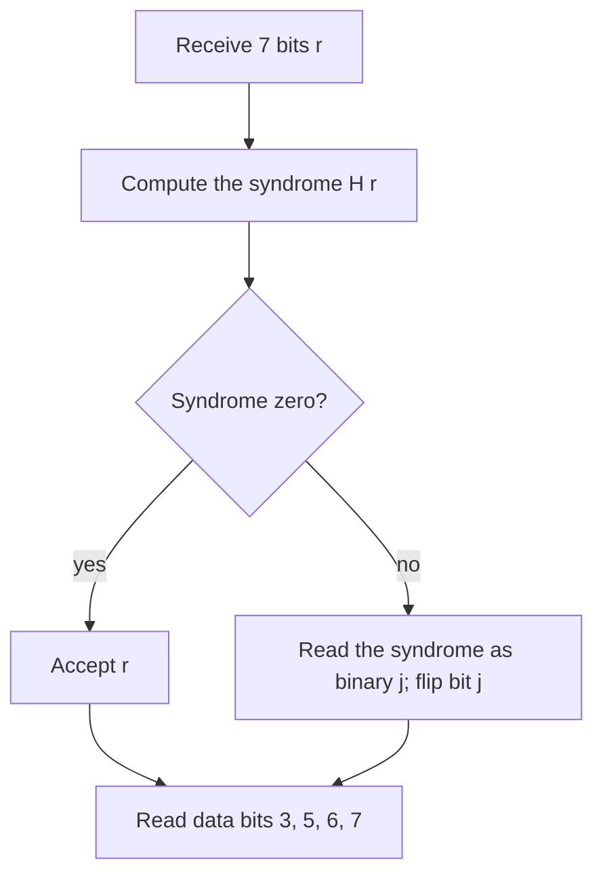

## Mistakes that fix themselves

Every stored or transmitted file is a long string of **bit** values, 0 or 1, and some of them
get flipped: by electrical noise, a scratch on a disc, a cosmic ray hitting a memory chip, or
a weak radio signal from a space probe. In the late 1940s Richard Hamming, a mathematician at
Bell Labs, was frustrated that the lab's relay computers would detect an error in his weekend
jobs and simply stop. If a machine can detect an error, he reasoned, it should be able to
find and fix it. His 1950 paper introduced the codes that now carry his name.

The surprise is that the whole theory is the linear algebra of this course, done with a
two-element number system. Null spaces, rank–nullity, bases and matrix products all reappear,
and the null space of one small matrix turns out to be a code that corrects any single error.

## Arithmetic with two numbers

The **binary field** has just two elements, 0 and 1, with ordinary multiplication and with
addition "mod 2": $0 + 0 = 0$, $0 + 1 = 1 + 0 = 1$, and $1 + 1 = 0$. (In computing, this addition
is the XOR operation.) It is often written $\mathbb{F}_2$ or $\mathrm{GF}(2)$.

Every rule you used for real scalars still holds: addition and multiplication are associative
and commutative, multiplication distributes over addition, $1$ is its own reciprocal, and
every element has a negative. In fact each element is its own negative ($1 + 1 = 0$), so
*subtraction is the same as addition*. That makes $\mathbb{F}_2$ a field, and everything built
on field arithmetic carries over: row reduction, span, linear independence, null space,
column space, rank and the rank theorem. The vectors are strings of bits; $\mathbb{F}_2^n$ has
$2^n$ of them, and a subspace of dimension $k$ has exactly $2^k$ elements (one for each choice
of the $k$ coefficients, each 0 or 1).

## Codes as subspaces

A **linear code** of length $n$ is a subspace $C$ of $\mathbb{F}_2^n$, and its elements are
**codewords**. If $\dim C = k$, the code has $2^k$ codewords, so it can carry $k$ bits of message
in each block of $n$ bits; the ratio $k/n$ is the code's *rate*. The simplest example is the
single parity bit: append to $k$ data bits one more bit that makes the number of 1s even. The
codewords are the vectors whose entries add to 0, which is the null space of the $1 \times n$
matrix $[1\ 1\ \cdots\ 1]$. One flipped bit makes the count odd, so the error is *detected*, but
nothing says which bit to fix.

Hamming's idea was to use several parity checks that overlap. The **Hamming code** of length 7
uses three checks. Number the bit positions 1 to 7 and let the **parity-check matrix** $H$ have
as its column $j$ the number $j$ written in binary (top row the 4s place, then the 2s place,
then the 1s place):

$$H = \begin{bmatrix} 0 & 0 & 0 & 1 & 1 & 1 & 1 \\ 0 & 1 & 1 & 0 & 0 & 1 & 1 \\ 1 & 0 & 1 & 0 & 1 & 0 & 1\end{bmatrix}.$$

The code is $C = \operatorname{Nul} H$. Each row of $H\mathbf{x} = \mathbf{0}$ is one parity check:
$x_4 + x_5 + x_6 + x_7 = 0$, $x_2 + x_3 + x_6 + x_7 = 0$, $x_1 + x_3 + x_5 + x_7 = 0$. The picture shows
them as three circles; each circle must contain an even number of 1s.

*Dimension.* Columns 4, 2 and 1 of $H$ are the three standard basis vectors of
$\mathbb{F}_2^3$, so $H$ has rank 3. By the rank theorem, $\dim\operatorname{Nul} H = 7 - 3 = 4$, and the
code has $2^4 = 16$ codewords. Its rate is $4/7$.

*Encoding.* In $H\mathbf{x} = \mathbf{0}$, take $x_1$, $x_2$, $x_4$ as the basic variables (each
appears in only one equation) and $x_3$, $x_5$, $x_6$, $x_7$ as free. The free variables hold the
four data bits, and the basic ones are the **parity bits**:

$$x_1 = x_3 + x_5 + x_7,\qquad x_2 = x_3 + x_6 + x_7,\qquad x_4 = x_5 + x_6 + x_7.$$

(Moving a term across the equals sign needs no sign change, since $-1 = 1$.) Setting one free
variable to 1 and the others to 0 gives a basis of the code, exactly as in parametric vector
form. The $7 \times 4$ matrix $G$ with these basis vectors as columns is a **generator matrix**:
the codeword for data $\mathbf{d}$ is $G\mathbf{d}$, and $HG = 0$.

### Example 1

Encode the data bits $1011$ (that is, $x_3 = 1$, $x_5 = 0$, $x_6 = 1$, $x_7 = 1$).

1. $x_1 = x_3 + x_5 + x_7 = 1 + 0 + 1 = 0$.
2. $x_2 = x_3 + x_6 + x_7 = 1 + 1 + 1 = 1$.
3. $x_4 = x_5 + x_6 + x_7 = 0 + 1 + 1 = 0$.
4. Codeword: $\mathbf{c} = (0, 1, 1, 0, 0, 1, 1)$.
5. Check with $H$: row 1 adds positions 4 to 7: $0 + 0 + 1 + 1 = 0$; row 2 adds positions 2, 3, 6, 7: $1 + 1 + 1 + 1 = 0$; row 3 adds positions 1, 3, 5, 7: $0 + 1 + 0 + 1 = 0$. So $H\mathbf{c} = \mathbf{0}$.

## Distance: why one error can be fixed

The **Hamming weight** of a bit vector is the number of 1s in it, and the **Hamming distance**
between two vectors is the number of positions where they differ. Since subtraction is
addition, the distance between $\mathbf{u}$ and $\mathbf{v}$ is the weight of $\mathbf{u} + \mathbf{v}$.

The **minimum distance** $d$ of a code is the smallest distance between two different
codewords. For a linear code, $\mathbf{u} + \mathbf{v}$ is again a codeword, so $d$ is simply the
smallest weight of a nonzero codeword. For the Hamming code:

- No codeword has weight 1, because $H\mathbf{e}_j$ is column $j$, and no column of $H$ is zero.
- No codeword has weight 2, because $H(\mathbf{e}_i + \mathbf{e}_j)$ is column $i$ plus column $j$, which is not zero when the columns are different (in $\mathbb{F}_2$, $\mathbf{a} + \mathbf{b} = \mathbf{0}$ means $\mathbf{a} = \mathbf{b}$).
- Columns 1, 2 and 3 add to zero ($001 + 010 + 011 = 000$), so $(1, 1, 1, 0, 0, 0, 0)$ is a codeword of weight 3.

So $d = 3$. Now suppose one bit of a codeword is flipped. The received word is at distance 1
from the codeword that was sent, and at distance at least $3 - 1 = 2$ from every other
codeword. So the nearest codeword is the right one. In general, a code with minimum distance
$d$ can correct up to $t$ errors when $d \ge 2t + 1$, or detect up to $d - 1$ errors if it does not
try to correct.

The Hamming code is as efficient as possible. Around each of the 16 codewords lie the 7 words
at distance 1, so each codeword "owns" $1 + 7 = 8$ words, and $16 \times 8 = 128 = 2^7$: these
balls cover every vector in $\mathbb{F}_2^7$ exactly once, with no gaps or overlaps. A code with
this property is a **perfect code**.

## Decoding with the syndrome

Suppose $\mathbf{c}$ is sent and $\mathbf{r} = \mathbf{c} + \mathbf{e}$ arrives, where the error vector
$\mathbf{e}$ has a 1 in each flipped position. The receiver computes the **syndrome**

$$H\mathbf{r} = H\mathbf{c} + H\mathbf{e} = \mathbf{0} + H\mathbf{e} = H\mathbf{e}.$$

The syndrome depends only on the error, not on the message. If exactly one bit $j$ flipped,
then $\mathbf{e} = \mathbf{e}_j$ and the syndrome is column $j$ of $H$, which is $j$ written in
binary. So the syndrome literally spells out the position of the bad bit. This is the reason
for ordering the columns of $H$ by binary numbers.

### Example 2

The word $\mathbf{r} = (0, 1, 1, 0, 1, 1, 1)$ arrives. Decode it.

1. Row 1 of $H$ (positions 4 to 7): $0 + 1 + 1 + 1 = 1$.
2. Row 2 (positions 2, 3, 6, 7): $1 + 1 + 1 + 1 = 0$.
3. Row 3 (positions 1, 3, 5, 7): $0 + 1 + 1 + 1 = 1$.
4. Syndrome $(1, 0, 1)$ is binary 101, which is 5. Flip bit 5: $\mathbf{c} = (0, 1, 1, 0, 0, 1, 1)$.
5. Data bits (positions 3, 5, 6, 7): $1011$. This is the codeword from Example 1 with bit 5 flipped, and the decoder recovered it.

In the circle picture, checks 1 and 4 fail and check 2 passes; the only region inside circles
1 and 4 but outside circle 2 is region 5.

### Example 3

What happens if bits 2 and 5 of the codeword $(0, 1, 1, 0, 0, 1, 1)$ are both flipped?

1. $\mathbf{r} = (0, 0, 1, 0, 1, 1, 1)$, and the syndrome is $H(\mathbf{e}_2 + \mathbf{e}_5) = 010 + 101 = 111$, which is 7.
2. The decoder flips bit 7 and outputs $(0, 0, 1, 0, 1, 1, 0)$. Check: this is a codeword (it is the codeword for data $1110$), but the wrong one.

With two errors the received word lies at distance 1 from a *different* codeword, so the
decoder is fooled: the code corrects one error but not two. A common upgrade adds an eighth
bit, the parity of all seven. Then a single error changes the overall parity and a double
error does not, so the extended code corrects every single error and *detects* every double
error. Codes of this "single error correction, double error detection" type protect the
memory in many servers, which store 8 check bits alongside each 64 data bits.

## Is it worth it?

Suppose each bit is flipped independently with probability $p = 0.01$. Sent unprotected, four
data bits arrive intact with probability $0.99^4 \approx 0.961$, so about 3.9% of 4-bit blocks
are damaged. With the Hamming code, a 7-bit block decodes correctly if it has at most one error:

$$0.99^7 + 7(0.01)(0.99)^6 \approx 0.998,$$

so only about 0.2% of blocks fail, roughly 19 times fewer, at the cost of sending 7 bits for
every 4. Claude Shannon had proved in 1948 that much better trade-offs are possible in
principle; finding practical codes that approach his limit took another 45 years. CDs, QR
codes and deep-space links use more powerful codes (such as Reed–Solomon codes) built on the
same idea: a code is a subspace, and checking membership is matrix multiplication, over
larger finite fields.

## Common mistakes

- *Using ordinary arithmetic.* In $\mathbb{F}_2$, $1 + 1 = 0$; a parity check counts 1s and keeps only whether the count is even or odd.
- *Reading the syndrome backward.* With $H$ ordered as above, the top entry is the 4s place: syndrome $(1, 1, 0)$ is 6, not 3.
- *Confusing detection with correction.* A single parity bit detects one error but cannot locate it; the Hamming code corrects one error but miscorrects two.
- *Counting codewords as $2^n$.* A code of dimension $k$ has $2^k$ codewords; most of the $2^n$ vectors are not codewords.
- *Forgetting that a codeword has syndrome zero.* A nonzero syndrome means an error happened; a zero syndrome means the word is a codeword (which is usually, but not always, the one sent).

## Key points

- $\mathbb{F}_2 = \{0, 1\}$ with $1 + 1 = 0$ is a field, so row reduction, null spaces and the rank theorem all work; subtraction is addition.
- A linear code is a subspace of $\mathbb{F}_2^n$; dimension $k$ gives $2^k$ codewords and rate $k/n$.
- Hamming (7,4) code: $C = \operatorname{Nul} H$, where column $j$ of the $3 \times 7$ matrix $H$ is $j$ in binary; parity bits sit in positions 1, 2, 4.
- Minimum distance = smallest nonzero weight = 3 for the Hamming code, so it corrects one error; $d \ge 2t + 1$ corrects $t$ errors.
- Syndrome $H\mathbf{r} = H\mathbf{e}$; for a single error it is the binary position of the flipped bit.
