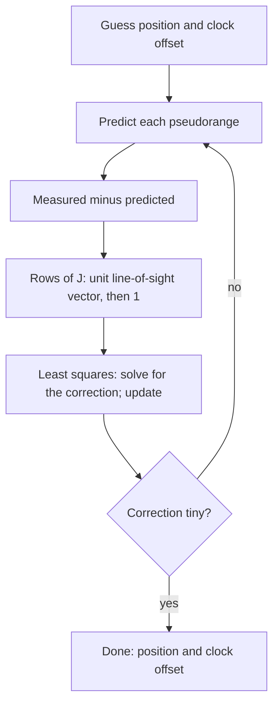

## Position from distances

A phone that knows how far it is from several known points can work out where it is. Cell
towers, Wi-Fi access points, ultrasound beacons in a warehouse and, most famously, the
satellites of the Global Positioning System (GPS) all support this. Finding a position from
distances is called **trilateration**.

The equations are not linear: a known distance puts you on a circle (or, in space, a sphere).
Yet everything a receiver does is built from this course's linear algebra. A simple algebra
trick turns circles into lines; least squares handles measurement errors; a linear
approximation, repeated, handles the rest; and the matrix $A^TA$ of the normal equations
tells you how much to trust the answer. This lesson follows those steps from two dimensions
to GPS.

## Turning circles into lines

Suppose beacons sit at known points $\mathbf{p}_1, \dots, \mathbf{p}_n$ in the plane and you
measure your distance $r_i$ to each. Your unknown position $\mathbf{x}$ satisfies

$$\|\mathbf{x} - \mathbf{p}_i\|^2 = r_i^2, \quad\text{that is,}\quad \mathbf{x}\cdot\mathbf{x} - 2\,\mathbf{p}_i\cdot\mathbf{x} + \mathbf{p}_i\cdot\mathbf{p}_i = r_i^2.$$

Every equation contains the same troublesome quadratic term $\mathbf{x}\cdot\mathbf{x}$. Subtract
the first equation from each of the others, and it cancels:

$$2(\mathbf{p}_i - \mathbf{p}_1)\cdot\mathbf{x} = r_1^2 - r_i^2 + \|\mathbf{p}_i\|^2 - \|\mathbf{p}_1\|^2, \qquad i = 2, \dots, n.$$

These are $n - 1$ *linear* equations in the coordinates of $\mathbf{x}$. Geometrically, each one
is the line through the two intersection points of circle 1 and circle $i$ (the line
perpendicular to $\mathbf{p}_i - \mathbf{p}_1$). In the plane, three beacons give two such lines,
and they meet at your position, provided the beacons don't lie on one line (otherwise the
two equations have parallel normal vectors and can't fix a single point). In space you need
four beacons not all on one plane.

### Example 1

Beacons sit at $\mathbf{p}_1 = (0, 0)$, $\mathbf{p}_2 = (8, 0)$ and $\mathbf{p}_3 = (2, 6)$. The
squared distances to them are $r_1^2 = 25$, $r_2^2 = 41$ and $r_3^2 = 5$. Where are you?

1. Beacon 2 minus beacon 1: $2(8, 0)\cdot\mathbf{x} = 25 - 41 + 64 - 0$, so $16x = 48$ and $x = 3$.
2. Beacon 3 minus beacon 1: $2(2, 6)\cdot\mathbf{x} = 25 - 5 + 40 - 0$, so $4x + 12y = 60$.
3. Substitute $x = 3$: $12 + 12y = 60$, so $y = 4$.
4. Check against the original circles: $3^2 + 4^2 = 25$, $(3 - 8)^2 + 4^2 = 41$ and $(3 - 2)^2 + (4 - 6)^2 = 5$.

```plot
{"x": [-6, 11], "y": [-3, 10], "equal": true, "circles": [{"center": [0, 0], "r": 5}, {"center": [8, 0], "r": 6.403}, {"center": [2, 6], "r": 2.236}], "points": [{"at": [0, 0], "label": "p1"}, {"at": [8, 0], "label": "p2"}, {"at": [2, 6], "label": "p3"}, {"at": [3, 4], "label": "you (3, 4)"}], "functions": [{"f": "5 - x/3", "dashed": true, "from": -3, "to": 9}], "segments": [{"from": [3, -3], "to": [3, 10], "dashed": true}], "caption": "Three circles meet at one point; the dashed lines come from subtracting the circle equations"}
```

## Noisy distances: least squares

Real distances carry errors, so with more beacons than the minimum the linear equations
disagree slightly. That is exactly the situation of the least-squares lesson: write the
equations as $M\mathbf{x} = \mathbf{c}$ and solve the normal equations $M^TM\hat{\mathbf{x}} = M^T\mathbf{c}$.
Extra beacons average out the errors.

### Example 2

Beacons sit at the corners $(0, 0)$, $(10, 0)$, $(0, 10)$ and $(10, 10)$ of a square. Measured
squared distances are $26$, $64$, $46$ and $85$ (the true position gives 25, 65, 45 and 85, so
the measurements are slightly off). Estimate the position.

1. Subtract the first equation from the others: $20x = 26 - 64 + 100 = 62$; $20y = 26 - 46 + 100 = 80$; $20x + 20y = 26 - 85 + 200 = 141$.
2. Divide by 20: $x = 3.1$, $y = 4$, $x + y = 7.05$. Three equations, two unknowns, and they disagree, since $3.1 + 4 \neq 7.05$.
3. $M = \begin{bmatrix} 1 & 0 \\ 0 & 1 \\ 1 & 1\end{bmatrix}$, $\mathbf{c} = (3.1, 4, 7.05)$. Then $M^TM = \begin{bmatrix} 2 & 1 \\ 1 & 2\end{bmatrix}$ and $M^T\mathbf{c} = (10.15, 11.05)$.
4. Solve: $\hat x = \tfrac{2(10.15) - 11.05}{3} \approx 3.083$ and $\hat y = \tfrac{2(11.05) - 10.15}{3} \approx 3.983$.

The estimate $(3.08, 3.98)$ lies within 0.1 of the true position $(3, 4)$. (Subtracting
equations mixes the errors of different beacons together, so this is a fast first estimate;
precise receivers refine it with the method below.)

## GPS: four unknowns, not three

A GPS satellite broadcasts its position and the exact time, kept by an atomic clock. The
receiver notes when the signal arrives and multiplies the travel time by the speed of light
to get a distance. The trouble is the receiver's own clock, an inexpensive quartz crystal:
light travels about 300 meters in one microsecond, so a clock error of a millionth of a second
spoils the position by hundreds of meters.

The fix is to treat the receiver's clock offset $b$ as a fourth unknown. The measured
distance to satellite $i$, called a **pseudorange**, is

$$\rho_i = \|\mathbf{x} - \mathbf{s}_i\| + cb,$$

where $\mathbf{s}_i$ is the satellite's position and $c$ is the speed of light. The same offset
$b$ appears in every equation, so with four unknowns ($x$, $y$, $z$, $b$) a receiver needs
signals from at least four satellites. It usually has more. As a bonus, solving for $b$ turns
every GPS receiver into a very accurate clock.

(Many smaller effects also have to be modeled: delays in the upper atmosphere, and
relativity, which makes the satellites' clocks run fast by about 38 microseconds per day
compared with clocks on the ground. These are handled in the system's design and corrections,
not in the linear algebra.)

## Linearize, solve, repeat

The pseudorange equations are not linear, but near any guess they are almost linear. Start
from a guess $\mathbf{x}_0$ and $b_0$ (the center of the Earth works). If you move a small step
$\boldsymbol{\delta}$, the distance to satellite $i$ changes by about
$\mathbf{e}_i\cdot\boldsymbol{\delta}$, where $\mathbf{e}_i = \dfrac{\mathbf{x}_0 - \mathbf{s}_i}{\|\mathbf{x}_0 - \mathbf{s}_i\|}$
is the unit vector pointing from the satellite toward you. (This is the derivative of distance
in disguise: moving along the line of sight changes the distance one-for-one, and moving
across it barely changes it.) So the corrections solve the linear least-squares problem

$$J\begin{bmatrix} \boldsymbol{\delta} \\ c\,\Delta b\end{bmatrix} \approx \boldsymbol{\rho} - \boldsymbol{\rho}_{\text{predicted}},$$

where row $i$ of $J$ is $[\,\mathbf{e}_i^T \ \ 1\,]$ and the right side lists how far each measured
pseudorange is from the one the guess predicts. Update the guess and repeat. Each step is
the least-squares lesson again, and a handful of steps usually settles the position. This
"linearize and solve by least squares" loop is the **Gauss–Newton method**, used throughout
science and engineering to fit nonlinear models.



## Geometry matters: dilution of precision

Measurement errors cannot be avoided, but how much they hurt depends on where the satellites
are. If each range error has standard deviation $\sigma$ (and they are independent), the
estimated position has covariance matrix $\sigma^2(J^TJ)^{-1}$, a fact from statistics that we
state without proof. The diagonal entries are the variances of the coordinates, so the
number

$$\text{DOP} = \sqrt{\operatorname{tr}\left((J^TJ)^{-1}\right)}$$

says how many times larger the overall position error is than a single range error. It is
called the **dilution of precision** (DOP). Small DOP means good geometry.


When all the satellites are in nearly the same direction, the rows of $J$ are nearly
parallel, $J^TJ$ is nearly singular, $(J^TJ)^{-1}$ is large, and small range errors become big
position errors. It is the same lesson as an ill-conditioned system: the problem itself is
touchy, whatever algorithm solves it.

### Example 3

In the plane (with no clock unknown), a receiver measures ranges to two beacons whose
directions differ by the angle $\theta$. Find the DOP for $\theta = 90^\circ$ and
$\theta = 20^\circ$.

1. Take the unit vectors $\mathbf{e}_1 = (1, 0)$ and $\mathbf{e}_2 = (\cos\theta, \sin\theta)$ as the rows of $J$.
2. $J^TJ = \begin{bmatrix} 1 + \cos^2\theta & \cos\theta\sin\theta \\ \cos\theta\sin\theta & \sin^2\theta\end{bmatrix}$, with trace 2 and determinant $\sin^2\theta$.
3. For a $2 \times 2$ matrix, $\operatorname{tr}(M^{-1}) = \operatorname{tr} M/\det M$ (the inverse swaps the diagonal entries and divides by the determinant). So $\operatorname{tr}\left((J^TJ)^{-1}\right) = 2/\sin^2\theta$ and $\text{DOP} = \sqrt2/\sin\theta$.
4. $\theta = 90^\circ$: $\text{DOP} = \sqrt2 \approx 1.41$. $\theta = 20^\circ$: $\text{DOP} \approx 1.414/0.342 \approx 4.13$.

With the beacons only $20^\circ$ apart, the same range errors produce a position error about
three times larger than with perpendicular lines of sight. Receivers prefer, and planning
software reports, satellite sets with low DOP.

## Common mistakes

- *Subtracting unsquared distances.* The quadratic terms cancel only when you subtract the squared equations $\|\mathbf{x} - \mathbf{p}_i\|^2 = r_i^2$.
- *Using beacons on one line.* Then the linear equations have parallel normal vectors and cannot pin down a point in the plane (a reflection across that line fits equally well).
- *Forgetting the clock unknown.* GPS needs four satellites for a 3D position because the receiver's clock offset is also unknown.
- *Thinking more satellites always fix a bad geometry.* What matters is how spread out the directions are, measured by $(J^TJ)^{-1}$.
- *Solving the linearized system once and stopping.* The linear model is only accurate near the guess; repeat until the correction is tiny.

## Key points

- Distance equations $\|\mathbf{x} - \mathbf{p}_i\|^2 = r_i^2$ become linear after subtracting one from the others: $2(\mathbf{p}_i - \mathbf{p}_1)\cdot\mathbf{x} = r_1^2 - r_i^2 + \|\mathbf{p}_i\|^2 - \|\mathbf{p}_1\|^2$.
- With extra or noisy measurements, solve the linear equations by least squares.
- GPS pseudoranges $\rho_i = \|\mathbf{x} - \mathbf{s}_i\| + cb$ have four unknowns, so at least four satellites are needed.
- Gauss–Newton: linearize with unit line-of-sight vectors, solve by least squares, update, repeat.
- Dilution of precision $\sqrt{\operatorname{tr}((J^TJ)^{-1})}$ measures how geometry magnifies range errors; spread-out satellites are best.
