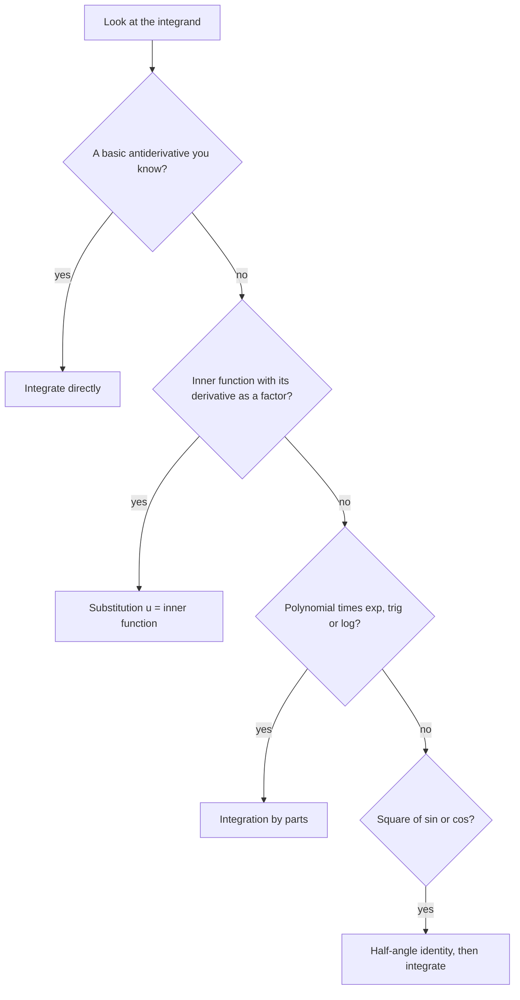

## What this lesson is for

Multivariable calculus does not replace single-variable calculus; it runs on it. A
partial derivative is an ordinary derivative taken while the other variables sit still.
A double integral is two ordinary integrals done one after the other. A line integral
becomes an ordinary integral in a parameter $t$. So before we add dimensions, this lesson
gathers the tools from Calculus I and II that the rest of the course uses constantly, and
says *where* each one will reappear. If any of it feels rusty, work the examples by hand
before moving on; every later lesson assumes you can do them quickly.

## Derivatives: rules you will use every day

The **derivative** $f'(x) = \lim_{h\to 0} \dfrac{f(x+h)-f(x)}{h}$ is the instantaneous rate
of change of $f$, and the slope of its graph. Geometrically it is the slope of the line
that best fits the graph near a point. That "best linear fit" idea is exactly what we
will generalize to tangent planes in Module 3.

| Rule | Statement |
|---|---|
| Power | $\dfrac{d}{dx}x^n = nx^{n-1}$ |
| Product | $(fg)' = f'g + fg'$ |
| Quotient | $\left(\dfrac{f}{g}\right)' = \dfrac{f'g - fg'}{g^2}$ |
| Chain | $\dfrac{d}{dx}f(g(x)) = f'(g(x))\,g'(x)$ |
| Exponential, log | $(e^x)' = e^x$, $(\ln x)' = \dfrac1x$ |
| Trig | $(\sin x)' = \cos x$, $(\cos x)' = -\sin x$, $(\tan x)' = \sec^2 x$ |
| Inverse trig | $(\arctan x)' = \dfrac{1}{1+x^2}$, $(\arcsin x)' = \dfrac{1}{\sqrt{1-x^2}}$ |

The **chain rule** deserves special attention. It says that rates of change multiply when
one quantity depends on another that depends on a third. In Module 3 it grows into a
tree of such products, one branch per intermediate variable. If you can already see
$\frac{d}{dx}\sin(x^2) = 2x\cos(x^2)$ as "outer derivative times inner derivative," the
multivariable version will feel natural.

### Example 1

Differentiate $f(x) = x^2 e^{3x}$.

1. It is a product, so use the product rule with $u = x^2$ and $v = e^{3x}$.
2. $u' = 2x$. For $v$, the chain rule gives $v' = e^{3x}\cdot 3$.
3. $f'(x) = 2x\,e^{3x} + x^2\cdot 3e^{3x} = e^{3x}(2x + 3x^2)$.

The habit to build: name the structure first (product, quotient, composition), then apply
the matching rule.

## Integrals: the fundamental theorem and two techniques

The **definite integral** $\int_a^b f(x)\,dx$ adds up $f(x)\,dx$ over $[a,b]$; for
$f \ge 0$ it is the area under the graph. The **Fundamental Theorem of Calculus** (FTC)
connects it to antiderivatives: if $F' = f$, then

$$\int_a^b f(x)\,dx = F(b) - F(a).$$

Why it works: the total change in $F$ across $[a,b]$ is the sum of its tiny changes
$F'(x)\,dx = f(x)\,dx$. Hold on to that sentence. The fundamental theorem for line
integrals, Green's theorem, Stokes' theorem and the Divergence theorem are all versions of
"adding up the small changes inside gives the total change on the boundary."

Two techniques carry most of the load:

- **Substitution** (the chain rule backwards): if $u = g(x)$, then
  $\int f(g(x))g'(x)\,dx = \int f(u)\,du$. For definite integrals, change the limits too.
- **Integration by parts** (the product rule backwards):
  $\int u\,dv = uv - \int v\,du$. Choose $u$ to be something that gets simpler when
  differentiated (a polynomial, a logarithm).

You will also meet the trig identities $\sin^2\theta = \tfrac12(1-\cos 2\theta)$ and
$\cos^2\theta = \tfrac12(1+\cos 2\theta)$ often in polar and spherical integrals, and the
values $\int_0^{2\pi}\sin^2\theta\,d\theta = \int_0^{2\pi}\cos^2\theta\,d\theta = \pi$.

When you meet a new integral, a quick sequence of questions usually tells you which tool to try first:



The chart is a starting point, not a law: some integrals need two tools in a row (a substitution followed by parts), and a few need neither.

### Example 2

Evaluate $\displaystyle\int_0^2 x\sqrt{x^2+5}\,dx$.

1. The factor $x$ is (half of) the derivative of the inside $x^2+5$, which signals
   substitution. Let $u = x^2+5$, so $du = 2x\,dx$ and $x\,dx = \tfrac12 du$.
2. Change limits: $x=0 \Rightarrow u=5$; $x=2 \Rightarrow u=9$.
3. $\displaystyle\int_5^9 \tfrac12 u^{1/2}\,du = \tfrac12\cdot\tfrac23 u^{3/2}\Big|_5^9 = \tfrac13\left(27 - 5\sqrt5\right)$.

So the integral is $9 - \tfrac{5\sqrt5}{3} \approx 5.273$.

### Example 3

Evaluate $\displaystyle\int_0^1 x e^{x}\,dx$.

1. Product of a polynomial and an exponential: integrate by parts with $u = x$,
   $dv = e^x dx$, so $du = dx$, $v = e^x$.
2. $\int_0^1 xe^x\,dx = \left[xe^x\right]_0^1 - \int_0^1 e^x\,dx = e - (e - 1) = 1.$

## Parametric curves and polar coordinates

A **parametric curve** describes a path by giving both coordinates as functions of a
parameter: $x = x(t)$, $y = y(t)$. The slope is $\dfrac{dy}{dx} = \dfrac{y'(t)}{x'(t)}$,
and the length of the path from $t=a$ to $t=b$ is

$$L = \int_a^b \sqrt{x'(t)^2 + y'(t)^2}\,dt.$$

The square root is the speed: in time $dt$ the point moves $x'\,dt$ across and $y'\,dt$
up, so by Pythagoras it travels $\sqrt{x'^2+y'^2}\,dt$. Module 2 adds a third coordinate
and the same formula gets one more term under the root.

In **polar coordinates** a point is located by its distance $r$ from the origin and its
angle $\theta$ from the positive $x$-axis:

$$x = r\cos\theta,\qquad y = r\sin\theta,\qquad r^2 = x^2+y^2,\qquad \tan\theta = \frac yx.$$

The area enclosed by a polar curve $r = f(\theta)$ for $\alpha\le\theta\le\beta$ is
$\tfrac12\int_\alpha^\beta f(\theta)^2\,d\theta$, because a thin wedge of angle $d\theta$
is nearly a triangle of area $\tfrac12 r^2\,d\theta$. That wedge reappears in Lesson 23 as
the area element $dA = r\,dr\,d\theta$.

The picture shows one such wedge cut from the cardioid $r = 1 + \cos\theta$: two radii a small angle apart, closed off by a short piece of the curve.

```plot
{"x": [-0.3, 2.3], "y": [-0.3, 1.6], "equal": true, "curves": [{"x": "(1+cos(t))*cos(t)", "y": "(1+cos(t))*sin(t)", "t": [0, 1.6]}], "polygons": [{"points": [[0, 0], [1.648, 0.9], [1.579, 0.968], [1.507, 1.031], [1.43, 1.087], [1.35, 1.137]], "fill": true}], "labels": [{"at": [1.85, 1.15], "text": "dθ wedge"}, {"at": [0.55, 0.6], "text": "r"}], "caption": "A thin polar wedge of angle dθ is nearly a triangle with two sides r, so its area is about ½ r² dθ"}
```

```plot
{"x": [-2.5, 2.5], "y": [-2.5, 2.5], "equal": true, "curves": [{"x": "(1+cos(t))*cos(t)", "y": "(1+cos(t))*sin(t)", "t": [0, "2pi"]}, {"x": "1.5*cos(t)", "y": "1.5*sin(t)", "t": ["-1.25*pi", "0.75*pi"], "dashed": true}], "caption": "Polar curves: the cardioid r = 1 + cos θ (solid) and the circle r = 1.5 (dashed)"}
```

## Where each tool shows up later

| Tool | Reappears as |
|---|---|
| Derivative as best linear fit | Tangent planes, linear approximation (Lesson 14) |
| Chain rule | Multivariable chain rule, implicit differentiation (Lesson 15) |
| Critical points, second-derivative test | Extrema of $f(x,y)$ (Lesson 17), least squares fitting (Lesson 20) |
| FTC | Fundamental theorem for line integrals, Green, Stokes, Divergence |
| Substitution | Change of variables with Jacobians (Lesson 28) |
| Parametric arc length | Arc length of space curves (Lesson 8) |
| Polar area | Double integrals in polar coordinates (Lesson 23) |

## Common mistakes

- Forgetting the inner derivative in the chain rule: $\frac{d}{dx}e^{3x}$ is $3e^{3x}$, not $e^{3x}$.
- Changing variables in a definite integral but keeping the old limits.
- Choosing $u = e^x$ in $\int xe^x\,dx$; the new integral gets harder, not easier.
- Dropping the $\tfrac12$ in polar area, or writing $\int r\,d\theta$ instead of $\tfrac12\int r^2\,d\theta$.

## Key points

- Derivative rules (especially the chain rule) and the FTC are the engine of this course.
- Substitution and integration by parts are the two techniques you will use most.
- Parametric arc length is $\int\sqrt{x'^2+y'^2}\,dt$; polar conversion is $x=r\cos\theta$, $y=r\sin\theta$.
- Every big theorem at the end of the course is a higher-dimensional FTC.
