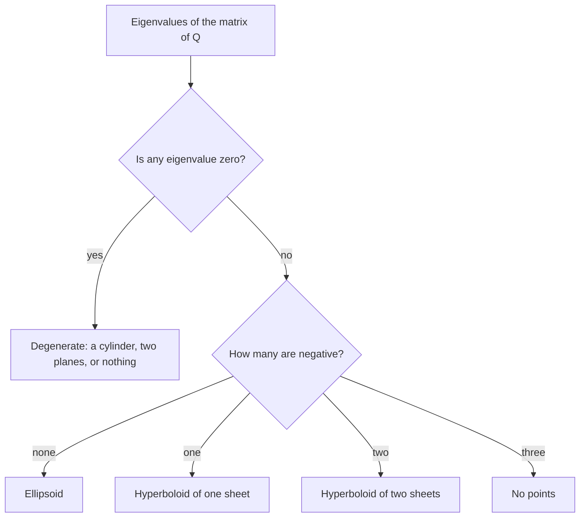

## The missing terms

Every quadric surface in Lesson 6 had an equation built from $x^2$, $y^2$, $z^2$, linear terms and a constant. The most general second-degree equation in $x, y, z$ also allows the **cross terms** $xy$, $yz$ and $xz$. What does $2xy + z^2 = 1$ look like? The answer is that cross terms do not create new shapes. They only *tilt* one of the six standard quadrics, so that its axes no longer line up with the coordinate axes. This lesson shows how to find the tilted axes and identify the surface, first for curves in the plane, then in space. The same mathematics returns in Lesson 17: the second-derivative test is a statement about this kind of expression.

Two results from linear algebra are stated here without proof and labeled as such; everything else is derived.

## Quadratic forms and their matrices

A **quadratic form** is a polynomial whose terms all have degree exactly 2. In two variables,

$$Q(x,y) = Ax^2 + Bxy + Cy^2 = \begin{bmatrix} x & y\end{bmatrix}\begin{bmatrix} A & B/2\\ B/2 & C\end{bmatrix}\begin{bmatrix} x\\ y\end{bmatrix}.$$

Multiply out the right side to check: the two off-diagonal entries each contribute $\tfrac B2 xy$. The matrix is a **symmetric matrix**: it equals its own transpose, because the cross term is split evenly between the two off-diagonal places. In three variables the form $Ax^2 + By^2 + Cz^2 + Dxy + Exz + Fyz$ has the symmetric $3\times3$ matrix with $A, B, C$ on the diagonal and half of each cross coefficient off it.

A curve $Q(x,y) = k$ with $B = 0$ is easy: $3x^2 + 5y^2 = 15$ is an ellipse with axes along the coordinate axes. The cross term is the only obstacle.

## Rotating the axes

Introduce new axes $x', y'$ rotated counterclockwise by an angle $\theta$. This **rotation of axes** relates the coordinates by

$$x = x'\cos\theta - y'\sin\theta,\qquad y = x'\sin\theta + y'\cos\theta.$$

Substituting into $Ax^2 + Bxy + Cy^2$ and collecting terms gives a new form $A'x'^2 + B'x'y' + C'y'^2$ whose cross coefficient works out to

$$B' = B\cos2\theta - (A - C)\sin2\theta.$$

(The double angles appear through $2\sin\theta\cos\theta = \sin2\theta$ and $\cos^2\theta - \sin^2\theta = \cos2\theta$.) So the cross term disappears when

$$\cot 2\theta = \frac{A - C}{B},$$

and since cotangent takes every real value on $0 < 2\theta < \pi$, an angle $0 < \theta < \tfrac{\pi}{2}$ always works. Two combinations do not change under any rotation, which you can confirm by expanding:

$$A' + C' = A + C,\qquad B'^2 - 4A'C' = B^2 - 4AC.$$

The second one, the discriminant of the form, classifies the curve $Ax^2 + Bxy + Cy^2 = k$ (with $k \ne 0$) without rotating at all. After rotation the equation is $A'x'^2 + C'y'^2 = k$, and $B'^2 - 4A'C' = -4A'C'$:

| $B^2 - 4AC$ | Signs of $A'$, $C'$ | Curve (typical case) |
|---|---|---|
| negative | same sign | ellipse (or nothing, if $k$ has the other sign) |
| positive | opposite signs | hyperbola |
| zero | one of them is 0 | a pair of parallel lines, or nothing |

With linear terms present, a zero discriminant usually gives a parabola; the table above is for pure quadratic forms.

## Principal axes and eigenvalues

There is a faster way to find $A'$ and $C'$ directly. A number $\lambda$ is an **eigenvalue** of a matrix $M$ if $M\mathbf u = \lambda\mathbf u$ for some nonzero vector $\mathbf u$, called an **eigenvector**: the matrix only stretches $\mathbf u$, without turning it. For a $2\times2$ matrix, $\lambda$ is an eigenvalue exactly when $\det(M - \lambda I) = 0$, a quadratic equation in $\lambda$.

The **principal axes theorem** (from linear algebra; stated here without proof). Every real symmetric matrix has real eigenvalues and a set of mutually perpendicular unit eigenvectors. Rotating the axes to point along those eigenvectors turns $Q$ into a sum of squares, with the eigenvalues as coefficients:

$$Q = \lambda_1x'^2 + \lambda_2y'^2 \quad\text{(or } \lambda_1x'^2 + \lambda_2y'^2 + \lambda_3z'^2 \text{ in space)}.$$

The eigenvector directions are the **principal axes** of the form. For the $2\times2$ matrix with diagonal $A, C$ and off-diagonal $h = B/2$, the quadratic $\det(M - \lambda I) = (A-\lambda)(C-\lambda) - h^2 = 0$ solves to

$$\lambda = \frac{A + C}{2} \pm \sqrt{\left(\frac{A - C}{2}\right)^2 + h^2}.$$

The square root is real, so the eigenvalues are real, as the theorem promises. Their sum is $A + C$ and their product is $AC - h^2 = -\tfrac14(B^2 - 4AC)$, which matches the two invariants above.

### Example 1: a tilted ellipse

Identify $5x^2 - 4xy + 8y^2 = 36$ and find its axes.

1. Matrix: $\begin{bmatrix} 5 & -2\\ -2 & 8\end{bmatrix}$. Discriminant $B^2 - 4AC = 16 - 160 = -144 < 0$: an ellipse (the right side is positive).
2. Eigenvalues: $\tfrac{13}{2} \pm \sqrt{\left(-\tfrac32\right)^2 + 4} = 6.5 \pm 2.5$, so $\lambda_1 = 4$ and $\lambda_2 = 9$.
3. Eigenvector for 4: $(5-4)u_1 - 2u_2 = 0$ gives $\mathbf u_1 = \langle 2,1\rangle$. For 9: $-4u_1 - 2u_2 = 0$ gives $\mathbf u_2 = \langle -1,2\rangle$. They are perpendicular, as promised.
4. In coordinates along $\mathbf u_1, \mathbf u_2$ the curve is $4x'^2 + 9y'^2 = 36$, that is, $\dfrac{x'^2}{9} + \dfrac{y'^2}{4} = 1$: semi-axes 3 along $\langle 2,1\rangle$ and 2 along $\langle -1,2\rangle$.
5. Check with the angle formula: $\cot2\theta = \dfrac{5-8}{-4} = \dfrac34$, so $\tan 2\theta = \tfrac43$ and $\theta \approx 26.57^\circ$. Indeed $\tan\theta = \tfrac12$, the slope of $\langle 2,1\rangle$.

```plot
{"x": [-4, 4], "y": [-3.5, 3.5], "equal": true, "curves": [{"x": "(6*cos(t) - 2*sin(t))/sqrt(5)", "y": "(3*cos(t) + 4*sin(t))/sqrt(5)", "t": [0, "2pi"]}], "segments": [{"from": [-3.6, -1.8], "to": [3.6, 1.8], "dashed": true, "arrow": true}, {"from": [1.4, -2.8], "to": [-1.4, 2.8], "dashed": true, "arrow": true}], "points": [{"at": [2.683, 1.342]}, {"at": [-0.894, 1.789]}], "labels": [{"at": [3.75, 1.35], "text": "x′"}, {"at": [-1.05, 3.05], "text": "y′"}], "caption": "The tilted ellipse with its principal axes: semi-axis 3 along x′ (direction ⟨2, 1⟩) and 2 along y′ (direction ⟨−1, 2⟩)"}
```

### Example 2: the saddle $z = xy$

1. The form $xy$ has $A = C = 0$, $B = 1$, matrix $\begin{bmatrix} 0 & \tfrac12\\ \tfrac12 & 0\end{bmatrix}$, eigenvalues $\pm\tfrac12$.
2. $\cot2\theta = 0$ gives $\theta = 45^\circ$: $x = \tfrac{x' - y'}{\sqrt2}$, $y = \tfrac{x' + y'}{\sqrt2}$.
3. Then $xy = \tfrac12(x'^2 - y'^2)$, so the surface is $z = \tfrac12x'^2 - \tfrac12y'^2$.

That is the hyperbolic paraboloid of Lesson 6, turned $45^\circ$ about the $z$-axis. It rises along the line $y = x$ and falls along $y = -x$, which you can check directly: $z = x^2$ on the first line and $z = -x^2$ on the second.

## Quadric surfaces in space

In three variables the principal axes theorem gives three perpendicular axes and three real eigenvalues, and $Q(x,y,z) = 1$ becomes $\lambda_1x'^2 + \lambda_2y'^2 + \lambda_3z'^2 = 1$. The signs decide the shape, by the same "count the minus signs" rule as Lesson 6:



In general the eigenvalues of a $3\times3$ matrix are roots of a cubic, which a computer handles. Problems by hand are usually built so the matrix splits into smaller blocks, as in the next example.

### Example 3: identify $2xy + z^2 = 1$

1. The $z$ part has no cross terms, so only $2xy$ needs rotating. As in Example 2, rotate the $xy$-plane by $45^\circ$: $2xy = x'^2 - y'^2$.
2. The equation becomes $x'^2 - y'^2 + z^2 = 1$. The eigenvalues are $1, -1, 1$: one negative.
3. One minus sign: a **hyperboloid of one sheet** whose axis is the $y'$-axis, the line through the origin in the direction $\langle -1, 1, 0\rangle$.

Check a trace: in the plane $x = y$ (that is, $y' = 0$) the equation becomes $2x^2 + z^2 = 1$, an ellipse around the axis, as a one-sheeted hyperboloid should have.

## The link to the second-derivative test

Near a critical point, Taylor's theorem says $f(a + h, b + k) - f(a,b) \approx \tfrac12\left(f_{xx}h^2 + 2f_{xy}hk + f_{yy}k^2\right)$, and the quadratic form in the parentheses, $f_{xx}h^2 + 2f_{xy}hk + f_{yy}k^2$, has the Hessian as its matrix. Its discriminant is $(2f_{xy})^2 - 4f_{xx}f_{yy} = -4D$, where $D = f_{xx}f_{yy} - f_{xy}^2$ is the discriminant of Lesson 17. So $D > 0$ means ellipse-like level curves (a bowl, so a local maximum or minimum), and $D < 0$ means hyperbola-like ones (a saddle). With three or more variables the test looks at the signs of the Hessian's eigenvalues instead: all positive gives a local minimum, all negative a local maximum, mixed signs a saddle. The proof that the quadratic part controls the shape needs more analysis than this course covers, so take that step as stated.

## Common mistakes

- Putting the whole cross coefficient $B$ off the diagonal. Each off-diagonal entry is $B/2$.
- Using $\tan2\theta = \dfrac{A - C}{B}$. It is the cotangent, $\cot2\theta = \dfrac{A - C}{B}$.
- Classifying by the signs of $A$ and $C$ when $B \ne 0$. With a cross term, $x^2 + 4xy + y^2 = 1$ has $A, C > 0$ yet is a hyperbola ($B^2 - 4AC = 12 > 0$).
- Forgetting the sign of the constant: $-x^2 - y^2 - z^2 = 1$ has three negative eigenvalues and no points.
- Treating eigenvectors as unique. Any nonzero multiple of an eigenvector is also one; only the direction matters.

## Key points

- A quadratic form $Ax^2 + Bxy + Cy^2$ has the symmetric matrix with diagonal $A, C$ and off-diagonal $B/2$.
- Rotating by $\theta$ with $\cot2\theta = (A - C)/B$ removes the cross term; $A + C$ and $B^2 - 4AC$ do not change.
- Principal axes theorem (stated): in eigenvector coordinates, $Q = \lambda_1x'^2 + \lambda_2y'^2\,(+\,\lambda_3z'^2)$.
- The signs of the eigenvalues classify the conic or quadric, and the same idea drives the second-derivative test.
