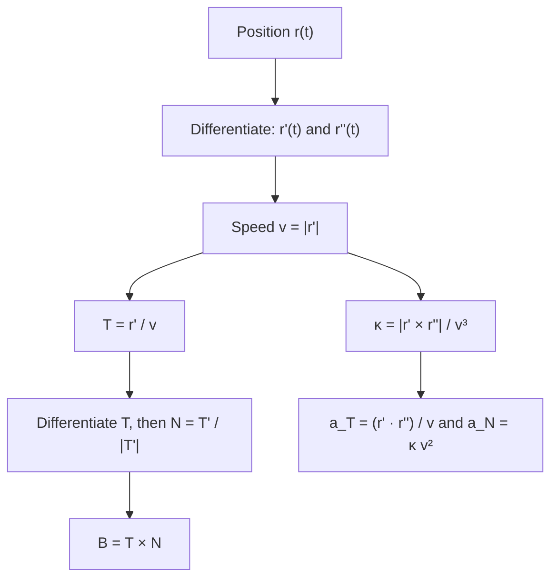

## A coordinate system that rides along the curve

The axes $\mathbf i, \mathbf j, \mathbf k$ are fixed in space. For a particle moving on a
curve, it is often more natural to use directions attached to the particle: "forward,"
"the way it is turning," and "sideways out of the plane of turning." These three unit
vectors form the **TNB frame** (or Frenet frame). It lets us split acceleration into the
part that changes speed and the part that changes direction, which is exactly what a
driver feels as "pressing back into the seat" and "being pushed toward the door."

## The three vectors

**Unit tangent.** $\mathbf T = \dfrac{\mathbf r'}{|\mathbf r'|}$ points forward along the curve.

**Principal unit normal.** Because $|\mathbf T| = 1$, the derivative $\mathbf T'$ is
perpendicular to $\mathbf T$ (Lesson 7). It points in the direction the curve is turning.
Normalize it:

$$\mathbf N(t) = \frac{\mathbf T'(t)}{|\mathbf T'(t)|}.$$

$\mathbf N$ points toward the concave side of the curve, toward the center of the
osculating circle.

**Binormal.** Complete a right-handed frame with

$$\mathbf B(t) = \mathbf T(t)\times\mathbf N(t).$$

Since $\mathbf T$ and $\mathbf N$ are perpendicular unit vectors, $\mathbf B$ is a unit
vector perpendicular to both. The plane spanned by $\mathbf T$ and $\mathbf N$ is the
**osculating plane** (the plane the curve is "momentarily lying in"), and $\mathbf B$ is its
normal. For a plane curve the osculating plane is just the curve's plane and $\mathbf B$ is
constant. How fast $\mathbf B$ turns measures how fast the curve twists out of its
osculating plane; that rate is called the **torsion** $\tau$, with $d\mathbf B/ds = -\tau\mathbf N$.

The picture shows the frame at one point $P$. $\mathbf T$ and $\mathbf N$ lie in the shaded
osculating plane, and $\mathbf B$ stands perpendicular to it. Where the curve rises out of
the shaded plane, it is twisting: that is torsion at work.


### Example 1: the helix

For $\mathbf r(t) = \langle \cos t,\, \sin t,\, t\rangle$:

1. $\mathbf r' = \langle -\sin t, \cos t, 1\rangle$, $|\mathbf r'| = \sqrt2$, so $\mathbf T = \tfrac{1}{\sqrt2}\langle -\sin t, \cos t, 1\rangle$.
2. $\mathbf T' = \tfrac{1}{\sqrt2}\langle -\cos t, -\sin t, 0\rangle$, with length $\tfrac{1}{\sqrt2}$, so $\mathbf N = \langle -\cos t, -\sin t, 0\rangle$.
3. $\mathbf B = \mathbf T\times\mathbf N = \tfrac{1}{\sqrt2}\langle \sin t,\, -\cos t,\, 1\rangle$.

Interpretation: $\mathbf N$ is horizontal and points straight at the $z$-axis, the axis the
helix winds around, just as for circular motion. The binormal tilts at $45^\circ$, mirroring
the helix's steady climb.

## Splitting acceleration

Let $v = |\mathbf r'| = ds/dt$ be the speed, so the velocity is $\mathbf v = v\mathbf T$.
Differentiate with the product rule:

$$\mathbf a = \mathbf v' = v'\,\mathbf T + v\,\mathbf T'.$$

Now $\mathbf T' = |\mathbf T'|\,\mathbf N$ and $|\mathbf T'| = \kappa v$ (from
$\kappa = |\mathbf T'|/|\mathbf r'|$). So

$$\mathbf a = v'\,\mathbf T + \kappa v^2\,\mathbf N.$$

Acceleration always lies in the osculating plane, with no $\mathbf B$ component. Its two
parts are

- the **tangential component** $a_T = v' = \dfrac{d}{dt}|\mathbf v|$: the rate of change of speed;
- the **normal component** $a_N = \kappa v^2$: the turning part, also called centripetal acceleration.

The $v^2$ explains why taking a curve twice as fast needs four times the sideways grip.

### Formulas without T and N

Dot $\mathbf a = a_T\mathbf T + a_N\mathbf N$ with $\mathbf T = \mathbf v/|\mathbf v|$,
and cross with it, to get

$$a_T = \frac{\mathbf r'\cdot\mathbf r''}{|\mathbf r'|},\qquad a_N = \frac{|\mathbf r'\times\mathbf r''|}{|\mathbf r'|}.$$

A check on any computation: $a_T^2 + a_N^2 = |\mathbf a|^2$, since $\mathbf T$ and
$\mathbf N$ are perpendicular unit vectors.

The whole computation, from a position function to the frame and the two components, runs
like this:



### Example 2

A particle moves along $\mathbf r(t) = \langle t,\, t^2,\, 0\rangle$. Find $a_T$ and $a_N$ at $t = 1$.

1. $\mathbf r' = \langle 1, 2t, 0\rangle = \langle 1,2,0\rangle$ and $\mathbf r'' = \langle 0,2,0\rangle$ at $t = 1$.
2. $\mathbf r'\cdot\mathbf r'' = 4$ and $|\mathbf r'| = \sqrt5$, so $a_T = \tfrac{4}{\sqrt5} \approx 1.789$.
3. $\mathbf r'\times\mathbf r'' = \langle 0, 0, 2\rangle$, so $a_N = \tfrac{2}{\sqrt5} \approx 0.894$.
4. Check: $a_T^2 + a_N^2 = \tfrac{16}{5} + \tfrac{4}{5} = 4 = |\mathbf r''|^2$. ✓

The particle is speeding up ($a_T > 0$) while turning left.

```plot
{"x": [-1, 3], "y": [-0.5, 3], "equal": true, "functions": [{"f": "x^2", "from": -0.8, "to": 1.7}], "points": [{"at": [1, 1], "label": "t = 1"}], "segments": [{"from": [1, 1], "to": [1.4472, 1.8944], "arrow": true, "label": "T"}, {"from": [1, 1], "to": [0.1056, 1.4472], "arrow": true, "label": "N"}, {"from": [1, 1], "to": [1, 3], "arrow": true, "dashed": true, "label": "a"}], "caption": "At t = 1 the acceleration ⟨0, 2⟩ splits into a forward part along T and a turning part along N"}
```

### Example 3: uniform circular motion

For $\mathbf r = \langle R\cos\omega t,\, R\sin\omega t\rangle$ the speed $v = R\omega$ is
constant, so $a_T = 0$ and all acceleration is normal: $a_N = \kappa v^2 = \tfrac1R(R\omega)^2 = R\omega^2 = v^2/R$,
the familiar centripetal acceleration, pointing toward the center.

## Common mistakes

- Computing $\mathbf N$ as $\mathbf r''/|\mathbf r''|$. That is the direction of acceleration, which equals $\mathbf N$ only when speed is constant.
- Forgetting to normalize $\mathbf T'$ before calling it $\mathbf N$.
- Using $\mathbf N\times\mathbf T$ for $\mathbf B$, which gives $-\mathbf B$.
- Thinking constant speed means zero acceleration; turning still needs $a_N = \kappa v^2$.

## Key points

- $\mathbf T = \mathbf r'/|\mathbf r'|$, $\mathbf N = \mathbf T'/|\mathbf T'|$, $\mathbf B = \mathbf T\times\mathbf N$: a moving right-handed frame.
- $\mathbf a = v'\,\mathbf T + \kappa v^2\,\mathbf N$; acceleration lies in the osculating plane.
- $a_T = \dfrac{\mathbf r'\cdot\mathbf r''}{|\mathbf r'|}$ (speeding up), $a_N = \dfrac{|\mathbf r'\times\mathbf r''|}{|\mathbf r'|}$ (turning).
