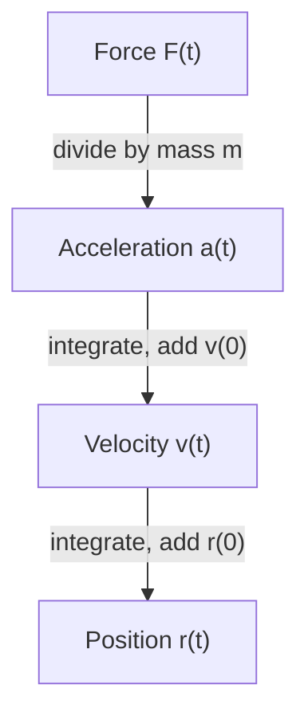

## Calculus as the language of motion

Newton invented calculus largely to describe motion, and vector functions are the natural
way to do it in space. This lesson collects the definitions, shows how to go from
acceleration back to position by integrating, and applies everything to the classic
problem of a projectile.

## Position, velocity, acceleration

If $\mathbf r(t)$ is the position of a particle at time $t$:

| Quantity | Definition |
|---|---|
| **velocity** | $\mathbf v(t) = \mathbf r'(t)$ |
| speed | $\lvert\mathbf v(t)\rvert = ds/dt$ |
| **acceleration** | $\mathbf a(t) = \mathbf v'(t) = \mathbf r''(t)$ |

Velocity is a vector tangent to the path; speed is its length, a scalar. Going backwards,
$\mathbf v(t) = \mathbf v(0) + \int_0^t\mathbf a(u)\,du$ and
$\mathbf r(t) = \mathbf r(0) + \int_0^t\mathbf v(u)\,du$. Each integration brings in an
initial condition, which is why a motion problem needs both a starting position and a
starting velocity.



### Example 1

A particle has position $\mathbf r(t) = \langle t^2,\, 2t,\, \ln t\rangle$ for $t > 0$. Find its velocity, speed and acceleration at $t = 1$.

1. $\mathbf v(t) = \langle 2t,\, 2,\, 1/t\rangle$, so $\mathbf v(1) = \langle 2, 2, 1\rangle$.
2. Speed: $|\mathbf v(1)| = \sqrt{4 + 4 + 1} = 3$.
3. $\mathbf a(t) = \langle 2,\, 0,\, -1/t^2\rangle$, so $\mathbf a(1) = \langle 2, 0, -1\rangle$.

As a bonus, this curve's speed $\sqrt{4t^2 + 4 + 1/t^2} = 2t + 1/t$ is a perfect square,
so the arc length from $t = 1$ to $t = e$ is $\int_1^e(2t + 1/t)\,dt = e^2 - 1 + 1 = e^2$.

## Newton's second law

**Newton's second law** in vector form is $\mathbf F(t) = m\,\mathbf a(t)$. Knowing the
force tells us the acceleration; integrating twice gives the motion. For uniform circular
motion $\mathbf r = \langle R\cos\omega t, R\sin\omega t\rangle$, differentiating twice gives
$\mathbf a = -\omega^2\mathbf r$, so the force must point toward the center with magnitude
$mR\omega^2$: that is the **centripetal force**, provided by tension in a string, friction on a
road, or gravity for an orbit.

## Projectile motion

Fire a projectile from the origin with speed $v_0$ at angle $\alpha$ above the
horizontal. Ignore air resistance, so the only force is gravity: $\mathbf a = \langle 0, -g\rangle$
with $g \approx 9.8\text{ m/s}^2$ (or $32\text{ ft/s}^2$).

1. Integrate once: $\mathbf v(t) = \langle 0, -gt\rangle + \mathbf v_0$, where $\mathbf v_0 = \langle v_0\cos\alpha,\, v_0\sin\alpha\rangle$.
2. Integrate again, with $\mathbf r(0) = \mathbf 0$:

$$\mathbf r(t) = \left\langle (v_0\cos\alpha)\,t,\;\; (v_0\sin\alpha)\,t - \tfrac12 g t^2\right\rangle.$$

The horizontal motion is steady; the vertical motion is a free fall superimposed on the
initial upward speed. From this one formula:

- **Time of flight** (back to height 0): $t = \dfrac{2v_0\sin\alpha}{g}$.
- Range (horizontal distance): $R = \dfrac{v_0^2\sin 2\alpha}{g}$, using $2\sin\alpha\cos\alpha = \sin2\alpha$. It is largest at $\alpha = 45^\circ$.
- **Maximum height** (when the vertical velocity is zero, at $t = v_0\sin\alpha/g$): $H = \dfrac{(v_0\sin\alpha)^2}{2g}$.

Eliminating $t$ shows the path is a parabola:
$y = (\tan\alpha)\,x - \dfrac{g}{2v_0^2\cos^2\alpha}x^2$.

The labeled sketch shows where each quantity lives on the path.


```plot
{"x": [0, 11], "y": [0, 4], "equal": true, "functions": [{"f": "x - 9.8/(2*100*0.5)*x^2", "from": 0, "to": 10.204}, {"f": "tan(pi/3)*x - 9.8/(2*100*0.25)*x^2", "from": 0, "to": 8.837, "dashed": true}, {"f": "tan(pi/6)*x - 9.8/(2*100*0.75)*x^2", "from": 0, "to": 8.837}], "xLabel": "x (m)", "yLabel": "y (m)", "caption": "Launches at 10 m/s: the 30° (lowest) and 60° (highest, dashed) paths land at the same spot; 45° goes farthest"}
```

### Example 2

A ball is kicked at $20$ m/s at $30^\circ$ above level ground. Using $g = 9.8\text{ m/s}^2$, find the flight time, range and maximum height.

1. Components: $v_0\cos\alpha = 20\cdot\tfrac{\sqrt3}{2} \approx 17.32$ m/s; $v_0\sin\alpha = 10$ m/s.
2. Flight time: $t = \dfrac{2\cdot10}{9.8} \approx 2.04$ s.
3. Range: $R = \dfrac{400\sin60^\circ}{9.8} \approx 35.35$ m (equivalently $17.32 \times 2.04$).
4. Max height: $H = \dfrac{10^2}{2\cdot9.8} \approx 5.10$ m.

### Example 3: launched from a height

A stone is thrown horizontally at 15 m/s from a 20 m cliff. When and where does it land?

With $\alpha = 0$ and starting height 20: $y(t) = 20 - 4.9t^2$, which is zero at
$t = \sqrt{20/4.9} \approx 2.02$ s. Meanwhile $x(t) = 15t \approx 30.3$ m. The horizontal
speed has no effect on the fall time: a dropped stone lands at the same moment.

### Example 4: motion on a helix

A particle moves along $\mathbf r(t) = \langle 3\cos t,\, 3\sin t,\, 4t\rangle$. Describe its velocity and acceleration.

1. $\mathbf v(t) = \langle -3\sin t,\, 3\cos t,\, 4\rangle$, so the speed is $\sqrt{9 + 16} = 5$, constant.
2. $\mathbf a(t) = \langle -3\cos t,\, -3\sin t,\, 0\rangle$: horizontal, of length 3, pointing straight at the $z$-axis.
3. Because the speed is constant, $a_T = 0$ and all the acceleration is normal. Lesson 9 predicts $a_N = \kappa v^2$; here $\kappa = \tfrac{|\mathbf r'\times\mathbf r''|}{|\mathbf r'|^3} = \tfrac{15}{125} = \tfrac{3}{25}$, and $\tfrac{3}{25}\cdot25 = 3$. ✓

By Newton's law, whatever keeps this particle on its spiral (a track, a magnetic field acting on a charged particle) must push it toward the axis with force $3m$, and does no work on it.

## Common mistakes

- Giving speed when velocity is asked for (or vice versa): velocity is a vector.
- Forgetting the initial velocity or position when integrating.
- Using the range formula $v_0^2\sin2\alpha/g$ when launch and landing heights differ; it assumes level ground.
- Mixing degrees and radians in $\sin\alpha$, or meters with $g = 32$ ft/s².

## Key points

- $\mathbf v = \mathbf r'$, speed $= |\mathbf v|$, $\mathbf a = \mathbf r''$; integrate with initial conditions to go back.
- $\mathbf F = m\mathbf a$; uniform circular motion needs a centripetal force $mR\omega^2$.
- Projectile from the origin: $\mathbf r = \langle v_0t\cos\alpha,\, v_0t\sin\alpha - \tfrac12gt^2\rangle$.
- Flight time $2v_0\sin\alpha/g$, range $v_0^2\sin2\alpha/g$, max height $(v_0\sin\alpha)^2/(2g)$.
