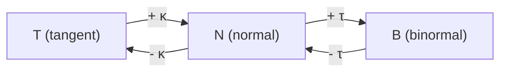

## Two numbers that describe a curve

Lesson 9 built the moving frame $\mathbf T, \mathbf N, \mathbf B$ and mentioned, almost in
passing, that the **torsion** $\tau$ is defined by $d\mathbf B/ds = -\tau\mathbf N$. That
definition raises questions the core lesson left open. Why should $d\mathbf B/ds$ point
along $\mathbf N$ at all? How do you compute $\tau$ for a curve given in terms of $t$? And
what do curvature and torsion *together* tell you about a curve?

This lesson answers all three. The answers are the **Frenet–Serret formulas**, found
independently by Jean Frédéric Frenet (1847) and Joseph Serret (1851), and a theorem that
says curvature and torsion pin down a curve's shape completely. At the end we use these
ideas on a practical problem: how railways and highways ease into a bend.

Throughout, a prime on $\mathbf T$, $\mathbf N$, $\mathbf B$ means a derivative with respect
to arc length $s$, and we assume the curve is smooth with $\kappa > 0$, so that $\mathbf N$
exists.

## Why $d\mathbf B/ds$ points along $\mathbf N$

Two facts do all the work.

1. $\mathbf B$ is a unit vector, so $\mathbf B\cdot\mathbf B = 1$. Differentiating gives
   $2\,\mathbf B\cdot\mathbf B' = 0$: $\mathbf B'$ is perpendicular to $\mathbf B$
   (the same argument as Lesson 7's "constant length" fact).
2. $\mathbf B\cdot\mathbf T = 0$. Differentiate with the product rule:
   $\mathbf B'\cdot\mathbf T + \mathbf B\cdot\mathbf T' = 0$. By the definition of curvature,
   $\mathbf T' = \kappa\mathbf N$, and $\mathbf B\cdot\mathbf N = 0$, so the second term
   vanishes. Hence $\mathbf B'\cdot\mathbf T = 0$ too.

So $\mathbf B'$ is perpendicular to both $\mathbf T$ and $\mathbf B$. In three dimensions the
only direction left is $\mathbf N$, so $\mathbf B' = (\text{some number})\,\mathbf N$. Calling
that number $-\tau$ defines the torsion. Its size $|\tau| = |\mathbf B'|$ measures how fast
the osculating plane is turning per unit of distance, that is, how fast the curve twists out
of the plane it is momentarily lying in.

*A note on the sign (convention).* The minus sign is chosen so that a right-handed helix,
like a standard screw thread, has positive torsion. Most calculus and differential geometry
books use $d\mathbf B/ds = -\tau\mathbf N$, as this course does, but a few use the opposite
sign. Always check which convention a source follows before comparing signs.

## The Frenet–Serret formulas

We now know $\mathbf T'$ and $\mathbf B'$. The derivative of $\mathbf N$ follows from
$\mathbf N = \mathbf B\times\mathbf T$ (the right-handed frame cycles
$\mathbf T\times\mathbf N = \mathbf B$, $\mathbf N\times\mathbf B = \mathbf T$,
$\mathbf B\times\mathbf T = \mathbf N$):

$$\mathbf N' = \mathbf B'\times\mathbf T + \mathbf B\times\mathbf T' = -\tau\,\mathbf N\times\mathbf T + \kappa\,\mathbf B\times\mathbf N = \tau\mathbf B - \kappa\mathbf T,$$

since $\mathbf N\times\mathbf T = -\mathbf B$ and $\mathbf B\times\mathbf N = -\mathbf T$.
Together:

$$\frac{d\mathbf T}{ds} = \kappa\mathbf N,\qquad \frac{d\mathbf N}{ds} = -\kappa\mathbf T + \tau\mathbf B,\qquad \frac{d\mathbf B}{ds} = -\tau\mathbf N.$$

Read them as a story about turning. Curvature swaps $\mathbf T$ and $\mathbf N$: the frame
rotates within the osculating plane. Torsion swaps $\mathbf N$ and $\mathbf B$: the frame
rotates about $\mathbf T$, tipping the osculating plane. The coefficients appear in matched
pairs with opposite signs ($\kappa$ and $-\kappa$, $\tau$ and $-\tau$), which is exactly what
keeps the three vectors unit length and mutually perpendicular as they move.

There is a compact way to say the same thing. Let $\boldsymbol\omega = \tau\mathbf T + \kappa\mathbf B$,
called the **Darboux vector**. Then each formula reads $\mathbf X' = \boldsymbol\omega\times\mathbf X$
for $\mathbf X = \mathbf T, \mathbf N, \mathbf B$. (Check one: $\boldsymbol\omega\times\mathbf T = \tau\,\mathbf T\times\mathbf T + \kappa\,\mathbf B\times\mathbf T = \kappa\mathbf N$.) So the whole frame
spins like a rigid body, with "angular velocity per unit length" $\boldsymbol\omega$ and
total turning rate $|\boldsymbol\omega| = \sqrt{\kappa^2 + \tau^2}$.

## Computing torsion in any parameter

Arc length is rarely convenient, so we want a formula in $t$, like Lesson 8's curvature
formula. Write $v = ds/dt$ for the speed. From Lesson 9,

$$\mathbf r' = v\mathbf T,\qquad \mathbf r'' = v'\mathbf T + \kappa v^2\mathbf N,$$

(primes on $\mathbf r$ are now $t$-derivatives). Differentiate once more. Only one term can
produce a $\mathbf B$ component: the $\mathbf N$ in $\kappa v^2\mathbf N$, whose
$t$-derivative is $v\,d\mathbf N/ds = v(-\kappa\mathbf T + \tau\mathbf B)$. So

$$\mathbf r''' = (\ldots)\,\mathbf T + (\ldots)\,\mathbf N + \kappa\tau v^3\,\mathbf B.$$

Meanwhile $\mathbf r'\times\mathbf r'' = \kappa v^3\,\mathbf T\times\mathbf N = \kappa v^3\mathbf B$.
Dotting with $\mathbf r'''$ keeps only the $\mathbf B$ part: $(\mathbf r'\times\mathbf r'')\cdot\mathbf r''' = \kappa^2\tau v^6$,
while $|\mathbf r'\times\mathbf r''|^2 = \kappa^2v^6$. Dividing,

$$\tau = \frac{(\mathbf r'\times\mathbf r'')\cdot\mathbf r'''}{|\mathbf r'\times\mathbf r''|^2}.$$

The numerator is the scalar triple product from Lesson 4. That gives a quick geometric
reading: $\tau = 0$ exactly when $\mathbf r'$, $\mathbf r''$, $\mathbf r'''$ are coplanar,
which is what you would expect of a curve that never leaves a plane.

### Example 1: the general helix

Find $\kappa$ and $\tau$ for $\mathbf r(t) = \langle a\cos t,\, a\sin t,\, bt\rangle$ with $a > 0$.

1. Derivatives: $\mathbf r' = \langle -a\sin t,\, a\cos t,\, b\rangle$, $\mathbf r'' = \langle -a\cos t,\, -a\sin t,\, 0\rangle$, $\mathbf r''' = \langle a\sin t,\, -a\cos t,\, 0\rangle$.
2. Cross product: $\mathbf r'\times\mathbf r'' = \langle ab\sin t,\, -ab\cos t,\, a^2\rangle$, so $|\mathbf r'\times\mathbf r''|^2 = a^2b^2 + a^4 = a^2(a^2 + b^2)$.
3. Triple product: $(\mathbf r'\times\mathbf r'')\cdot\mathbf r''' = a^2b\sin^2t + a^2b\cos^2t = a^2b$.
4. Torsion: $\tau = \dfrac{a^2b}{a^2(a^2 + b^2)} = \dfrac{b}{a^2 + b^2}$.
5. Curvature (Lesson 8): $\kappa = \dfrac{a\sqrt{a^2 + b^2}}{(a^2 + b^2)^{3/2}} = \dfrac{a}{a^2 + b^2}$.

Both are constant, as they should be for a curve that looks the same everywhere. For the
unit helix ($a = b = 1$), $\kappa = \tau = \tfrac12$. With $b < 0$ the helix winds the other
way (left-handed) and $\tau < 0$. Letting $b \to 0$ flattens it into a circle: $\tau \to 0$
and $\kappa \to 1/a$. Making $a$ very small gives a tight, nearly straight spiral with small
curvature.

### Example 2: the twisted cubic

Find the torsion of $\mathbf r(t) = \langle t,\, t^2,\, t^3\rangle$ at $t = 0$ and $t = 1$.

1. $\mathbf r' = \langle 1,\, 2t,\, 3t^2\rangle$, $\mathbf r'' = \langle 0,\, 2,\, 6t\rangle$, $\mathbf r''' = \langle 0,\, 0,\, 6\rangle$.
2. $\mathbf r'\times\mathbf r'' = \langle 12t^2 - 6t^2,\; -6t,\; 2\rangle = \langle 6t^2,\, -6t,\, 2\rangle$.
3. Triple product: $\langle 6t^2, -6t, 2\rangle\cdot\langle 0, 0, 6\rangle = 12$.
4. $|\mathbf r'\times\mathbf r''|^2 = 36t^4 + 36t^2 + 4$, so $\tau(t) = \dfrac{12}{36t^4 + 36t^2 + 4} = \dfrac{3}{9t^4 + 9t^2 + 1}$.
5. At $t = 0$: $\tau = 3$. At $t = 1$: $\tau = \tfrac{3}{19} \approx 0.158$.

Unlike the helix, the twisted cubic twists hardest near the origin and less and less as
$|t|$ grows. (Lesson 8 found its curvature at $t = 1$ to be about $0.166$; at $t = 0$ it is $2$.)

## Torsion zero means flat

**Theorem.** If a curve with $\kappa > 0$ has $\tau = 0$ everywhere, it lies in a plane.

*Proof.* With $\tau = 0$, $\mathbf B' = \mathbf 0$, so $\mathbf B$ is a constant vector.
Fix a point $\mathbf r_0 = \mathbf r(s_0)$ on the curve and let $f(s) = (\mathbf r(s) - \mathbf r_0)\cdot\mathbf B$. Then
$f'(s) = \mathbf T\cdot\mathbf B = 0$, so $f$ is constant, and $f(s_0) = 0$. Hence every
point satisfies $(\mathbf r - \mathbf r_0)\cdot\mathbf B = 0$: the curve lies in the plane
through $\mathbf r_0$ with normal $\mathbf B$. $\blacksquare$

The converse is easier: a plane curve has $\mathbf r'$, $\mathbf r''$, $\mathbf r'''$ all
parallel to its plane, so the triple product, and $\tau$, is zero.

### Example 3: spotting a plane curve

Is $\mathbf r(t) = \langle t,\, t^2,\, 1 - t - t^2\rangle$ a plane curve?

Here $\mathbf r''' = \mathbf 0$, so the triple product is $0$ and $\tau = 0$ everywhere. The
theorem says it lies in a plane, and indeed $x + y + z = t + t^2 + 1 - t - t^2 = 1$ for
every $t$. It is a parabola drawn in the tilted plane $x + y + z = 1$.

## Curvature and torsion determine the curve

The two numbers $\kappa(s)$ and $\tau(s)$ are **intrinsic**: they do not change when you
move or rotate the curve, because they are defined from lengths and angles along it. The
remarkable fact is that nothing else is needed.

**Fundamental theorem of space curves** (stated without proof). Given continuous functions
$\kappa(s) > 0$ and $\tau(s)$ on an interval, there is a curve parametrized by arc length
with exactly that curvature and torsion, and any two such curves differ only by a rigid
motion (a rotation plus a translation).

The proof treats the Frenet–Serret formulas as a system of differential equations for
$\mathbf T, \mathbf N, \mathbf B$ and uses the existence and uniqueness theorem for such
systems; then $\mathbf r = \int\mathbf T\,ds$. The pair $\kappa(s), \tau(s)$ is sometimes
called the curve's *natural equations*. Two consequences:

- Constant $\kappa > 0$ and $\tau = 0$: a circle of radius $1/\kappa$ (nothing else).
- Constant $\kappa > 0$ and constant $\tau \ne 0$: a helix. Solving
  $\tfrac{a}{a^2 + b^2} = \kappa$, $\tfrac{b}{a^2 + b^2} = \tau$ gives
  $a = \dfrac{\kappa}{\kappa^2 + \tau^2}$, $b = \dfrac{\tau}{\kappa^2 + \tau^2}$.

## Application: easing into a curve

For a plane curve, $\tau = 0$ and only $\kappa(s)$ matters. If $\theta(s)$ is the angle of
$\mathbf T$, then $\kappa = |d\theta/ds|$. Now think of a train at constant speed $v$. Its
sideways (normal) acceleration is $a_N = \kappa v^2$ (Lesson 9). A straight track ($\kappa = 0$)
joined directly to a circular arc of radius $R$ ($\kappa = 1/R$) makes $a_N$ jump from $0$
to $v^2/R$ in an instant: a lurch.

The fix is a **transition curve** whose curvature grows in proportion to distance:
$\kappa(s) = s/A^2$ for a constant $A$. This curve is the **clothoid** (also called the Euler
spiral or Cornu spiral). Its tangent angle is $\theta(s) = \int_0^s \kappa\,du = s^2/(2A^2)$,
so $\mathbf r(s) = \int_0^s\langle\cos\theta(u),\, \sin\theta(u)\rangle\,du$, the Fresnel
integrals, which have no elementary antiderivative and are computed numerically. At
constant speed, $s = vt$, so $a_N = \kappa v^2$ rises *linearly in time*. Its rate of change,
the lateral **jerk**, is constant: $v^3/(RL)$ for a transition of length $L$ ending at
radius $R$ (where $A^2 = RL$). Clothoid transitions have been used on railways since the
nineteenth century and are standard in highway design.

### Example 4: designing a transition

A transition of length $L = 100$ m joins a straight to a curve of radius $R = 500$ m, for
trains running at $v = 30$ m/s.

1. Curvature must reach $1/R$ at $s = L$: $L/A^2 = 1/500$, so $A^2 = RL = 50{,}000\text{ m}^2$.
2. Total turn: $\theta(L) = \dfrac{L^2}{2A^2} = \dfrac{L}{2R} = 0.1$ rad $\approx 5.73^\circ$.
3. Final sideways acceleration: $v^2/R = 900/500 = 1.8\text{ m/s}^2$, reached after $L/v \approx 3.33$ s.
4. Jerk: $\dfrac{1.8}{3.33} = \dfrac{v^3}{RL} = \dfrac{27{,}000}{50{,}000} = 0.54\text{ m/s}^3$.
5. Where does the spiral end? For small angles $\cos\theta \approx 1$ and $\sin\theta \approx \theta$, so $x \approx L = 100$ m and $y \approx \dfrac{L^3}{6A^2} \approx 3.33$ m. (Numerical integration gives $x \approx 99.90$ m, $y \approx 3.33$ m.)

*Simplified:* real track design also tilts (cants, or banks) the track, which cancels part
of the sideways acceleration that passengers feel, and limits both the cant and its rate of
change. The clothoid's linear curvature is the core geometric idea.

## Common mistakes

- Using $\mathbf r'\times\mathbf r''$ with $|\cdot|^3$ in the torsion formula. Torsion uses the triple product over $|\mathbf r'\times\mathbf r''|^2$; the cube belongs to $|\mathbf r'|^3$ in the curvature formula.
- Writing $d\mathbf N/ds = -\kappa\mathbf T$ and forgetting the $\tau\mathbf B$ term: $\mathbf N$ turns both toward $-\mathbf T$ and toward $\mathbf B$.
- Thinking torsion must be positive. Unlike $\kappa$, $\tau$ has a sign: a left-handed helix has $\tau < 0$.
- Concluding a curve is planar because its curvature is constant. A helix has constant curvature and is not planar; it is $\tau = 0$ that means planar.
- Mixing $t$-derivatives and $s$-derivatives. The Frenet–Serret formulas use $s$; with a general parameter each right side gains a factor of the speed $v$.

## Key points

- $\mathbf T' = \kappa\mathbf N$, $\mathbf N' = -\kappa\mathbf T + \tau\mathbf B$, $\mathbf B' = -\tau\mathbf N$ (derivatives in $s$).
- $\tau = \dfrac{(\mathbf r'\times\mathbf r'')\cdot\mathbf r'''}{|\mathbf r'\times\mathbf r''|^2}$; $\tau = 0$ everywhere (with $\kappa > 0$) exactly when the curve is planar.
- Helix $\langle a\cos t, a\sin t, bt\rangle$: $\kappa = \dfrac{a}{a^2 + b^2}$, $\tau = \dfrac{b}{a^2 + b^2}$.
- Curvature and torsion as functions of $s$ determine a curve up to a rigid motion.
- A clothoid, $\kappa = s/A^2$, makes sideways acceleration build steadily: the shape of railway and highway transition curves.
