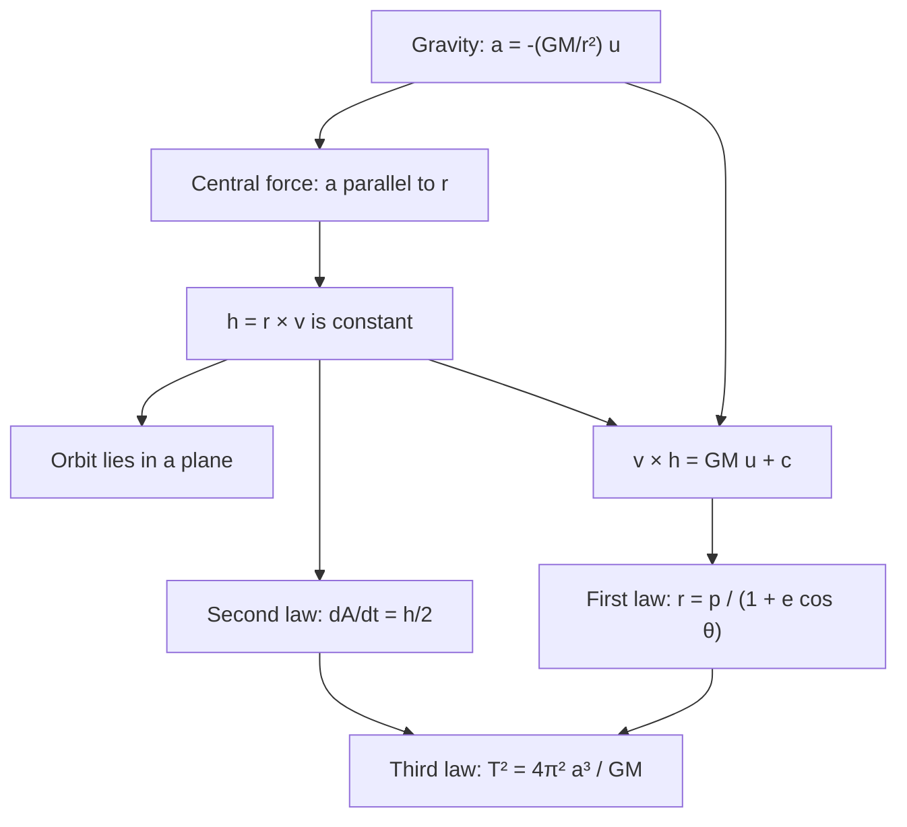

## From projectiles to planets

Lesson 10 integrated Newton's second law for a projectile, where gravity is a constant
vector $\langle 0, -g\rangle$. Over the distances of a solar system, gravity is not constant:
it always points toward the Sun and weakens with the square of the distance. This lesson
integrates $\mathbf F = m\mathbf a$ for that force, using only the vector calculus of this
module (cross products, the product rule, polar coordinates), and recovers the three laws of
planetary motion.

The history is part of the point. Johannes Kepler found the laws by fitting Tycho Brahe's
naked-eye observations of Mars: the first two appeared in *Astronomia nova* (1609) and the
third in *Harmonices mundi* (1619). They were empirical rules, with no explanation. In the
*Principia* (1687), Isaac Newton showed that all three follow from his laws of motion and an
inverse-square law of gravitation, one of the first great triumphs of calculus.

**Kepler's laws**, in modern wording:

1. Each planet moves in an ellipse with the Sun at one focus.
2. The line from the Sun to the planet sweeps out equal areas in equal times.
3. The square of the orbital period is proportional to the cube of the ellipse's semi-major axis.

## The model

Put the Sun, of mass $M$, at the origin and let $\mathbf r(t)$ be the position of a planet
of mass $m$. Write $r = |\mathbf r|$ and $\mathbf u = \mathbf r/r$ for the unit vector
pointing from the Sun to the planet. Newton's law of gravitation says

$$\mathbf F = -\frac{GMm}{r^2}\,\mathbf u,\qquad\text{so}\qquad \mathbf a = -\frac{GM}{r^2}\,\mathbf u,$$

with $G$ the gravitational constant. Notice that $m$ cancels.

*Simplified (stated assumptions).* We treat the Sun as fixed and ignore the pull of the
other planets. In fact the Sun and planet both orbit their common center of mass, and the
exact two-body result replaces $GM$ by $G(M + m)$, a tiny change for a planet. Other planets,
and general relativity (noticeable for Mercury), cause slow drifts in the orbits.

## Central forces conserve angular momentum

A **central force** is one that always points along the line to a fixed center, so
$\mathbf a$ is parallel to $\mathbf r$. Gravity is one, but so are a spring tied to a post
and the electric attraction between charges. Define

$$\mathbf h = \mathbf r\times\mathbf v,$$

the angular momentum per unit mass. By the product rule for cross products (Lesson 7),

$$\mathbf h' = \mathbf v\times\mathbf v + \mathbf r\times\mathbf a = \mathbf 0 + \mathbf 0 = \mathbf 0,$$

because a vector crossed with itself is zero and $\mathbf a \parallel \mathbf r$. So
$\mathbf h$ is a constant vector. Two consequences:

- **The orbit lies in a plane.** Since $\mathbf r\cdot\mathbf h = \mathbf r\cdot(\mathbf r\times\mathbf v) = 0$ at every moment, $\mathbf r(t)$ stays in the plane through the Sun with normal $\mathbf h$. (If $\mathbf h = \mathbf 0$, the planet falls straight in along a line.)
- **Equal areas.** Use polar coordinates $(r, \theta)$ in that plane, with $\mathbf h$ along $\mathbf k$. Then $\mathbf r = r\mathbf u$ and $\mathbf v = r'\mathbf u + r\theta'\,\mathbf u_\theta$, where $\mathbf u_\theta$ is the unit vector $90^\circ$ ahead of $\mathbf u$. Crossing, $\mathbf h = r^2\theta'\,(\mathbf u\times\mathbf u_\theta) = r^2\theta'\,\mathbf k$, so $h = |\mathbf h| = r^2\theta'$.

The area swept in a short time $dt$ is a thin triangle with sides $r$ and arc $r\,d\theta$,
so $dA = \tfrac12 r^2\,d\theta$ (the polar area formula from the bridge lesson). Therefore

$$\frac{dA}{dt} = \frac12 r^2\frac{d\theta}{dt} = \frac h2,$$

a constant. That is **Kepler's second law**, and the proof used only that the force is
central: the inverse square played no role yet.

### Example 1: fastest at perihelion

The closest point of an orbit to the Sun is the **perihelion** and the farthest is the
**aphelion**. At both, the velocity is perpendicular to $\mathbf r$, so $h = |\mathbf r\times\mathbf v| = rv$.
Since $h$ is the same at both points,

$$r_p v_p = r_a v_a,\qquad\frac{v_p}{v_a} = \frac{r_a}{r_p}.$$

For Earth, $r_p \approx 1.471\times10^{11}$ m and $r_a \approx 1.521\times10^{11}$ m, so
Earth moves about $1.521/1.471 \approx 1.034$ times faster in early January (perihelion)
than in early July, roughly 3.4% faster.

## The first law: the orbit is a conic

Now the inverse square enters. Two ingredients:

1. Because $\mathbf u$ is a unit vector, $\mathbf u\cdot\mathbf u' = 0$, and differentiating $\mathbf r = r\mathbf u$ gives $\mathbf v = r'\mathbf u + r\mathbf u'$, so $\mathbf h = \mathbf r\times\mathbf v = r^2\,\mathbf u\times\mathbf u'$.
2. The vector identity $\mathbf a\times(\mathbf b\times\mathbf c) = (\mathbf a\cdot\mathbf c)\,\mathbf b - (\mathbf a\cdot\mathbf b)\,\mathbf c$.

Then

$$\mathbf a\times\mathbf h = -\frac{GM}{r^2}\mathbf u\times\left(r^2\,\mathbf u\times\mathbf u'\right) = -GM\left[(\mathbf u\cdot\mathbf u')\mathbf u - (\mathbf u\cdot\mathbf u)\mathbf u'\right] = GM\,\mathbf u'.$$

Since $\mathbf h$ is constant, the left side is $(\mathbf v\times\mathbf h)'$. Both sides are
derivatives, so integrate:

$$\mathbf v\times\mathbf h = GM\,\mathbf u + \mathbf c$$

for a constant vector $\mathbf c$ lying in the orbit's plane. Choose the polar axis along
$\mathbf c$, so $\theta$ is the angle between $\mathbf u$ and $\mathbf c$. Dot both sides with
$\mathbf r$. On the left, the scalar triple product can be cycled:
$\mathbf r\cdot(\mathbf v\times\mathbf h) = (\mathbf r\times\mathbf v)\cdot\mathbf h = h^2$. On
the right, $\mathbf r\cdot(GM\mathbf u + \mathbf c) = GMr + rc\cos\theta$, where $c = |\mathbf c|$. So

$$h^2 = r\,(GM + c\cos\theta)\qquad\Longrightarrow\qquad r = \frac{h^2/GM}{1 + e\cos\theta},\qquad e = \frac{c}{GM}.$$

This is the polar equation of a **conic section** with a focus at the origin and
**eccentricity** $e$: a circle if $e = 0$, an ellipse if $0 < e < 1$, a parabola if $e = 1$,
a hyperbola if $e > 1$. A planet stays at bounded distance, so its orbit is an ellipse with
the Sun at a focus: **Kepler's first law**. Some comets and interstellar visitors move on
hyperbolas and leave for good.

## The third law

Write $p = h^2/GM$, so $r = p/(1 + e\cos\theta)$. The perihelion is at $\theta = 0$ and the
aphelion at $\theta = \pi$:

$$r_p = \frac{p}{1 + e},\qquad r_a = \frac{p}{1 - e}.$$

The **semi-major axis** $a$ is half the long axis of the ellipse, $a = \tfrac12(r_p + r_a) = \dfrac{p}{1 - e^2}$,
and the semi-minor axis is $b = a\sqrt{1 - e^2}$. So $b^2 = a^2(1 - e^2) = ap$, which gives
$h^2 = GMp = GM\,b^2/a$.

In one period $T$ the planet sweeps the whole ellipse, of area $\pi ab$, at the constant rate
$h/2$. So $\pi ab = \tfrac h2 T$ and

$$T^2 = \frac{4\pi^2a^2b^2}{h^2} = \frac{4\pi^2a^2b^2\cdot a}{GM\,b^2} = \frac{4\pi^2}{GM}\,a^3.$$

That is **Kepler's third law**, now with the constant identified: $T^2/a^3 = 4\pi^2/(GM)$ is
the same for every body orbiting the same central mass, whatever its own mass or
eccentricity.

### Example 2: the length of Earth's year

Earth's semi-major axis is $a \approx 1.496\times10^{11}$ m and the Sun's
$GM \approx 1.327\times10^{20}\text{ m}^3/\text{s}^2$. Then

$$T = 2\pi\sqrt{\frac{a^3}{GM}} \approx 2\pi\sqrt{\frac{3.348\times10^{33}}{1.327\times10^{20}}} \approx 3.156\times10^{7}\text{ s} \approx 365.26\text{ days}.$$

In units of years and **astronomical units** (AU, about Earth's average distance from the Sun), the constant is 1
for anything orbiting the Sun: $T_{\text{years}}^2 = a_{\text{AU}}^3$. Mars, with
$a \approx 1.524$ AU, has $T \approx 1.524^{3/2} \approx 1.88$ years.

### Example 3: a geostationary orbit

A geostationary satellite orbits above the equator once per sidereal day,
$T \approx 86{,}164$ s, so it seems to hang still in the sky. For Earth,
$GM \approx 3.986\times10^{14}\text{ m}^3/\text{s}^2$. Solve the third law for $a$:

$$a = \left(\frac{GM\,T^2}{4\pi^2}\right)^{1/3} \approx \left(\frac{3.986\times10^{14}\times(86{,}164)^2}{39.48}\right)^{1/3} \approx 4.216\times10^{7}\text{ m}.$$

That is about $42{,}164$ km from Earth's *center*, or about $35{,}786$ km above the equator
(Earth's equatorial radius is about $6{,}378$ km).

### Example 4: speed in a circular orbit

For a circular orbit of radius $r$ ($e = 0$), the speed is constant and all acceleration is
centripetal, $v^2/r$ (Lesson 9). Setting $v^2/r = GM/r^2$ gives $v = \sqrt{GM/r}$ and
$T = 2\pi r/v$. At an altitude of $400$ km, $r = 6{,}371 + 400 = 6{,}771$ km (using Earth's
mean radius), so $v \approx \sqrt{3.986\times10^{14}/6.771\times10^{6}} \approx 7.67$ km/s
and $T \approx 92.4$ minutes, close to the International Space Station's orbit.

## Common mistakes

- Measuring the orbit radius from Earth's surface. In $T^2 = 4\pi^2a^3/GM$ and $v = \sqrt{GM/r}$, distances are from the center of the attracting body.
- Using the perihelion distance as $a$. The semi-major axis is the *average* of the closest and farthest distances.
- Thinking equal areas means equal speeds. Equal areas in equal times force the planet to move *faster* when it is closer.
- Believing the second law needs an inverse-square force. Any central force conserves $\mathbf h$; the inverse square is what makes the orbit a conic and fixes the third-law constant.
- Mixing units: with $GM$ in $\text{m}^3/\text{s}^2$, distances must be in meters and times in seconds.

## Key points

- For any central force, $\mathbf h = \mathbf r\times\mathbf v$ is constant: the orbit is planar and sweeps area at the rate $h/2$ (second law).
- With $\mathbf a = -GM\mathbf u/r^2$, integrating $(\mathbf v\times\mathbf h)' = GM\mathbf u'$ gives $r = \dfrac{h^2/GM}{1 + e\cos\theta}$, a conic with the Sun at a focus (first law).
- $T^2 = \dfrac{4\pi^2}{GM}a^3$ (third law); for the Sun in years and AU, $T^2 = a^3$.
- Circular orbit: $v = \sqrt{GM/r}$, $T = 2\pi r/v$.
- These results treat the Sun as fixed and ignore other planets; the exact two-body law uses $G(M + m)$.
