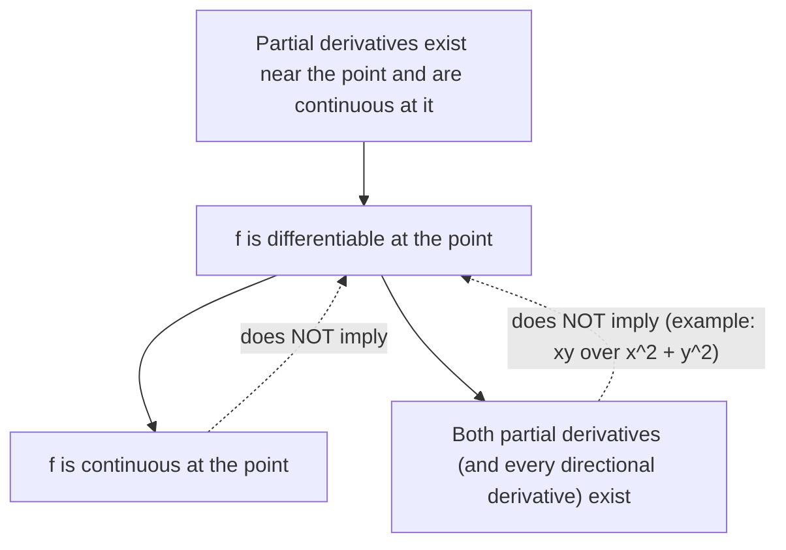

## The best flat fit

In one variable, zooming in on a smooth graph makes it look like its tangent line, and that
line gives the approximation $f(x) \approx f(a) + f'(a)(x - a)$. Zoom in on a smooth surface
and it looks like a plane: the **tangent plane**. Its equation uses both partial
derivatives, and it gives the most useful approximation in applied mathematics.

## The tangent plane

Suppose $f$ has continuous partial derivatives near $(a, b)$, and let $c = f(a, b)$. The
tangent plane must pass through $(a, b, c)$ and must contain the tangent lines of the two
traces: in the $x$-direction the slope is $f_x(a, b)$, in the $y$-direction $f_y(a, b)$. A
non-vertical plane through $(a, b, c)$ has the form $z - c = A(x - a) + B(y - b)$; setting
$y = b$ shows $A$ is its $x$-slope, so $A = f_x(a, b)$, and likewise $B = f_y(a, b)$:

$$z = f(a, b) + f_x(a, b)(x - a) + f_y(a, b)(y - b).$$

A normal vector to it is $\langle f_x(a, b),\, f_y(a, b),\, -1\rangle$.

### Example 1

Find the tangent plane to $z = x^2 + 3y^2$ at $(1, 1, 4)$.

1. $f_x = 2x$, $f_y = 6y$, so $f_x(1, 1) = 2$, $f_y(1, 1) = 6$.
2. $z = 4 + 2(x - 1) + 6(y - 1)$, that is, $z = 2x + 6y - 4$.

Check: at $(1,1)$ the plane gives $2 + 6 - 4 = 4$. ✓ The slice $y = 1$ shows the idea in
two dimensions: the trace $z = x^2 + 3$ and the plane's trace $z = 2x + 2$ touch at $x = 1$.

```plot
{"x": [-1, 3], "y": [0, 12], "functions": [{"f": "x^2+3", "label": "trace z = x² + 3 (y = 1)"}, {"f": "2*x+2", "dashed": true, "label": "tangent plane's trace z = 2x + 2"}], "points": [{"at": [1, 4], "label": "(1, 4)"}], "xLabel": "x", "yLabel": "z", "caption": "In the slice y = 1, the tangent plane meets the surface along a tangent line"}
```

## Linear approximation

The function whose graph is the tangent plane is the **linearization** of $f$ at $(a, b)$:

$$L(x, y) = f(a, b) + f_x(a, b)(x - a) + f_y(a, b)(y - b).$$

Near $(a, b)$, $f(x, y) \approx L(x, y)$: the **linear approximation**. The approximation
is good when $(x, y)$ is close to $(a, b)$, and the error shrinks faster than the
distance.

### Example 2

Use a linearization to estimate $\sqrt{x^2 + y^2}$ at $(3.02, 3.97)$.

1. Base point $(3, 4)$, where $f = 5$.
2. $f_x = \dfrac{x}{\sqrt{x^2+y^2}} = \dfrac35$ and $f_y = \dfrac{y}{\sqrt{x^2+y^2}} = \dfrac45$ at $(3, 4)$.
3. $L(3.02, 3.97) = 5 + 0.6(0.02) + 0.8(-0.03) = 5 + 0.012 - 0.024 = 4.988$.

The true value is $\sqrt{9.1204 + 15.7609} = \sqrt{24.8813} \approx 4.98812$; the estimate is
off by about $0.0001$.

## Differentiability

In two variables, having partial derivatives is *not* enough for the surface to have a
genuine tangent plane: $f_x$ and $f_y$ only look along two directions. A function is
**differentiable** at $(a, b)$ if the linear approximation is good in every direction,
meaning the error $f(x,y) - L(x,y)$ goes to zero faster than the distance to $(a, b)$.
The working test: *if $f_x$ and $f_y$ exist near $(a, b)$ and are continuous at $(a, b)$,
then $f$ is differentiable there.* All polynomial, exponential and trig combinations pass
this test wherever they are defined. A standard warning example is
$f(x,y) = \dfrac{xy}{x^2+y^2}$ (with $f(0,0) = 0$), which has $f_x(0,0) = f_y(0,0) = 0$
but is not even continuous at the origin (along $y = x$ it equals $\tfrac12$).

The chart sums up which conditions imply which. Solid arrows are theorems; dotted arrows are
implications that fail.



## Differentials

Writing $dx = \Delta x$ and $dy = \Delta y$ for small changes in the inputs, the
**differential** of $z = f(x, y)$ is

$$dz = f_x\,dx + f_y\,dy.$$

It is the change in height along the tangent plane, and it approximates the actual change
$\Delta z = f(x + dx, y + dy) - f(x, y)$. Differentials are the standard tool for
estimating how measurement errors propagate.

### Example 3: error in a computed volume

A cylinder is measured as radius $r = 5$ cm and height $h = 12$ cm, each with possible
error $\pm0.1$ cm. Estimate the maximum error in the computed volume $V = \pi r^2h$.

1. $dV = V_r\,dr + V_h\,dh = 2\pi rh\,dr + \pi r^2\,dh$.
2. At the measured values: $dV = 2\pi(5)(12)(0.1) + \pi(25)(0.1) = 12\pi + 2.5\pi = 14.5\pi$, using the worst case where both errors add.
3. $dV \approx 45.6\text{ cm}^3$, compared with $V = 300\pi \approx 942.5\text{ cm}^3$, about a 4.8% error.

Notice the radius error contributes far more: $V$ depends on $r^2$, so measure the radius
carefully. For three variables, $dw = f_x\,dx + f_y\,dy + f_z\,dz$.

## Common mistakes

- Forgetting to evaluate the partial derivatives at the base point, leaving $x$'s in the slopes.
- Dropping $f(a, b)$ from the linearization.
- Assuming partial derivatives existing at a point guarantees differentiability.
- In error estimates, letting errors cancel; for a maximum error, take all terms with the same sign.

## Key points

- Tangent plane: $z = f(a,b) + f_x(a,b)(x - a) + f_y(a,b)(y - b)$; normal $\langle f_x, f_y, -1\rangle$.
- $f(x,y) \approx L(x,y)$ near $(a,b)$.
- Continuous partial derivatives imply differentiability.
- $dz = f_x\,dx + f_y\,dy$ estimates changes and errors.
