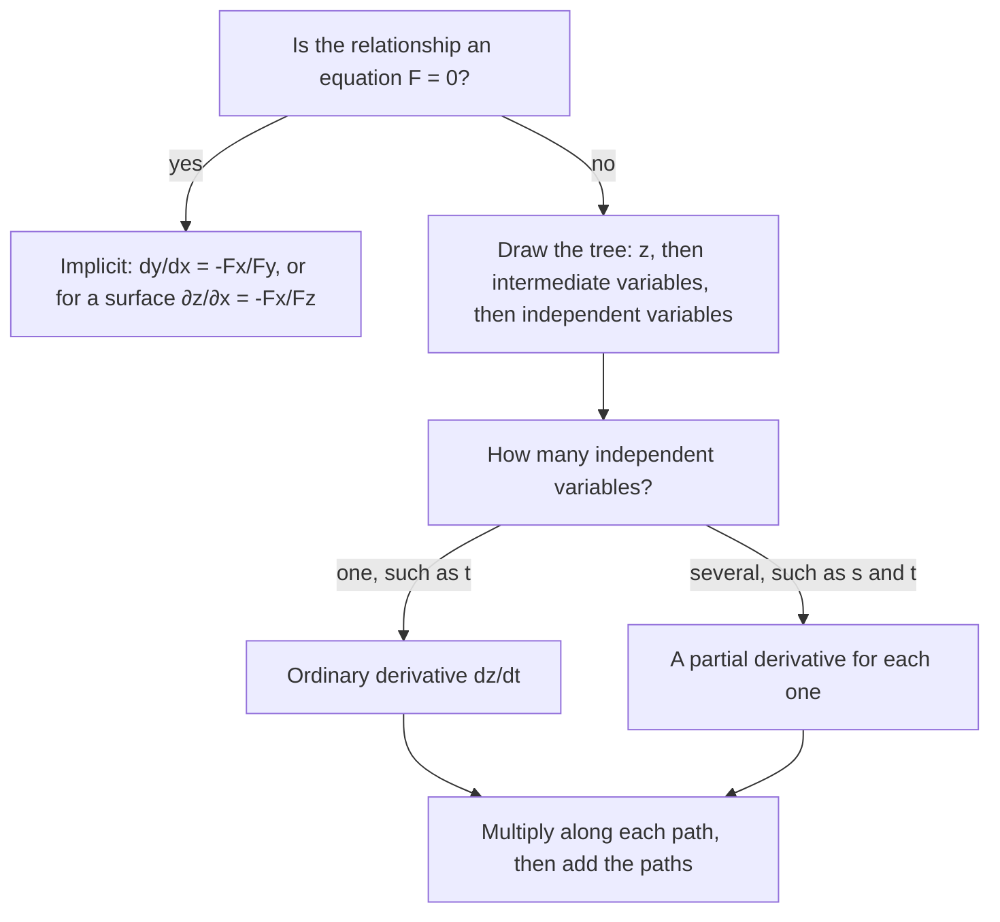

## When the inputs themselves change

Suppose the temperature on a plate is $T(x, y)$ and an ant walks along a path
$x = x(t)$, $y = y(t)$. How fast does the temperature the ant feels change? The ant's
temperature is the composite $T(x(t), y(t))$, a function of $t$ alone, and the chain rule
tells us its derivative. The idea is the same as in one variable: rates along a chain of
dependencies multiply. What is new is that there are several chains, and their
contributions add.

## Case 1: one parameter

If $z = f(x, y)$ is differentiable and $x = g(t)$, $y = h(t)$ are differentiable, then

$$\frac{dz}{dt} = \frac{\partial f}{\partial x}\frac{dx}{dt} + \frac{\partial f}{\partial y}\frac{dy}{dt}.$$

*Why.* For a small time step $\Delta t$, the inputs change by $\Delta x$ and $\Delta y$.
By linear approximation, $\Delta z \approx f_x\,\Delta x + f_y\,\Delta y$. Divide by
$\Delta t$ and let $\Delta t \to 0$: $\Delta x/\Delta t \to dx/dt$ and
$\Delta y/\Delta t \to dy/dt$. (Differentiability of $f$ is what makes the approximation
error vanish in the limit.)

### Example 1

Let $z = x^2y + 3xy^4$ with $x = \sin2t$, $y = \cos t$. Find $dz/dt$ at $t = 0$.

1. Partials: $z_x = 2xy + 3y^4$, $z_y = x^2 + 12xy^3$.
2. Inner derivatives: $dx/dt = 2\cos2t$, $dy/dt = -\sin t$.
3. At $t = 0$: $x = 0$, $y = 1$, so $z_x = 3$, $z_y = 0$, $dx/dt = 2$, $dy/dt = 0$.
4. $dz/dt = 3\cdot2 + 0\cdot0 = 6$.

You could also substitute first and differentiate a function of $t$; the chain rule is
usually cleaner and works even when $f$ is known only through its partial derivatives
(for instance from a table or a contour map).

## Case 2: several parameters, and tree diagrams

If $z = f(x, y)$ with $x = g(s, t)$ and $y = h(s, t)$, then $z$ is a function of $s$ and $t$,
and each partial derivative follows the same pattern:

$$\frac{\partial z}{\partial s} = \frac{\partial z}{\partial x}\frac{\partial x}{\partial s} + \frac{\partial z}{\partial y}\frac{\partial y}{\partial s},\qquad \frac{\partial z}{\partial t} = \frac{\partial z}{\partial x}\frac{\partial x}{\partial t} + \frac{\partial z}{\partial y}\frac{\partial y}{\partial t}.$$

A **tree diagram** organizes this: write the dependent variable at the top, the
intermediate variables below it, and the independent variables at the bottom, labeling
each branch with the partial derivative of the upper variable with respect to the lower.
To find $\partial z/\partial t$, multiply along every path from $z$ down to $t$ and add the
products.

```shape
{"segments": [{"from": [3, 4], "to": [1, 2], "label": "∂z/∂x"}, {"from": [3, 4], "to": [5, 2], "label": "∂z/∂y"}, {"from": [1, 2], "to": [0, 0], "label": "∂x/∂s"}, {"from": [1, 2], "to": [2, 0], "label": "∂x/∂t"}, {"from": [5, 2], "to": [4, 0], "label": "∂y/∂s"}, {"from": [5, 2], "to": [6, 0], "label": "∂y/∂t"}], "labels": [{"at": [3, 4.4], "text": "z"}, {"at": [0.6, 2.1], "text": "x"}, {"at": [5.4, 2.1], "text": "y"}, {"at": [0, -0.4], "text": "s"}, {"at": [2, -0.4], "text": "t"}, {"at": [4, -0.4], "text": "s"}, {"at": [6, -0.4], "text": "t"}], "caption": "Tree diagram: ∂z/∂t is the sum over the two paths from z to t"}
```

The rule generalizes to any number of intermediate and independent variables: one term per
path.

### Example 2

Let $z = e^x\sin y$ with $x = st^2$, $y = s^2t$. Find $\partial z/\partial s$.

1. $z_x = e^x\sin y$, $z_y = e^x\cos y$.
2. $x_s = t^2$, $y_s = 2st$.
3. $\dfrac{\partial z}{\partial s} = e^x\sin y\cdot t^2 + e^x\cos y\cdot 2st = e^{st^2}\left(t^2\sin(s^2t) + 2st\cos(s^2t)\right)$.

## Implicit differentiation

Suppose $F(x, y) = 0$ defines $y$ implicitly as a function of $x$. Differentiate both sides
with respect to $x$ using Case 1 (with $x$ itself as the parameter):

$$F_x\cdot1 + F_y\frac{dy}{dx} = 0\quad\Longrightarrow\quad \frac{dy}{dx} = -\frac{F_x}{F_y}\qquad (F_y \ne 0).$$

This is the single-variable implicit differentiation you learned, packaged as a formula.
Likewise, if $F(x, y, z) = 0$ defines $z$ as a function of $x$ and $y$,

$$\frac{\partial z}{\partial x} = -\frac{F_x}{F_z},\qquad \frac{\partial z}{\partial y} = -\frac{F_y}{F_z}\qquad (F_z \ne 0).$$

The minus sign is essential and easy to forget. (The **implicit function theorem**
guarantees that such a function exists near a point where $F_z \ne 0$.)

### Example 3: the folium

Find $dy/dx$ for $x^3 + y^3 = 6xy$ at $(3, 3)$.

1. $F = x^3 + y^3 - 6xy$: $F_x = 3x^2 - 6y$, $F_y = 3y^2 - 6x$.
2. $\dfrac{dy}{dx} = -\dfrac{3x^2 - 6y}{3y^2 - 6x}$. At $(3, 3)$: $-\dfrac{27 - 18}{27 - 18} = -1$.

### Example 4: a surface

Find $\partial z/\partial x$ if $x^3 + y^3 + z^3 + 6xyz = 1$.

$F_x = 3x^2 + 6yz$ and $F_z = 3z^2 + 6xy$, so
$\dfrac{\partial z}{\partial x} = -\dfrac{3x^2 + 6yz}{3z^2 + 6xy} = -\dfrac{x^2 + 2yz}{z^2 + 2xy}$.

### Example 5: switching to polar coordinates

If $z = f(x, y)$ and we substitute $x = r\cos\theta$, $y = r\sin\theta$, the tree has two paths to each of $r$ and $\theta$:

$$z_r = f_x\cos\theta + f_y\sin\theta,\qquad z_\theta = -f_x\,r\sin\theta + f_y\,r\cos\theta.$$

For instance, with $f = x^2 + y^2$ these give $z_r = 2x\cos\theta + 2y\sin\theta = 2r$ and $z_\theta = 0$, which matches $z = r^2$ directly. Formulas like these are how equations such as Laplace's equation are rewritten in polar form.

## Which form do I need?



## Common mistakes

- Including only one path in the tree, for example writing $dz/dt = z_x\,dx/dt$ alone.
- Evaluating the partials of $f$ at $t$ instead of at $(x(t), y(t))$.
- Dropping the minus sign in $-F_x/F_y$.
- Writing $\partial z/\partial x = F_x/F_z$ for an equation not first written as $F = 0$ (move everything to one side).

## Key points

- $\dfrac{dz}{dt} = f_x\dfrac{dx}{dt} + f_y\dfrac{dy}{dt}$; with several parameters, one term per path in the tree.
- Implicit: $\dfrac{dy}{dx} = -\dfrac{F_x}{F_y}$; $\dfrac{\partial z}{\partial x} = -\dfrac{F_x}{F_z}$, $\dfrac{\partial z}{\partial y} = -\dfrac{F_y}{F_z}$.
