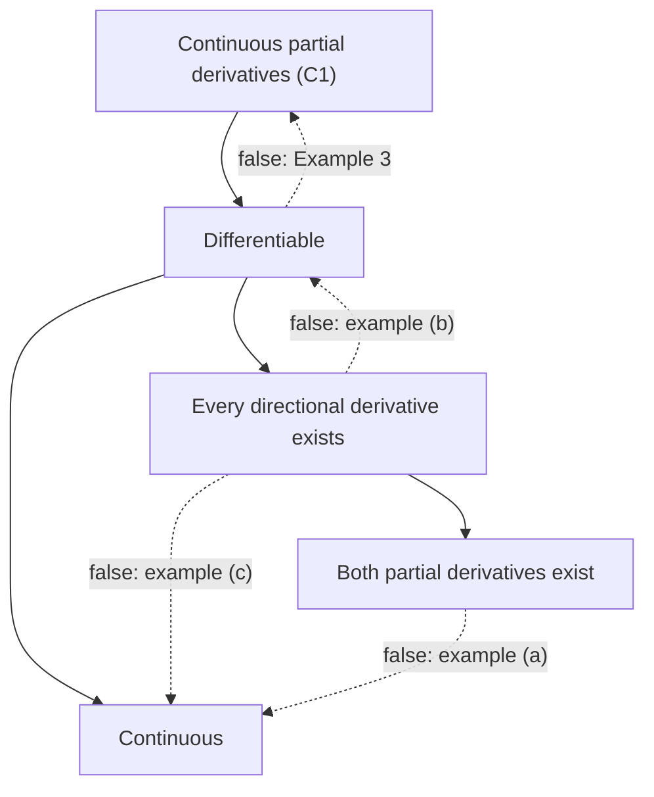

## Why look closer

Lesson 14 gave a working test: if $f_x$ and $f_y$ are continuous, $f$ is differentiable, and its
tangent plane is a good approximation. Lesson 13 gave Clairaut's theorem: if the mixed partials
are continuous, $f_{xy} = f_{yx}$. For every function you meet in applications those hypotheses
hold, so it is tempting to skip them. This lesson shows why they are there. We state
differentiability precisely, prove what it gives us, prove the working test, and then meet the
standard **counterexamples**: functions built to show that a plausible statement is false. Each
one breaks exactly one hypothesis, and seeing which one is the best way to understand the
theorems.

## The precise definition

Write a small step from $(a, b)$ as $(h, k)$, with length $\rho = \sqrt{h^2 + k^2}$. We call
$f$ differentiable at $(a, b)$ if there are numbers $A$ and $B$ such that the **error term**

$$E(h, k) = f(a + h, b + k) - f(a, b) - Ah - Bk$$

satisfies

$$\lim_{(h,k)\to(0,0)}\frac{E(h, k)}{\sqrt{h^2 + k^2}} = 0.$$

In words: the plane $z = f(a,b) + Ah + Bk$ matches the surface so well that the gap shrinks
*faster than the distance* from the base point, from every direction at once. That last phrase
is the whole difference from having partial derivatives, which only look along two lines.

Three facts follow quickly.

1. **The numbers are the partials.** Take $k = 0$ and $h > 0$: $E(h, 0)/h \to 0$ says
   $\dfrac{f(a + h, b) - f(a, b)}{h} \to A$ (and $h < 0$ works the same way), so $A = f_x(a, b)$.
   Likewise $B = f_y(a, b)$.
2. **Differentiable implies continuous.** $f(a + h, b + k) - f(a, b) = Ah + Bk + E$. As
   $(h, k)\to(0,0)$, $Ah + Bk \to 0$, and $E = \rho\cdot(E/\rho) \to 0\cdot0 = 0$.
3. **Every directional derivative exists and equals $\nabla f\cdot\mathbf u$.** Put
   $(h, k) = t\,\mathbf u$ with $\mathbf u = \langle u_1, u_2\rangle$ a unit vector, so $\rho = |t|$:
   $\dfrac{f(a + tu_1, b + tu_2) - f(a,b)}{t} = Au_1 + Bu_2 + \dfrac{E}{t}$, and $E/t \to 0$.

Fact 3 is why the formula $D_{\mathbf u}f = \nabla f\cdot\mathbf u$ from Lesson 16 needs
differentiability: it says the directional slopes must be a *linear* function of the direction.

### Example 1: differentiability straight from the definition

Show that $f(x, y) = xy$ is differentiable at $(1, 2)$.

1. Expand: $f(1 + h, 2 + k) = (1 + h)(2 + k) = 2 + 2h + k + hk$.
2. The partials are $f_x = y = 2$ and $f_y = x = 1$, so $E(h, k) = hk$.
3. Since $(|h| - |k|)^2 \ge 0$, we have $|hk| \le \tfrac12(h^2 + k^2)$. Therefore
   $\dfrac{|E|}{\rho} \le \dfrac{\rho^2/2}{\rho} = \dfrac{\rho}{2} \to 0$.
4. So the error ratio goes to 0 and $f$ is differentiable at $(1, 2)$, with tangent plane
   $z = 2 + 2(x - 1) + (y - 2)$.

## Three counterexamples

**(a) Partials exist, but $f$ is not even continuous.** Lesson 14's
$f(x,y) = \dfrac{xy}{x^2 + y^2}$, $f(0,0) = 0$, is zero on both axes, so $f_x(0,0) = f_y(0,0) = 0$;
yet $f = \tfrac12$ all along $y = x$. By fact 2 it cannot be differentiable.

**(b) Continuous, every directional derivative exists, still not differentiable.** This is the
subtle one, so it gets a full example.

### Example 2: slopes that are not linear in the direction

Let $f(x, y) = \dfrac{x^2y}{x^2 + y^2}$ with $f(0,0) = 0$.

1. *Continuous at the origin.* Since $\dfrac{x^2}{x^2 + y^2} \le 1$, $|f(x,y)| \le |y| \to 0$.
2. *Directional derivatives.* For a unit vector $\mathbf u = \langle u_1, u_2\rangle$,
   $f(tu_1, tu_2) = \dfrac{t^3u_1^2u_2}{t^2(u_1^2 + u_2^2)} = t\,u_1^2u_2$, so
   $D_{\mathbf u}f(0,0) = \lim_{t\to0}\dfrac{t\,u_1^2u_2}{t} = u_1^2u_2$. It exists for every $\mathbf u$.
3. *Partials.* $\mathbf u = \mathbf i$ gives $f_x(0,0) = 0$; $\mathbf u = \mathbf j$ gives $f_y(0,0) = 0$.
4. *The contradiction.* If $f$ were differentiable, fact 3 would force
   $D_{\mathbf u}f(0,0) = \langle 0, 0\rangle\cdot\mathbf u = 0$ for every $\mathbf u$. But for
   $\mathbf u = \tfrac{1}{\sqrt2}\langle 1, 1\rangle$, $D_{\mathbf u}f = \tfrac12\cdot\tfrac{1}{\sqrt2} = \tfrac{1}{2\sqrt2} \approx 0.354$.
   So $f$ is not differentiable at the origin.

Geometrically, the surface is made of straight lines through the origin (along each direction it
is exactly $z = t\,u_1^2u_2$), but those lines do not lie in one plane. Writing
$\mathbf u = \langle\cos\theta, \sin\theta\rangle$, the slope in direction $\theta$ is
$\cos^2\theta\sin\theta$. For a differentiable function it would have to be
$A\cos\theta + B\sin\theta$, a single sine wave; here it is not.

```plot
{"x": [0, 6.2832], "y": [-0.6, 0.6], "functions": [{"f": "cos(x)^2*sin(x)", "label": "actual slope cos²θ sin θ"}, {"f": "0*x", "dashed": true, "label": "∇f(0,0)·u = 0"}], "xLabel": "direction angle θ (radians)", "yLabel": "slope", "caption": "Directional slopes of x²y/(x² + y²) at the origin: not of the form A cos θ + B sin θ"}
```

**(c) Every directional derivative exists, but $f$ is not continuous.** Take Lesson 12's
$f(x, y) = \dfrac{xy^2}{x^2 + y^4}$, $f(0,0) = 0$. For $u_1 \ne 0$,
$\dfrac{f(tu_1, tu_2)}{t} = \dfrac{u_1u_2^2}{u_1^2 + t^2u_2^4} \to \dfrac{u_2^2}{u_1}$, and for
$u_1 = 0$ the function is identically 0. So every directional derivative at the origin exists,
yet $f = \tfrac12$ along the parabola $x = y^2$. Checking every straight line, whether for limits
or for slopes, cannot see what happens along curves.



## Why continuous partials are enough

A function whose partial derivatives exist and are continuous on an open set is called a
**$C^1$ function** (continuously differentiable). Here is the proof that such a function is
differentiable; it is the theorem behind Lesson 14's working test. The tool is the one-variable
**mean value theorem**: if $g$ is differentiable between $p$ and $q$ (and continuous at the ends),
then $g(q) - g(p) = g'(c)(q - p)$ for some $c$ between them.

Go from $(a, b)$ to $(a + h, b + k)$ in two legs, first vertically, then horizontally:

$$f(a + h, b + k) - f(a, b) = \underbrace{\big[f(a + h, b + k) - f(a, b + k)\big]}_{\text{change in } x} + \underbrace{\big[f(a, b + k) - f(a, b)\big]}_{\text{change in } y}.$$

Apply the mean value theorem to each bracket (each is a one-variable change):
the first equals $f_x(c_1, b + k)\,h$ with $c_1$ between $a$ and $a + h$, and the second equals
$f_y(a, c_2)\,k$ with $c_2$ between $b$ and $b + k$. Subtracting the linear part,

$$E(h, k) = \big[f_x(c_1, b + k) - f_x(a, b)\big]h + \big[f_y(a, c_2) - f_y(a, b)\big]k.$$

Divide by $\rho$. Since $|h|/\rho \le 1$ and $|k|/\rho \le 1$, the ratio $|E|/\rho$ is at most the
sum of the two brackets in absolute value. As $(h, k)\to(0,0)$ the points $(c_1, b + k)$ and
$(a, c_2)$ close in on $(a, b)$, and because $f_x$ and $f_y$ are *continuous*, both brackets go to
0. So $E/\rho \to 0$. (A sharper version needs only one of the two partials to be continuous; we
won't need it.)

### Example 3: the converse is false

Let $f(x, y) = (x^2 + y^2)\sin\!\left(\dfrac{1}{\sqrt{x^2 + y^2}}\right)$ with $f(0,0) = 0$.

1. *Differentiable at the origin.* $|f| \le x^2 + y^2 = \rho^2$. Take $A = B = 0$: then
   $|E|/\rho \le \rho \to 0$. So $f$ is differentiable there, with tangent plane $z = 0$.
2. *The partials are not continuous there.* Away from the origin the product and chain rules give
   $f_x = 2x\sin(1/\rho) - \dfrac{x}{\rho}\cos(1/\rho)$. On the positive $x$-axis ($y = 0$,
   $\rho = x$): $f_x = 2x\sin(1/x) - \cos(1/x)$. The first term goes to 0, but $\cos(1/x)$ keeps
   swinging between $-1$ and $1$ as $x \to 0^+$, so $f_x$ has no limit at the origin.

Continuous partials are a *sufficient* condition for differentiability, not a necessary one.

## When the mixed partials disagree

Clairaut's theorem has a hypothesis too: the mixed partials must be continuous. Here is why it
works, and an example where it fails.

*Why it works.* Consider the **second difference**
$\Delta = f(a + h, b + h) - f(a + h, b) - f(a, b + h) + f(a, b)$. Write it as
$\varphi(a + h) - \varphi(a)$, where $\varphi(x) = f(x, b + h) - f(x, b)$. The mean value theorem in
$x$ gives $\Delta = h\,\varphi'(\xi) = h\,[f_x(\xi, b + h) - f_x(\xi, b)]$, and the mean value theorem
again, now in $y$ applied to $f_x$, gives $\Delta = h^2 f_{xy}(p)$ for some point $p$ in the square
of side $h$. Write $\Delta$ instead as $\psi(b + h) - \psi(b)$ with $\psi(y) = f(a + h, y) - f(a, y)$,
do the $y$-step first, and you get $\Delta = h^2 f_{yx}(q)$ for another point $q$ in the same
square. So $f_{xy}(p) = f_{yx}(q)$. As $h \to 0$, both $p$ and $q$ shrink onto $(a, b)$, and
if both mixed partials are continuous there, $f_{xy}(a, b) = f_{yx}(a, b)$.

### Example 4: a function with $f_{xy} \ne f_{yx}$

Let $f(x, y) = \dfrac{xy(x^2 - y^2)}{x^2 + y^2}$ with $f(0,0) = 0$, an example often credited to
Giuseppe Peano (1884).

1. *$f_x$ on the $y$-axis.* $f(0, y) = 0$, so
   $f_x(0, y) = \lim_{h\to0}\dfrac{f(h, y)}{h} = \lim_{h\to0}\dfrac{y(h^2 - y^2)}{h^2 + y^2} = -y$
   (this also holds at $y = 0$).
2. *$f_y$ on the $x$-axis.* Similarly
   $f_y(x, 0) = \lim_{k\to0}\dfrac{f(x, k)}{k} = \lim_{k\to0}\dfrac{x(x^2 - k^2)}{x^2 + k^2} = x$.
3. *Mixed partials.* $f_{xy}(0,0) = (f_x)_y(0,0) = \dfrac{d}{dy}(-y) = -1$, while
   $f_{yx}(0,0) = (f_y)_x(0,0) = \dfrac{d}{dx}(x) = 1$.

They differ, so by Clairaut's theorem the mixed partials cannot both be continuous at the origin.
Indeed, away from the origin $f$ is a rational function, its two mixed partials agree, and their
common formula equals $1$ on the $x$-axis and $-1$ on the $y$-axis, so it has no limit at the
origin. The function itself is tame: it is $C^1$, and $|f| \le |xy| \le \rho^2/2$. Only its second
derivatives misbehave.

## Common mistakes

- Proving differentiability by finding $f_x$ and $f_y$ at the point. Existence of partials proves nothing; you need the error ratio to vanish, or continuous partials nearby.
- Checking only straight lines through the point, for limits or for slopes. Examples (b) and (c) pass every line test.
- Reading "continuous partials imply differentiable" backwards. Example 3 is differentiable with discontinuous partials.
- Using $D_{\mathbf u}f = \nabla f\cdot\mathbf u$ at a point where $f$ is not differentiable; in Example 2 it gives 0 where the true slope is $0.354$.
- Assuming $f_{xy} = f_{yx}$ without checking continuity, especially for functions defined piece by piece.

## Key points

- $f$ is differentiable at $(a, b)$ when $E(h,k)/\sqrt{h^2 + k^2} \to 0$; then $A = f_x$, $B = f_y$, $f$ is continuous, and $D_{\mathbf u}f = \nabla f\cdot\mathbf u$ for every unit $\mathbf u$.
- $C^1$ implies differentiable (proof: mean value theorem on two legs). The converse fails.
- Partials existing, or even all directional derivatives existing, does not give continuity or differentiability.
- Clairaut needs continuous mixed partials; without them $f_{xy}(0,0) = -1$ and $f_{yx}(0,0) = 1$ can happen.
