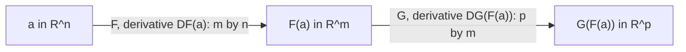

## One idea behind every derivative so far

You have now met several kinds of derivative: $f'(x)$ for one variable, $\mathbf r'(t)$ for a
vector function (Lesson 7), the gradient $\nabla f$ for a function of several variables
(Lesson 16), and the tables of partials that a tree diagram multiplies together (Lesson 15). They
look different, but they are one idea: *the derivative is the best linear approximation*. In
Lesson 14 the linearization of $f(x, y)$ at $\mathbf a = (a, b)$ was

$$f(\mathbf a + \mathbf h) \approx f(\mathbf a) + \nabla f(\mathbf a)\cdot\mathbf h,\qquad \mathbf h = \langle h, k\rangle.$$

This lesson extends that to functions with several *outputs* and writes the derivative as a
matrix. The payoff is a chain rule that fits on one line, and a clean way to state the inverse
and implicit function theorems.

## Maps with several inputs and outputs

A map $\mathbf F$ from $\mathbb R^n$ to $\mathbb R^m$ takes $n$ numbers in and gives $m$ numbers
out, so it has $m$ component functions $F_1, \dots, F_m$, each a function of $n$ variables. You
already know three cases:

- $n = 1$: a vector function $\mathbf r(t) = \langle x(t), y(t), z(t)\rangle$ (here $m = 3$).
- $m = 1$: an ordinary function $f(x, y)$ of several variables.
- $n = m = 2$: a change of coordinates, such as the polar map
  $\mathbf P(r, \theta) = (r\cos\theta,\ r\sin\theta)$, which takes a point of the
  $r\theta$-plane to a point of the $xy$-plane.

## The derivative matrix

The **derivative matrix** of $\mathbf F$ at $\mathbf a$ is the $m\times n$ matrix of all first
partial derivatives,

$$D\mathbf F(\mathbf a) = \begin{bmatrix} \dfrac{\partial F_1}{\partial x_1} & \cdots & \dfrac{\partial F_1}{\partial x_n}\\ \vdots & & \vdots\\ \dfrac{\partial F_m}{\partial x_1} & \cdots & \dfrac{\partial F_m}{\partial x_n}\end{bmatrix}\quad\text{(evaluated at } \mathbf a\text{)}.$$

Read it two ways. *Row $i$ is the gradient of the output $F_i$.* *Column $j$ is the partial
derivative vector $\partial\mathbf F/\partial x_j$*: how all the outputs respond when only input
$j$ moves. One row ($m = 1$) is the gradient, written as a row; one column ($n = 1$) is the
velocity $\mathbf r'(t)$. The square case is the matrix whose determinant Lesson 28 calls the
Jacobian, which is why many books call $D\mathbf F$ the *Jacobian matrix*.

The linear approximation keeps its form, with a matrix-times-vector product in place of the dot
product:

$$\mathbf F(\mathbf a + \mathbf h) \approx \mathbf F(\mathbf a) + D\mathbf F(\mathbf a)\,\mathbf h.$$

As in the previous lesson, $\mathbf F$ is differentiable at $\mathbf a$ when the error
$\mathbf F(\mathbf a + \mathbf h) - \mathbf F(\mathbf a) - D\mathbf F(\mathbf a)\mathbf h$ is small
compared with $|\mathbf h|$ (its length divided by $|\mathbf h|$ goes to 0). That happens exactly
when every component $F_i$ is differentiable, and continuous partials still guarantee it.

### Example 1: the polar map

Find $D\mathbf P$ for $\mathbf P(r, \theta) = (r\cos\theta, r\sin\theta)$ at $(r, \theta) = (2, \pi/6)$,
and use it to estimate $\mathbf P(2.1,\ \pi/6 + 0.05)$.

1. Rows are the gradients of $x = r\cos\theta$ and $y = r\sin\theta$ with respect to $(r, \theta)$:
   $$D\mathbf P = \begin{bmatrix}\cos\theta & -r\sin\theta\\ \sin\theta & r\cos\theta\end{bmatrix} = \begin{bmatrix}\tfrac{\sqrt3}{2} & -1\\ \tfrac12 & \sqrt3\end{bmatrix}\ \text{at } (2, \pi/6).$$
2. Base value: $\mathbf P(2, \pi/6) = (\sqrt3, 1) \approx (1.7321, 1)$. Step $\mathbf h = \langle 0.1, 0.05\rangle$.
3. $D\mathbf P\,\mathbf h = \left\langle \tfrac{\sqrt3}{2}(0.1) - 0.05,\ \tfrac12(0.1) + \sqrt3(0.05)\right\rangle \approx \langle 0.0366, 0.1366\rangle$.
4. Estimate: $\mathbf P \approx (1.7687, 1.1366)$. The true value is $(1.7639, 1.1396)$, off by about $0.006$, small next to the step.

The columns have a meaning you can see. The first column $\langle\cos\theta, \sin\theta\rangle$ is
the direction a point moves when $r$ grows; the second, $\langle -r\sin\theta, r\cos\theta\rangle$, is
the direction it moves when $\theta$ grows, with length $r$ because points far out sweep faster.
A small rectangle of sides $\Delta r$, $\Delta\theta$ maps to a curved patch that is close to the
parallelogram spanned by $\Delta r$ times column 1 and $\Delta\theta$ times column 2. Its area is
about $|\det D\mathbf P|\,\Delta r\,\Delta\theta = r\,\Delta r\,\Delta\theta$, the $r$ in
$dA = r\,dr\,d\theta$ of Lesson 23.

```plot
{"x": [1, 2.6], "y": [0.8, 2.1], "equal": true, "curves": [{"x": "2*cos(t)", "y": "2*sin(t)", "t": [0.5236, 0.8236]}, {"x": "2.6*cos(t)", "y": "2.6*sin(t)", "t": [0.5236, 0.8236]}], "segments": [{"from": [1.7321, 1], "to": [2.2517, 1.3], "label": "Δr · column 1", "arrow": true}, {"from": [1.3592, 1.4672], "to": [1.7669, 1.9074]}, {"from": [1.7321, 1], "to": [1.4321, 1.5196], "label": "Δθ · column 2", "arrow": true, "dashed": true}, {"from": [2.2517, 1.3], "to": [1.9517, 1.8196], "dashed": true}, {"from": [1.4321, 1.5196], "to": [1.9517, 1.8196], "dashed": true}], "points": [{"at": [1.7321, 1], "label": "P(2, π/6)"}], "caption": "The image of the rectangle 2 ≤ r ≤ 2.6, π/6 ≤ θ ≤ π/6 + 0.3 (solid, curved) and its linear approximation, the parallelogram spanned by the scaled columns of DP (dashed)"}
```

## The chain rule as matrix multiplication

Suppose $\mathbf F$ takes $\mathbf a$ to $\mathbf b = \mathbf F(\mathbf a)$ and $\mathbf G$ is
defined near $\mathbf b$. Approximate each map by its linearization: a small input change
$\mathbf h$ becomes $D\mathbf F(\mathbf a)\mathbf h$ after $\mathbf F$, and then
$D\mathbf G(\mathbf b)\,D\mathbf F(\mathbf a)\mathbf h$ after $\mathbf G$. Composing linear maps is
multiplying their matrices, so the **matrix chain rule** reads

$$D(\mathbf G\circ\mathbf F)(\mathbf a) = D\mathbf G\big(\mathbf F(\mathbf a)\big)\;D\mathbf F(\mathbf a).$$

(The full proof checks that the two error terms stay small; it uses differentiability of both
maps, just as Lesson 15's justification did.) Two details matter. The outer derivative is
evaluated at $\mathbf F(\mathbf a)$, not at $\mathbf a$. And the order is outer times inner: the
sizes $(p\times m)(m\times n)$ only fit that way.



This is the tree diagram in disguise. For $z = f(x, y)$ with $x = x(s, t)$, $y = y(s, t)$:

$$\begin{bmatrix} z_s & z_t\end{bmatrix} = \begin{bmatrix} f_x & f_y\end{bmatrix}\begin{bmatrix} x_s & x_t\\ y_s & y_t\end{bmatrix},$$

and each entry of the product, such as $z_s = f_xx_s + f_yy_s$, is a sum over the paths of the
tree, one product per path.

### Example 2: composing two maps

Let $\mathbf F(s, t) = (s^2t,\ s + t^2)$ and $\mathbf G(x, y) = (xy,\ x - y)$. Find
$D(\mathbf G\circ\mathbf F)(1, 1)$.

1. Inner map: $D\mathbf F = \begin{bmatrix} 2st & s^2\\ 1 & 2t\end{bmatrix} = \begin{bmatrix} 2 & 1\\ 1 & 2\end{bmatrix}$ at $(1, 1)$, and $\mathbf F(1, 1) = (1, 2)$.
2. Outer map *at $(1, 2)$*: $D\mathbf G = \begin{bmatrix} y & x\\ 1 & -1\end{bmatrix} = \begin{bmatrix} 2 & 1\\ 1 & -1\end{bmatrix}$.
3. Multiply, outer times inner: $\begin{bmatrix} 2 & 1\\ 1 & -1\end{bmatrix}\begin{bmatrix} 2 & 1\\ 1 & 2\end{bmatrix} = \begin{bmatrix} 5 & 4\\ 1 & -1\end{bmatrix}$.
4. Check directly: $\mathbf G\circ\mathbf F = \big(s^2t(s + t^2),\ s^2t - s - t^2\big)$. Its first component has $s$-derivative $2st(s + t^2) + s^2t = 4 + 1 = 5$ at $(1,1)$; the others check the same way.

### Example 3: the gradient in polar coordinates

If $z = f(x, y)$ and we substitute $x = r\cos\theta$, $y = r\sin\theta$, the chain rule gives
$[z_r\ \ z_\theta] = [f_x\ \ f_y]\,D\mathbf P$. Lesson 15 used this to get $z_r$ and $z_\theta$.
Going the other way, solve for $f_x$ and $f_y$ by multiplying on the right by the inverse matrix
(it exists when $\det D\mathbf P = r \ne 0$):

$$D\mathbf P^{-1} = \begin{bmatrix}\cos\theta & \sin\theta\\ -\dfrac{\sin\theta}{r} & \dfrac{\cos\theta}{r}\end{bmatrix},\qquad f_x = z_r\cos\theta - \frac{z_\theta\sin\theta}{r},\quad f_y = z_r\sin\theta + \frac{z_\theta\cos\theta}{r}.$$

Squaring and adding, the $\sin\theta\cos\theta$ terms cancel: $|\nabla f|^2 = z_r^2 + \dfrac{z_\theta^2}{r^2}$.

Try it on the angle itself, $z = \theta$ (so $f$ is the polar angle, defined away from the
origin): $z_r = 0$, $z_\theta = 1$, so $f_x = -\dfrac{\sin\theta}{r} = -\dfrac{y}{x^2 + y^2}$ and
$f_y = \dfrac{\cos\theta}{r} = \dfrac{x}{x^2 + y^2}$, which are the partials of $\arctan(y/x)$, and
$|\nabla\theta| = 1/r$: the angle changes fastest near the origin.

## Inverting a map

When is a map like $\mathbf P$ reversible, so that $(x, y)$ determines $(r, \theta)$? Its
linearization is reversible exactly when the square matrix $D\mathbf F(\mathbf a)$ is invertible,
that is, $\det D\mathbf F(\mathbf a) \ne 0$. The **inverse function theorem** says the map
inherits this, near the point: if $\mathbf F$ is $C^1$ and $\det D\mathbf F(\mathbf a) \ne 0$, then
$\mathbf F$ has a **local inverse**, a $C^1$ map $\mathbf F^{-1}$ defined near $\mathbf F(\mathbf a)$
that undoes $\mathbf F$ near $\mathbf a$, and

$$D(\mathbf F^{-1})\big(\mathbf F(\mathbf a)\big) = \big(D\mathbf F(\mathbf a)\big)^{-1}.$$

(The proof is beyond this course; we state the theorem without proof.) The polar map shows why
"local" matters. Its determinant is $r$, nonzero everywhere except the origin, so near any point
with $r > 0$ you can recover $(r, \theta)$ from $(x, y)$. But globally $\mathbf P$ is not one-to-one,
since $\theta$ and $\theta + 2\pi$ give the same point; the theorem promises an inverse only on a
small neighborhood. At $r = 0$ the determinant vanishes, and indeed every $\theta$ maps to the
origin.

The implicit function theorem from Lesson 15 is a close relative: from $F(x, y, z) = 0$ with
$F_z \ne 0$ we could solve for $z$ near the point, and the condition $F_z \ne 0$ is the
one-by-one version of "the relevant part of the derivative matrix is invertible."

## Common mistakes

- Transposing the matrix. Rows go with outputs, columns with inputs; $D\mathbf F$ for $\mathbb R^n \to \mathbb R^m$ is $m\times n$.
- Multiplying in the wrong order. It is $D\mathbf G\,D\mathbf F$ (outer times inner); matrix multiplication does not commute, and the sizes often won't even fit the other way.
- Evaluating the outer derivative at $\mathbf a$ instead of at $\mathbf F(\mathbf a)$.
- Confusing the derivative matrix with the Jacobian determinant: one is a matrix, the other a single number (its determinant).
- Reading the inverse function theorem as global. A nonzero determinant everywhere does not make a map one-to-one.

## Key points

- $D\mathbf F(\mathbf a)$ is the $m\times n$ matrix of partials; row $i$ is $\nabla F_i$, column $j$ is $\partial\mathbf F/\partial x_j$.
- Linear approximation: $\mathbf F(\mathbf a + \mathbf h) \approx \mathbf F(\mathbf a) + D\mathbf F(\mathbf a)\mathbf h$.
- Chain rule: $D(\mathbf G\circ\mathbf F)(\mathbf a) = D\mathbf G(\mathbf F(\mathbf a))\,D\mathbf F(\mathbf a)$; each entry is a sum over tree paths.
- Polar coordinates: $|\nabla f|^2 = z_r^2 + z_\theta^2/r^2$.
- Inverse function theorem: $C^1$ with $\det D\mathbf F(\mathbf a) \ne 0$ gives a local inverse with derivative $D\mathbf F(\mathbf a)^{-1}$.
