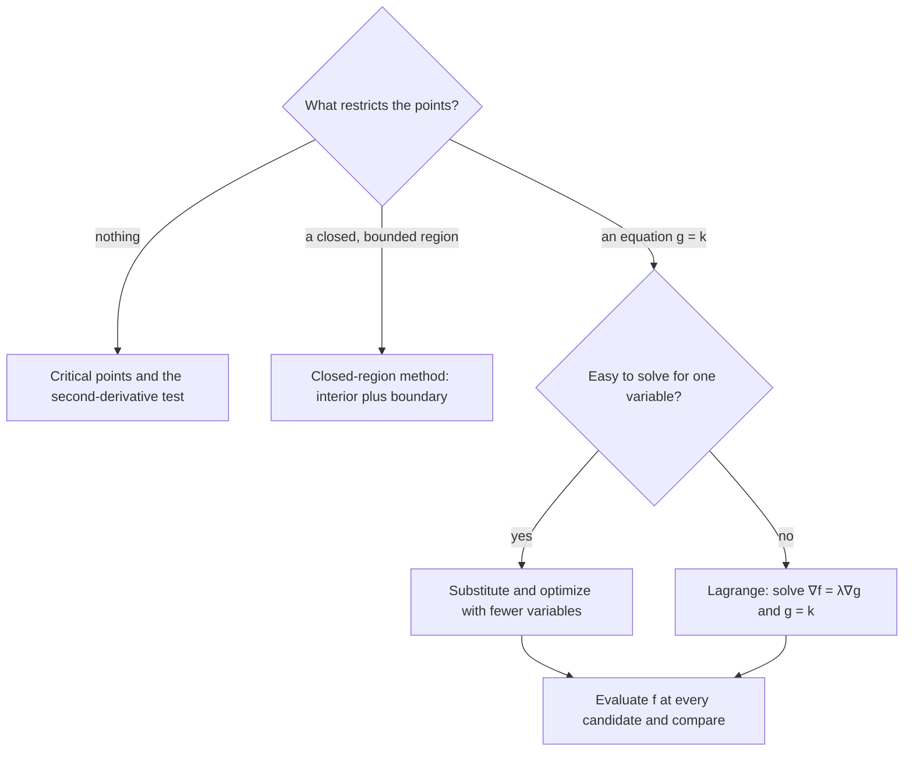

## Optimizing under a constraint

Many optimization problems come with a condition attached: maximize profit with a fixed
budget, minimize material for a fixed volume, find the point on a surface closest to a
given point. In the last lesson we handled a boundary by substituting it into $f$. That
works when the constraint is easy to solve for one variable, but often it is not. The method
of **Lagrange multipliers** handles a constraint $g(x, y) = k$ (or $g(x, y, z) = k$) directly
and symmetrically, using gradients.

## The geometric idea

We want the extreme values of $f(x, y)$ for points on the curve $g(x, y) = k$. Picture the
level curves $f = c$ for increasing $c$. Walking along the constraint curve, you cross these
level curves, and $f$ increases or decreases. At a point where $f$ reaches a max or min along
the constraint, you stop crossing them: the constraint curve just *touches* a level curve
of $f$ there. Two curves that touch share a tangent line, so their normals are parallel. The
normals are the gradients (Lesson 16). Hence, at the extreme point,

$$\nabla f = \lambda\,\nabla g$$

for some scalar $\lambda$, called the **Lagrange multiplier**.

The sketch below shows why a crossing cannot give an extreme value. The line $f = 2$ crosses the circle, so walking along the circle through a crossing point takes you from values below 2 to values above 2. The line $f = 7.5$ misses the circle, so that value is never reached. The largest value reached is on the line $f = 5$, which just touches the circle at $(1, 2)$, where $\nabla f$ and $\nabla g$ point the same way.


```plot
{"x": [-3.5, 3.5], "y": [-3.5, 3.5], "equal": true, "curves": [{"x": "sqrt(5)*cos(t)", "y": "sqrt(5)*sin(t)", "t": [0, "2pi"], "label": "constraint x² + y² = 5"}], "functions": [{"f": "(5-x)/2", "dashed": true, "label": "x + 2y = 5"}, {"f": "(2-x)/2", "dashed": true, "label": "x + 2y = 2"}, {"f": "(-5-x)/2", "dashed": true, "label": "x + 2y = −5"}], "points": [{"at": [1, 2], "label": "max (1, 2)"}, {"at": [-1, -2], "label": "min (−1, −2)"}], "segments": [{"from": [1, 2], "to": [1.5, 3], "arrow": true, "label": "∇f ∥ ∇g"}], "caption": "Level lines of f = x + 2y touch the circle exactly at the max and the min"}
```

## The method

To find the extreme values of $f(x, y, z)$ subject to $g(x, y, z) = k$ (assuming the extreme
values exist and $\nabla g \ne \mathbf 0$ on the constraint):

1. Solve the system
   $$\nabla f(x, y, z) = \lambda\nabla g(x, y, z),\qquad g(x, y, z) = k.$$
   That is four equations, $f_x = \lambda g_x$, $f_y = \lambda g_y$, $f_z = \lambda g_z$,
   $g = k$, in four unknowns $x, y, z, \lambda$. (In two variables: three equations.)
2. Evaluate $f$ at every solution. The largest value is the maximum, the smallest the
   minimum.

Solving the system is the hard part, and there is no single recipe. Useful tricks: solve
each equation for $\lambda$ and set the expressions equal; divide equations to eliminate
$\lambda$ (watch for dividing by zero); exploit symmetry.

### Example 1

Find the extreme values of $f(x, y) = x + 2y$ on the circle $x^2 + y^2 = 5$.

1. $\nabla f = \langle 1, 2\rangle$ and $\nabla g = \langle 2x, 2y\rangle$. Equations: $1 = 2\lambda x$, $2 = 2\lambda y$, $x^2 + y^2 = 5$.
2. $\lambda \ne 0$ (otherwise $1 = 0$), so $x = \tfrac{1}{2\lambda}$ and $y = \tfrac{1}{\lambda}$. Thus $y = 2x$.
3. Substitute: $x^2 + 4x^2 = 5$, so $x = \pm1$, giving $(1, 2)$ and $(-1, -2)$.
4. $f(1, 2) = 5$ (maximum) and $f(-1, -2) = -5$ (minimum).

The circle is closed and bounded, so the extremes exist, and they must be among these points.

### Example 2: closest point on a plane

Find the point on the plane $x + 2y + 2z = 9$ closest to the origin.

1. Minimize the squared distance $f = x^2 + y^2 + z^2$ (same minimizer, simpler algebra) subject to $g = x + 2y + 2z = 9$.
2. $\langle 2x, 2y, 2z\rangle = \lambda\langle 1, 2, 2\rangle$, so $x = \tfrac{\lambda}{2}$, $y = \lambda$, $z = \lambda$.
3. Substitute: $\tfrac{\lambda}{2} + 2\lambda + 2\lambda = 9$, so $\tfrac92\lambda = 9$ and $\lambda = 2$. Point: $(1, 2, 2)$.
4. Distance $\sqrt{1 + 4 + 4} = 3$, matching the point-to-plane formula $\tfrac{|0 - 9|}{\sqrt{1+4+4}} = 3$ from Lesson 5.

Notice the answer is a multiple of the normal $\langle 1,2,2\rangle$: the closest point lies
straight out along the normal, as geometry says it should.

### Example 3: the biggest box

A closed rectangular box has surface area $24\text{ m}^2$. What dimensions maximize its volume?

1. Maximize $V = xyz$ subject to $g = 2xy + 2xz + 2yz = 24$, with $x, y, z > 0$.
2. $\nabla V = \lambda\nabla g$: $yz = \lambda(2y + 2z)$, $xz = \lambda(2x + 2z)$, $xy = \lambda(2x + 2y)$.
3. Multiply the equations by $x$, $y$, $z$ respectively: $xyz = \lambda(2xy + 2xz) = \lambda(2xy + 2yz) = \lambda(2xz + 2yz)$.
4. From the first two, $\lambda\cdot2xz = \lambda\cdot2yz$; since $\lambda, z \ne 0$, $x = y$. Similarly $y = z$. So the box is a cube.
5. $6x^2 = 24$ gives $x = 2$: dimensions $2 \times 2 \times 2$, volume $8\text{ m}^3$.

## What λ means

The multiplier is not just bookkeeping. At the optimum, $\lambda$ equals the rate at which the
optimal value of $f$ changes as the constraint level $k$ changes: $\lambda = \dfrac{df_{\max}}{dk}$.
In Example 1 the max of $x + 2y$ on $x^2 + y^2 = k$ is $\sqrt{5k}$, whose derivative at $k = 5$
is $\tfrac12$, and indeed $\lambda = \tfrac{1}{2x} = \tfrac12$ at $(1, 2)$. Economists call it a
shadow price: what one more unit of budget is worth.

## Two constraints

To optimize $f(x, y, z)$ subject to $g = k$ and $h = c$ (the intersection is usually a
curve), solve $\nabla f = \lambda\nabla g + \mu\nabla h$ together with both constraints:
five equations in $x, y, z, \lambda, \mu$. The gradient of $f$ must lie in the plane
spanned by the two constraint normals. This needs the same kind of proviso as
$\nabla g \ne \mathbf 0$ in the one-constraint case: at the point, $\nabla g$ and $\nabla h$
must be nonzero and not parallel, so that they really do span a plane.

The next lesson returns to optimization without constraints, for one of its most common
uses: choosing the line that best fits a set of data points.

How do you choose among the methods of this module? The chart sums it up.



## Common mistakes

- Forgetting to include the constraint equation itself in the system.
- Dividing by a variable that might be zero, and losing solutions.
- Treating $\lambda$'s value as the answer; the answer is the point (and $f$ there).
- Using the method on an unbounded constraint without checking that an extremum exists.

## Key points

- At a constrained extremum, $\nabla f = \lambda\nabla g$: the level curve of $f$ is tangent to the constraint.
- Solve $\nabla f = \lambda\nabla g$, $g = k$; evaluate $f$ at all solutions and compare.
- $\lambda$ is the sensitivity of the optimal value to the constraint level.
- Two constraints: $\nabla f = \lambda\nabla g + \mu\nabla h$.
