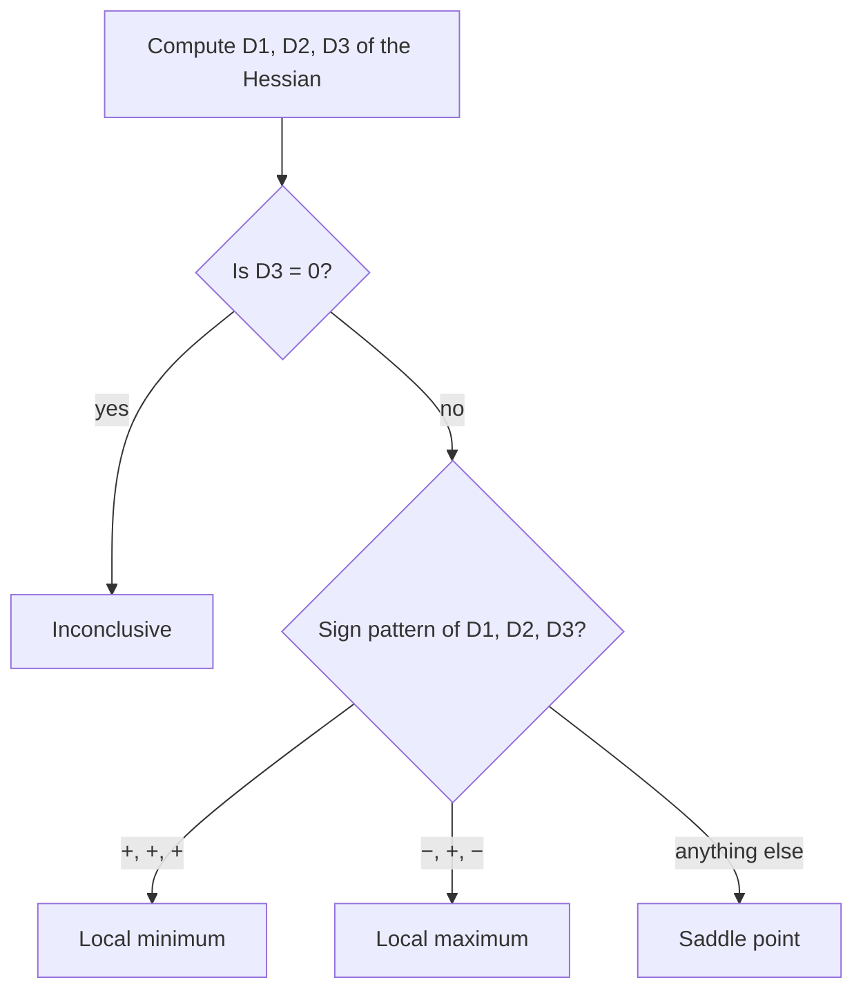

## Opening the black box

Lesson 17 gave you a rule: compute $D = f_{xx}f_{yy} - f_{xy}^2$ at a critical point, and read off minimum, maximum or saddle from the signs of $D$ and $f_{xx}$. It works, but as stated it is a black box. This honors lesson opens it. You will see where the rule comes from (completing the square in a quadratic), what the Hessian matrix has to do with the shape of a surface, and how the same idea classifies critical points of functions of three variables, where Lesson 17's rule says nothing. (The optional module 1 lesson on quadratic forms met the same algebra while tilting conics and quadric surfaces, and took the link to the second-derivative test on trust; this lesson supplies the proof. You do not need that lesson to follow this one.) The tools here, quadratic forms, eigenvalues and principal minors, are the ones used throughout engineering, physics and statistics whenever something is optimized in many variables.

## The quadratic that decides

Near a point $(a, b)$, a function with continuous second partials is approximated by its second-degree Taylor polynomial. Write $h = x - a$ and $k = y - b$ for the displacements. Then

$$f(a + h, b + k) \approx f(a, b) + f_x h + f_y k + \tfrac12\left(f_{xx}h^2 + 2f_{xy}hk + f_{yy}k^2\right),$$

with every partial evaluated at $(a, b)$. At a critical point $f_x = f_y = 0$, so the linear terms vanish and

$$f(a + h, b + k) - f(a, b) \approx \tfrac12\,Q(h, k),\qquad Q(h, k) = Ah^2 + 2Bhk + Ck^2,$$

where $A = f_{xx}$, $B = f_{xy}$, $C = f_{yy}$ at the point. A homogeneous quadratic like $Q$ (every term of degree exactly 2) is called a quadratic form. Whether $f$ goes up or down as you leave the critical point depends, to a first approximation, only on the sign of $Q$.

There are three main cases. $Q$ is **positive definite** if $Q(h, k) > 0$ for every $(h, k) \ne (0, 0)$: then $f$ rises in every direction, a local minimum. It is **negative definite** if $Q(h, k) < 0$ for every $(h, k) \ne (0, 0)$: a local maximum. It is **indefinite** if it takes both positive and negative values: a saddle.

## Completing the square

Suppose $A \ne 0$. Multiply $Q$ by $A$ and complete the square in $h$:

$$A\,Q(h, k) = A^2h^2 + 2ABhk + ACk^2 = (Ah + Bk)^2 + (AC - B^2)k^2.$$

The number $AC - B^2$ is exactly Lesson 17's discriminant $D$. Now read off the cases.

- **$D > 0$.** Both terms on the right are $\ge 0$, and they cannot both be zero unless $k = 0$ and then $h = 0$. So $A\,Q > 0$ for every nonzero $(h, k)$. If $A > 0$, then $Q > 0$: positive definite, a minimum. If $A < 0$, then $Q < 0$: negative definite, a maximum.
- **$D < 0$.** Take $k = 0$, $h = 1$: $A\,Q = A^2 > 0$. Take $k = 1$, $h = -B/A$: $A\,Q = D < 0$. So $Q$ has both signs: indefinite, a saddle. (If $A = 0$, then $D = -B^2 < 0$ forces $B \ne 0$, and $Q = 2Bhk + Ck^2$ still takes both signs; try $k$ small and $h = \pm1$.)
- **$D = 0$.** Then $A\,Q = (Ah + Bk)^2 \ge 0$, which is zero along a whole line of directions. Along that line the quadratic says nothing, and the higher-order terms of $f$ decide. This is why the test is inconclusive.

That is the whole proof of the table in Lesson 17, apart from one detail.

*The detail.* "Approximately" needs care: the Taylor error must not overwhelm $Q$. When $Q$ is positive definite, its smallest value on the unit circle $h^2 + k^2 = 1$ is some $m > 0$ (the circle is closed and bounded, so the Extreme Value Theorem of Lesson 18 applies). Because $Q$ is homogeneous, $Q(h, k) \ge m(h^2 + k^2)$ everywhere. Taylor's theorem says the error is small compared with $h^2 + k^2$ when $(h, k)$ is small, so near the point it cannot cancel $\tfrac12 m(h^2 + k^2)$. We state that error bound without proof; it is the same idea as the one-variable Taylor remainder.

## The Hessian matrix and its eigenvalues

The coefficients of $Q$ form the **Hessian** matrix

$$H = \begin{bmatrix} f_{xx} & f_{xy}\\ f_{xy} & f_{yy}\end{bmatrix},\qquad Q(h, k) = \begin{bmatrix} h & k\end{bmatrix} H \begin{bmatrix} h\\ k\end{bmatrix}.$$

$H$ is symmetric (by Clairaut's theorem), and a symmetric matrix has real eigenvalues $\lambda_1, \lambda_2$ (numbers with $H\mathbf v = \lambda\mathbf v$ for some nonzero vector $\mathbf v$, the eigenvector; they solve $\det(H - \lambda I) = 0$) with perpendicular eigenvectors. In coordinates $(u, v)$ along those eigenvectors, the cross term disappears and $Q = \lambda_1u^2 + \lambda_2v^2$. The classification becomes a statement about signs:

| Eigenvalues of $H$ | Quadratic form | Critical point |
|---|---|---|
| both positive | positive definite | local minimum |
| both negative | negative definite | local maximum |
| one positive, one negative | indefinite | saddle point |
| at least one zero | semidefinite or zero | test inconclusive |

This agrees with the $D$ test because $D = \det H = \lambda_1\lambda_2$ and $f_{xx} + f_{yy} = \lambda_1 + \lambda_2$ (the trace). $D > 0$ says the eigenvalues have the same sign; $D < 0$ says opposite signs.

The eigenvalues also have a geometric meaning. For a unit vector $\mathbf u$, the second directional derivative of $f$ in direction $\mathbf u$ is $\mathbf u^{\mathsf T}H\mathbf u$. Its largest and smallest values over all directions are the two eigenvalues, reached along the eigenvectors. So the eigenvectors point along the directions of greatest and least curvature of the surface, and the level curves near a minimum are approximately ellipses with their axes along those directions.

### Example 1

Classify the critical point of $f(x, y) = 3x^2 + 2xy + 3y^2$ at the origin and find the directions of greatest and least curvature.

1. $H = \begin{bmatrix} 6 & 2\\ 2 & 6\end{bmatrix}$, so $D = 36 - 4 = 32 > 0$ and $f_{xx} = 6 > 0$: a local minimum (in fact a global one, since here $f$ equals $\tfrac12 Q$ exactly, with no higher-order terms).
2. Eigenvalues: $\det(H - \lambda I) = (6 - \lambda)^2 - 4 = 0$ gives $\lambda = 8$ and $\lambda = 4$. Check: product $32 = D$, sum $12 = f_{xx} + f_{yy}$.
3. For $\lambda = 8$: $(H - 8I)\mathbf v = \mathbf 0$ gives $-2v_1 + 2v_2 = 0$, so $\mathbf v = \langle 1, 1\rangle$. For $\lambda = 4$: $\mathbf v = \langle 1, -1\rangle$.
4. In the rotated coordinates $u = \tfrac{x + y}{\sqrt2}$, $v = \tfrac{x - y}{\sqrt2}$, the function is $f = 4u^2 + 2v^2$ (half of each eigenvalue, because $f = \tfrac12 Q$). The surface is steepest along $\langle 1, 1\rangle$ and flattest along $\langle 1, -1\rangle$, so the level ellipses are long in the $\langle 1, -1\rangle$ direction.

```plot
{"x": [-2.6, 2.6], "y": [-2.6, 2.6], "equal": true, "curves": [{"x": "(sqrt(1)*cos(t)+sqrt(2)*sin(t))/sqrt(2)", "y": "(sqrt(1)*cos(t)-sqrt(2)*sin(t))/sqrt(2)", "t": [0, "2pi"]}, {"x": "(sqrt(2)*cos(t)+sqrt(4)*sin(t))/sqrt(2)", "y": "(sqrt(2)*cos(t)-sqrt(4)*sin(t))/sqrt(2)", "t": [0, "2pi"]}, {"x": "(sqrt(3)*cos(t)+sqrt(6)*sin(t))/sqrt(2)", "y": "(sqrt(3)*cos(t)-sqrt(6)*sin(t))/sqrt(2)", "t": [0, "2pi"]}], "segments": [{"from": [0, 0], "to": [1.1, 1.1], "arrow": true}, {"from": [0, 0], "to": [1.6, -1.6], "arrow": true}], "labels": [{"at": [1.75, 1.6], "text": "λ = 8"}, {"at": [2.0, -2.1], "text": "λ = 4"}], "points": [{"at": [0, 0]}], "caption": "Level curves f = 4, 8, 12 of f = 3x² + 2xy + 3y²: ellipses whose axes point along the eigenvectors of the Hessian"}
```

## Three variables: leading principal minors

For $f(x, y, z)$ the Hessian is $3 \times 3$:

$$H = \begin{bmatrix} f_{xx} & f_{xy} & f_{xz}\\ f_{xy} & f_{yy} & f_{yz}\\ f_{xz} & f_{yz} & f_{zz}\end{bmatrix}.$$

The quadratic form is still $\mathbf h^{\mathsf T}H\mathbf h$, and the classification by eigenvalue signs carries over unchanged. Finding three eigenvalues by hand means solving a cubic, so in practice one uses determinants instead. The **leading principal minors** are the determinants of the top-left $1 \times 1$, $2 \times 2$ and $3 \times 3$ corners:

$$D_1 = f_{xx},\qquad D_2 = \begin{vmatrix} f_{xx} & f_{xy}\\ f_{xy} & f_{yy}\end{vmatrix},\qquad D_3 = \det H.$$

**Sylvester's criterion** (named for the 19th-century English mathematician J. J. Sylvester) says a symmetric matrix is positive definite exactly when all its leading principal minors are positive. Applying it to $-H$ gives the test for negative definite. At a critical point with continuous second partials:

- $D_1 > 0$, $D_2 > 0$, $D_3 > 0$: local minimum.
- $D_1 < 0$, $D_2 > 0$, $D_3 < 0$ (signs alternate, starting negative): local maximum.
- $D_3 \ne 0$ but neither pattern holds: saddle point. (A nonzero determinant means no eigenvalue is zero; not all positive and not all negative means mixed signs.)
- $D_3 = 0$: inconclusive.

With two variables this is exactly Lesson 17's test: $D_1 = f_{xx}$ and $D_2 = D$.



### Example 2

Find and classify the critical point of $f(x, y, z) = x^2 + y^2 + z^2 + xy + yz - x - z$.

1. Gradient: $f_x = 2x + y - 1$, $f_y = x + 2y + z$, $f_z = y + 2z - 1$. Set all three to zero.
2. Subtracting the first and third equations gives $2x - 2z = 0$, so $z = x$. The middle equation becomes $2x + 2y = 0$, so $y = -x$. The first gives $2x - x - 1 = 0$, so $x = 1$. The critical point is $(1, -1, 1)$.
3. Hessian (constant, since $f$ is quadratic): $H = \begin{bmatrix} 2 & 1 & 0\\ 1 & 2 & 1\\ 0 & 1 & 2\end{bmatrix}$.
4. Minors: $D_1 = 2$, $D_2 = 4 - 1 = 3$, $D_3 = 2(4 - 1) - 1(2 - 0) + 0 = 4$. All positive: a local minimum.
5. Value: $f(1, -1, 1) = 3 - 1 - 1 - 1 - 1 = -1$.

### Example 3

Classify the critical points of $f(x, y, z) = x^3 - 3x + y^2 + yz + z^2$.

1. $f_x = 3x^2 - 3$, $f_y = 2y + z$, $f_z = y + 2z$. The first gives $x = \pm1$; the other two give $z = -2y$ and $y - 4y = 0$, so $y = z = 0$. Critical points: $(1, 0, 0)$ and $(-1, 0, 0)$.
2. $H = \begin{bmatrix} 6x & 0 & 0\\ 0 & 2 & 1\\ 0 & 1 & 2\end{bmatrix}$, so $D_1 = 6x$, $D_2 = 12x$, $D_3 = 6x(4 - 1) = 18x$.
3. At $(1, 0, 0)$: $6, 12, 18$, all positive: local minimum, $f = -2$.
4. At $(-1, 0, 0)$: $-6, -12, -18$. That is not $-, +, -$, and $D_3 \ne 0$, so it is a saddle with $f = 2$. Check directly: along the $x$-axis $f = x^3 - 3x$ has a local max at $x = -1$, but moving in $y$ from $(-1, 0, 0)$ adds $y^2 > 0$.

Notice that all three minors being negative is *not* the maximum pattern. The middle minor of a negative definite matrix is positive (it is a product of two negative eigenvalues of the $2 \times 2$ corner).

## Common mistakes

- Expecting a maximum when all the minors are negative; the maximum pattern alternates $-, +, -$.
- Testing the minors of $H$ at a point that is not critical. The test only classifies points where $\nabla f = \mathbf 0$.
- Concluding "minimum" from $f_{xx}, f_{yy}, f_{zz} > 0$ alone. The diagonal can be positive while $H$ is indefinite, as with $x^2 + y^2 + z^2 + 3xy$.
- Reading $D_3 = 0$ (or $D = 0$) as "no extremum". The test is silent; examine $f$ itself.
- Forgetting that $f - f(a, b) \approx \tfrac12 Q$, not $Q$. The factor $\tfrac12$ never changes a sign, but it matters when you compute the curvature in a direction.

## Key points

- At a critical point, $f$ minus its value behaves like $\tfrac12 Q(\mathbf h) = \tfrac12\mathbf h^{\mathsf T}H\mathbf h$, a quadratic form in the displacement.
- Completing the square, $A\,Q = (Ah + Bk)^2 + Dk^2$, proves the two-variable second-derivative test.
- Classification by the signs of the Hessian's eigenvalues: all positive, minimum; all negative, maximum; mixed, saddle; a zero eigenvalue, inconclusive.
- For three variables, use the leading principal minors: $+, +, +$ minimum; $-, +, -$ maximum; any other pattern with $D_3 \ne 0$ saddle; $D_3 = 0$ inconclusive.
- The eigenvectors of the Hessian are the directions of greatest and least curvature.
