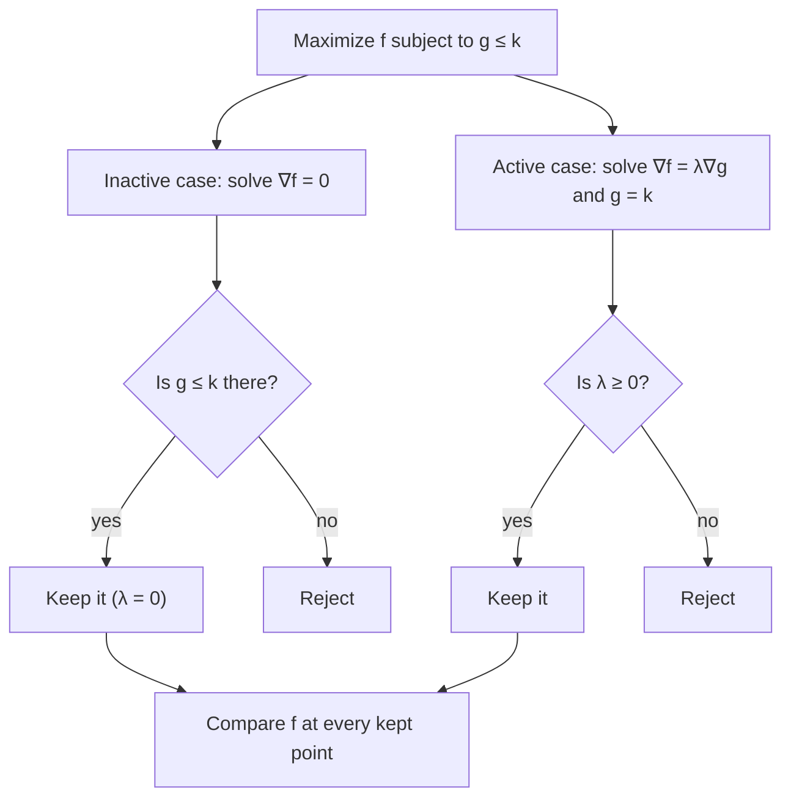

## From "exactly" to "at most"

Lesson 19 optimized $f$ on a curve $g = k$: spend exactly the budget, use exactly the surface area. Real limits are usually inequalities. A budget says spend *at most* $k$; a factory can run *at most* so many hours; a design must keep stress *below* a limit. This honors lesson extends Lagrange multipliers to constraints of the form $g \le k$. Along the way it proves the claim from Lesson 19 that $\lambda$ measures how fast the optimal value changes with $k$, because that fact is what makes the inequality version work. The conditions you will learn, the KKT conditions, are the foundation of the field called nonlinear programming, used in economics, engineering design and machine learning.

## Why λ is a rate: a proof

Suppose that for each constraint level $k$ near some $k_0$, the maximum of $f(x, y)$ on $g(x, y) = k$ occurs at a point $\big(x(k), y(k)\big)$ that changes differentiably with $k$, with multiplier $\lambda(k)$. Let $F(k) = f\big(x(k), y(k)\big)$ be the optimal value. By the chain rule (Lesson 15),

$$F'(k) = f_x\,x'(k) + f_y\,y'(k).$$

At the optimum, $f_x = \lambda g_x$ and $f_y = \lambda g_y$, so

$$F'(k) = \lambda\left(g_x\,x'(k) + g_y\,y'(k)\right) = \lambda\,\frac{d}{dk}\,g\big(x(k), y(k)\big) = \lambda\,\frac{d}{dk}(k) = \lambda.$$

So $\lambda = F'(k)$: the multiplier is the rate of change of the best achievable value with respect to the constraint level. In economics it is called the **shadow price** of the constraint, the value of one more unit of the limited resource. (The proof assumes the optimal point moves smoothly with $k$; that holds in typical problems and can be justified with the implicit function theorem, which we do not do here.)

### Example 1: what is one more dollar worth?

A shopper's satisfaction from $x$ units of one good and $y$ units of another is modeled as $f = xy$. The goods cost \$1 and \$4 per unit and the budget is \$16. Maximize $f$, then estimate the effect of a \$17 budget.

1. Constraint $g = x + 4y = 16$. Lagrange: $y = \lambda$, $x = 4\lambda$, so $x = 4y$.
2. Substitute: $4y + 4y = 16$, so $y = 2$, $x = 8$, $\lambda = 2$, and the maximum is $f = 16$.
3. Shadow price $\lambda = 2$: one more dollar should raise the best satisfaction by about 2, to about 18.
4. Check exactly: with budget $k$, the same steps give $x = k/2$, $y = k/8$, so $F(k) = k^2/16$ and $F'(k) = k/8 = 2$ at $k = 16$. At $k = 17$, $F = 289/16 \approx 18.06$, close to the estimate.

## Inequality constraints: active or inactive

Now maximize $f(x, y)$ over the **feasible region** $g(x, y) \le k$. The maximum is either inside the region or on its edge $g = k$.

- If it is inside, the constraint is **inactive** (not binding): small moves in every direction stay feasible, so it is an ordinary local maximum and $\nabla f = \mathbf 0$. Relaxing the limit a little changes nothing, so its shadow price is $\lambda = 0$.
- If it is on the edge, the constraint is **active** (binding): $\nabla f = \lambda\nabla g$ as in Lesson 19. But now there is an extra sign condition. $\nabla g$ points toward larger $g$, out of the region. At a maximum on the edge, $f$ must not increase as you step into the region, so $\nabla f$ must point out of the region too, or be zero. That means $\lambda \ge 0$. Equivalently: raising $k$ enlarges the region, which cannot lower the best value, so $F'(k) = \lambda \ge 0$.

Both cases fit in one set of equations.

**KKT conditions** (to maximize $f$ subject to $g \le k$). At a maximum point, provided $\nabla g \ne \mathbf 0$ there if the constraint is active,

$$\nabla f = \lambda\nabla g,\qquad \lambda \ge 0,\qquad g \le k,\qquad \lambda\,(g - k) = 0.$$

The last equation is **complementary slackness**: either $\lambda = 0$ (then $\nabla f = \mathbf 0$, the interior case) or $g = k$ (the active case), or both. The conditions are named for William Karush, who wrote them down in a 1939 master's thesis, and Harold Kuhn and Albert Tucker, who published them in 1951.

To *minimize* $f$ subject to $g \le k$, maximize $-f$ instead. In terms of $f$ the sign flips: an active minimum needs $\nabla f = \lambda\nabla g$ with $\lambda \le 0$.

Two cautions. The KKT conditions are *necessary*: a maximum must satisfy them, but a point satisfying them need not be a maximum. They become sufficient when $f$ is concave (its graph curves downward, like $-x^2 - y^2$) and $g$ is convex (so the feasible region is convex), a theorem we state without proof. And on a closed, bounded feasible region you can also just list every KKT point and compare values, as in Lesson 18.



### Example 2: when does the limit bind?

Maximize $f(x, y) = 4x + 2y - x^2 - y^2$ subject to $x + y \le k$, first for $k = 4$, then for $k = 2$.

Without the constraint, $\nabla f = \langle 4 - 2x, 2 - 2y\rangle = \mathbf 0$ at $(2, 1)$, where $f = 5$ and $x + y = 3$.

**$k = 4$.** Inactive case: $(2, 1)$ has $x + y = 3 \le 4$, so it is feasible; keep it, $\lambda = 0$. Active case: $4 - 2x = \lambda$, $2 - 2y = \lambda$, $x + y = 4$. Then $x - y = 1$, so $x = 2.5$, $y = 1.5$, $\lambda = -1$. The sign is wrong, so reject it. (Moving inward from that edge point *raises* $f$; it cannot be the maximum.) Answer: max $f = 5$ at $(2, 1)$, constraint inactive.

**$k = 2$.** Inactive case: $(2, 1)$ has $x + y = 3 > 2$, infeasible; reject. Active case: again $x - y = 1$, now with $x + y = 2$, so $x = 1.5$, $y = 0.5$, $\lambda = 4 - 3 = 1 \ge 0$. Keep it. Answer: max $f = 6 + 1 - 2.25 - 0.25 = 4.5$ at $(1.5, 0.5)$, constraint active.

Here $f$ is concave and the constraint is linear, so these KKT points really are the maxima. The shadow price $\lambda = 1$ at $k = 2$ says loosening the limit to $k = 2.1$ raises the maximum by about $0.1$. In general, for $k \le 3$ the active case gives $\lambda = 3 - k$, which shrinks to 0 exactly at $k = 3$, where the unconstrained maximum $(2, 1)$ first becomes feasible. Past that point extra room is worth nothing.

### Example 3: the nearest point of a disk

Find the point of the disk $x^2 + y^2 \le 4$ closest to $(3, 0)$.

1. Closest means minimizing $(x - 3)^2 + y^2$, so maximize $f = -(x - 3)^2 - y^2$ subject to $g = x^2 + y^2 \le 4$.
2. Inactive case: $\nabla f = \mathbf 0$ only at $(3, 0)$, which has $g = 9 > 4$. Reject.
3. Active case: $-2(x - 3) = 2\lambda x$ and $-2y = 2\lambda y$, with $x^2 + y^2 = 4$. The second equation gives $y = 0$ or $\lambda = -1$. If $\lambda = -1$, the first becomes $-2x + 6 = -2x$, impossible. So $y = 0$ and $x = \pm2$.
4. At $(2, 0)$: $-2(-1) = 2 = \lambda\cdot4$, so $\lambda = \tfrac12 \ge 0$. Keep it; $f = -1$.
5. At $(-2, 0)$: $-2(-5) = 10 = \lambda\cdot(-4)$, so $\lambda = -\tfrac52 < 0$. Reject. This is the *farthest* point of the disk, where $f$ is smallest.
6. The closest point is $(2, 0)$, at distance $\sqrt{1} = 1$.

The sign test did real work: plain Lagrange multipliers on the circle find both $(\pm2, 0)$, and only the sign of $\lambda$ separates the nearest point from the farthest.

```plot
{"x": [-3, 4], "y": [-2.8, 2.8], "equal": true, "circles": [{"center": [0, 0], "r": 2}], "points": [{"at": [3, 0], "label": "(3, 0)"}, {"at": [2, 0], "label": "nearest, λ = 1/2"}, {"at": [-2, 0], "label": "farthest, λ = −5/2"}], "segments": [{"from": [2, 0], "to": [2, 1.2], "arrow": true, "label": "∇g"}], "caption": "The disk x² + y² ≤ 4. Both (2, 0) and (−2, 0) satisfy ∇f = λ∇g, but only (2, 0) has λ ≥ 0"}
```

## Common mistakes

- Forgetting the interior case: if the unconstrained maximum is feasible, the constraint is inactive and $\lambda = 0$.
- Keeping an active-case point with the wrong sign of $\lambda$. For a maximum with $g \le k$, $\lambda$ must be $\ge 0$.
- Mixing up the sign rule for minimization; convert to maximizing $-f$ if in doubt.
- Writing complementary slackness as $\lambda + (g - k) = 0$. It is a product: at least one factor is zero.
- Reading $\lambda$ as the change in the *point*. It is the rate of change of the optimal *value* of $f$.
- Treating KKT points as automatically optimal. Without concavity, compare values (or check that a maximum exists first).

## Key points

- $\lambda = \dfrac{dF}{dk}$, where $F(k)$ is the optimal value; the proof is one application of the chain rule. This is the shadow price.
- With $g \le k$, a maximum is either interior ($\nabla f = \mathbf 0$, inactive, $\lambda = 0$) or on the edge ($\nabla f = \lambda\nabla g$ with $\lambda \ge 0$).
- KKT conditions for a maximum: $\nabla f = \lambda\nabla g$, $\lambda \ge 0$, $g \le k$, $\lambda(g - k) = 0$.
- They are necessary conditions; for concave $f$ and convex $g$ they are also sufficient.
