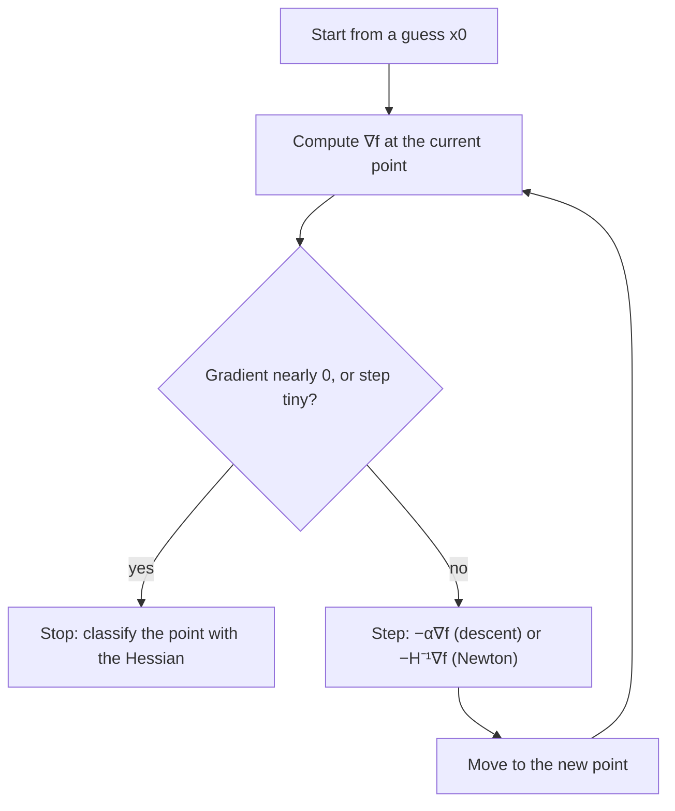

## When the equations will not solve

Every example in this module ended with a system $\nabla f = \mathbf 0$ (or $\nabla f = \lambda\nabla g$) that could be solved by hand. Real problems rarely cooperate. The equations $4x^3 - 2y = 0$, $2y - 2x = 0$ are easy, but change an exponent or add a term like $e^{xy}$ and there is usually no formula for the solution. Fitting a model with thousands of parameters, as in Lesson 20 but on a large scale, gives thousands of equations. In practice, optimization is done by **iterative methods**: start with a guess, improve it step by step, and stop when the steps stop mattering. This honors lesson develops the two classic methods. Gradient descent uses only the gradient (Lesson 16); Newton's method also uses the Hessian (Lesson 17 and the first honors lesson). Both are the multivariable versions of ideas you may know from single-variable calculus.

## Gradient descent

Lesson 16 showed that $-\nabla f$ points in the direction in which $f$ decreases fastest. So to walk downhill toward a minimum, step that way:

$$\mathbf x_{n+1} = \mathbf x_n - \alpha\,\nabla f(\mathbf x_n).$$

This is **gradient descent**. The positive number $\alpha$ is the **step size** (in machine learning it is called the learning rate). Each new point $\mathbf x_n$ is an **iterate**. When $\nabla f = \mathbf 0$ the formula stops moving, so a limit of the iterates, if there is one, is a critical point. To find a maximum, step *up* the gradient instead ($+\alpha\nabla f$), which is the same as minimizing $-f$.

### Example 1

Minimize $f(x, y) = x^2 + 3y^2$ by gradient descent from $(3, 1)$ with $\alpha = 0.1$.

1. $\nabla f = \langle 2x, 6y\rangle$, so the update is $x \leftarrow x - 0.2x = 0.8x$ and $y \leftarrow y - 0.6y = 0.4y$.
2. Iterates: $(3, 1) \to (2.4, 0.4) \to (1.92, 0.16) \to (1.536, 0.064) \to (1.2288, 0.0256)$.
3. The values of $f$ fall: $12,\ 6.24,\ 3.763,\ 2.372,\ 1.512$. The iterates approach the minimum $(0, 0)$.

Notice the uneven progress. $y$ shrinks by a factor $0.4$ each step but $x$ only by $0.8$. Along $y$ the bowl is steep (second derivative 6), along $x$ it is shallow (second derivative 2), and one step size has to serve both.

```plot
{"x": [-0.6, 3.8], "y": [-2.2, 2.2], "equal": true, "curves": [{"x": "sqrt(12)*cos(t)", "y": "2*sin(t)", "t": [0, "2pi"]}, {"x": "sqrt(6.24)*cos(t)", "y": "sqrt(2.08)*sin(t)", "t": [0, "2pi"]}, {"x": "sqrt(3.7632)*cos(t)", "y": "sqrt(1.2544)*sin(t)", "t": [0, "2pi"]}], "segments": [{"from": [3, 1], "to": [2.4, 0.4], "arrow": true}, {"from": [2.4, 0.4], "to": [1.92, 0.16], "arrow": true}, {"from": [1.92, 0.16], "to": [1.536, 0.064], "arrow": true}, {"from": [3, 1], "to": [1.2, -0.8], "arrow": true, "dashed": true}, {"from": [1.2, -0.8], "to": [0.48, 0.64], "arrow": true, "dashed": true}, {"from": [0.48, 0.64], "to": [0.192, -0.512], "arrow": true, "dashed": true}], "points": [{"at": [3, 1], "label": "start (3, 1)"}, {"at": [0, 0]}], "caption": "Gradient descent on f = x² + 3y² from (3, 1). Solid: α = 0.1, a smooth slide. Dashed: α = 0.3, zigzagging across the valley. The ellipses are the level curves f = 12, 6.24, 3.76"}
```

## How big a step?

For $f = x^2 + 3y^2$ the update multiplies $x$ by $1 - 2\alpha$ and $y$ by $1 - 6\alpha$. The iterates converge exactly when both factors are between $-1$ and $1$:

- $\alpha = 0.1$: factors $0.8$ and $0.4$, steady convergence.
- $\alpha = 0.3$: factors $0.4$ and $-0.8$. The $y$-coordinate flips sign each step, so the path zigzags across the valley, but it still shrinks.
- $\alpha = 0.4$: the $y$-factor is $-1.4$, so $y$ grows: $1, -1.4, 1.96, -2.744, \dots$. The method diverges.

So the steep direction limits the step size: here $\alpha$ must be less than $1/3$. In general, for a quadratic bowl whose Hessian has largest eigenvalue $\lambda_{\max}$, gradient descent converges exactly when $0 < \alpha < 2/\lambda_{\max}$. Here $\lambda_{\max} = 6$ gives $\alpha < 1/3$. For non-quadratic functions this is only a local guide near a minimum, and practical codes adjust $\alpha$ as they go (a "line search"). The shallow direction then sets the speed: when the eigenvalues are very different, gradient descent crawls along the valley floor.

## Newton's method

Newton's method uses curvature to choose both the direction and the length of the step. Near $\mathbf x_n$, replace $f$ by its second-degree Taylor model,

$$f(\mathbf x_n + \mathbf h) \approx f(\mathbf x_n) + \nabla f\cdot\mathbf h + \tfrac12\,\mathbf h^{\mathsf T}H\mathbf h,$$

and jump to the critical point of the model. Setting the model's gradient to zero gives $\nabla f + H\mathbf h = \mathbf 0$, so

$$\mathbf x_{n+1} = \mathbf x_n - H^{-1}\nabla f(\mathbf x_n),$$

with $\nabla f$ and $H$ evaluated at $\mathbf x_n$. For two variables you can invert $H$ directly: if $H = \begin{bmatrix} A & B\\ B & C\end{bmatrix}$ with $D = AC - B^2 \ne 0$, then

$$H^{-1} = \frac{1}{D}\begin{bmatrix} C & -B\\ -B & A\end{bmatrix}.$$

(In one variable this is the familiar $x_{n+1} = x_n - f'(x_n)/f''(x_n)$, Newton's root-finding method applied to $f'$.) If $f$ is itself quadratic, the model is exact and Newton's method lands on the critical point in one step.

### Example 2

Use Newton's method on $f(x, y) = x^4 + y^2 - 2xy$, starting at $(1, 1)$.

1. $\nabla f = \langle 4x^3 - 2y,\ 2y - 2x\rangle$ and $H = \begin{bmatrix} 12x^2 & -2\\ -2 & 2\end{bmatrix}$.
2. At $(1, 1)$: $\nabla f = \langle 2, 0\rangle$, $H = \begin{bmatrix} 12 & -2\\ -2 & 2\end{bmatrix}$, $D = 24 - 4 = 20$.
3. $H^{-1}\nabla f = \tfrac{1}{20}\begin{bmatrix} 2 & 2\\ 2 & 12\end{bmatrix}\begin{bmatrix} 2\\ 0\end{bmatrix} = \begin{bmatrix} 0.2\\ 0.2\end{bmatrix}$, so the next iterate is $(0.8, 0.8)$.
4. At $(0.8, 0.8)$: $\nabla f = \langle 0.448, 0\rangle$, $H = \begin{bmatrix} 7.68 & -2\\ -2 & 2\end{bmatrix}$, $D = 11.36$. The step is $\tfrac{2(0.448)}{11.36}\langle 1, 1\rangle \approx \langle 0.0789, 0.0789\rangle$, giving about $(0.7211, 0.7211)$.

The iterates approach the minimum at $x = y = \tfrac{1}{\sqrt2} \approx 0.707107$ (solve $y = x$ and $4x^3 = 2x$; there $D = 12x^2\cdot2 - 4 = 8 > 0$; by symmetry there is a second minimum at $x = y = -\tfrac{1}{\sqrt2}$, and the origin is a saddle). The errors in $x$ at successive iterates are

| Iterate | 0 | 1 | 2 | 3 | 4 |
|---|---|---|---|---|---|
| Error in $x$ | $0.29$ | $0.093$ | $0.014$ | $0.0004$ | $0.0000003$ |

Near the answer each error is roughly a constant times the square of the previous one, so the number of correct digits about doubles every step. This is **quadratic convergence**. For comparison, gradient descent with $\alpha = 0.1$ from the same start needs 46 steps to get both coordinates within $0.001$.

## Choosing between them

| | Gradient descent | Newton's method |
|---|---|---|
| Needs | gradient only | gradient and Hessian |
| Work per step | small | solve a linear system with $H$ |
| Speed near a minimum | steady but can be slow | quadratic: very fast |
| Tuning | step size $\alpha$ | none, but needs $D \ne 0$ |
| Goes to | (usually) a minimum | any critical point: min, max or saddle |

The last row matters. Newton's method finds where $\nabla f = \mathbf 0$, and it does not care what kind of point that is. For Example 2's function, Newton's method started at $(0.3, 0.3)$ converges to the saddle point at the origin (there $D = 0\cdot2 - 4 < 0$), not to a minimum. So after any numerical method, check what you found: compute the Hessian there and classify the point. Gradient descent, by contrast, lowers $f$ at each step when $\alpha$ is small enough, so it heads for minima (though it can stall near a saddle). Large practical codes blend the two ideas. Like every result in this lesson, the convergence claims hold for well-behaved functions started close enough to a minimum; far from one, both methods can wander.



The test "gradient nearly zero, or step tiny" is the **stopping criterion**. A typical choice is to stop when $|\nabla f|$ falls below a small tolerance such as $10^{-8}$, or after a fixed maximum number of steps.

## Common mistakes

- Adding $\alpha\nabla f$ when minimizing; that climbs uphill.
- Choosing $\alpha$ too large and watching the iterates blow up; halve it and try again.
- Writing the Newton step as $-H\nabla f$ instead of $-H^{-1}\nabla f$.
- Swapping the diagonal entries wrong in $H^{-1}$: the $A$ and $C$ trade places, and the $B$ entries change sign.
- Trusting the limit without checking it. Newton's method can converge to a saddle or a maximum.
- Stopping because $f$ changed little in one step; a slow method can creep while still far from the minimum.

## Key points

- Gradient descent: $\mathbf x_{n+1} = \mathbf x_n - \alpha\nabla f(\mathbf x_n)$. Simple and cheap; the step size must be small enough (for a quadratic bowl, $\alpha < 2/\lambda_{\max}$).
- Newton's method: $\mathbf x_{n+1} = \mathbf x_n - H^{-1}\nabla f(\mathbf x_n)$, from minimizing the second-degree Taylor model. Exact in one step for quadratics, quadratically convergent near a minimum with $D > 0$.
- Both stop at critical points; classify the result with the Hessian.
