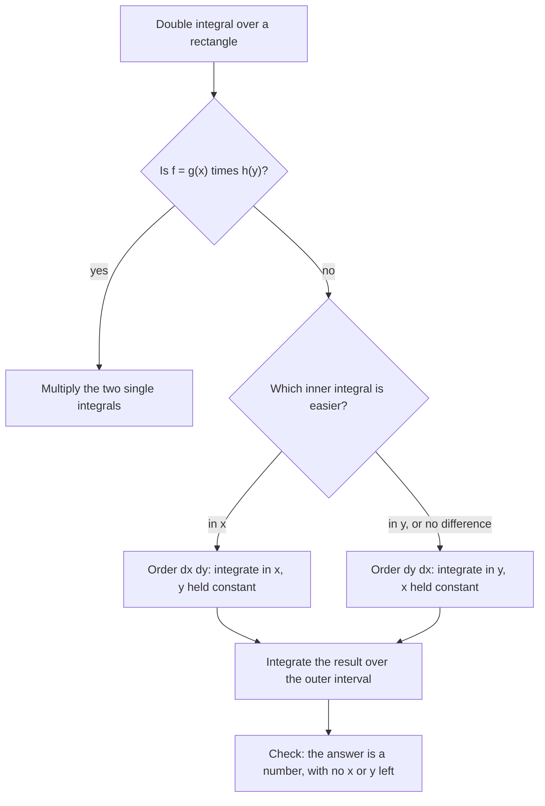

## From area under a curve to volume under a surface

The definite integral $\int_a^b f(x)\,dx$ adds up thin strips to find the area under a curve.
The **double integral** does the same thing one dimension up: it adds up thin columns to
find the volume under a surface $z = f(x, y)$ over a region in the plane. The same idea
computes mass from density, total rainfall from a rainfall map, and probabilities from a
joint density. We start with the simplest region, a rectangle, where the computation
reduces to two ordinary integrals.

## Riemann sums and the definition

Let $f(x, y) \ge 0$ on the rectangle $R = [a, b]\times[c, d]$. Cut $R$ into small
sub-rectangles $R_{ij}$ of area $\Delta A$, pick a sample point $(x_{ij}^*, y_{ij}^*)$ in
each, and build a column of height $f(x_{ij}^*, y_{ij}^*)$ on it. The total volume of the
columns is a **double Riemann sum**,
$\sum_{i}\sum_{j} f(x_{ij}^*, y_{ij}^*)\,\Delta A$. As the grid gets finer, the sums approach
the volume under the surface, and we define

$$\iint_R f(x, y)\,dA = \lim_{m,n\to\infty}\sum_{i=1}^m\sum_{j=1}^n f(x_{ij}^*, y_{ij}^*)\,\Delta A.$$

The limit exists for every continuous $f$. When $f$ takes negative values, the integral is
the volume above the plane minus the volume below it, just as in one variable.

### Example 1: the midpoint rule

Estimate $\iint_R (x^2 + y)\,dA$ over $R = [0, 2]\times[0, 2]$ using four unit squares and their midpoints.

```plot
{"x": [-0.3, 2.3], "y": [-0.3, 2.3], "equal": true, "polygons": [{"points": [[0, 0], [1, 0], [1, 1], [0, 1]]}, {"points": [[1, 0], [2, 0], [2, 1], [1, 1]]}, {"points": [[0, 1], [1, 1], [1, 2], [0, 2]]}, {"points": [[1, 1], [2, 1], [2, 2], [1, 2]]}], "points": [{"at": [0.5, 0.5], "label": "0.75"}, {"at": [1.5, 0.5], "label": "2.75"}, {"at": [0.5, 1.5], "label": "1.75"}, {"at": [1.5, 1.5], "label": "3.75"}], "caption": "Midpoints of four unit squares, labeled with f = x² + y"}
```

The values at the midpoints are $0.75, 2.75, 1.75, 3.75$, each multiplied by $\Delta A = 1$:
the estimate is $9$. We will see below that the exact value is $\tfrac{28}{3} \approx 9.33$.

## Iterated integrals and Fubini's theorem

Computing limits of Riemann sums directly is painful. Instead, slice the solid. Fix $x$; the
cross-section of the solid by the plane at that $x$ has area
$A(x) = \int_c^d f(x, y)\,dy$, an ordinary integral in which $x$ is held constant (a "partial
integration"). Then volume equals the integral of cross-sectional area:
$\int_a^b A(x)\,dx$. This gives an **iterated integral**:

$$\int_a^b\int_c^d f(x, y)\,dy\,dx = \int_a^b\left[\int_c^d f(x, y)\,dy\right]dx.$$

Work from the inside out: integrate in $y$ first (treating $x$ as constant), then in $x$.
Slicing the other way gives the iterated integral in the other order.

The picture shows both ways of seeing the volume: one thin column from a Riemann sum, and one slice whose area is $A(x)$.


**Fubini's theorem.** If $f$ is continuous on $R = [a, b]\times[c, d]$, then

$$\iint_R f(x, y)\,dA = \int_a^b\int_c^d f(x, y)\,dy\,dx = \int_c^d\int_a^b f(x, y)\,dx\,dy.$$

On a rectangle you may choose either order; pick the one that makes the inner integral
easier.

### Example 2

Evaluate $\iint_R (x^2 + y)\,dA$ for $R = [0, 2]\times[0, 2]$ exactly.

1. Inner, in $y$ with $x$ fixed: $\int_0^2(x^2 + y)\,dy = \left[x^2y + \tfrac{y^2}{2}\right]_{y=0}^{y=2} = 2x^2 + 2$.
2. Outer: $\int_0^2(2x^2 + 2)\,dx = \tfrac{16}{3} + 4 = \tfrac{28}{3}$.

Check the other order: $\int_0^2(x^2 + y)\,dx = \tfrac83 + 2y$, then $\int_0^2\left(\tfrac83 + 2y\right)dy = \tfrac{16}{3} + 4$. ✓ The midpoint estimate $9$ was close.

### Example 3: choosing the order

Evaluate $\iint_R y\cos(xy)\,dA$ over $R = [0, 1]\times\left[0, \tfrac{\pi}{2}\right]$.

Integrating in $y$ first would need integration by parts. In $x$ first, $y$ is a constant
and $y\cos(xy)$ is exactly the $x$-derivative of $\sin(xy)$:

1. $\int_0^1 y\cos(xy)\,dx = \left[\sin(xy)\right]_{x=0}^{x=1} = \sin y$.
2. $\int_0^{\pi/2}\sin y\,dy = 1$.

## Products of single-variable functions

If $f(x, y) = g(x)h(y)$ and $R$ is a rectangle, the double integral factors:

$$\iint_R g(x)h(y)\,dA = \left(\int_a^b g(x)\,dx\right)\left(\int_c^d h(y)\,dy\right).$$

For example, $\iint_{[0,1]\times[0,\ln2]} xe^y\,dA = \tfrac12\cdot(2 - 1) = \tfrac12$. This
shortcut works only for rectangles (constant limits).

The chart sums up how to choose a method for a rectangle.



## Average value

The **average value** of $f$ over a region $R$ of area $A(R)$ is

$$f_{\text{avg}} = \frac{1}{A(R)}\iint_R f(x, y)\,dA.$$

It is the height of the flat-topped box with base $R$ and the same volume as the solid under
$f$. For $f = xy$ on $[0, 2]\times[0, 4]$: $\iint xy\,dA = (2)(8) = 16$ and $A(R) = 8$, so
$f_{\text{avg}} = 2$.

### Example 4: a total from a density

A rectangular district $[0, 3]\times[0, 2]$ (in km) has population density $p(x, y) = 100 + 20x$ people per km². The total population is

$$\iint_R(100 + 20x)\,dA = 100\cdot6 + 20\int_0^2\int_0^3x\,dx\,dy = 600 + 20\cdot\tfrac92\cdot2 = 780.$$

Any "amount per unit area" integrates to a total amount in exactly this way; the average density is $780/6 = 130$ people per km².

## Common mistakes

- Integrating in the wrong variable first: the inner differential ($dy$ in $dy\,dx$) goes with the inner limits.
- Forgetting that the "constant" variable stays in the inner result (the inner integral is a function of the outer variable).
- Using the product shortcut when the limits are not constants.
- Forgetting to divide by the area for an average value.

## Key points

- $\iint_R f\,dA$ is a limit of Riemann sums; for $f \ge 0$ it is the volume under the surface.
- Fubini: on a rectangle, compute as an iterated integral in either order.
- $\iint g(x)h(y)\,dA$ over a rectangle factors into two single integrals.
- $f_{\text{avg}} = \frac{1}{A(R)}\iint_R f\,dA$.
