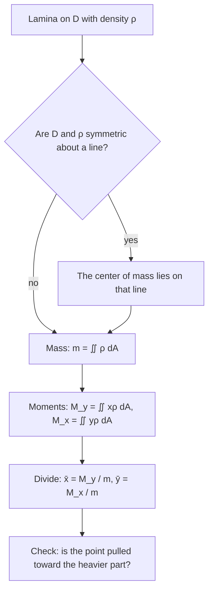

## What double integrals measure

A double integral adds up "something per unit area" over a region. If that something is
height, you get volume. If it is mass per unit area, you get mass. Weighted by distance, it
gives moments and the balance point. And with the right integrand it even measures the area
of a curved surface. This lesson collects these applications; each is the same recipe:
*identify the small piece, write its contribution, integrate.*

## Mass and density

A thin plate (a **lamina**) occupies a region $D$ and has **density** $\rho(x, y)$ (mass per
unit area). A tiny patch of area $dA$ near $(x, y)$ has mass about $\rho(x, y)\,dA$, so the
total **mass** is

$$m = \iint_D \rho(x, y)\,dA.$$

The same form gives total electric charge from a charge density, or total population from a
population density.

## Moments and center of mass

The **moment** of a mass about an axis measures its tendency to rotate the plate about that
axis: mass times distance. A patch at $(x, y)$ is at distance $x$ from the $y$-axis and
distance $y$ from the $x$-axis, so

$$M_y = \iint_D x\,\rho(x, y)\,dA,\qquad M_x = \iint_D y\,\rho(x, y)\,dA.$$

(The subscript names the axis: $M_y$ is about the $y$-axis and uses $x$.) The **center of mass** $(\bar x, \bar y)$ is where a single point of mass $m$ would have the same moments:

$$\bar x = \frac{M_y}{m},\qquad \bar y = \frac{M_x}{m}.$$

The plate balances on a pin placed there. When the density is constant, the center of mass
depends only on the shape and is called the **centroid**; the constant cancels and
$\bar x = \frac{1}{A}\iint_D x\,dA$, $\bar y = \frac{1}{A}\iint_D y\,dA$.

Use symmetry: if the region and density are symmetric about a line, the center of mass lies
on that line.

The steps, in order:



### Example 1

A square plate $[0, 1]\times[0, 1]$ has density $\rho = x + y$. Find its mass and center of mass.

1. $m = \int_0^1\int_0^1(x + y)\,dy\,dx = \int_0^1\left(x + \tfrac12\right)dx = 1$.
2. $M_y = \int_0^1\int_0^1 x(x + y)\,dy\,dx = \int_0^1\left(x^2 + \tfrac x2\right)dx = \tfrac13 + \tfrac14 = \tfrac{7}{12}$.
3. By symmetry in $x \leftrightarrow y$, $M_x = \tfrac{7}{12}$ too.
4. $(\bar x, \bar y) = \left(\tfrac{7}{12}, \tfrac{7}{12}\right)$: pulled from the center $(\tfrac12, \tfrac12)$ toward the heavy corner $(1, 1)$.

### Example 2: centroid of a half-disk

Find the centroid of the upper half of the disk of radius $a$.

```plot
{"x": [-1.3, 1.3], "y": [-0.3, 1.3], "equal": true, "curves": [{"x": "cos(t)", "y": "sin(t)", "t": [0, "pi"]}], "segments": [{"from": [-1, 0], "to": [1, 0]}], "points": [{"at": [0, 0.4244], "label": "centroid (0, 4a/3π)"}], "caption": "Half-disk of radius a = 1: the centroid sits at height 4/(3π) ≈ 0.424"}
```

1. By symmetry about the $y$-axis, $\bar x = 0$. The area is $A = \tfrac12\pi a^2$.
2. In polar coordinates: $\iint_D y\,dA = \int_0^\pi\int_0^a r\sin\theta\,r\,dr\,d\theta = \frac{a^3}{3}\cdot2 = \frac{2a^3}{3}$.
3. $\bar y = \dfrac{2a^3/3}{\pi a^2/2} = \dfrac{4a}{3\pi} \approx 0.424a$.

The centroid sits below the halfway height $\tfrac a2$, because the half-disk is wider near
its base.

## Moments of inertia

The **moment of inertia** measures resistance to rotational acceleration. It weights mass
by the *square* of distance from the axis: $I_x = \iint_D y^2\rho\,dA$,
$I_y = \iint_D x^2\rho\,dA$, and about the origin
$I_0 = \iint_D (x^2 + y^2)\rho\,dA = I_x + I_y$. For a uniform disk of radius $a$ and density
$\rho$, polar coordinates give $I_0 = \rho\int_0^{2\pi}\int_0^a r^3\,dr\,d\theta = \tfrac12\pi\rho a^4 = \tfrac12ma^2$,
the familiar formula for a spinning disk.

## Surface area

To find the area of the surface $z = f(x, y)$ over a region $D$, look at a tiny rectangle
$\Delta x$ by $\Delta y$ in $D$. Above it, the surface is nearly a piece of its tangent
plane: a parallelogram spanned by $\mathbf a = \langle\Delta x, 0, f_x\Delta x\rangle$ and
$\mathbf b = \langle 0, \Delta y, f_y\Delta y\rangle$. Its area is
$|\mathbf a\times\mathbf b| = |\langle -f_x, -f_y, 1\rangle|\,\Delta x\,\Delta y$. Adding up:

$$A(S) = \iint_D\sqrt{1 + f_x^2 + f_y^2}\;dA.$$

The square root is the stretch factor: how much bigger a patch of surface is than its shadow
on the $xy$-plane. A flat horizontal surface has factor 1; steep surfaces have large factors.

The picture shows one patch: a small rectangle of area $\Delta A$ in the $xy$-plane, the piece of tangent plane above it spanned by $\mathbf a$ and $\mathbf b$, and the normal vector $\mathbf a\times\mathbf b$, which is $\langle -f_x, -f_y, 1\rangle\,\Delta x\,\Delta y$.


### Example 3: a tilted plane

Find the area of the part of the plane $z = 2 + 3x + 4y$ above the rectangle $[0, 5]\times[1, 4]$.

$f_x = 3$, $f_y = 4$, so the stretch factor is $\sqrt{1 + 9 + 16} = \sqrt{26}$, constant. The
shadow has area 15, so $A = 15\sqrt{26} \approx 76.5$.

### Example 4: a paraboloid

Find the area of the part of $z = x^2 + y^2$ below the plane $z = 4$.

1. The shadow is the disk $x^2 + y^2 \le 4$. $f_x = 2x$, $f_y = 2y$, so the factor is $\sqrt{1 + 4x^2 + 4y^2} = \sqrt{1 + 4r^2}$.
2. $A = \displaystyle\int_0^{2\pi}\int_0^2\sqrt{1 + 4r^2}\,r\,dr\,d\theta = 2\pi\cdot\frac{1}{12}\left[(1 + 4r^2)^{3/2}\right]_0^2 = \frac{\pi}{6}\left(17\sqrt{17} - 1\right) \approx 36.18.$

## Probability

"Amount per unit area" can also be probability per unit area. If $X$ and $Y$ are continuous
random variables, their **joint density function** $f(x, y)$ satisfies $f \ge 0$ and
$\iint_{\mathbb R^2} f\,dA = 1$. The probability that the point $(X, Y)$ lands in a region $D$ is
$P\big((X, Y)\in D\big) = \iint_D f(x, y)\,dA$. The mean of $X$ is the "center of mass" of this
probability, $E(X) = \iint_{\mathbb R^2} x\,f(x, y)\,dA$, and $E(Y)$ is defined the same way.
When $X$ and $Y$ are independent, $f(x, y) = f_1(x)f_2(y)$ is a product. For example,
$f = 4xy$ on the unit square (and 0 elsewhere) integrates to $(2\cdot\tfrac12)(2\cdot\tfrac12) = 1$,
and $P(X + Y \le 1) = \int_0^1\int_0^{1 - x}4xy\,dy\,dx = \int_0^1 2x(1 - x)^2\,dx = \tfrac16$.

## Common mistakes

- Swapping $M_x$ and $M_y$: $M_x$ uses $y$ (distance from the $x$-axis).
- Forgetting to divide moments by the mass.
- Leaving out the 1 under the square root in the surface-area formula.
- Forgetting the polar $r$ when a surface-area integral is converted to polar coordinates.

## Key points

- $m = \iint_D\rho\,dA$; $M_y = \iint x\rho\,dA$, $M_x = \iint y\rho\,dA$; $(\bar x, \bar y) = (M_y/m,\, M_x/m)$.
- Constant density gives the centroid; use symmetry to skip computations.
- Moments of inertia weight by distance squared: $I_0 = \iint(x^2 + y^2)\rho\,dA$.
- Surface area of $z = f(x, y)$: $\iint_D\sqrt{1 + f_x^2 + f_y^2}\,dA$.
