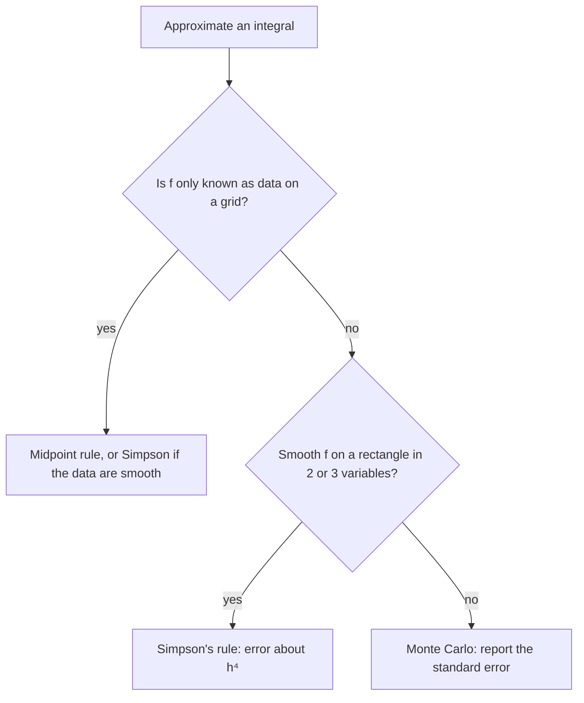

## When there is no formula

Lesson 21 estimated $\iint_R (x^2 + y)\,dA$ over $[0, 2]\times[0, 2]$ with four midpoints and got $9$, close to the exact $\tfrac{28}{3}$. There we had the exact answer to compare with. Often we don't. The integrand may have no elementary antiderivative (try $\iint e^{xy}\,dA$ over the unit square, or $e^{-x^2-y^2}$ over a square), the "function" may be a table of measurements (depths of a lake, rainfall at weather stations), or there may be so many variables that iterated integrals are hopeless. Scientific software then approximates the integral, and it is worth knowing how, because each method has a predictable error.

This lesson develops three methods: the **midpoint rule**, which you have already met; **Simpson's rule** in two variables, which is far more accurate for smooth functions; and **Monte Carlo integration**, which uses random points and is the method of choice in many dimensions.

## The midpoint rule and its error

Divide $R = [a, b]\times[c, d]$ into $m\times n$ sub-rectangles of width $h = \tfrac{b - a}{m}$ and height $k = \tfrac{d - c}{n}$, so each has area $\Delta A = hk$. The **midpoint rule** evaluates $f$ at the center $(\bar x_i, \bar y_j)$ of each one:

$$\iint_R f\,dA \approx M_{m,n} = \sum_{i=1}^m\sum_{j=1}^n f(\bar x_i, \bar y_j)\,\Delta A.$$

How good is it? Expand $f$ in a Taylor polynomial about the center of one sub-rectangle. The linear terms integrate to zero over the sub-rectangle, because the center sits in the middle, and so does the mixed term $(x - \bar x_i)(y - \bar y_j)$. So the midpoint rule is *exact* for every function of the form $a + bx + cy + dxy$. The first terms that it misses are the quadratic ones, and adding up their contributions gives, for $f$ with continuous second partial derivatives,

$$\iint_R f\,dA - M_{m,n} \approx \frac{h^2}{24}\iint_R f_{xx}\,dA + \frac{k^2}{24}\iint_R f_{yy}\,dA.$$

(The approximation sign means that the terms left out shrink faster than $h^2$ and $k^2$.) Two lessons follow. First, the error is proportional to the *square* of the mesh size: halving $h$ and $k$ cuts the error by about a factor of 4. Mathematicians say the method has **order of accuracy** 2. Second, when $f$ is convex in both directions ($f_{xx}, f_{yy} > 0$) the midpoint rule *under*estimates (at least once the grid is fine), as it did in Lesson 21.

### Example 1: halving the mesh

Apply the midpoint rule to $\iint_R (x^2 + y)\,dA$ on $R = [0, 2]\times[0, 2]$ with $h = k = 1$ and with $h = k = \tfrac12$.

1. With $h = k = 1$ (four squares) Lesson 21 found $M = 9$. The error is $\tfrac{28}{3} - 9 = \tfrac13$.
2. The formula predicts this exactly: $f_{xx} = 2$ and $f_{yy} = 0$, so the error is $\tfrac{1^2}{24}\cdot(2\cdot4) = \tfrac13$. (For a quadratic $f$ the left-out terms are zero, so here "$\approx$" is "$=$".)
3. With $h = k = \tfrac12$ (sixteen squares) the predicted error is $\tfrac{1/4}{24}\cdot8 = \tfrac{1}{12}$, so $M = \tfrac{28}{3} - \tfrac{1}{12} = 9.25$. Summing the sixteen midpoint values directly gives the same $9.25$.

Four times as many points, one quarter of the error: that is order 2.

### Example 2: a lake from a table of depths

A pond fits in a rectangle 40 m long and 30 m wide. Divide it into twelve squares, 10 m on a side, and measure the depth (in meters) at the center of each:

| | $x$: 0–10 m | 10–20 m | 20–30 m | 30–40 m |
|---|---|---|---|---|
| $y$: 20–30 m | 0.4 | 1.1 | 1.3 | 0.6 |
| $y$: 10–20 m | 0.9 | 2.0 | 2.4 | 1.2 |
| $y$: 0–10 m | 0.5 | 1.4 | 1.6 | 0.7 |

The volume of water is $\iint_R(\text{depth})\,dA$, and the table *is* a midpoint rule. The depths add up to $3.4 + 6.5 + 4.2 = 14.1$, and $\Delta A = 100\text{ m}^2$, so the volume is about $14.1\times100 = 1410\text{ m}^3$. There is no formula to integrate here at all; a sum of samples is the only option, and the error formula tells a surveyor that halving the grid spacing (four times as many soundings) should make the estimate about four times as accurate, if the bottom is smooth.

## Simpson's rule in two variables

In one variable, Simpson's rule on $[x_0, x_2]$ with midpoint $x_1$ and spacing $h$ is $\tfrac h3\big(f(x_0) + 4f(x_1) + f(x_2)\big)$. It is exact for cubics, and its error is proportional to $h^4$. To integrate over a rectangle, apply it in each direction: Simpson in $y$ along each of three vertical lines, then Simpson in $x$ to combine the three results. Each grid value is multiplied by the product of its two one-variable weights.

```shape
{"x": [-0.25, 1.3], "y": [-0.25, 1.3], "equal": true, "polygons": [{"points": [[0, 0], [1, 0], [1, 1], [0, 1]]}], "segments": [{"from": [0.5, 0], "to": [0.5, 1], "dashed": true}, {"from": [0, 0.5], "to": [1, 0.5], "dashed": true}], "points": [{"at": [0, 0], "label": "1"}, {"at": [0, 0.5], "label": "4"}, {"at": [0, 1], "label": "1"}, {"at": [0.5, 0], "label": "4"}, {"at": [0.5, 0.5], "label": "16"}, {"at": [0.5, 1], "label": "4"}, {"at": [1, 0], "label": "1"}, {"at": [1, 0.5], "label": "4"}, {"at": [1, 1], "label": "1"}], "caption": "Simpson weights on a 3 × 3 grid: corners 1, edge midpoints 4, center 16, all times hk/9"}
```

On a single panel (a $3\times3$ grid with spacings $h$ and $k$) the weights are $1, 4, 1$ times $1, 4, 1$:

$$\iint f\,dA \approx \frac{hk}{9}\Big[(\text{sum of the 4 corners}) + 4(\text{sum of the 4 edge midpoints}) + 16 f(\text{center})\Big].$$

For a larger even-by-even grid the one-variable pattern $1, 4, 2, 4, \dots, 2, 4, 1$ is multiplied the same way. **Simpson's rule** in two variables is exact whenever $f$ is a polynomial of degree at most 3 in each variable separately, and for smooth $f$ its error shrinks like $h^4$: halving the spacing cuts the error by about 16. The price is that $f$ must be smooth; for data with jumps or kinks, the extra accuracy disappears.

### Example 3: Simpson versus midpoint for $e^{xy}$

Estimate $I = \iint_{[0,1]\times[0,1]} e^{xy}\,dA$. Expanding $e^{xy}$ in a power series and integrating term by term gives $I = \sum_{n\ge1}\frac{1}{n\cdot n!} \approx 1.317902$, a value to check against.

1. Simpson with $h = k = \tfrac12$ uses the grid $x, y\in\{0, \tfrac12, 1\}$. On the edges $x = 0$ and $y = 0$ the integrand is $e^0 = 1$. The corners give $1 + 1 + 1 + e$; the edge midpoints give $1 + 1 + e^{1/2} + e^{1/2}$; the center gives $e^{1/4}$. So
$$I \approx \frac{1/4}{9}\Big[(3 + e) + 4\big(2 + 2e^{1/2}\big) + 16e^{1/4}\Big] \approx 1.318124,$$
an error of about $0.00022$ from nine function values.
2. The midpoint rule with a $3\times3$ grid also uses nine values and gives $1.313376$, an error of about $0.0045$, twenty times larger.
3. The midpoint error formula predicts the error of the $2\times2$ midpoint rule ($h = k = \tfrac12$): $f_{xx} + f_{yy} = (x^2 + y^2)e^{xy}$, whose integral over the square is exactly 1, so the predicted error is $\tfrac{1/4}{24}\cdot1 = \tfrac{1}{96} \approx 0.0104$. The actual error is $1.317902 - 1.308002 \approx 0.0099$. The formula is an approximation, but a good one.

## Monte Carlo integration

The grid methods share a weakness. In $d$ dimensions, a grid with 10 points per direction needs $10^d$ function values: 100 in the plane, but ten billion in ten dimensions. Integrals in many dimensions are common (the position of every particle in a gas, the prices of many assets), and this explosion is called the **curse of dimensionality**. The fix, developed in the late 1940s at Los Alamos by Stanislaw Ulam, John von Neumann and Nicholas Metropolis, was to use random points.

**Monte Carlo integration** rests on the average value from Lesson 21. Put the region $D$ inside a box $B$ whose area you know. Define $g = f$ on $D$ and $g = 0$ on the rest of $B$. Then $\iint_D f\,dA = A(B)\cdot g_{\text{avg}}$, and the average can be *estimated* by sampling: choose $N$ points $P_1, \dots, P_N$ uniformly at random in $B$, and

$$\iint_D f\,dA \approx A(B)\cdot\frac{1}{N}\sum_{i=1}^N g(P_i).$$

With $f = 1$, this counts hits: the area of $D$ is about $A(B)$ times the fraction of points that land in $D$. The region can be any shape at all, as long as you can test whether a point is inside it.

The estimate is random, so its error is described statistically. If $s$ is the standard deviation of the values $g(P_i)$, the **standard error** of the estimate is about $A(B)\,s/\sqrt N$, and by the central limit theorem the estimate lands within two standard errors of the true value roughly 95% of the time. The error shrinks like $1/\sqrt N$: to gain one more correct digit you need 100 times as many points. That is slow, but it does not depend on the dimension, which is why Monte Carlo methods win in high dimensions.

### Example 4: estimating π

The quarter disk $x^2 + y^2 \le 1$, $x, y \ge 0$ has area $\tfrac\pi4$ and sits inside the unit square $B$, of area 1.

```plot
{"x": [-0.05, 1.1], "y": [-0.05, 1.1], "equal": true, "curves": [{"x": "cos(t)", "y": "sin(t)", "t": [0, "pi/2"]}], "polygons": [{"points": [[0, 0], [1, 0], [1, 1], [0, 1]]}], "points": [[0.81, 0.26], [0.08, 0.95], [0.61, 0.0], [0.29, 0.81], [0.08, 0.44], [0.82, 0.41], [0.52, 0.12], [0.81, 0.5], [0.25, 0.78], [0.03, 0.6], [0.97, 0.12], [0.22, 0.55], [0.72, 0.55], [0.55, 0.05], [0.74, 0.32], [0.07, 0.96], [0.66, 0.46], [0.73, 0.48], [0.12, 0.6], [0.37, 0.27], [0.53, 0.65], [0.16, 0.56], [0.44, 0.0], [0.42, 0.4], [0.96, 0.05], [0.6, 0.19], [0.79, 0.16], [0.32, 0.67], [0.43, 0.46], [0.3, 0.04], [0.36, 0.83], [0.83, 0.08], [0.55, 0.35], [0.81, 0.51], [0.38, 0.78], [0.46, 0.69], [0.84, 0.3], [0.76, 0.48], [0.53, 0.46], [0.37, 0.75], [0.39, 0.18], [0.79, 0.4], [0.65, 0.52], [0.28, 0.71], [0.77, 0.32], [0.31, 0.36], [0.47, 0.18], [0.53, 0.26], [0.64, 0.34], [0.58, 0.58], [0.04, 0.74], [0.26, 0.06], [0.18, 0.75], [0.28, 0.5], [0.12, 0.42], [0.26, 0.03], [0.29, 0.93], [0.53, 0.27], [0.11, 0.9], [0.09, 0.04], [0.11, 0.75], [0.93, 0.1], [0.64, 0.65], [0.53, 0.0], [0.69, 0.43], [0.64, 0.12], [0.32, 0.63], [0.87, 0.42], [0.36, 0.61], [0.86, 0.2], [0.6, 0.62], [0.48, 0.36], [0.16, 0.0], [0.26, 0.42], [0.16, 0.34], [0.32, 0.53], [0.74, 0.61], [0.58, 0.81], {"at": [0.86, 0.86], "open": true}, {"at": [0.91, 0.98], "open": true}, {"at": [0.98, 0.54], "open": true}, {"at": [0.74, 0.99], "open": true}, {"at": [0.75, 0.74], "open": true}, {"at": [0.55, 0.93], "open": true}, {"at": [0.95, 0.87], "open": true}, {"at": [0.93, 0.91], "open": true}, {"at": [0.4, 0.99], "open": true}, {"at": [0.51, 0.92], "open": true}, {"at": [0.73, 0.74], "open": true}, {"at": [0.58, 0.98], "open": true}, {"at": [0.96, 0.71], "open": true}, {"at": [0.48, 0.89], "open": true}, {"at": [0.95, 0.44], "open": true}, {"at": [0.41, 0.98], "open": true}, {"at": [0.91, 0.78], "open": true}, {"at": [0.93, 1.0], "open": true}, {"at": [0.95, 0.82], "open": true}, {"at": [0.68, 0.74], "open": true}, {"at": [0.82, 0.81], "open": true}, {"at": [0.95, 0.9], "open": true}], "caption": "100 random points in the unit square: 78 filled dots land inside the quarter disk x² + y² ≤ 1, 22 open dots outside"}
```

1. Of 100 random points, 78 land inside, so the area is about $0.78$ and $\pi \approx 4\times0.78 = 3.12$.
2. Each point scores 1 (inside) or 0 (outside), with probability $p = \tfrac\pi4$ of a 1, so $s = \sqrt{p(1 - p)} \approx 0.41$. For $4\times$ the area, the standard error is $4\times0.41/\sqrt{100} \approx 0.16$. The estimate $3.12$ is well within that of $\pi$.
3. With 10,000 points the standard error drops to about $0.016$: a hundred times the work for one more digit.

Even this is far worse than Simpson's rule in two dimensions. Monte Carlo pays off when the dimension is high or the region is too irregular for a grid.

## Comparing the methods

For a smooth integrand in $d$ dimensions using $N$ function values in total, the errors typically behave like this (these are rates for well-behaved functions, not guarantees):

| Method | Error with $N$ points | In the plane ($d = 2$) |
|---|---|---|
| Midpoint rule | about $N^{-2/d}$ | about $1/N$ |
| Simpson's rule | about $N^{-4/d}$ | about $1/N^2$ |
| Monte Carlo | about $N^{-1/2}$, any $d$ | about $1/\sqrt N$ |

Monte Carlo beats the midpoint rule once $d > 4$ and Simpson's rule once $d > 8$. In practice, software also adapts: it puts more points where the integrand changes quickly.



## Common mistakes

- Forgetting the factor $\Delta A$ (or $\tfrac{hk}{9}$ for Simpson), and reporting the sum of the function values as the integral.
- Using Simpson's rule with an odd number of subintervals in a direction; it needs an even number.
- Using the wrong weights: the center of a Simpson panel gets $4\times4 = 16$, not 4 or 8.
- Expecting Monte Carlo to give the same answer every time, or to improve by a factor of 10 with 10 times the points (it improves by about $\sqrt{10} \approx 3.2$).
- Using Monte Carlo without the box area: the average of $g$ must be multiplied by $A(B)$.

## Key points

- Midpoint rule: $M = \Delta A\sum f(\text{centers})$; error $\approx \frac{h^2}{24}\iint f_{xx} + \frac{k^2}{24}\iint f_{yy}$, so order 2.
- Simpson in two variables: weights are products of $1, 4, 1$; exact for degree $\le 3$ in each variable; error about $h^4$.
- Monte Carlo: $\iint_D f\,dA \approx A(B)\cdot(\text{average of } g)$ over $N$ random points; standard error about $A(B)\,s/\sqrt N$.
- Grids suffer from the curse of dimensionality; Monte Carlo's $1/\sqrt N$ rate does not depend on the dimension.
