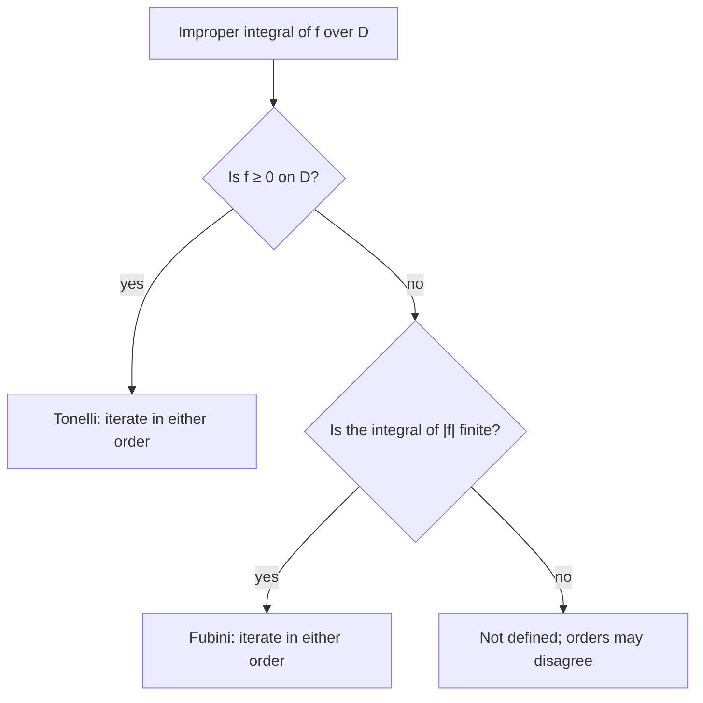

## Integrating over infinity

Lesson 23 found $\int_{-\infty}^{\infty}e^{-x^2}\,dx = \sqrt\pi$ by integrating $e^{-(x^2+y^2)}$ over the whole plane in polar coordinates. Two steps there were taken on trust. The region was unbounded, but Fubini's theorem (Lesson 21) was stated for continuous functions on a *rectangle*. And we squared an integral over lines and then integrated over disks: why should squares and disks give the same answer? This lesson makes such calculations honest. It defines double integrals over unbounded regions and of unbounded functions, gives tests for when they converge, and shows a famous integrand for which the two orders of integration give *different* answers.

## Defining an improper double integral

An **improper double integral** is one where the region is unbounded or the integrand blows up somewhere in it. The idea, as in one variable, is to integrate over bounded pieces that stay away from the trouble and take a limit.

Let $f \ge 0$ be continuous on a region $D$ (except perhaps at a few points or along a curve). An **exhaustion** of $D$ is a sequence of bounded regions $D_1 \subseteq D_2 \subseteq D_3 \subseteq \cdots$ on which $f$ is continuous and bounded, which together fill up $D$ (every point of $D$ where $f$ is continuous lies in some $D_n$). Define

$$\iint_D f\,dA = \lim_{n\to\infty}\iint_{D_n} f\,dA.$$

Because $f \ge 0$ and the regions grow, the integrals $\iint_{D_n}f\,dA$ increase with $n$, so the limit always exists, though it may be $+\infty$. If it is finite the integral *converges*; otherwise it *diverges*. The key fact for nonnegative integrands is that *every* exhaustion gives the same limit. So you may choose whatever pieces are easiest: disks, squares, rings.

For an integrand that changes sign, the standard definition asks first that $\iint_D |f|\,dA$ converge; such an $f$ is called **absolutely integrable**, and then $\iint_D f\,dA$ is the integral of the positive part minus the integral of the negative part. Unlike in one variable, where $\int_1^\infty \frac{\sin x}{x}\,dx$ converges without absolute convergence, a double integral that is not absolutely convergent is simply not defined this way: different exhaustions could give different answers. (This is a simplified account. The full theory is Lebesgue integration, met in a course on real analysis.)

## The Gaussian integral, honestly

Let $I_R = \int_{-R}^{R}e^{-x^2}\,dx$. Because $e^{-(x^2+y^2)} = e^{-x^2}e^{-y^2}$ is a product, the shortcut from Lesson 21 gives

$$I_R^2 = \iint_{S_R}e^{-(x^2+y^2)}\,dA,$$

where $S_R$ is the square $[-R, R]\times[-R, R]$. This is the integral over squares, and squares are awkward in polar coordinates. But the square sits between two disks: the disk $D_R$ of radius $R$ fits inside it, and it fits inside the disk of radius $R\sqrt2$ (its corners are at distance $R\sqrt2$).

```shape
{"x": [-1.7, 1.7], "y": [-1.7, 1.7], "equal": true, "circles": [{"center": [0, 0], "r": 1}, {"center": [0, 0], "r": 1.4142}], "polygons": [{"points": [[-1, -1], [1, -1], [1, 1], [-1, 1]]}], "labels": [{"at": [0, 0.45], "text": "disk of radius R"}, {"at": [0, -1.25], "text": "square of side 2R"}, {"at": [0, 1.52], "text": "disk of radius R√2"}], "caption": "The disk of radius R fits inside the square of side 2R, which fits inside the disk of radius R√2"}
```

The integrand is positive, so a bigger region gives a bigger integral. Over a disk of radius $\rho$, polar coordinates give $\int_0^{2\pi}\int_0^{\rho}e^{-r^2}r\,dr\,d\theta = \pi\left(1 - e^{-\rho^2}\right)$. Therefore

$$\pi\left(1 - e^{-R^2}\right) \le I_R^2 \le \pi\left(1 - e^{-2R^2}\right).$$

Both bounds tend to $\pi$ as $R\to\infty$, so $I_R^2 \to \pi$ by the squeeze theorem, and $\int_{-\infty}^\infty e^{-x^2}\,dx = \sqrt\pi$. The squares and the disks are two exhaustions of the plane, and for this positive integrand they must agree.

### Example 1: the squeeze in numbers

At $R = 1$ the bounds are $\pi(1 - e^{-1}) \approx 1.986$ and $\pi(1 - e^{-2}) \approx 2.716$, and the true value of $I_1^2$ is about $2.231$. At $R = 2$ they are $3.084$ and $3.141$, with $I_2^2 \approx 3.112$. Already at $R = 2$ the square of the integral is within 1% of $\pi \approx 3.1416$, because $e^{-x^2}$ is tiny beyond $|x| = 2$.

## Power functions: the critical exponent 2

The most useful test integrands are powers of the distance $r = \sqrt{x^2 + y^2}$. For $q > 0$, polar coordinates give

$$\iint_{r\le1}\frac{dA}{r^q} = \int_0^{2\pi}\int_0^1 r^{1-q}\,dr\,d\theta = \frac{2\pi}{2 - q}\quad(q < 2),$$

and the integral diverges for $q \ge 2$, because $\int_0^1 r^{1-q}\,dr$ does (for $q = 2$ it is $\int_0^1 \frac{dr}{r}$). Outside the unit disk the test reverses:

$$\iint_{r\ge1}\frac{dA}{r^q} = \int_0^{2\pi}\int_1^\infty r^{1-q}\,dr\,d\theta = \frac{2\pi}{q - 2}\quad(q > 2),$$

and the integral diverges for $q \le 2$. Compare one variable, where the critical exponent is 1 ($\int_0^1 x^{-p}\,dx$ converges for $p < 1$). In the plane it is 2: the area element $r\,dr\,d\theta$ contributes an extra factor $r$, which tames the blow-up near the origin and makes the tail far away heavier. (In space the critical exponent is 3.)

### Example 2: a singular integrand

Evaluate $\iint_{x^2+y^2\le1}\dfrac{dA}{\sqrt{x^2 + y^2}}$.

1. Here $q = 1 < 2$, so it converges. Exhaust the disk by the rings $\tfrac1n \le r \le 1$, which avoid the origin.
2. $\displaystyle\int_0^{2\pi}\int_{1/n}^1\frac1r\,r\,dr\,d\theta = 2\pi\left(1 - \frac1n\right) \to 2\pi.$

The integrand is infinite at the center, yet the volume under it is finite: the cone-like spike is thin. By contrast, $\iint_{r\le1}\frac{dA}{x^2+y^2}$ gives $2\pi\int_{1/n}^1\frac{dr}{r} = 2\pi\ln n \to \infty$.

## The comparison test

If $0 \le f \le g$ on $D$ and $\iint_D g\,dA$ converges, then so does $\iint_D f\,dA$, and $\iint_D f \le \iint_D g$. If $\iint_D f$ diverges, so does $\iint_D g$. This **comparison test** works because for nonnegative integrands every exhaustion gives an increasing sequence, and the smaller sequence is bounded by the larger one's limit.

### Example 3: comparing with a power

Does $\iint_{r\ge1}\dfrac{dA}{x^4 + y^4}$ converge?

1. Compare with a power of $r$. Since $2x^2y^2 \le x^4 + y^4$, we have $(x^2 + y^2)^2 = x^4 + 2x^2y^2 + y^4 \le 2(x^4 + y^4)$, so $\dfrac{1}{x^4 + y^4} \le \dfrac{2}{r^4}$.
2. $\iint_{r\ge1}\frac{2}{r^4}\,dA = 2\cdot\frac{2\pi}{4 - 2} = 2\pi$ converges, so the original integral converges, with value at most $2\pi \approx 6.28$.
3. (Its exact value happens to be $\sqrt2\,\pi \approx 4.44$, but the test needs no exact value.)

## Iterating: Tonelli and Fubini

To compute an improper double integral we still want iterated integrals. Two theorems say when that is safe.

**Tonelli's theorem.** If $f \ge 0$, the double integral and both iterated integrals are equal, whether they are finite or $+\infty$. Nonnegative integrands can always be iterated, in either order.

**Fubini's theorem (general form).** If $f$ is absolutely integrable, $\iint_D|f|\,dA < \infty$, then both iterated integrals of $f$ exist and equal $\iint_D f\,dA$.

Guido Fubini published his theorem in 1907, and Leonida Tonelli his version for nonnegative functions in 1909; both are proved in measure theory. In practice: check that $\iint|f|$ is finite (usually by Tonelli, iterating $|f|$, or by comparison), and then iterate $f$ in whichever order is convenient.

### Example 4: two orders, two answers

Let $f(x, y) = \dfrac{x^2 - y^2}{(x^2 + y^2)^2}$ on the square $[0, 1]\times[0, 1]$, excluding the origin.

1. Inner integral in $y$: since $\dfrac{\partial}{\partial y}\left(\dfrac{y}{x^2 + y^2}\right) = \dfrac{x^2 - y^2}{(x^2 + y^2)^2}$, we get $\displaystyle\int_0^1 f\,dy = \frac{1}{x^2 + 1}$ for $x > 0$, and then $\displaystyle\int_0^1\frac{dx}{1 + x^2} = \frac\pi4$.
2. In the other order, $f(y, x) = -f(x, y)$, so the same steps give $-\dfrac\pi4$.
3. The two iterated integrals disagree. Neither Fubini theorem applies: $f$ is not continuous at the origin (it is unbounded there), so the rectangle version fails, and $f$ is not absolutely integrable. In polar form $|f| = \dfrac{|\cos2\theta|}{r^2}$, so $\iint|f|\,dA$ includes $\int_0^1\frac{1}{r^2}\,r\,dr$, which diverges (the critical exponent again).

The positive and negative parts of $f$ each have infinite integral, and the order of integration decides how the two infinities cancel. A double integral of this $f$ simply does not exist.



### Example 5: two waiting times

Two independent waiting times (in hours) have densities $e^{-x}$ for $x \ge 0$ and $2e^{-2y}$ for $y \ge 0$, so their joint density is $f(x, y) = 2e^{-x-2y}$ on the first quadrant (Lesson 24). What is the probability that the first wait is shorter, $P(X < Y)$?

1. The region $\{0 \le x < y\}$ is unbounded, but $f \ge 0$, so Tonelli lets us iterate. Check the total: $\int_0^\infty\int_0^\infty 2e^{-x-2y}\,dy\,dx = 1\cdot1 = 1$.
2. $\displaystyle P(X < Y) = \int_0^\infty\int_x^\infty 2e^{-x-2y}\,dy\,dx = \int_0^\infty e^{-x}e^{-2x}\,dx = \frac13.$

The second wait has the larger rate (its average is half an hour, against an hour for the first), so it usually finishes first. In general, rates $a$ and $b$ give $P(X < Y) = \dfrac{a}{a + b}$.

## Common mistakes

- Treating an improper integral as ordinary without checking convergence: write it as a limit over an exhaustion, or use a comparison.
- Using the one-variable critical exponent: in the plane, $r^{-q}$ is integrable near 0 when $q < 2$ and at infinity when $q > 2$.
- Forgetting the factor $r$ in polar form, which changes the exponent by one.
- Swapping the order of a sign-changing improper integral without checking $\iint|f| < \infty$.
- Assuming a function that blows up has infinite integral (Example 2 is finite).

## Key points

- For $f \ge 0$: $\iint_D f = \lim\iint_{D_n}f$ over any exhaustion; every exhaustion gives the same value (possibly $\infty$).
- Sign-changing $f$: require $\iint|f| < \infty$ (absolutely integrable).
- $\iint_{r\le1}r^{-q}\,dA$ converges iff $q < 2$; $\iint_{r\ge1}r^{-q}\,dA$ converges iff $q > 2$.
- Comparison: $0 \le f \le g$ and $\iint g < \infty$ imply $\iint f < \infty$.
- Tonelli ($f \ge 0$) and Fubini ($\iint|f| < \infty$) allow either order; without them, the orders can disagree, as for $\frac{x^2 - y^2}{(x^2 + y^2)^2}$.
